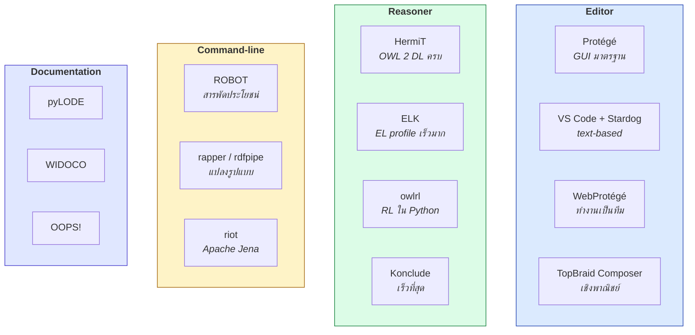
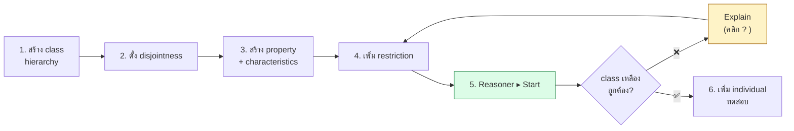
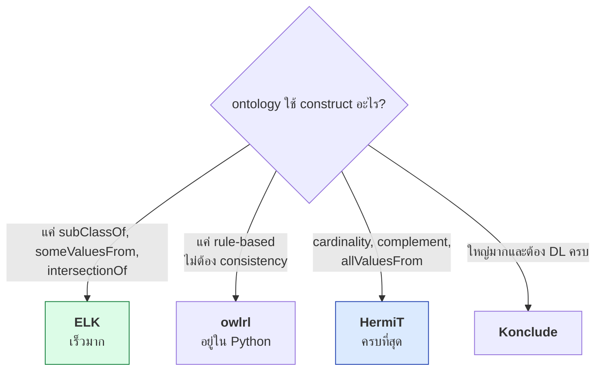
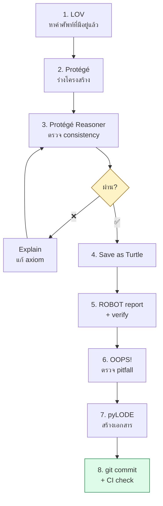

# 10.09 Tools สำหรับ Ontology Engineering

เครื่องมือที่ดีทำให้การออกแบบ ontology เร็วขึ้นและผิดพลาดน้อยลง
บทนี้แนะนำเครื่องมือหลัก 4 กลุ่ม: **editor**, **reasoner**, **command-line**, และ **documentation**

---

## ภาพรวมเครื่องมือ



---

## 1. Protégé

**Editor มาตรฐานของวงการ** — ฟรี open source จาก Stanford
ดาวน์โหลดที่ [protege.stanford.edu](https://protege.stanford.edu)

### แท็บที่ใช้จริง

| แท็บ | ใช้ทำอะไร |
| --- | --- |
| **Active Ontology** | ตั้ง ontology IRI, versionIRI, `owl:imports`, metadata |
| **Entities** | สร้าง/แก้ class, property, individual |
| **Classes** | ดู hierarchy — **สีเหลืองหมายถึง inferred** |
| **Object/Data Properties** | ตั้ง domain, range, characteristics |
| **Individuals** | สร้าง instance และ assertion |
| **DL Query** | ทดสอบ class expression ทันที |
| **SPARQL Query** | รัน SPARQL บน ontology |
| **OntoGraf** (plugin) | ดู graph แบบภาพ |

### 🔑 Workflow ใน Protégé



### ⭐ ฟีเจอร์ที่ควรใช้ให้เป็น

#### Explain (อธิบายว่าทำไม)

คลิกไอคอน **`?`** ข้าง inferred axiom → Protégé แสดง **justification** คือชุด axiom ที่น้อยที่สุดที่ทำให้เกิดผลนั้น

```
? uni:alice Type uni:GraduateStudent

Explanation:
  1) uni:alice uni:enrolledIn uni:cs501
  2) uni:cs501 Type uni:GraduateCourse
  3) uni:GraduateStudent EquivalentTo
       uni:Student and (uni:enrolledIn some uni:GraduateCourse)
  4) uni:alice Type uni:Student
```

> 💡 **นี่คือเครื่องมือ debug ที่สำคัญที่สุด** — เวลา class กลายเป็น unsatisfiable
> ให้คลิก `?` ที่ `owl:Nothing` แล้วอ่านว่า axiom ไหนขัดกัน

#### DL Query

พิมพ์ class expression ด้วย **Manchester Syntax** แล้วดูผลทันที

| ต้องการ | Manchester Syntax |
| --- | --- |
| นักศึกษาที่ลงวิชาบัณฑิตศึกษา | `Student and (enrolledIn some GraduateCourse)` |
| อาจารย์ที่สอนมากกว่า 3 วิชา | `Professor and (teaches min 3 Course)` |
| คนที่ไม่ใช่นักศึกษา | `Person and not Student` |
| ทุกวิชาที่สอนเป็นวิชาบัณฑิต | `Professor and (teaches only GraduateCourse)` |

<table>
<tr><th width="50%">Manchester Syntax (Protégé)</th><th width="50%">Turtle</th></tr>
<tr valign="top">
<td>

```
Class: GraduateStudent

  EquivalentTo:
    Student
      and (enrolledIn some GraduateCourse)

  SubClassOf:
    hasSupervisor exactly 1 Professor
```

</td>
<td>

```turtle
uni:GraduateStudent a owl:Class ;
    owl:equivalentClass [
        a owl:Class ;
        owl:intersectionOf (
            uni:Student
            [ a owl:Restriction ;
              owl:onProperty     uni:enrolledIn ;
              owl:someValuesFrom uni:GraduateCourse ]
        )
    ] ;
    rdfs:subClassOf [
        a owl:Restriction ;
        owl:onProperty  uni:hasSupervisor ;
        owl:onClass     uni:Professor ;
        owl:qualifiedCardinality
            "1"^^xsd:nonNegativeInteger
    ] .
```

</td>
</tr>
</table>

### ⚠️ กับดักใน Protégé

| กับดัก | ทางแก้ |
| --- | --- |
| **บันทึกเป็น RDF/XML โดยอัตโนมัติ** | `File ▸ Save as` เลือก **Turtle** ทุกครั้ง |
| **สลับ prefix เองเวลาบันทึก** | ตั้ง `Preferences ▸ New entities` ให้คงที่ |
| **`owl:imports` พยายามโหลดจากเน็ต** | ใช้ `catalog-v001.xml` ([10.07](10.07-modularization.md)) |
| **Reasoner ไม่รันอัตโนมัติ** | `Reasoner ▸ Synchronize` หลังแก้ทุกครั้ง |
| **Auto-generated IRI เป็นตัวเลข** | `Preferences ▸ New entities ▸ User supplied name` |

---

## 2. ROBOT — สวิสอาร์มีมีดของ ontology

**ROBOT** (ROBOT is an OBO Tool) — command-line tool ที่ทำได้เกือบทุกอย่าง
ติดตั้ง: [robot.obolibrary.org](http://robot.obolibrary.org)

```bash
brew install robot
```

### คำสั่งที่ใช้บ่อย

```bash
robot reason --input university.ttl --reasoner HermiT \
  --output university-inferred.ttl
```

```bash
robot report --input university.ttl --output report.tsv
```

```bash
robot extract --input snomed.owl --method STAR \
  --term-file terms.txt --output module.owl
```

```bash
robot convert --input university.ttl --format owl --output university.owl
```

```bash
robot merge --input core.ttl --input academic.ttl --input hr.ttl \
  --output merged.ttl
```

```bash
robot diff --left university-v1.ttl --right university-v2.ttl --output diff.txt
```

```bash
robot verify --input university.ttl --queries checks/*.rq --output-dir results/
```

### ตารางคำสั่ง

| คำสั่ง | ทำอะไร |
| --- | --- |
| `reason` | รัน reasoner แล้วเขียน inferred axiom ลงไฟล์ |
| `report` | ตรวจ quality control ~40 ข้อ |
| `extract` | ดึง module (STAR / BOT / TOP / MIREOT) |
| `convert` | แปลงรูปแบบ (ttl ↔ owl ↔ obo ↔ json) |
| `merge` | รวมหลายไฟล์เข้าด้วยกัน |
| `diff` | เทียบสองเวอร์ชัน |
| `verify` | รัน SPARQL ที่ต้องไม่คืนผล (unit test!) |
| `annotate` | เพิ่ม metadata ของ ontology |
| `query` | รัน SPARQL SELECT/CONSTRUCT |
| `template` | สร้าง ontology จาก spreadsheet |

### 🧪 `robot verify` = unit test ของ ontology

เขียน SPARQL ที่ **ต้องไม่คืนผลลัพธ์** — ถ้าคืนแปลว่าเจอปัญหา

```sparql
# checks/no-class-without-label.rq
PREFIX owl:  <http://www.w3.org/2002/07/owl#>
PREFIX rdfs: <http://www.w3.org/2000/01/rdf-schema#>

SELECT ?class WHERE {
  ?class a owl:Class .
  FILTER(isIRI(?class))
  FILTER NOT EXISTS { ?class rdfs:label ?label }
}
```

```sparql
# checks/no-deprecated-in-use.rq
PREFIX owl: <http://www.w3.org/2002/07/owl#>

SELECT ?subject ?deprecated WHERE {
  ?deprecated owl:deprecated true .
  ?subject ?deprecated ?o .
}
```

```bash
robot verify --input university.ttl --queries checks/*.rq --output-dir results/
```

> 💡 ใส่คำสั่งนี้ใน **CI pipeline** — pull request ที่ทำให้ check ล้มเหลวจะถูกปฏิเสธอัตโนมัติ

### 📊 ROBOT Template — สร้าง ontology จาก spreadsheet

`courses.tsv`:

```
ID	LABEL	TYPE	SUBCLASS_OF	credits
ID	LABEL	TYPE	SC %	A uni:credits^^xsd:integer
uni:CS101	Intro to CS	owl:Class	uni:UndergraduateCourse	3
uni:CS501	Advanced AI	owl:Class	uni:GraduateCourse	3
uni:CS502	Machine Learning	owl:Class	uni:GraduateCourse	4
```

```bash
robot template --template courses.tsv --prefix "uni: http://example.org/university#" \
  --output courses.ttl
```

> 💡 **เหมาะมากเมื่อ domain expert ถนัด Excel** — ให้เขากรอกตาราง แล้ว generate OWL อัตโนมัติ

---

## 3. Reasoner เปรียบเทียบ

| Reasoner | Profile | ภาษา | จุดเด่น | จุดอ่อน |
| --- | --- | --- | --- | --- |
| **HermiT** | OWL 2 DL | Java | ครบถ้วน, ใช้ hypertableau | ช้าเมื่อ ontology ใหญ่ |
| **Pellet / Openllet** | OWL 2 DL | Java | อธิบายผลได้ดี, รองรับ SWRL | maintain น้อยลง |
| **FaCT++** | OWL 2 DL | C++ | เร็วกว่า HermiT | ไม่รองรับ datatype ทุกตัว |
| **ELK** | OWL 2 EL | Java | **เร็วมาก** (SNOMED 350k class ใน ~40 วินาที) | รองรับแค่ EL |
| **Konclude** | OWL 2 DL | C++ | เร็วที่สุดในการแข่ง | ติดตั้งยากกว่า |
| **owlrl** | OWL 2 RL | **Python** | ใช้กับ rdflib ตรง ๆ | ไม่ตรวจ consistency |
| **RDFox** | OWL 2 RL+ | C++ | in-memory เร็วมาก | เชิงพาณิชย์ |



### เรียก reasoner จาก Python

```python
"""เปรียบเทียบ reasoner สองตัวบน ontology เดียวกัน"""

import time

from rdflib import Graph
import owlrl


def run_owlrl(path: str) -> None:
    """owlrl: OWL 2 RL ใน Python ล้วน -- เร็วแต่ไม่ตรวจ consistency"""
    g = Graph().parse(path, format="turtle")
    before = len(g)

    t0 = time.perf_counter()
    owlrl.DeductiveClosure(owlrl.OWLRL_Semantics).expand(g)
    elapsed = time.perf_counter() - t0

    print(f"  owlrl  : {before:5d} → {len(g):5d} triples  ({elapsed:.2f}s)")


def run_hermit(path: str) -> None:
    """HermiT ผ่าน owlready2 -- ครบแต่ช้ากว่าเพราะต้องสตาร์ท JVM"""
    import owlready2
    from owlready2 import get_ontology, sync_reasoner, OWL

    # ⚠️ ต้องแปลงเป็น RDF/XML ก่อน และถอด owl:imports ออก
    g = Graph().parse(path, format="turtle")
    g.remove((None, OWL.imports, None))
    g.serialize("/tmp/tmp_onto.owl", format="xml")

    onto = get_ontology("file:///tmp/tmp_onto.owl").load()
    t0 = time.perf_counter()
    with onto:
        sync_reasoner(infer_property_values=True)
    elapsed = time.perf_counter() - t0

    print(f"  HermiT : {len(list(onto.classes())):5d} classes classified "
          f"({elapsed:.2f}s)")


run_owlrl("data/university.ttl")
```

---

## 4. Documentation

### pyLODE — สร้างเอกสาร HTML จาก ontology

```bash
pip install pylode
```

```bash
pylode -i university.ttl -o docs/university.html
```

```python
"""สร้างเอกสาร HTML ด้วย pyLODE จาก Python"""

from pylode import OntPub

od = OntPub(ontology="code/ch05/university_tbox.ttl")
od.make_html(destination="docs/university.html")
print("  ✅ เขียน docs/university.html แล้ว")
```

> ⚠️ pyLODE ต้องการ metadata ครบ — ถ้าไม่มี `dcterms:title`, `dcterms:creator`,
> `dcterms:created` จะขึ้นคำเตือนหรือ error

### สิ่งที่ ontology ต้องมีก่อนสร้างเอกสาร

```turtle
@prefix owl:     <http://www.w3.org/2002/07/owl#> .
@prefix dcterms: <http://purl.org/dc/terms/> .
@prefix vann:    <http://purl.org/vocab/vann/> .
@prefix xsd:     <http://www.w3.org/2001/XMLSchema#> .

<http://example.org/university> a owl:Ontology ;
    dcterms:title       "University Ontology"@en ;
    dcterms:description "An ontology for modelling universities, their people, courses and organisational units."@en ;
    dcterms:creator     "Semantic Web Course"@en ;
    dcterms:created     "2024-11-01"^^xsd:date ;
    dcterms:modified    "2025-03-15"^^xsd:date ;
    dcterms:license     <https://creativecommons.org/licenses/by/4.0/> ;
    owl:versionIRI      <http://example.org/university/1.0.0> ;
    owl:versionInfo     "1.0.0" ;
    vann:preferredNamespacePrefix "uni" ;
    vann:preferredNamespaceUri    "http://example.org/university#" .
```

### WIDOCO

**WI**zard for **DOC**umenting **O**ntologies — สร้างเอกสารสวยกว่า pyLODE พร้อม diagram

```bash
java -jar widoco.jar -ontFile university.ttl -outFolder docs/ \
  -rewriteAll -webVowl -includeAnnotationProperties
```

| ฟีเจอร์ | pyLODE | WIDOCO |
| --- | --- | --- |
| ภาษา | Python | Java |
| ติดตั้ง | `pip install` | ดาวน์โหลด jar |
| diagram | ❌ | ✅ WebVOWL |
| หลายภาษา | ❌ | ✅ |
| ปรับแต่ง | จำกัด | ยืดหยุ่นกว่า |
| ความเร็ว | เร็ว | ช้ากว่า |

---

## 5. เครื่องมือเสริม

| เครื่องมือ | ใช้ทำอะไร |
| --- | --- |
| **OOPS!** | ตรวจ 41 pitfall ออนไลน์ — [oops.linkeddata.es](https://oops.linkeddata.es) |
| **WebVOWL** | ดู ontology เป็น graph แบบ interactive |
| **LOV** | ค้นหาคำศัพท์ที่มีคนใช้แล้ว — [lov.linkeddata.es](https://lov.linkeddata.es) |
| **Ontology Lookup Service (OLS)** | ค้น term ใน OBO ontologies |
| **rdfpipe** (rdflib) | แปลงรูปแบบใน command line |
| **riot** (Apache Jena) | แปลง + ตรวจ syntax |
| **SHACL Playground** | ทดสอบ SHACL shape ออนไลน์ |
| **YASGUI** | SPARQL editor ที่ดีที่สุดในเบราว์เซอร์ |

```bash
rdfpipe -i turtle -o nt university.ttl > university.nt
```

```bash
riot --validate university.ttl
```

```bash
riot --output=ntriples university.ttl | sort | uniq > canonical.nt
```

---

## Workflow ที่แนะนำ



### ตัวอย่าง CI script

```bash
#!/usr/bin/env bash
set -euo pipefail

echo "==> syntax check"
riot --validate ontology/*.ttl

echo "==> consistency check"
robot reason --input ontology/uni.ttl --reasoner HermiT --output /dev/null

echo "==> quality report"
robot report --input ontology/uni.ttl --fail-on ERROR --output build/report.tsv

echo "==> unit tests"
robot verify --input ontology/uni.ttl --queries checks/*.rq --output-dir build/

echo "==> module structure"
python3 code/ch10/check_modules.py

echo "==> metrics"
python3 code/ch10/ontology_eval.py

echo "✅ all checks passed"
```

---

## Key Points

- **Protégé** คือ editor มาตรฐาน — ฟีเจอร์สำคัญที่สุดคือ **Explain (`?`)** และ **DL Query**
- ⚠️ Protégé บันทึกเป็น RDF/XML โดยอัตโนมัติ — ต้อง `Save as ▸ Turtle` ทุกครั้ง
- **Manchester Syntax** อ่านง่ายกว่า Turtle มากสำหรับ class expression
- **ROBOT** ทำได้เกือบทุกอย่าง — `reason`, `report`, `extract`, `verify`, `diff`, `template`
- **`robot verify`** คือ **unit test ของ ontology** — SPARQL ที่ต้องไม่คืนผล ใส่ใน CI ได้
- **`robot template`** สร้าง OWL จาก spreadsheet — เหมาะเมื่อ domain expert ถนัด Excel
- เลือก reasoner ตาม profile: **ELK** (EL, เร็วมาก), **owlrl** (RL, Python ล้วน), **HermiT** (DL, ครบที่สุด)
- **pyLODE / WIDOCO** สร้างเอกสาร HTML — ต้องมี `dcterms:title`, `creator`, `created` ครบก่อน
- ⚠️ **owlready2 อ่าน Turtle ไม่ได้** — ต้องแปลงเป็น RDF/XML และถอด `owl:imports` ออกก่อน
- ใส่ทุกอย่างลง **CI pipeline** — syntax → consistency → report → verify → metrics
