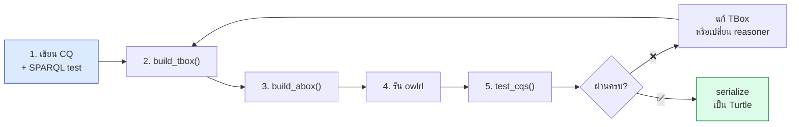
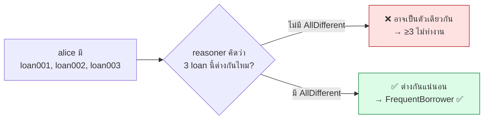
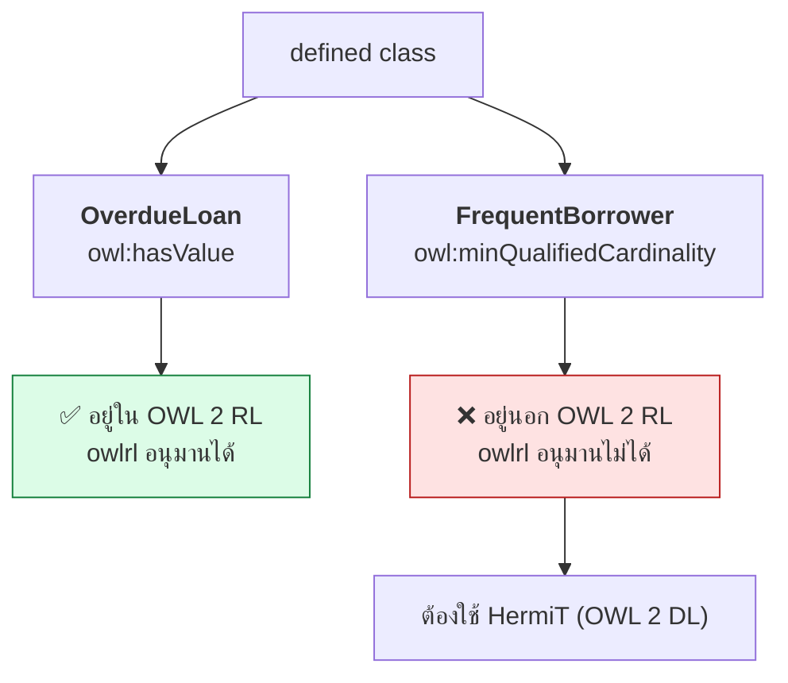

# 10.10 Python: สร้างและทดสอบ Ontology จาก Competency Questions

บทนี้เดินผ่าน workflow ครบวงจร: เขียน CQ → สร้าง TBox ด้วย rdflib → สร้าง ABox → รัน reasoner → ทดสอบว่า CQ ตอบได้
พร้อมบทเรียนสำคัญเรื่อง **ข้อจำกัดของ OWL 2 RL** ที่จะเจอในทางปฏิบัติ

---

## Workflow



> 💡 **หัวใจของวิธีนี้**: เขียน test ก่อนเขียน ontology — เหมือน TDD ในซอฟต์แวร์
> CQ ที่ยังไม่ผ่านคือ backlog ของงานที่เหลือ

---

## 1. เขียน Competency Questions พร้อม test

```python
COMPETENCY_QUESTIONS = [
    {
        "id": "CQ01",
        "text": "Which books were borrowed by a given member?",
        "query": """
            PREFIX lib: <http://example.org/library#>
            SELECT ?book WHERE {
              ?loan lib:borrower lib:alice ; lib:loanedBook ?book .
            }
        """,
        "expect_min": 2,
    },
    {
        "id": "CQ02",
        "text": "Which loans are overdue?",
        "query": """
            PREFIX lib: <http://example.org/library#>
            SELECT ?loan ?due WHERE {
              ?loan a lib:OverdueLoan ; lib:dueDate ?due .
            }
        """,
        "expect_min": 1,
    },
    {
        "id": "CQ03",
        "text": "Who are the frequent borrowers (3 or more loans)?",
        "query": """
            PREFIX lib: <http://example.org/library#>
            SELECT ?member WHERE { ?member a lib:FrequentBorrower }
        """,
        "expect_min": 1,
    },
    {
        "id": "CQ04",
        "text": "What is the ISBN of a given book?",
        "query": """
            PREFIX lib: <http://example.org/library#>
            SELECT ?isbn WHERE { lib:book001 lib:isbn ?isbn }
        """,
        "expect_min": 1,
    },
]
```

**สังเกตว่า CQ แต่ละข้อบังคับให้ ontology มีอะไร**

| CQ | บังคับให้มี |
| --- | --- |
| CQ01 | class `Loan`, property `borrower`, `loanedBook` |
| CQ02 | **defined class** `OverdueLoan`, property `dueDate`, `overdue` |
| CQ03 | **defined class** `FrequentBorrower` ที่ใช้ cardinality |
| CQ04 | property `isbn` |

---

## 2. สร้าง TBox ด้วย rdflib

```python
from rdflib import Graph, Literal, Namespace, BNode
from rdflib.collection import Collection
from rdflib.namespace import OWL, RDF, RDFS, XSD

LIB = Namespace("http://example.org/library#")


def build_tbox() -> Graph:
    """สร้าง TBox จาก conceptualization -- แต่ละส่วนมาจาก CQ ข้อใดข้อหนึ่ง"""
    g = Graph()
    g.bind("lib", LIB)
    g.bind("owl", OWL)

    onto = LIB[""]
    g.add((onto, RDF.type, OWL.Ontology))
    g.add((onto, RDFS.label, Literal("Library Ontology", lang="en")))

    # ----- classes -----
    for name, label, parent in [
        ("Person", "Person",         None),
        ("Member", "Library Member", "Person"),
        ("Book",   "Book",           None),
        ("Loan",   "Loan",           None),
    ]:
        cls = LIB[name]
        g.add((cls, RDF.type, OWL.Class))
        g.add((cls, RDFS.label, Literal(label, lang="en")))
        if parent:
            g.add((cls, RDFS.subClassOf, LIB[parent]))

    g.add((LIB.Person, OWL.disjointWith, LIB.Book))
    g.add((LIB.Person, OWL.disjointWith, LIB.Loan))
    g.add((LIB.Book,   OWL.disjointWith, LIB.Loan))

    # ----- object properties (CQ01) -----
    for name, label, dom, rng, functional in [
        ("borrower",   "borrower",    "Loan", "Member", True),
        ("loanedBook", "loaned book", "Loan", "Book",   True),
    ]:
        p = LIB[name]
        g.add((p, RDF.type, OWL.ObjectProperty))
        g.add((p, RDFS.label, Literal(label, lang="en")))
        g.add((p, RDFS.domain, LIB[dom]))
        g.add((p, RDFS.range, LIB[rng]))
        if functional:
            g.add((p, RDF.type, OWL.FunctionalProperty))

    # inverse ให้ query จากฝั่ง member ได้ (CQ03)
    g.add((LIB.hasLoan, RDF.type, OWL.ObjectProperty))
    g.add((LIB.hasLoan, OWL.inverseOf, LIB.borrower))

    # ----- datatype properties (CQ02, CQ04) -----
    for name, label, dom, rng in [
        ("isbn",     "ISBN",     "Book", XSD.string),
        # ⚠️ ใช้ xsd:dateTime ไม่ใช่ xsd:date -- xsd:date ไม่อยู่ใน OWL 2 datatype map
        ("dueDate",  "due date", "Loan", XSD.dateTime),
        ("returned", "returned", "Loan", XSD.boolean),
    ]:
        p = LIB[name]
        g.add((p, RDF.type, OWL.DatatypeProperty))
        g.add((p, RDF.type, OWL.FunctionalProperty))
        g.add((p, RDFS.label, Literal(label, lang="en")))
        g.add((p, RDFS.domain, LIB[dom]))
        g.add((p, RDFS.range, rng))

    return g
```

### ⚠️ กับดัก 1: `xsd:date` ทำให้ HermiT พัง

```
org.semanticweb.HermiT.datatypes.UnsupportedDatatypeException:
The datatype 'http://www.w3.org/2001/XMLSchema#date' is not part of
the OWL 2 datatype map
```

| Datatype | HermiT รองรับ |
| --- | --- |
| `xsd:string`, `xsd:integer`, `xsd:decimal`, `xsd:boolean` | ✅ |
| `xsd:dateTime`, `xsd:dateTimeStamp` | ✅ |
| **`xsd:date`**, `xsd:gYear`, `xsd:time`, `xsd:duration` | ❌ |

> 💡 ถ้าจำเป็นต้องใช้ `xsd:date` ให้**ไม่ประกาศ `rdfs:range`** หรือถอด range ออกก่อนส่งให้ HermiT

---

## 3. สร้าง defined class ด้วย BNode + Collection

### `OverdueLoan` — ใช้ `owl:hasValue`

```python
    # Loan ⊓ ∃overdue.{true}
    g.add((LIB.overdue, RDF.type, OWL.DatatypeProperty))
    g.add((LIB.overdue, RDFS.domain, LIB.Loan))

    overdue_restr = BNode()
    g.add((overdue_restr, RDF.type, OWL.Restriction))
    g.add((overdue_restr, OWL.onProperty, LIB.overdue))
    g.add((overdue_restr, OWL.hasValue, Literal(True)))

    overdue_inter = BNode()
    g.add((overdue_inter, RDF.type, OWL.Class))
    members = BNode()
    Collection(g, members, [LIB.Loan, overdue_restr])   # ← สร้าง rdf:List
    g.add((overdue_inter, OWL.intersectionOf, members))

    g.add((LIB.OverdueLoan, RDF.type, OWL.Class))
    g.add((LIB.OverdueLoan, RDFS.label, Literal("Overdue Loan", lang="en")))
    g.add((LIB.OverdueLoan, OWL.equivalentClass, overdue_inter))
```

### `FrequentBorrower` — ใช้ qualified cardinality

```python
    # Member ⊓ ≥3 hasLoan.Loan
    freq_restr = BNode()
    g.add((freq_restr, RDF.type, OWL.Restriction))
    g.add((freq_restr, OWL.onProperty, LIB.hasLoan))
    g.add((freq_restr, OWL.onClass, LIB.Loan))
    g.add((freq_restr, OWL.minQualifiedCardinality,
           Literal(3, datatype=XSD.nonNegativeInteger)))

    freq_inter = BNode()
    freq_members = BNode()
    Collection(g, freq_members, [LIB.Member, freq_restr])
    g.add((freq_inter, RDF.type, OWL.Class))
    g.add((freq_inter, OWL.intersectionOf, freq_members))

    g.add((LIB.FrequentBorrower, RDF.type, OWL.Class))
    g.add((LIB.FrequentBorrower, OWL.equivalentClass, freq_inter))
```

### ผลลัพธ์เมื่อ serialize เป็น Turtle

<table>
<tr><th width="50%">Full form (สิ่งที่โค้ดสร้างจริง)</th><th width="50%">Shorthand (สิ่งที่ rdflib เขียนออกมา)</th></tr>
<tr valign="top">
<td>

```turtle
lib:FrequentBorrower
    rdf:type owl:Class .
lib:FrequentBorrower
    rdfs:label "Frequent Borrower"@en .
lib:FrequentBorrower
    owl:equivalentClass _:b0 .

_:b0 rdf:type owl:Class .
_:b0 owl:intersectionOf _:b1 .

_:b1 rdf:first lib:Member .
_:b1 rdf:rest  _:b2 .

_:b2 rdf:first _:b3 .
_:b2 rdf:rest  rdf:nil .

_:b3 rdf:type owl:Restriction .
_:b3 owl:onProperty lib:hasLoan .
_:b3 owl:onClass lib:Loan .
_:b3 owl:minQualifiedCardinality
    "3"^^xsd:nonNegativeInteger .
```

</td>
<td>

```turtle
lib:FrequentBorrower a owl:Class ;
    rdfs:label "Frequent Borrower"@en ;
    owl:equivalentClass [
        a owl:Class ;
        owl:intersectionOf (
            lib:Member
            [ a owl:Restriction ;
              owl:minQualifiedCardinality
                  "3"^^xsd:nonNegativeInteger ;
              owl:onClass    lib:Loan ;
              owl:onProperty lib:hasLoan ]
        )
    ] .
```

</td>
</tr>
</table>

> 💡 **13 triples กลายเป็น 11 บรรทัด** — นี่คือพลังของ Turtle shorthand
> `[]` ย่อ blank node และ `()` ย่อ `rdf:first`/`rdf:rest` chain

---

## 4. สร้าง ABox — อย่าลืม `owl:AllDifferent`

```python
def build_abox() -> Graph:
    """สร้างข้อมูลตัวอย่างที่ครอบคลุมทุก CQ"""
    g = Graph()
    g.bind("lib", LIB)

    for m in ["alice", "bob"]:
        g.add((LIB[m], RDF.type, LIB.Member))
        g.add((LIB[m], RDFS.label, Literal(m.capitalize(), lang="en")))

    books = {
        "book001": ("Semantic Web Primer",          "978-0262012423"),
        "book002": ("Foundations of Rule Learning", "978-3540753964"),
        "book003": ("Linked Data Patterns",         "978-1105080562"),
    }
    for bid, (title, isbn) in books.items():
        g.add((LIB[bid], RDF.type, LIB.Book))
        g.add((LIB[bid], RDFS.label, Literal(title, lang="en")))
        g.add((LIB[bid], LIB.isbn, Literal(isbn, datatype=XSD.string)))

    loans = [
        ("loan001", "alice", "book001", "2025-01-15T00:00:00", True),
        ("loan002", "alice", "book002", "2025-02-20T00:00:00", False),
        ("loan003", "alice", "book003", "2025-03-10T00:00:00", False),
        ("loan004", "bob",   "book001", "2025-03-25T00:00:00", False),
    ]
    for lid, member, book, due, overdue in loans:
        g.add((LIB[lid], RDF.type, LIB.Loan))
        g.add((LIB[lid], LIB.borrower, LIB[member]))
        g.add((LIB[lid], LIB.loanedBook, LIB[book]))
        g.add((LIB[lid], LIB.dueDate, Literal(due, datatype=XSD.dateTime)))
        g.add((LIB[lid], LIB.overdue, Literal(overdue)))

    # ⚠️ ต้องประกาศ AllDifferent -- ไม่มี UNA! ไม่งั้น ≥3 ไม่ทำงาน
    all_diff = BNode()
    g.add((all_diff, RDF.type, OWL.AllDifferent))
    members_list = BNode()
    Collection(g, members_list, [LIB[f"loan00{i}"] for i in range(1, 5)])
    g.add((all_diff, OWL.distinctMembers, members_list))

    return g
```

### ⚠️ กับดัก 2: ไม่มี Unique Name Assumption



---

## 5. ทดสอบ CQ

```python
def test_cqs(g: Graph) -> int:
    print("=" * 68)
    print("  CQ TEST")
    print("=" * 68)
    passed = 0
    for cq in COMPETENCY_QUESTIONS:
        rows = list(g.query(cq["query"]))
        ok = len(rows) >= cq["expect_min"]
        print(f"  {'✅' if ok else '❌'} {cq['id']}: {len(rows)} results "
              f"(expect ≥{cq['expect_min']}) -- {cq['text']}")
        for row in rows[:3]:
            vals = [str(v).split("#")[-1] for v in row]
            print(f"         {vals}")
        passed += ok
    print(f"\n  Coverage: {passed}/{len(COMPETENCY_QUESTIONS)} "
          f"({100 * passed / len(COMPETENCY_QUESTIONS):.0f}%)")
    return passed


def main() -> None:
    tbox = build_tbox()
    abox = build_abox()
    g = tbox + abox
    print(f"  TBox {len(tbox)} + ABox {len(abox)} = {len(g)} triples")

    print("\n  --- ก่อน reasoning ---")
    before = test_cqs(g)

    owlrl.DeductiveClosure(owlrl.OWLRL_Semantics).expand(g)
    print(f"\n  หลัง reasoning: {len(g)} triples")

    print("\n  --- หลัง reasoning ---")
    after = test_cqs(g)
```

📄 โค้ดเต็ม: [`code/ch10/cq_to_sparql.py`](../code/ch10/cq_to_sparql.py)

Expected output:

```
  TBox 71 + ABox 43 = 114 triples

  --- ก่อน reasoning ---
====================================================================
  CQ TEST
====================================================================
  ✅ CQ01: 3 results (expect ≥2) -- Which books were borrowed by a given member?
         ['book002']
         ['book001']
         ['book003']
  ❌ CQ02: 0 results (expect ≥1) -- Which loans are overdue?
  ❌ CQ03: 0 results (expect ≥1) -- Who are the frequent borrowers (3 or more loans)?
  ✅ CQ04: 1 results (expect ≥1) -- What is the ISBN of a given book?
         ['978-0262012423']

  Coverage: 2/4 (50%)

  หลัง reasoning: 418 triples

  --- หลัง reasoning ---
====================================================================
  CQ TEST
====================================================================
  ✅ CQ01: 3 results (expect ≥2) -- Which books were borrowed by a given member?
  ✅ CQ02: 1 results (expect ≥1) -- Which loans are overdue?
         ['loan001', '2025-01-15T00:00:00']
  ❌ CQ03: 0 results (expect ≥1) -- Who are the frequent borrowers (3 or more loans)?
  ✅ CQ04: 1 results (expect ≥1) -- What is the ISBN of a given book?

  Coverage: 3/4 (75%)

====================================================================
  🎯 reasoning ทำให้ CQ ผ่านเพิ่ม 1 ข้อ
```

---

## 🔥 บทเรียนสำคัญ: CQ03 ไม่ผ่านกับ owlrl

**CQ02 ผ่านหลัง reasoning แต่ CQ03 ยังไม่ผ่าน** — ทำไม?



### ทำไม OWL 2 RL ทำ min cardinality ไม่ได้

**OWL 2 RL ถูกออกแบบให้แปลงเป็นกฎ if-then ได้ทั้งหมด**
`≥3 hasLoan.Loan` ในตำแหน่ง superclass บังคับให้ต้อง **สร้าง individual ใหม่** ถ้าไม่ครบ 3
ซึ่งเป็นสิ่งที่ rule engine ทำไม่ได้ — จึงถูกตัดออกจาก profile

| Construct | ตำแหน่ง subclass | ตำแหน่ง superclass |
| --- | --- | --- |
| `owl:someValuesFrom` | ✅ | ❌ |
| `owl:allValuesFrom` | ❌ | ✅ |
| `owl:hasValue` | ✅ | ✅ |
| `owl:maxCardinality` (0/1) | ❌ | ✅ |
| **`owl:minCardinality`** | ❌ | ❌ |
| `owl:unionOf` | ✅ | ❌ |
| `owl:intersectionOf` | ✅ | ✅ |

### ทางแก้: สลับไปใช้ HermiT

```python
def run_hermit(tbox: Graph, abox: Graph) -> None:
    """CQ03 ต้องใช้ minQualifiedCardinality ซึ่ง OWL 2 RL อนุมานไม่ได้
    -- ต้องใช้ reasoner ระดับ OWL 2 DL แทน"""
    try:
        from owlready2 import get_ontology, sync_reasoner
    except ImportError:
        print("  ⏭  ข้าม HermiT (ยังไม่ได้ติดตั้ง owlready2)")
        return

    merged = tbox + abox
    merged.remove((None, OWL.imports, None))     # กัน owlready2 ออกเน็ต
    merged.serialize("/tmp/library.owl", format="xml")

    onto = get_ontology("file:///tmp/library.owl").load()
    with onto:
        sync_reasoner(infer_property_values=True)

    freq = onto.search(type=onto.FrequentBorrower)
    print(f"  HermiT → FrequentBorrower: {[i.name for i in freq]}")
    overdue = onto.search(type=onto.OverdueLoan)
    print(f"  HermiT → OverdueLoan     : {[i.name for i in overdue]}")
```

Expected output:

```
  ⚠️ CQ03 ยังไม่ผ่าน -- minQualifiedCardinality อยู่นอก OWL 2 RL
     ลองใช้ HermiT (OWL 2 DL) แทน:
* Owlready2 * Running HermiT...
* Owlready2 * HermiT took 2.216705083847046 seconds
  HermiT → FrequentBorrower: ['alice']
  HermiT → OverdueLoan     : ['loan001']

  ✅ เขียน code/ch10/library_tbox.ttl แล้ว
```

**alice มี 3 loans → ถูกจัดเป็น `FrequentBorrower` ✅**

---

## 📊 ตารางเลือก reasoner ตาม CQ

| ถ้า CQ ต้องการ | ใช้ |
| --- | --- |
| subclass propagation, domain/range | **owlrl (RL)** — เร็ว อยู่ใน Python |
| `hasValue`, `someValuesFrom` (subclass position) | **owlrl (RL)** |
| **cardinality**, `complementOf`, `allValuesFrom` classification | **HermiT (DL)** |
| ontology ใหญ่มากแต่ใช้แค่ `subClassOf` + `someValuesFrom` | **ELK (EL)** |
| ต้องการ explanation ว่าทำไม | **HermiT ผ่าน Protégé** |

---

## 🎓 บทเรียนจากการทำจริง

| # | บทเรียน | รายละเอียด |
| --- | --- | --- |
| 1 | **เขียน CQ test ก่อนสร้าง ontology** | test ที่ล้มเหลวคือ backlog |
| 2 | **`xsd:date` ทำ HermiT พัง** | ใช้ `xsd:dateTime` แทน |
| 3 | **ไม่มี UNA** | ต้อง `owl:AllDifferent` ก่อนใช้ cardinality |
| 4 | **owlrl ทำ min cardinality ไม่ได้** | เป็นข้อจำกัดของ profile ไม่ใช่ bug |
| 5 | **owlready2 อ่าน Turtle ไม่ได้** | ต้อง serialize เป็น `format="xml"` ก่อน |
| 6 | **ถอด `owl:imports` ก่อนส่ง owlready2** | ไม่งั้นจะพยายามโหลดจากเน็ตแล้ว 403 |
| 7 | **`rdflib.collection.Collection`** | สร้าง `rdf:List` ให้ง่ายกว่าเขียน `first`/`rest` เอง |

---

## Key Points

- เขียน **CQ พร้อม SPARQL test ก่อน** สร้าง ontology — CQ ที่ล้มเหลวคือ backlog ของงาน
- สร้าง TBox ด้วย **rdflib** ใช้ `BNode()` สำหรับ restriction และ **`Collection`** สำหรับ `rdf:List`
- ⚠️ **`xsd:date` ไม่อยู่ใน OWL 2 datatype map** — HermiT จะโยน `UnsupportedDatatypeException` ให้ใช้ **`xsd:dateTime`**
- ⚠️ **ต้องประกาศ `owl:AllDifferent`** ก่อนใช้ cardinality เพราะ OWL ไม่มี **Unique Name Assumption**
- ⚠️ **owlrl (OWL 2 RL) อนุมาน `minQualifiedCardinality` ไม่ได้** — เป็นข้อจำกัดของ profile ไม่ใช่ bug
- **OWL 2 RL** ตัด min cardinality ออกเพราะแปลงเป็นกฎ if-then ไม่ได้ (ต้องสร้าง individual ใหม่)
- ถ้า CQ ต้องการ cardinality หรือ `complementOf` → ต้องใช้ **HermiT (OWL 2 DL)**
- **owlready2 ต้องการ RDF/XML** และต้อง **ถอด `owl:imports`** ออกก่อน ไม่งั้นจะออกเน็ตแล้ว 403
- Turtle shorthand ย่อ **13 triples เหลือ 11 บรรทัด** ด้วย `[]` และ `()`
