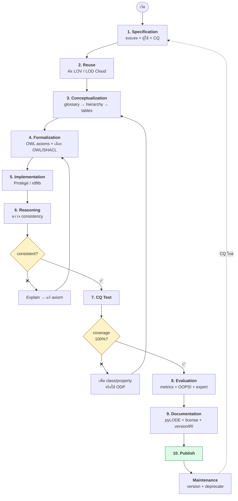
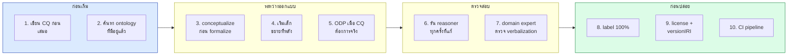
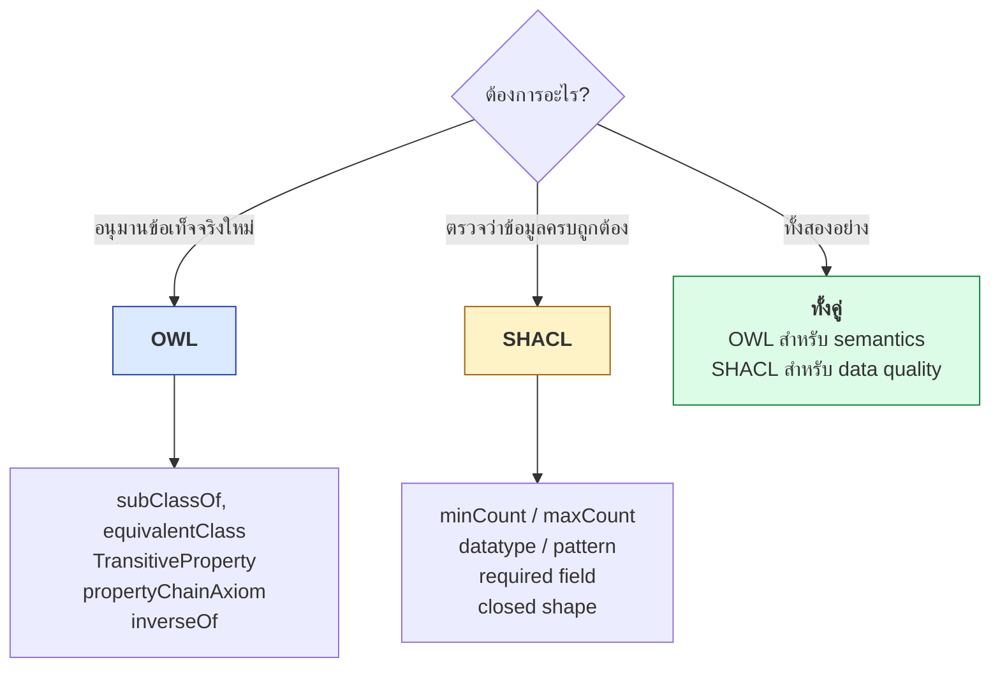
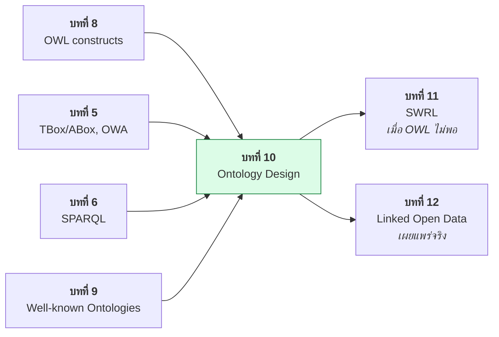

# 10.11 สรุปบทที่ 10: Ontology Design

บทนี้ครอบคลุมกระบวนการออกแบบ ontology ตั้งแต่ methodology, competency questions, conceptualization, formalization, design patterns, anti-patterns, modularization, evaluation จนถึงเครื่องมือและการทำจริงด้วย Python
สรุปนี้เชื่อมทุกหัวข้อเข้าด้วยกันเป็นภาพเดียว

---

## Concept Map ของบทที่ 10

```mermaid
mindmap
  root((Ontology<br/>Design))
    Methodology
      METHONTOLOGY
        specification
        conceptualization
        formalization
        implementation
      NeOn
        9 scenarios
        ORSD
      SAMOD
        3 tests per iteration
        agile
    Requirements
      Competency Questions
        SPARQL test
        negative test
        CQ coverage
      Scope
        in-scope
        out-of-scope
    Conceptualization
      glossary
      class hierarchy
      relation table
      attribute table
      instance examples
    Formalization
      necessary vs sufficient
        primitive class
        defined class
      OWL vs SHACL
        inference
        validation
      OWA traps
        closure axiom
        AllDifferent
        disjointUnionOf
    Design Patterns
      AgentRole
        Agent Role AgentRole
      Time-Indexed Situation
        reify + shortcut
      Participation
      Classification SKOS
      N-ary Relation
      Part-Whole
      Sequence
    Anti-Patterns
      Class as Instance
      Role as Class
      Domain Range as Constraint
      Lonely allValuesFrom
      Synonym as Subclass
      Attribute as Class
      String Everywhere
      God Class
      Wrong Hierarchy Size
      Wrong Disjointness
    Modularization
      owl:imports
        DAG only
        catalog-v001.xml
      Module extraction
        STAR BOT TOP
        MIREOT
      Versioning
        versionIRI
        owl:deprecated
    Evaluation
      Consistency
        reasoner
      Completeness
        CQ coverage
      Conciseness
        metrics
      Correctness
        verbalization
        domain expert
      Usability
        label license docs
    Tools
      Protege
        Explain
        DL Query
      ROBOT
        reason report
        extract verify
      Reasoners
        HermiT ELK owlrl
      Docs
        pyLODE WIDOCO OOPS
```

---

## กระบวนการครบวงจร



---

## ตารางสรุปแต่ละหัวข้อ

| ไฟล์ | หัวข้อ | สิ่งที่ต้องจำ |
| --- | --- | --- |
| [10.01](10.01-methodology.md) | Methodology | METHONTOLOGY (ครบ), NeOn (reuse), SAMOD (agile) — เลือกตามขนาดทีมและความชัดของ requirement |
| [10.02](10.02-competency-questions.md) | Competency Questions | CQ ต้องแปลงเป็น SPARQL ได้ — **CQ คือ test suite** |
| [10.03](10.03-conceptualization.md) | Conceptualization | glossary → hierarchy → relation/attribute table — **ยังไม่แตะ OWL** |
| [10.04](10.04-formalization.md) | Formalization | necessary (`subClassOf`) vs sufficient (`equivalentClass`); OWL อนุมาน / SHACL ตรวจ |
| [10.05](10.05-odp.md) | Design Patterns | AgentRole, Time-Indexed Situation, Participation — **มีราคาต้องจ่าย** |
| [10.06](10.06-anti-patterns.md) | Anti-Patterns | 10 กับดัก — ที่พบบ่อยที่สุดคือ **Role as Class** และ **domain/range as constraint** |
| [10.07](10.07-modularization.md) | Modularization | `owl:imports` เป็น DAG, catalog file, `robot extract` |
| [10.08](10.08-evaluation.md) | Evaluation | 5 มิติ — **Correctness ตรวจอัตโนมัติไม่ได้** |
| [10.09](10.09-tools.md) | Tools | Protégé (Explain!), ROBOT (verify = unit test), pyLODE |
| [10.10](10.10-python-design.md) | Python | CQ-driven development, ข้อจำกัดของ OWL 2 RL |

---

## 🎯 หลักการที่สำคัญที่สุด 10 ข้อ



| # | หลักการ | เหตุผล |
| --- | --- | --- |
| 1 | **เขียน CQ ก่อนเสมอ** | ไม่มี CQ = ไม่รู้ว่าเสร็จเมื่อไหร่ |
| 2 | **ค้นหาของที่มีอยู่แล้วก่อนสร้างใหม่** | FOAF, schema.org, SKOS, PROV-O ครอบคลุมส่วนใหญ่แล้ว |
| 3 | **Conceptualize ก่อน formalize** | อย่าคิดเป็น OWL ตั้งแต่แรก จะติดกรอบ |
| 4 | **เริ่มเล็ก** | ontology 20 class ที่ใช้งานได้ดีกว่า 200 class ที่ไม่มีใครใช้ |
| 5 | **ใช้ ODP เมื่อ CQ ต้องการ** | ไม่ใช่เพราะดูเป็นมืออาชีพ |
| 6 | **รัน reasoner ทุกครั้งที่แก้** | inconsistency เจอเร็วแก้ง่าย |
| 7 | **Domain expert ตรวจ verbalization** | reasoner บอกได้แค่ "ไม่ขัดแย้ง" ไม่ใช่ "ถูกต้อง" |
| 8 | **`rdfs:label` ครบ 100%** | ontology ที่ไม่มี label ไม่มีใครใช้ |
| 9 | **License + versionIRI** | ไม่มี license = ใช้ไม่ได้ตามกฎหมาย |
| 10 | **CI pipeline** | ป้องกันการถอยหลังในทุก commit |

---

## ⚡ Decision Tree: OWL หรือ SHACL



| ความต้องการ | OWL | SHACL |
| --- | --- | --- |
| "ทุก Student เป็น Person" | ✅ `rdfs:subClassOf` | — |
| "Student ต้องมี studentId" | ❌ (OWA) | ✅ `sh:minCount 1` |
| "ถ้าลงวิชาบัณฑิต → เป็น GraduateStudent" | ✅ `equivalentClass` | ❌ |
| "email ต้องตรง regex" | ❌ | ✅ `sh:pattern` |
| "supervisedBy ตรงข้ามกับ supervises" | ✅ `owl:inverseOf` | ❌ |
| "gpa ต้องอยู่ระหว่าง 0–4" | ⚠️ ทำได้แต่ยุ่ง | ✅ `sh:minInclusive` |

---

## 🚨 กับดักที่ต้องระวังที่สุด 5 อันดับ

| อันดับ | กับดัก | อาการ | ทางแก้ |
| --- | --- | --- | --- |
| 🥇 | **domain/range เข้าใจว่าเป็น constraint** | เกิด inference ที่ไม่ตั้งใจ / inconsistent | ใช้ SHACL |
| 🥈 | **Role as Class** | class ระเบิด, disjointness พัง | AgentRole pattern |
| 🥉 | **ลืม closure axiom** | defined class ที่ใช้ `allValuesFrom` ไม่จัดอะไรเลย | เพิ่ม `oneOf` closure |
| 4 | **ลืม `owl:AllDifferent`** | cardinality ไม่ทำงาน | ประกาศ AllDifferent |
| 5 | **เลือก reasoner ผิด profile** | คิดว่า ontology ผิด แต่จริง ๆ reasoner ทำไม่ได้ | ดูตาราง profile |

---

## 📈 จาก requirement ถึง OWL — ตัวอย่างเดินตลอดสาย

**Requirement**: "ระบบต้องบอกได้ว่าใครเป็นนักศึกษาบัณฑิตศึกษา"

| ขั้น | ผลลัพธ์ |
| --- | --- |
| **1. CQ** | *"Who are the graduate students?"* |
| **2. SPARQL test** | `SELECT ?s WHERE { ?s a uni:GraduateStudent }` |
| **3. Conceptualization** | Term: *Graduate Student* = นักศึกษาที่ลงเรียนวิชาระดับบัณฑิตศึกษาอย่างน้อยหนึ่งวิชา |
| **4. ตัดสิน necessary/sufficient** | เงื่อนไข**เพียงพอ** → **defined class** |
| **5. Formalization** | `GraduateStudent ≡ Student ⊓ ∃enrolledIn.GraduateCourse` |
| **6. OWL** | ดูโค้ดข้างล่าง |
| **7. Reasoning** | HermiT จัด `alice` เข้า `GraduateStudent` |
| **8. Test** | SPARQL คืน `alice` ✅ |

<table>
<tr><th width="50%">Full form</th><th width="50%">Shorthand</th></tr>
<tr valign="top">
<td>

```turtle
@prefix uni:  <http://example.org/university#> .
@prefix owl:  <http://www.w3.org/2002/07/owl#> .
@prefix rdf:  <http://www.w3.org/1999/02/22-rdf-syntax-ns#> .
@prefix rdfs: <http://www.w3.org/2000/01/rdf-schema#> .

uni:GraduateStudent rdf:type owl:Class .
uni:GraduateStudent rdfs:label
    "Graduate Student"@en .
uni:GraduateStudent owl:equivalentClass _:x .

_:x rdf:type owl:Class .
_:x owl:intersectionOf _:l1 .

_:l1 rdf:first uni:Student .
_:l1 rdf:rest  _:l2 .
_:l2 rdf:first _:r .
_:l2 rdf:rest  rdf:nil .

_:r rdf:type owl:Restriction .
_:r owl:onProperty uni:enrolledIn .
_:r owl:someValuesFrom uni:GraduateCourse .
```

</td>
<td>

```turtle
@prefix uni:  <http://example.org/university#> .
@prefix owl:  <http://www.w3.org/2002/07/owl#> .
@prefix rdfs: <http://www.w3.org/2000/01/rdf-schema#> .

uni:GraduateStudent a owl:Class ;
    rdfs:label   "Graduate Student"@en ;
    rdfs:comment """A student enrolled in at
least one graduate-level course."""@en ;
    owl:equivalentClass [
        a owl:Class ;
        owl:intersectionOf (
            uni:Student
            [ a owl:Restriction ;
              owl:onProperty     uni:enrolledIn ;
              owl:someValuesFrom uni:GraduateCourse ]
        )
    ] .
```

</td>
</tr>
</table>

---

## เชื่อมกับบทอื่น



| บท | ความเชื่อมโยง |
| --- | --- |
| [บทที่ 5](../05-knowledge-management/05.01-knowledge-base.md) | TBox/ABox, OWA, no-UNA — พื้นฐานที่ทำให้เข้าใจกับดักในบทนี้ |
| [บทที่ 6](../06-sparql/06.01-sparql-intro.md) | SPARQL ที่ใช้ทดสอบ CQ |
| [บทที่ 8](../08-owl/08.01-owl-intro.md) | OWL constructs ที่ใช้ใน formalization |
| [บทที่ 9](../09-well-known-ontologies/09.01-vocabulary-reuse.md) | ontology ที่ควร reuse แทนสร้างใหม่ |
| [บทที่ 11](../11-swrl/11.01-swrl-intro.md) | เมื่อ OWL แสดงกฎไม่ได้ — เช่น "ลุงคือพี่ชายของพ่อ" |
| [บทที่ 12](../12-linked-open-data/12.01-lod-principles.md) | การเผยแพร่ ontology และข้อมูลเป็น Linked Open Data |

---

## Key Points

- กระบวนการออกแบบเป็น **วงจร**: specification → reuse → conceptualization → formalization → implementation → evaluation → maintenance
- **CQ คือทั้ง requirement และ test suite** — ไม่มี CQ = ไม่รู้ว่างานเสร็จเมื่อไหร่
- **Conceptualize ก่อน formalize** — คิดเป็น OWL ตั้งแต่แรกจะติดกรอบของภาษา
- **necessary → `rdfs:subClassOf`** (primitive), **sufficient → `owl:equivalentClass`** (defined)
- **OWL อนุมาน / SHACL ตรวจสอบ** — สองอย่างนี้ทำคนละหน้าที่และควรใช้คู่กัน
- **ODP มีราคาต้องจ่าย** — ใช้เมื่อ CQ ต้องการ ไม่ใช่เพราะดูเป็นมืออาชีพ
- กับดักอันดับหนึ่งคือ **เข้าใจว่า `rdfs:domain`/`rdfs:range` เป็น constraint**
- **Correctness ตรวจอัตโนมัติไม่ได้** — ต้องแปลง axiom เป็นประโยคให้ domain expert ตอบจริง/เท็จ
- **เลือก reasoner ให้ตรง profile** — owlrl ทำ min cardinality ไม่ได้ ไม่ใช่ bug แต่เป็นข้อจำกัดของ OWL 2 RL
- ก่อนปล่อยต้องมี: **consistent + CQ 100% + label 100% + license + versionIRI + เอกสาร + CI**
