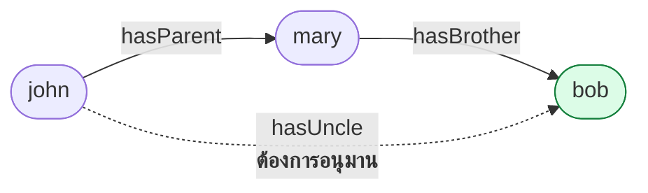
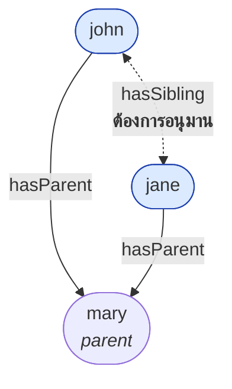
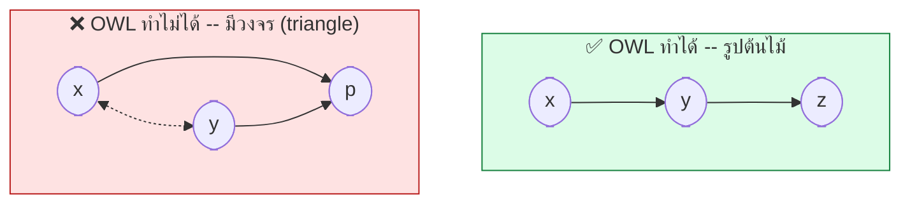
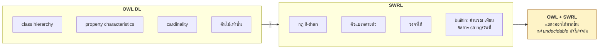
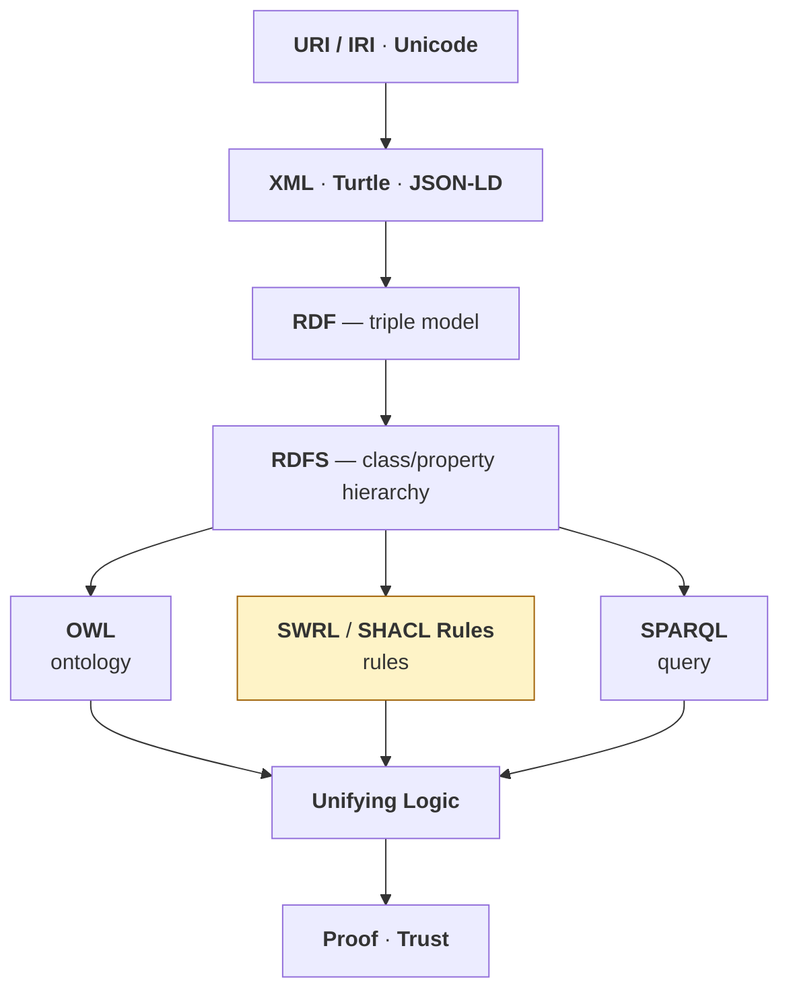
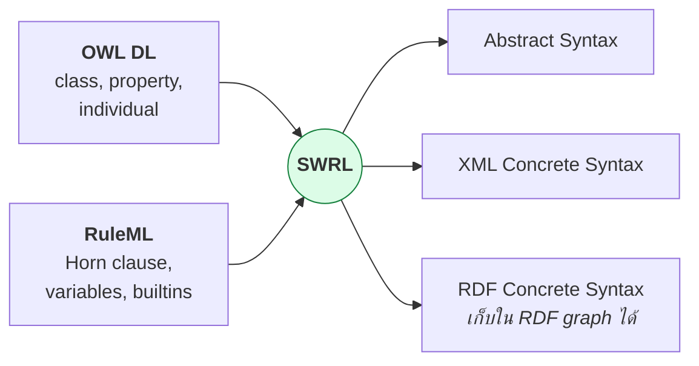
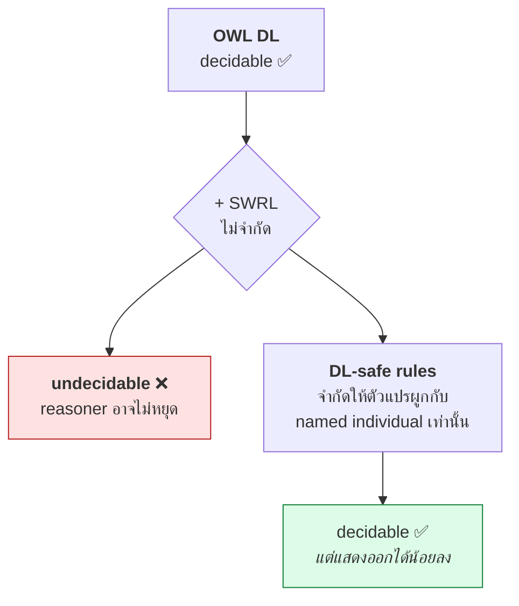
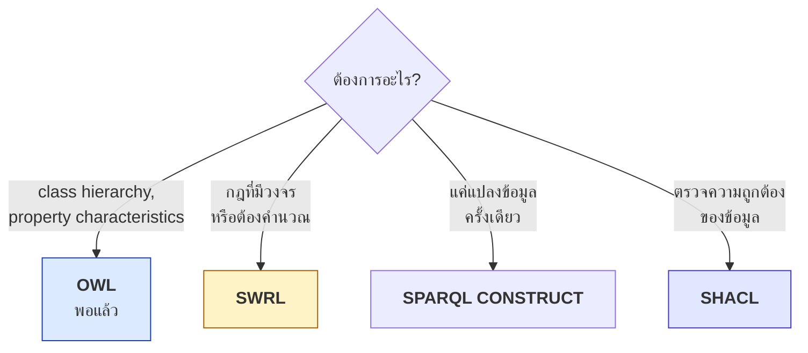

# 11.01 SWRL คืออะไร

**SWRL (Semantic Web Rule Language)** คือภาษาสำหรับเขียนกฎ if-then บน ontology ที่เกิดจากการรวม **OWL DL** เข้ากับ **RuleML**
บทนี้อธิบายว่าทำไม OWL อย่างเดียวไม่พอ SWRL เข้ามาเติมช่องว่างตรงไหน และมันอยู่ตำแหน่งไหนใน Semantic Web stack

---

## ปัญหา: มีสิ่งที่ OWL แสดงไม่ได้

**โจทย์**: *"ลุงของ x คือพี่ชายของพ่อแม่ของ x"*



### ลองด้วย OWL: property chain

```turtle
@prefix fam: <http://example.org/family#> .
@prefix owl: <http://www.w3.org/2002/07/owl#> .

fam:hasUncle owl:propertyChainAxiom ( fam:hasParent fam:hasBrother ) .
```

**ใช้ได้!** ✅ กรณีนี้ OWL 2 ทำได้ด้วย `owl:propertyChainAxiom`

### แต่ลองเปลี่ยนโจทย์: *"พี่น้องคือคนที่มีพ่อแม่คนเดียวกัน"*

```
hasParent(?x, ?p) ∧ hasParent(?y, ?p) ∧ x ≠ y → hasSibling(?x, ?y)
```



**OWL ทำไม่ได้** ❌ — เพราะเป็น pattern ที่ตัวแปรสองตัว (`?x`, `?y`) มาบรรจบกันที่ **node เดียวกัน** (`?p`)
แล้วต้องส่งความสัมพันธ์กลับไปที่ `?x` กับ `?y`

### 🌳 ทำไม OWL ทำไม่ได้: Tree Model Property



**Description Logic มี tree model property** — ทุกโมเดลที่สอดคล้องกับ ontology สามารถ "คลี่" ออกเป็นต้นไม้ได้
คุณสมบัตินี้เองที่ทำให้ DL **decidable** แต่ก็ทำให้แสดงกฎที่มีวงจร (เช่น `hasSibling`) ไม่ได้

ทบทวน [04.08](../04-logics/04.08-description-logic.md)

---

## SWRL เข้ามาเติมช่องว่าง

```
hasParent(?x, ?p) ∧ hasParent(?y, ?p) ∧ differentFrom(?x, ?y) → hasSibling(?x, ?y)
```



---

## กำเนิดของ SWRL

| ปี | เหตุการณ์ |
| --- | --- |
| 2003 | RuleML + DAML รวมกันเป็นข้อเสนอ SWRL |
| **2004** | **W3C Member Submission** (ไม่ใช่ Recommendation!) |
| 2007 | Protégé รองรับ SWRL Tab |
| 2009 | OWL 2 เพิ่ม `propertyChainAxiom` ทดแทนกฎง่าย ๆ บางส่วน |
| 2017 | SHACL กลายเป็น W3C Recommendation — มี SHACL Rules |

> ⚠️ **SWRL เป็นแค่ Member Submission ไม่ใช่ W3C Recommendation**
> หมายความว่าไม่ใช่มาตรฐานอย่างเป็นทางการ แต่ยังใช้กันแพร่หลายเพราะ Protégé และ Pellet รองรับ

---

## ตำแหน่งใน Semantic Web Stack



**SWRL อยู่ระนาบเดียวกับ OWL และ SPARQL** — ทั้งสามทำงานบน RDF/RDFS แต่คนละหน้าที่

| ภาษา | หน้าที่ | ผลลัพธ์ |
| --- | --- | --- |
| **OWL** | นิยามความหมายของ class/property | อนุมาน class membership, ความสัมพันธ์ |
| **SWRL** | เขียนกฎ if-then ที่ OWL แสดงไม่ได้ | เพิ่ม assertion ใหม่ลง ABox |
| **SPARQL** | ถามข้อมูล | ตาราง / graph |
| **SHACL** | ตรวจสอบความถูกต้อง | validation report |

---

## SWRL = OWL + RuleML



### รูปแบบการเขียน SWRL

**1. Human-readable syntax** (ที่ใช้ใน Protégé และในคอร์สนี้)

```
Person(?x) ^ hasParent(?x, ?y) ^ hasBrother(?y, ?z) -> hasUncle(?x, ?z)
```

**2. RDF concrete syntax** (สิ่งที่เก็บจริงในไฟล์ Turtle)

<table>
<tr><th width="50%">Full form</th><th width="50%">Shorthand</th></tr>
<tr valign="top">
<td>

```turtle
@prefix swrl: <http://www.w3.org/2003/11/swrl#> .
@prefix fam:  <http://example.org/family#> .
@prefix rdf:  <http://www.w3.org/1999/02/22-rdf-syntax-ns#> .

_:rule rdf:type swrl:Imp .
_:rule swrl:body _:body .
_:rule swrl:head _:head .

_:body rdf:type swrl:AtomList .
_:body rdf:first _:atom1 .
_:body rdf:rest  _:bodyRest .

_:atom1 rdf:type swrl:ClassAtom .
_:atom1 swrl:classPredicate fam:Person .
_:atom1 swrl:argument1 _:varX .

_:bodyRest rdf:first _:atom2 .
_:bodyRest rdf:rest  _:bodyRest2 .

_:atom2 rdf:type swrl:IndividualPropertyAtom .
_:atom2 swrl:propertyPredicate fam:hasParent .
_:atom2 swrl:argument1 _:varX .
_:atom2 swrl:argument2 _:varY .

_:varX rdf:type swrl:Variable .
_:varY rdf:type swrl:Variable .
```

</td>
<td>

```turtle
@prefix swrl: <http://www.w3.org/2003/11/swrl#> .
@prefix fam:  <http://example.org/family#> .

[] a swrl:Imp ;
   swrl:body (
       [ a swrl:ClassAtom ;
         swrl:classPredicate fam:Person ;
         swrl:argument1 _:x ]
       [ a swrl:IndividualPropertyAtom ;
         swrl:propertyPredicate fam:hasParent ;
         swrl:argument1 _:x ;
         swrl:argument2 _:y ]
       [ a swrl:IndividualPropertyAtom ;
         swrl:propertyPredicate fam:hasBrother ;
         swrl:argument1 _:y ;
         swrl:argument2 _:z ]
   ) ;
   swrl:head (
       [ a swrl:IndividualPropertyAtom ;
         swrl:propertyPredicate fam:hasUncle ;
         swrl:argument1 _:x ;
         swrl:argument2 _:z ]
   ) .

_:x a swrl:Variable .
_:y a swrl:Variable .
_:z a swrl:Variable .
```

</td>
</tr>
</table>

> 💡 **ไม่มีใครเขียน RDF syntax ด้วยมือ** — ใช้ Protégé SWRL Tab หรือ owlready2 `Imp().set_as_rule()`
> แต่ควรรู้ว่ามันถูกเก็บเป็น RDF triples ธรรมดา จึงเก็บใน triple store และ query ด้วย SPARQL ได้

---

## ลองรันจริงด้วย Python

```python
"""กฎ uncle: ลุงคือพี่ชายของพ่อแม่"""

from owlready2 import (Imp, ObjectProperty, Thing, get_ontology,
                       sync_reasoner_hermit)

onto = get_ontology("http://example.org/family#")

with onto:
    class Person(Thing):
        pass

    class hasParent(ObjectProperty):
        pass

    class hasBrother(ObjectProperty):
        pass

    class hasUncle(ObjectProperty):
        pass

    # ----- SWRL rule -----
    rule = Imp()
    rule.set_as_rule(
        "Person(?x), hasParent(?x, ?y), hasBrother(?y, ?z) -> hasUncle(?x, ?z)"
    )

    # ----- ABox -----
    john = Person("john")
    mary = Person("mary")
    bob = Person("bob")
    john.hasParent = [mary]
    mary.hasBrother = [bob]

sync_reasoner_hermit(infer_property_values=True)

print("john.hasUncle =", john.hasUncle)
print("rules:", [str(r) for r in onto.rules()])
```

Expected output:

```
* Owlready2 * Running HermiT...
* Owlready2 * HermiT took 0.4921252727508545 seconds
* Owlready * Adding relation family.john hasUncle family.bob
john.hasUncle = [family.bob]
rules: ['Person(?x), hasParent(?x, ?y), hasBrother(?y, ?z) -> hasUncle(?x, ?z)']
```

**กฎทำงานจริง — `john hasUncle bob` ถูกอนุมานขึ้นมา** ✅

---

## ⚠️ ราคาที่ต้องจ่าย: Undecidability



**OWL DL + SWRL แบบไม่จำกัด = undecidable** — reasoner อาจวนไม่รู้จบ
ทางแก้คือ **DL-safe rules** ซึ่งจะอธิบายละเอียดใน [11.02](11.02-rule-anatomy.md)

---

## เมื่อไหร่ควรใช้ SWRL



| สถานการณ์ | ใช้ |
| --- | --- |
| "ทุก Student เป็น Person" | OWL `rdfs:subClassOf` |
| "ลุง = พี่ชายของพ่อแม่" | OWL `propertyChainAxiom` (ทำได้!) |
| "พี่น้อง = มีพ่อแม่คนเดียวกัน" | **SWRL** (OWL ทำไม่ได้) |
| "BMI = น้ำหนัก ÷ ส่วนสูง²" | **SWRL builtin** |
| "ส่วนลด 10% ถ้าซื้อเกิน 1000" | **SWRL builtin** |
| แปลง CSV เป็น RDF | SPARQL CONSTRUCT |
| "ทุก Student ต้องมี studentId" | SHACL |

---

## Key Points

- **SWRL = OWL DL + RuleML** — ภาษาเขียนกฎ if-then บน ontology
- ⚠️ SWRL เป็นแค่ **W3C Member Submission (2004)** ไม่ใช่ Recommendation
- **OWL ทำกฎที่มีวงจรไม่ได้** เพราะ Description Logic มี **tree model property** ซึ่งเป็นสิ่งที่ทำให้ decidable
- ตัวอย่างคลาสสิกที่ OWL ทำไม่ได้: **`hasSibling`** (คนที่มีพ่อแม่คนเดียวกัน)
- ตัวอย่างที่ OWL **ทำได้**: `hasUncle` ด้วย **`owl:propertyChainAxiom`** — อย่าใช้ SWRL ถ้า OWL พอ
- SWRL เก็บเป็น **RDF triples ธรรมดา** ในตระกูล `swrl:` — เก็บใน triple store ได้
- ⚠️ **OWL DL + SWRL ไม่จำกัด = undecidable** — ต้องใช้ **DL-safe rules**
- SWRL แข็งที่สุดตรง **builtin** — คำนวณ เปรียบเทียบ จัดการ string และวันที่
- ในทางปฏิบัติเขียนด้วย **Protégé SWRL Tab** หรือ **owlready2 `Imp().set_as_rule()`** ไม่ใช่เขียน RDF ด้วยมือ
