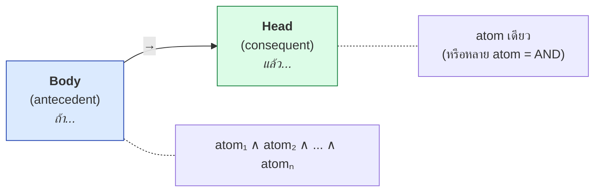
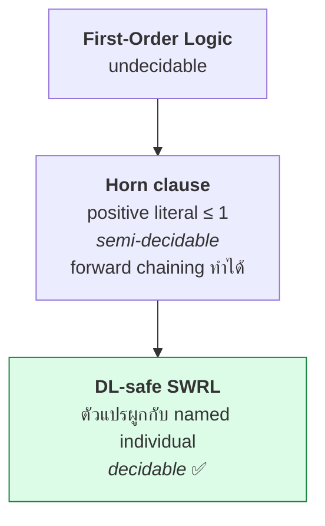
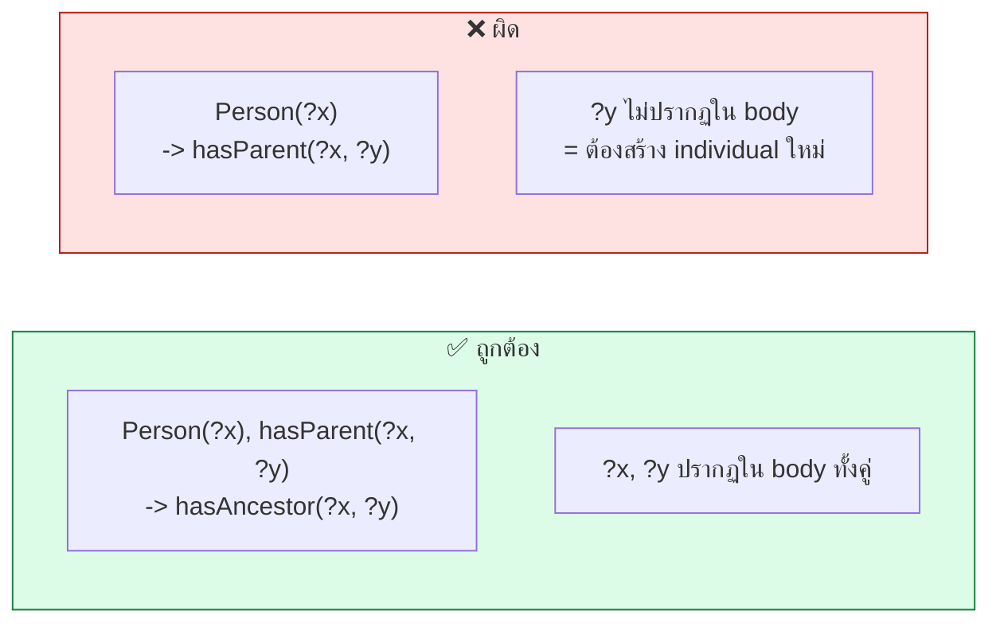
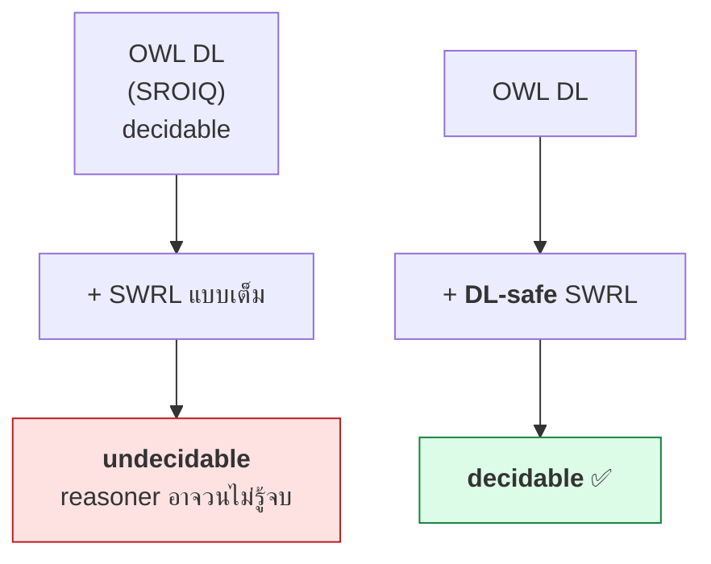
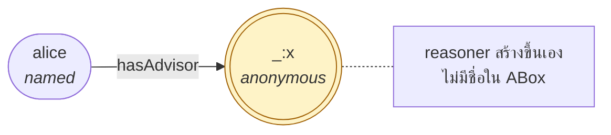
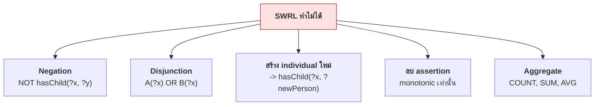

# 11.02 กายวิภาคของ SWRL Rule

SWRL rule ทุกข้อมีโครงสร้างเดียวกัน: **body (antecedent) → head (consequent)** ซึ่งเป็นรูปแบบของ **Horn clause**
บทนี้อธิบายโครงสร้าง กฎการผูกตัวแปร และแนวคิด **DL-safe rules** ที่ทำให้ reasoning ยังหยุดได้

---

## โครงสร้างพื้นฐาน



```
Person(?x) ^ hasParent(?x, ?y) ^ hasBrother(?y, ?z) -> hasUncle(?x, ?z)
└──────────────────── body ─────────────────────┘    └────── head ─────┘
```

| สัญลักษณ์ | ความหมาย | เขียนใน owlready2 |
| --- | --- | --- |
| `^` หรือ `,` | AND (conjunction) | `,` |
| `->` | implication | `->` |
| `?x` | ตัวแปร | `?x` |

> ⚠️ **ไม่มี OR, ไม่มี NOT, ไม่มี ∃ ใน head** — SWRL รองรับเฉพาะ conjunction เท่านั้น

---

## Horn Clause

SWRL rule คือ **Horn clause** ในตรรกศาสตร์ — clause ที่มี positive literal ได้ไม่เกินหนึ่งตัว

```
∀x,y,z. Person(x) ∧ hasParent(x,y) ∧ hasBrother(y,z) → hasUncle(x,z)
```

**เขียนใหม่เป็น disjunction**

```
¬Person(x) ∨ ¬hasParent(x,y) ∨ ¬hasBrother(y,z) ∨ hasUncle(x,z)
                                                  └── positive ตัวเดียว ──┘
```



### ทำไมต้องเป็น Horn clause

| ข้อดี | เหตุผล |
| --- | --- |
| **Forward chaining ได้** | เห็น body ครบ → เพิ่ม head ทันที |
| **ไม่ต้องเดา** | ไม่มี disjunction = ไม่ต้องแตกกิ่ง |
| **ประสิทธิภาพดี** | rule engine ทำได้เร็วมาก |

---

## ตัวแปร (Variables)

### กฎการผูกตัวแปร: ทุกตัวแปรใน head ต้องปรากฏใน body



```
# ❌ ผิด: ?y ไม่ถูกผูก -- SWRL สร้าง individual ใหม่ไม่ได้
Person(?x) -> hasParent(?x, ?y)

# ✅ ถูก
Person(?x), hasParent(?x, ?y) -> hasAncestor(?x, ?y)
```

> 💡 **SWRL สร้าง individual ใหม่ไม่ได้** ต่างจาก OWL ที่ `someValuesFrom` บอกว่า "ต้องมีสักตัว"
> SWRL ทำได้แค่ **เพิ่ม assertion ระหว่าง individual ที่มีอยู่แล้ว**

### ตัวแปรตัวเดียวกันต้องผูกกับ individual เดียวกัน

```
# "คนที่เป็นทั้งนักศึกษาและอาจารย์ในภาควิชาเดียวกัน"
Student(?x), Professor(?x), memberOf(?x, ?d), Department(?d) -> TeachingStudent(?x)
       ↑ ตัวเดียวกัน ↑            ↑ ตัวเดียวกัน ↑
```

---

## Head ที่มีหลาย atom

```
Person(?x), hasAge(?x, ?a), greaterThan(?a, 60)
    -> Senior(?x), eligibleForDiscount(?x, true)
```

**เทียบเท่ากับแยกเป็นสองกฎ**

```
Person(?x), hasAge(?x, ?a), greaterThan(?a, 60) -> Senior(?x)
Person(?x), hasAge(?x, ?a), greaterThan(?a, 60) -> eligibleForDiscount(?x, true)
```

> ⚠️ **head ที่มีหลาย atom คือ AND ไม่ใช่ OR** — ทั้งคู่จะถูกเพิ่มพร้อมกัน

---

## 🔒 DL-safe Rules

### ปัญหา: SWRL แบบเต็มทำให้ undecidable



### DL-safe คืออะไร

> **ทุกตัวแปรในกฎต้องผูกกับ named individual ที่ปรากฏใน ABox เท่านั้น**
> ไม่ใช่กับ individual ที่ reasoner สร้างขึ้นระหว่างการอนุมาน

```turtle
@prefix uni: <http://example.org/university#> .
@prefix owl: <http://www.w3.org/2002/07/owl#> .

# OWL บอกว่า "ทุก Student มี advisor สักคน" -- แต่ไม่บอกว่าใคร
uni:Student rdfs:subClassOf [
    a owl:Restriction ;
    owl:onProperty     uni:hasAdvisor ;
    owl:someValuesFrom uni:Professor ] .

uni:alice a uni:Student .
```

reasoner จะสร้าง **anonymous individual** ขึ้นมาเป็น advisor ของ alice



| โหมด | กฎทำงานกับ `_:x` ไหม |
| --- | --- |
| **SWRL แบบเต็ม** | ✅ ทำงาน → อาจสร้าง individual เพิ่มไม่รู้จบ → **undecidable** |
| **DL-safe** | ❌ ไม่ทำงาน → พิจารณาแค่ `alice`, `bob`, ... ที่มีชื่อ → **decidable** |

### 💡 ในทางปฏิบัติ

**Pellet และ HermiT บังคับ DL-safe โดยอัตโนมัติ** — เราไม่ต้องทำอะไรเพิ่ม
แต่ต้องรู้ว่ากฎจะ **ไม่ทำงานกับ individual ที่ reasoner สร้างขึ้น**

```python
"""แสดงว่ากฎ DL-safe ทำงานเฉพาะกับ named individual"""

from owlready2 import (Imp, ObjectProperty, Thing, get_ontology,
                       sync_reasoner_hermit)

onto = get_ontology("http://example.org/dlsafe#")

with onto:
    class Person(Thing):
        pass

    class knows(ObjectProperty):
        pass

    class hasContact(ObjectProperty):
        pass

    rule = Imp()
    rule.set_as_rule("Person(?x), knows(?x, ?y), Person(?y) -> hasContact(?x, ?y)")

    alice = Person("alice")
    bob = Person("bob")
    alice.knows = [bob]

sync_reasoner_hermit(infer_property_values=True)

print("alice.hasContact =", alice.hasContact)   # [dlsafe.bob] -- named ✅
```

Expected output:

```
* Owlready * Adding relation dlsafe.alice hasContact dlsafe.bob
alice.hasContact = [dlsafe.bob]
```

---

## รูปแบบการเขียนในเครื่องมือต่าง ๆ

<table>
<tr><th width="50%">Protégé SWRL Tab</th><th width="50%">owlready2</th></tr>
<tr valign="top">
<td>

```
Person(?x) ^ hasParent(?x, ?y)
  ^ hasBrother(?y, ?z)
  -> hasUncle(?x, ?z)
```

ใช้ `^` เป็นตัวเชื่อม

</td>
<td>

```python
rule = Imp()
rule.set_as_rule(
    "Person(?x), hasParent(?x, ?y), "
    "hasBrother(?y, ?z) -> hasUncle(?x, ?z)"
)
```

ใช้ `,` เป็นตัวเชื่อม

</td>
</tr>
</table>

### เขียน SWRL ลง Turtle โดยตรง

<table>
<tr><th width="50%">Full form</th><th width="50%">Shorthand</th></tr>
<tr valign="top">
<td>

```turtle
@prefix swrl: <http://www.w3.org/2003/11/swrl#> .
@prefix fam:  <http://example.org/family#> .
@prefix rdf:  <http://www.w3.org/1999/02/22-rdf-syntax-ns#> .

fam:siblingRule rdf:type swrl:Imp .
fam:siblingRule swrl:body _:b1 .
fam:siblingRule swrl:head _:h1 .

_:b1 rdf:type swrl:AtomList .
_:b1 rdf:first _:a1 .
_:b1 rdf:rest  _:b2 .

_:a1 rdf:type swrl:IndividualPropertyAtom .
_:a1 swrl:propertyPredicate fam:hasParent .
_:a1 swrl:argument1 fam:varX .
_:a1 swrl:argument2 fam:varP .

_:b2 rdf:first _:a2 .
_:b2 rdf:rest  rdf:nil .

_:a2 rdf:type swrl:IndividualPropertyAtom .
_:a2 swrl:propertyPredicate fam:hasParent .
_:a2 swrl:argument1 fam:varY .
_:a2 swrl:argument2 fam:varP .

_:h1 rdf:type swrl:AtomList .
_:h1 rdf:first _:a3 .
_:h1 rdf:rest  rdf:nil .

_:a3 rdf:type swrl:IndividualPropertyAtom .
_:a3 swrl:propertyPredicate fam:hasSibling .
_:a3 swrl:argument1 fam:varX .
_:a3 swrl:argument2 fam:varY .

fam:varX rdf:type swrl:Variable .
fam:varY rdf:type swrl:Variable .
fam:varP rdf:type swrl:Variable .
```

</td>
<td>

```turtle
@prefix swrl: <http://www.w3.org/2003/11/swrl#> .
@prefix swrlb: <http://www.w3.org/2003/11/swrlb#> .
@prefix fam:  <http://example.org/family#> .

fam:siblingRule a swrl:Imp ;
    swrl:body (
        [ a swrl:IndividualPropertyAtom ;
          swrl:propertyPredicate fam:hasParent ;
          swrl:argument1 fam:varX ;
          swrl:argument2 fam:varP ]
        [ a swrl:IndividualPropertyAtom ;
          swrl:propertyPredicate fam:hasParent ;
          swrl:argument1 fam:varY ;
          swrl:argument2 fam:varP ]
        [ a swrl:BuiltinAtom ;
          swrl:builtin swrlb:notEqual ;
          swrl:arguments ( fam:varX fam:varY ) ]
    ) ;
    swrl:head (
        [ a swrl:IndividualPropertyAtom ;
          swrl:propertyPredicate fam:hasSibling ;
          swrl:argument1 fam:varX ;
          swrl:argument2 fam:varY ]
    ) .

fam:varX a swrl:Variable .
fam:varY a swrl:Variable .
fam:varP a swrl:Variable .
```

</td>
</tr>
</table>

> 💡 **สังเกต**: ตัวแปรใน SWRL เป็น **resource ที่มี IRI** ประเภท `swrl:Variable`
> ไม่ใช่แค่ syntax — จึงอ้างถึงข้ามกฎได้

---

## ⚠️ สิ่งที่ SWRL rule ทำไม่ได้



| ทำไม่ได้ | ทางเลือก |
| --- | --- |
| **Negation** (`NOT`) | SPARQL `FILTER NOT EXISTS` หรือ SHACL |
| **Disjunction** (`OR`) | เขียนแยกเป็นหลายกฎ |
| **สร้าง individual ใหม่** | SPARQL CONSTRUCT หรือโค้ด Python |
| **ลบ assertion** | SPARQL DELETE — SWRL เป็น **monotonic** |
| **Aggregate** (COUNT, SUM) | **SQWRL** ([11.06](11.06-sqwrl.md)) หรือ SPARQL |

### ตัวอย่าง: Negation ทำไม่ได้

```
# ❌ เขียนแบบนี้ไม่ได้ใน SWRL
Person(?x), NOT hasChild(?x, ?y) -> Childless(?x)
```

**เหตุผลเชิงลึก**: OWL ใช้ **Open World Assumption** — "ไม่รู้ว่ามีลูก" ≠ "ไม่มีลูก"
ถ้าอนุญาต negation กฎจะให้ผลต่างกันเมื่อเพิ่มข้อมูลใหม่ ทำลาย **monotonicity**

```turtle
# ✅ ทางแก้ด้วย OWL: closure axiom
uni:Childless owl:equivalentClass [
    a owl:Restriction ;
    owl:onProperty     uni:hasChild ;
    owl:maxCardinality "0"^^xsd:nonNegativeInteger ] .
```

---

## ตารางสรุปกายวิภาค

| ส่วน | ชื่อทางการ | เนื้อหา | ข้อจำกัด |
| --- | --- | --- | --- |
| ซ้ายของ `->` | **body** / antecedent | atom ต่อกันด้วย AND | ไม่มี OR/NOT |
| ขวาของ `->` | **head** / consequent | atom ต่อกันด้วย AND | ไม่มี builtin, ไม่สร้าง individual ใหม่ |
| `?x` | **variable** | `swrl:Variable` | ทุกตัวใน head ต้องอยู่ใน body |
| `Person(?x)` | **ClassAtom** | ตรวจ/กำหนด type | — |
| `hasParent(?x,?y)` | **IndividualPropertyAtom** | object property | — |
| `hasAge(?x,?a)` | **DatavaluedPropertyAtom** | data property | — |
| `greaterThan(?a,60)` | **BuiltinAtom** | ฟังก์ชันในตัว | **body เท่านั้น** |

---

## Key Points

- SWRL rule มีรูป **body → head** ซึ่งเป็น **Horn clause** (positive literal ไม่เกินหนึ่งตัว)
- **atom ใน body ต่อกันด้วย AND เท่านั้น** — ไม่มี OR และไม่มี NOT
- ⚠️ **ทุกตัวแปรใน head ต้องปรากฏใน body** — ไม่งั้นต้องสร้าง individual ใหม่ซึ่ง SWRL ทำไม่ได้
- **head ที่มีหลาย atom = AND** เทียบเท่าการแยกเป็นหลายกฎ
- **OWL DL + SWRL ไม่จำกัด = undecidable** — ทางแก้คือ **DL-safe rules**
- **DL-safe**: ตัวแปรผูกกับ **named individual ใน ABox เท่านั้น** ไม่ผูกกับ anonymous individual ที่ reasoner สร้าง
- **Pellet และ HermiT บังคับ DL-safe อัตโนมัติ** — แต่ต้องรู้ว่ากฎจะไม่ทำงานกับ individual ที่ถูกอนุมานขึ้น
- SWRL เป็น **monotonic** — เพิ่ม assertion ได้อย่างเดียว ลบไม่ได้
- ทำ **negation, disjunction, aggregate ไม่ได้** — ต้องใช้ SPARQL, SHACL หรือ SQWRL แทน
- ในไฟล์ Turtle ตัวแปรเป็น **resource ประเภท `swrl:Variable`** ไม่ใช่แค่ syntax
