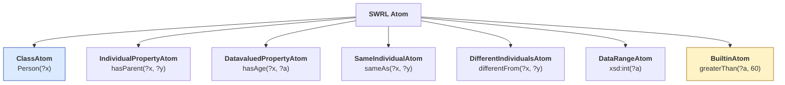
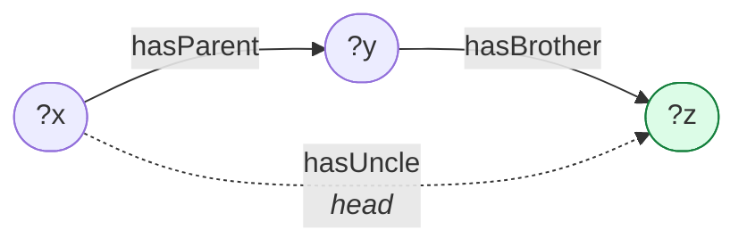
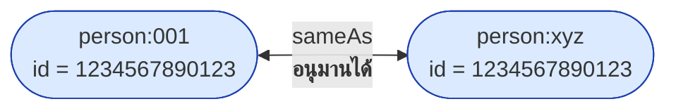
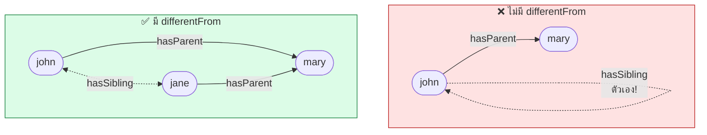
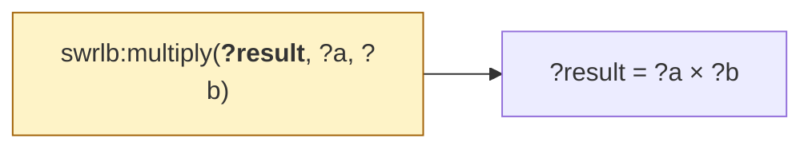

# 11.03 ชนิดของ Atom

**Atom** คือหน่วยย่อยที่สุดของ SWRL rule — แต่ละ atom เป็นเงื่อนไขหนึ่งข้อใน body หรือข้อสรุปหนึ่งข้อใน head
SWRL มี atom ทั้งหมด **7 ชนิด** ซึ่งบทนี้อธิบายทีละชนิดพร้อมตัวอย่างและข้อจำกัด

---

## ภาพรวม 7 ชนิด



| Atom | ตัวอย่าง | ใน body | ใน head |
| --- | --- | --- | --- |
| **ClassAtom** | `Person(?x)` | ✅ | ✅ |
| **IndividualPropertyAtom** | `hasParent(?x, ?y)` | ✅ | ✅ |
| **DatavaluedPropertyAtom** | `hasAge(?x, ?a)` | ✅ | ✅ |
| **SameIndividualAtom** | `sameAs(?x, ?y)` | ✅ | ✅ |
| **DifferentIndividualsAtom** | `differentFrom(?x, ?y)` | ✅ | ✅ |
| **DataRangeAtom** | `xsd:integer(?a)` | ✅ | ❌ |
| **BuiltinAtom** | `greaterThan(?a, 60)` | ✅ | ❌ |

> ⚠️ **BuiltinAtom และ DataRangeAtom ใช้ได้เฉพาะใน body** — เป็นเงื่อนไข ไม่ใช่ข้อสรุป

---

## 1. ClassAtom

**ตรวจว่า individual เป็นสมาชิกของ class หรือกำหนดให้เป็น**

```
# ใน body: ตรวจสอบ
Student(?x), enrolledIn(?x, ?c) -> ...

# ใน head: กำหนด type ใหม่
Person(?x), hasAge(?x, ?a), greaterThan(?a, 60) -> SeniorCitizen(?x)
```

### รับ class expression ได้ด้วย (ถ้า reasoner รองรับ)

```
# Manchester-style class expression ใน ClassAtom
(Student and (enrolledIn some GraduateCourse))(?x) -> GraduateStudent(?x)
```

> ⚠️ **ในทางปฏิบัติ**: reasoner ส่วนใหญ่รองรับแค่ **named class** ไม่รองรับ class expression
> ถ้าต้องการ class expression ให้ประกาศเป็น **defined class** ใน OWL ก่อนแล้วอ้างชื่อ

<table>
<tr><th width="50%">Full form (RDF)</th><th width="50%">Shorthand</th></tr>
<tr valign="top">
<td>

```turtle
@prefix swrl: <http://www.w3.org/2003/11/swrl#> .
@prefix uni:  <http://example.org/university#> .
@prefix rdf:  <http://www.w3.org/1999/02/22-rdf-syntax-ns#> .

_:atom rdf:type swrl:ClassAtom .
_:atom swrl:classPredicate uni:Student .
_:atom swrl:argument1 uni:varX .

uni:varX rdf:type swrl:Variable .
```

</td>
<td>

```turtle
@prefix swrl: <http://www.w3.org/2003/11/swrl#> .
@prefix uni:  <http://example.org/university#> .

[ a swrl:ClassAtom ;
  swrl:classPredicate uni:Student ;
  swrl:argument1      uni:varX ]

uni:varX a swrl:Variable .
```

</td>
</tr>
</table>

---

## 2. IndividualPropertyAtom (Object Property)

**ความสัมพันธ์ระหว่าง individual สองตัว**

```
hasParent(?x, ?y)          # ตัวแปรทั้งคู่
hasParent(?x, mary)        # argument2 เป็น individual ที่ระบุชื่อ
memberOf(alice, ?d)        # argument1 เป็น individual
```



```
Person(?x), hasParent(?x, ?y), hasBrother(?y, ?z) -> hasUncle(?x, ?z)
```

### ใช้ individual ที่ระบุชื่อได้

```
Student(?x), enrolledIn(?x, cs501) -> AdvancedStudent(?x)
                          ↑ ไม่ใช่ตัวแปร แต่เป็น individual
```

---

## 3. DatavaluedPropertyAtom (Data Property)

**ความสัมพันธ์ระหว่าง individual กับ literal**

```
hasAge(?x, ?a)              # ?a เป็นตัวแปรของ literal
hasAge(?x, 18)              # ค่าคงที่
hasName(?x, "Alice")        # string literal
hasGPA(?x, ?g)
```

### ⚠️ กับดัก: datatype ต้องตรงกัน

```python
# ถ้าประกาศ range = [float] แล้วส่ง int เข้าไป กฎอาจไม่ทำงาน
class hasAge(DataProperty, FunctionalProperty):
    domain = [Person]
    range  = [int]        # ← ต้องเทียบกับ int ไม่ใช่ float

# ✅ ถูก
"Person(?x), hasAge(?x, ?a), greaterThan(?a, 60) -> Senior(?x)"

# ⚠️ อาจไม่ทำงานถ้า ?a เป็น int แต่เทียบกับ 60.0
"Person(?x), hasAge(?x, ?a), greaterThan(?a, 60.0) -> Senior(?x)"
```

---

## 4. SameIndividualAtom

**บอกว่าสอง individual คือสิ่งเดียวกัน** (เทียบเท่า `owl:sameAs`)

```
# ใน body: ตรวจว่าเป็นตัวเดียวกัน
Person(?x), Person(?y), sameAs(?x, ?y), hasEmail(?x, ?e) -> hasEmail(?y, ?e)

# ใน head: ประกาศว่าเป็นตัวเดียวกัน -- entity resolution!
Person(?x), Person(?y), hasNationalId(?x, ?id), hasNationalId(?y, ?id)
    -> sameAs(?x, ?y)
```



> 💡 **นี่คือ entity resolution ด้วยกฎ** — พลังที่ SPARQL CONSTRUCT ทำได้เหมือนกัน
> แต่ SWRL ทำแล้ว reasoner จะ **รวมข้อมูลทั้งสองฝั่งเข้าด้วยกันทันที**

---

## 5. DifferentIndividualsAtom

**บอกว่าสอง individual ต่างกัน** (เทียบเท่า `owl:differentFrom`)

```
# กฎ sibling ที่จำเป็นต้องมี -- ไม่งั้น john จะเป็นพี่น้องของตัวเอง!
hasParent(?x, ?p), hasParent(?y, ?p), differentFrom(?x, ?y) -> hasSibling(?x, ?y)
```



> ⚠️ **ต้องประกาศ `owl:AllDifferent` ใน ABox ด้วย** — เพราะ OWL **ไม่มี UNA**
> `differentFrom(?x, ?y)` จะเป็นจริงก็ต่อเมื่อ reasoner **รู้แน่ชัด**ว่าต่างกัน

```turtle
@prefix fam: <http://example.org/family#> .
@prefix owl: <http://www.w3.org/2002/07/owl#> .

[] a owl:AllDifferent ;
   owl:distinctMembers ( fam:john fam:jane fam:mary fam:bob ) .
```

---

## 6. DataRangeAtom

**ตรวจว่า literal อยู่ในช่วง datatype ที่กำหนด**

```
Person(?x), hasAge(?x, ?a), xsd:integer(?a) -> ValidAge(?x)
```

**ใช้ enumerated datatype ได้**

```turtle
@prefix uni: <http://example.org/university#> .
@prefix owl: <http://www.w3.org/2002/07/owl#> .

uni:PassingGrade a rdfs:Datatype ;
    owl:equivalentClass [
        a owl:DataRange ;
        owl:oneOf ( "A" "B+" "B" "C+" "C" "D" ) ] .
```

```
Enrollment(?e), hasGrade(?e, ?g), PassingGrade(?g) -> Passed(?e)
```

> 💡 **ใช้น้อยที่สุดใน 7 ชนิด** — ส่วนใหญ่ใช้ builtin แทนได้และอ่านง่ายกว่า

---

## 7. BuiltinAtom ⭐

**ฟังก์ชันในตัวสำหรับคำนวณ เปรียบเทียบ และจัดการข้อมูล — จุดแข็งที่สุดของ SWRL**

```
# เปรียบเทียบ
Person(?x), hasAge(?x, ?a), swrlb:greaterThan(?a, 60) -> Senior(?x)

# คำนวณ
Order(?o), hasSubtotal(?o, ?s), swrlb:multiply(?tax, ?s, 0.07) -> hasTax(?o, ?tax)

# string
Person(?x), hasFirstName(?x, ?f), hasLastName(?x, ?l),
    swrlb:stringConcat(?full, ?f, " ", ?l) -> hasFullName(?x, ?full)
```

### รูปแบบการเรียก: **ผลลัพธ์อยู่ argument แรก**



| Builtin | รูปแบบ | ความหมาย |
| --- | --- | --- |
| `swrlb:add(?r, ?a, ?b)` | ผลลัพธ์ก่อน | `?r = ?a + ?b` |
| `swrlb:greaterThan(?a, ?b)` | ไม่มีผลลัพธ์ | เป็น predicate — จริง/เท็จ |
| `swrlb:stringConcat(?r, ?a, ?b)` | ผลลัพธ์ก่อน | `?r = concat(?a, ?b)` |

> ⚠️ **สับสนบ่อยที่สุด**: `multiply(?result, ?a, ?b)` ไม่ใช่ `multiply(?a, ?b, ?result)`
> ผลลัพธ์อยู่**ตัวแรก**เสมอ

รายละเอียด builtin ทั้งหมดดู [11.04](11.04-builtins.md)

---

## 🧪 ทดลองใช้ atom ทุกชนิด

```python
"""ตัวอย่างกฎที่ใช้ atom หลายชนิดพร้อมกัน"""

from owlready2 import (DataProperty, FunctionalProperty, Imp, ObjectProperty,
                       Thing, get_ontology, sync_reasoner_hermit, AllDifferent)

onto = get_ontology("http://example.org/atoms#")

with onto:
    class Person(Thing):
        pass

    class Sibling(Person):          # ClassAtom ใน head
        pass

    class hasParent(ObjectProperty):    # IndividualPropertyAtom
        pass

    class hasSibling(ObjectProperty):
        pass

    class hasNationalId(DataProperty, FunctionalProperty):   # DatavaluedPropertyAtom
        domain = [Person]
        range = [str]

    # --- กฎ 1: sibling (ใช้ DifferentIndividualsAtom) ---
    r1 = Imp()
    r1.set_as_rule("Person(?x), Person(?y), hasParent(?x, ?p), hasParent(?y, ?p), "
                   "differentFrom(?x, ?y) -> hasSibling(?x, ?y), Sibling(?x)")

    # --- กฎ 2: entity resolution (ใช้ SameIndividualAtom ใน head) ---
    r2 = Imp()
    r2.set_as_rule("Person(?x), Person(?y), hasNationalId(?x, ?id), "
                   "hasNationalId(?y, ?id), differentFrom(?x, ?y) -> sameAs(?x, ?y)")

    # --- ABox ---
    mary = Person("mary")
    john = Person("john")
    jane = Person("jane")
    john.hasParent = [mary]
    jane.hasParent = [mary]

    # ⚠️ ต้องประกาศ AllDifferent -- ไม่มี UNA!
    AllDifferent([mary, john, jane])

sync_reasoner_hermit(infer_property_values=True)

print("john.hasSibling =", john.hasSibling)
print("jane.hasSibling =", jane.hasSibling)
print("john.is_a       =", john.is_a)
```

Expected output:

```
* Owlready * Reparenting atoms.john: {atoms.Person} => {atoms.Sibling}
* Owlready * Reparenting atoms.jane: {atoms.Person} => {atoms.Sibling}
* Owlready * Adding relation atoms.john hasSibling atoms.jane
* Owlready * Adding relation atoms.jane hasSibling atoms.john
john.hasSibling = [atoms.jane]
jane.hasSibling = [atoms.john]
john.is_a       = [atoms.Sibling]
```

**กฎ sibling ที่ OWL ทำไม่ได้ — SWRL ทำได้** ✅

> 🔍 **สังเกต `Reparenting`** — owlready2 ถอด `Person` ออกจาก `john.is_a` แล้วเหลือแค่ `Sibling`
> ไม่ใช่ข้อมูลหาย แต่เป็นการ **normalize**: `Sibling` เป็น subclass ของ `Person` อยู่แล้ว
> จึงไม่ต้องเก็บ `Person` ซ้ำ — ตรวจได้ด้วย `Person in john.INDIRECT_is_a` ซึ่งยังเป็น `True`

---

## ตารางเทียบ atom กับ OWL/SPARQL

| SWRL Atom | OWL เทียบเท่า | SPARQL เทียบเท่า |
| --- | --- | --- |
| `Person(?x)` | `rdf:type` | `?x a :Person` |
| `hasParent(?x, ?y)` | object property assertion | `?x :hasParent ?y` |
| `hasAge(?x, ?a)` | data property assertion | `?x :hasAge ?a` |
| `sameAs(?x, ?y)` | `owl:sameAs` | `?x owl:sameAs ?y` |
| `differentFrom(?x, ?y)` | `owl:differentFrom` | `FILTER(?x != ?y)` ⚠️ ไม่เหมือนกัน! |
| `xsd:integer(?a)` | `rdfs:range` | `FILTER(datatype(?a) = xsd:integer)` |
| `greaterThan(?a, 60)` | ❌ ไม่มี | `FILTER(?a > 60)` |

> ⚠️ **`differentFrom` ≠ `FILTER(?x != ?y)`**
> - SPARQL `!=` เทียบ **IRI ต่างกันไหม** (syntactic)
> - SWRL `differentFrom` ต้องการให้ reasoner **รู้แน่ชัด**ว่าเป็นคนละสิ่ง (semantic)
> - ไม่มี `owl:AllDifferent` → `differentFrom` ไม่เป็นจริง แต่ `!=` เป็นจริง

---

## 📋 Checklist เขียน atom

| # | ตรวจ | เหตุผล |
| --- | --- | --- |
| 1 | ทุกตัวแปรใน head ปรากฏใน body | SWRL สร้าง individual ใหม่ไม่ได้ |
| 2 | ไม่มี BuiltinAtom ใน head | builtin เป็นเงื่อนไขเท่านั้น |
| 3 | ใช้ `differentFrom` เมื่อไม่ต้องการ self-loop | เช่น กฎ sibling |
| 4 | ประกาศ `owl:AllDifferent` ใน ABox | ไม่มี UNA |
| 5 | datatype ตรงกัน (int vs float) | ไม่งั้นกฎเงียบ ๆ ไม่ทำงาน |
| 6 | ผลลัพธ์ของ builtin อยู่ argument แรก | `multiply(?r, ?a, ?b)` |
| 7 | ใช้ named class ไม่ใช่ class expression | reasoner ส่วนใหญ่ไม่รองรับ |

---

## Key Points

- SWRL มี atom **7 ชนิด** — ที่ใช้บ่อยที่สุดคือ **ClassAtom**, **IndividualPropertyAtom**, **DatavaluedPropertyAtom**, **BuiltinAtom**
- ⚠️ **BuiltinAtom และ DataRangeAtom ใช้ได้เฉพาะใน body** — เป็นเงื่อนไข ไม่ใช่ข้อสรุป
- **ClassAtom ใน head กำหนด type ใหม่** ให้ individual
- **SameIndividualAtom ใน head = entity resolution ด้วยกฎ** — reasoner จะรวมข้อมูลสองฝั่งทันที
- ⚠️ **`differentFrom` ต้องมี `owl:AllDifferent` ใน ABox** เพราะ OWL ไม่มี **Unique Name Assumption**
- ⚠️ **`differentFrom` ≠ SPARQL `FILTER(?x != ?y)`** — อันแรกเป็น semantic อันหลังเป็น syntactic
- ⚠️ **builtin เอาผลลัพธ์ไว้ argument แรก**: `multiply(?result, ?a, ?b)`
- กฎ **sibling** ที่ต้องใช้ `differentFrom` คือตัวอย่างคลาสสิกของสิ่งที่ **OWL ทำไม่ได้แต่ SWRL ทำได้**
- reasoner ส่วนใหญ่รองรับแค่ **named class** ใน ClassAtom — ถ้าต้องการ class expression ให้ทำ defined class ก่อน
