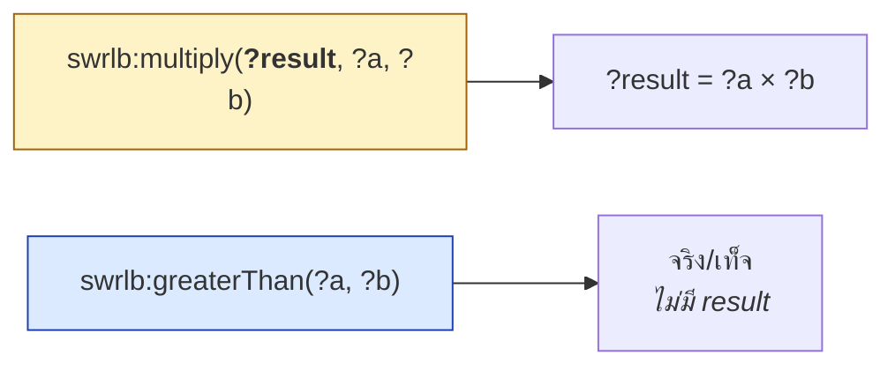
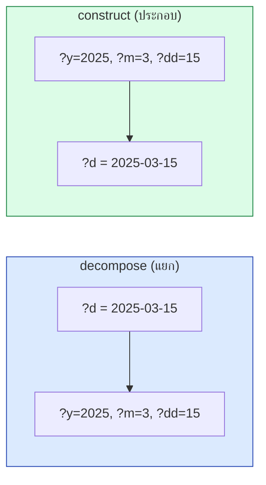
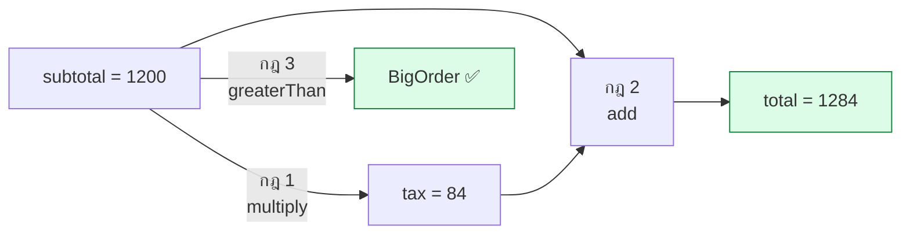

# 11.04 SWRL Built-ins

**Built-in** คือฟังก์ชันในตัวของ SWRL สำหรับคำนวณ เปรียบเทียบ และจัดการ string กับวันที่ — เป็นจุดแข็งที่สุดของ SWRL เพราะ OWL ทำไม่ได้เลย
บทนี้รวมรายการ builtin ที่ใช้บ่อยพร้อมตัวอย่างที่รันจริงและกับดักที่ต้องระวัง

---

## กฎเหล็ก: ผลลัพธ์อยู่ argument แรก



**builtin แบ่งเป็น 2 กลุ่ม**

| กลุ่ม | รูปแบบ | ตัวอย่าง |
| --- | --- | --- |
| **Function** (คำนวณค่า) | `f(?result, arg1, arg2, ...)` | `add(?r, ?a, ?b)` |
| **Predicate** (จริง/เท็จ) | `p(arg1, arg2)` | `greaterThan(?a, ?b)` |

> ⚠️ **ผิดบ่อยที่สุด**: เขียน `multiply(?a, ?b, ?result)` — **ผิด!** ผลลัพธ์ต้องอยู่ตัวแรกเสมอ

---

## 1. Comparison Built-ins (Predicate)

| Builtin | ความหมาย | ตัวอย่าง |
| --- | --- | --- |
| `swrlb:equal(?a, ?b)` | `?a = ?b` | `equal(?g, "A")` |
| `swrlb:notEqual(?a, ?b)` | `?a ≠ ?b` | `notEqual(?x, ?y)` |
| `swrlb:lessThan(?a, ?b)` | `?a < ?b` | `lessThan(?gpa, 2.0)` |
| `swrlb:lessThanOrEqual(?a, ?b)` | `?a ≤ ?b` | — |
| `swrlb:greaterThan(?a, ?b)` | `?a > ?b` | `greaterThan(?age, 60)` |
| `swrlb:greaterThanOrEqual(?a, ?b)` | `?a ≥ ?b` | — |

```
Person(?p), hasAge(?p, ?a), greaterThan(?a, 60) -> Senior(?p)
Student(?s), hasGPA(?s, ?g), lessThan(?g, 2.0) -> ProbationStudent(?s)
Order(?o), hasSubtotal(?o, ?s), greaterThan(?s, 1000.0) -> BigOrder(?o)
```

### ⚠️ กับดัก: datatype ต้องตรงกัน

```python
# ถ้า hasAge range = [int] ต้องเทียบกับ int
"Person(?p), hasAge(?p, ?a), greaterThan(?a, 60) -> Senior(?p)"      # ✅

# ถ้า hasSubtotal range = [float] ต้องเทียบกับ float
"Order(?o), hasSubtotal(?o, ?s), greaterThan(?s, 1000.0) -> BigOrder(?o)"  # ✅
"Order(?o), hasSubtotal(?o, ?s), greaterThan(?s, 1000) -> BigOrder(?o)"    # ⚠️ อาจเงียบ
```

---

## 2. Math Built-ins (Function)

| Builtin | ผลลัพธ์ | ตัวอย่าง |
| --- | --- | --- |
| `swrlb:add(?r, ?a, ?b, ...)` | `?a + ?b + ...` | `add(?total, ?sub, ?tax)` |
| `swrlb:subtract(?r, ?a, ?b)` | `?a − ?b` | `subtract(?r, ?v, 1.5)` |
| `swrlb:multiply(?r, ?a, ?b, ...)` | `?a × ?b × ...` | `multiply(?tax, ?sub, 0.07)` |
| `swrlb:divide(?r, ?a, ?b)` | `?a ÷ ?b` | `divide(?bmi, ?w, ?hh)` |
| `swrlb:pow(?r, ?a, ?b)` | `?a ^ ?b` | `pow(?r, ?v, 2.0)` |
| `swrlb:mod(?r, ?a, ?b)` | `?a mod ?b` | — |
| `swrlb:abs(?r, ?a)` | `\|?a\|` | `abs(?r, ?v)` |
| `swrlb:ceiling(?r, ?a)` | ปัดขึ้น | `ceiling(?r, ?v)` |
| `swrlb:floor(?r, ?a)` | ปัดลง | `floor(?r, ?v)` |
| `swrlb:round(?r, ?a)` | ปัดใกล้สุด | `round(?r, ?v)` |
| `swrlb:unaryMinus(?r, ?a)` | `−?a` | — |
| `swrlb:integerDivide(?r, ?a, ?b)` | หารปัดเศษ | — |
| `swrlb:sin/cos/tan(?r, ?a)` | ตรีโกณ | — |

### ทดสอบจริง

```python
"""ทดสอบ math builtin ทุกตัวกับ ?v = -3.7"""

from owlready2 import DataProperty, FunctionalProperty, Imp, Thing, get_ontology
from pellet_runner import run_pellet, parse_propvals

onto = get_ontology("http://example.org/math#")

with onto:
    class T(Thing):
        pass

    class x(DataProperty, FunctionalProperty):
        domain = [T]
        range = [float]

    for name in ["r_abs", "r_ceil", "r_floor", "r_round", "r_pow", "r_sub"]:
        type(name, (DataProperty, FunctionalProperty),
             {"domain": [T], "range": [float]})

    Imp().set_as_rule("T(?t), x(?t, ?v), abs(?r, ?v)          -> r_abs(?t, ?r)")
    Imp().set_as_rule("T(?t), x(?t, ?v), ceiling(?r, ?v)      -> r_ceil(?t, ?r)")
    Imp().set_as_rule("T(?t), x(?t, ?v), floor(?r, ?v)        -> r_floor(?t, ?r)")
    Imp().set_as_rule("T(?t), x(?t, ?v), round(?r, ?v)        -> r_round(?t, ?r)")
    Imp().set_as_rule("T(?t), x(?t, ?v), pow(?r, ?v, 2.0)     -> r_pow(?t, ?r)")
    Imp().set_as_rule("T(?t), x(?t, ?v), subtract(?r, ?v, 1.5) -> r_sub(?t, ?r)")

    t1 = T("t1")
    t1.x = -3.7

for _, prop, val in parse_propvals(run_pellet(onto)):
    print(f"  {prop:10s} = {val}")
```

Expected output:

```
  r_pow      = 13.69
  r_floor    = -4
  r_round    = -4
  r_abs      = 3.7
  x          = -3.7
  r_sub      = -5.2
  r_ceil     = -3
```

> 🔍 **สังเกต `round(-3.7) = -4`** — ปัดไปทางค่าที่ใกล้ที่สุด ไม่ใช่ปัดเข้าหาศูนย์

---

## 3. String Built-ins

| Builtin | ผลลัพธ์ | หมายเหตุ |
| --- | --- | --- |
| `swrlb:stringConcat(?r, ?a, ?b, ...)` | ต่อ string | รับหลาย argument |
| `swrlb:stringLength(?r, ?s)` | ความยาว | — |
| `swrlb:upperCase(?r, ?s)` | ตัวพิมพ์ใหญ่ | — |
| `swrlb:lowerCase(?r, ?s)` | ตัวพิมพ์เล็ก | — |
| `swrlb:substring(?r, ?s, ?offset, ?len)` | ตัด string | ⚠️ **offset เริ่มที่ 1** |
| `swrlb:substringBefore(?r, ?s, ?sep)` | ก่อนตัวคั่น | — |
| `swrlb:substringAfter(?r, ?s, ?sep)` | หลังตัวคั่น | — |
| `swrlb:replace(?r, ?s, ?find, ?repl)` | แทนที่ | รับ regex |
| `swrlb:normalizeSpace(?r, ?s)` | ตัดช่องว่างเกิน | — |
| `swrlb:translate(?r, ?s, ?from, ?to)` | แทนตัวอักษร | — |
| `swrlb:tokenize(?r, ?s, ?sep)` | แยกเป็นหลายค่า | คืนหลายผลลัพธ์ |
| `swrlb:contains(?s, ?sub)` | **predicate** | — |
| `swrlb:containsIgnoreCase(?s, ?sub)` | **predicate** | — |
| `swrlb:startsWith(?s, ?prefix)` | **predicate** | — |
| `swrlb:endsWith(?s, ?suffix)` | **predicate** | — |
| `swrlb:matches(?s, ?regex)` | **predicate** | regex เต็มรูปแบบ |
| `swrlb:stringEqualIgnoreCase(?a, ?b)` | **predicate** | — |

```
# ต่อชื่อเต็ม
Person(?p), hasFirstName(?p, ?f), hasLastName(?p, ?l),
    stringConcat(?n, ?f, " ", ?l) -> hasFullName(?p, ?n)

# ตัวย่อชื่อ -- ⚠️ offset เริ่มที่ 1 ไม่ใช่ 0!
Person(?p), hasFirstName(?p, ?f), substring(?i, ?f, 1, 1) -> hasInitial(?p, ?i)

# ตรวจ regex
Person(?p), hasEmail(?p, ?e), matches(?e, "^[\\w.]+@example\\.org$") -> InternalUser(?p)
```

### ⚠️ กับดักที่ 1: `substring` เริ่มนับที่ 1

```python
# ❌ ผิด -- ได้ string ว่าง
"Person(?p), firstName(?p, ?f), substring(?i, ?f, 0, 1) -> initials(?p, ?i)"
# → literal((),(),rdf:PlainLiteral)

# ✅ ถูก
"Person(?p), firstName(?p, ?f), substring(?i, ?f, 1, 1) -> initials(?p, ?i)"
# → literal(A,(),rdf:PlainLiteral)
```

**SWRL ตาม XPath `fn:substring` ซึ่งเป็น 1-based ไม่ใช่ 0-based แบบ Python**

### ⚠️ กับดักที่ 2: ผลลัพธ์กลายเป็น `rdf:PlainLiteral`

```
DATAPROPVAL: ...#alice ...#upperName literal(ALICE,(),http://www.w3.org/1999/02/22-rdf-syntax-ns#PlainLiteral)
                                                       ↑ ไม่ใช่ xsd:string!
```

**builtin ที่คืน string จะได้ `rdf:PlainLiteral` ไม่ใช่ `xsd:string`** — ทำให้เทียบด้วย `equal` กับ `xsd:string` อาจไม่ตรง

---

## 4. Date/Time Built-ins

| Builtin | ความหมาย |
| --- | --- |
| `swrlb:date(?d, ?y, ?m, ?dd, ?tz)` | แยก/ประกอบวันที่ — **ทำงานสองทาง** |
| `swrlb:dateTime(?dt, ?y, ?m, ?d, ?h, ?mi, ?s, ?tz)` | แยก/ประกอบวันเวลา |
| `swrlb:time(?t, ?h, ?m, ?s, ?tz)` | แยก/ประกอบเวลา |
| `swrlb:subtractDates(?r, ?d1, ?d2)` | ผลต่างวันที่ |
| `swrlb:addDayTimeDurationToDate(?r, ?d, ?dur)` | บวกระยะเวลา |
| `swrlb:subtractDayTimeDurationFromDate(?r, ?d, ?dur)` | ลบระยะเวลา |
| `swrlb:yearMonthDuration(?r, ?y, ?m)` | สร้าง duration |
| `swrlb:dayTimeDuration(?r, ?d, ?h, ?m, ?s)` | สร้าง duration |

### `swrlb:date` ทำงานสองทาง



```python
"""แยกปี/เดือนออกจาก xsd:date"""

import datetime

from owlready2 import DataProperty, FunctionalProperty, Imp, Thing, get_ontology
from pellet_runner import run_pellet

onto = get_ontology("http://example.org/dates#")

with onto:
    class Event(Thing):
        pass

    class eventDate(DataProperty, FunctionalProperty):
        domain = [Event]
        range = [datetime.date]

    class eventYear(DataProperty, FunctionalProperty):
        domain = [Event]
        range = [int]

    class eventMonth(DataProperty, FunctionalProperty):
        domain = [Event]
        range = [int]

    # date(?d, ?y, ?m, ?dd, ?tz) -- แยกส่วนประกอบออกมา
    Imp().set_as_rule("Event(?e), eventDate(?e, ?d), date(?d, ?y, ?m, ?dd, ?tz) "
                      "-> eventYear(?e, ?y), eventMonth(?e, ?m)")

    e1 = Event("e1")
    e1.eventDate = datetime.date(2025, 3, 15)

print(run_pellet(onto))
```

Expected output:

```
 http://www.w3.org/2002/07/owl#Thing
    http://example.org/dates#Event - (http://example.org/dates#e1)

DATAPROPVAL: ...#e1 ...#eventYear  literal(2025,(),http://www.w3.org/2001/XMLSchema#integer)
DATAPROPVAL: ...#e1 ...#eventMonth literal(3,(),http://www.w3.org/2001/XMLSchema#integer)
DATAPROPVAL: ...#e1 ...#eventDate  literal(2025-03-15,(),http://www.w3.org/2001/XMLSchema#date)
```

> ⚠️ **`xsd:date` ใช้กับ Pellet ได้แต่ใช้กับ HermiT ไม่ได้** (`UnsupportedDatatypeException`)
> ดู [10.10](../10-ontology-design/10.10-python-design.md)

---

## 5. Boolean / List / URI Built-ins

| Builtin | ความหมาย |
| --- | --- |
| `swrlb:booleanNot(?r, ?b)` | นิเสธของ boolean **ค่าหนึ่ง** (ไม่ใช่ negation ของ atom!) |
| `swrlb:resolveURI(?r, ?rel, ?base)` | รวม relative URI |
| `swrlb:anyURI(?r, ?scheme, ?host, ...)` | ประกอบ URI |
| `swrlb:listConcat(?r, ?l1, ?l2)` | ต่อ list |
| `swrlb:member(?item, ?list)` | **predicate** — เป็นสมาชิกไหม |
| `swrlb:length(?r, ?list)` | ความยาว list |
| `swrlb:first(?r, ?list)` / `swrlb:rest(?r, ?list)` | หัว/หาง |
| `swrlb:empty(?list)` | **predicate** |

> ⚠️ **`booleanNot` ไม่ใช่ negation** — มันแค่กลับค่า `true`/`false` ของ literal
> ไม่ได้ทำให้เขียน "ถ้าไม่มี..." ได้

---

## 🧪 ตัวอย่างรวม: ระบบคำนวณราคา

```python
"""คำนวณภาษีและยอดรวม พร้อมจัดประเภทออเดอร์ใหญ่"""

from owlready2 import DataProperty, FunctionalProperty, Imp, Thing, get_ontology
from pellet_runner import run_pellet, parse_propvals, parse_realization

onto = get_ontology("http://example.org/shop#")

with onto:
    class Order(Thing):
        pass

    class BigOrder(Order):
        pass

    class subtotal(DataProperty, FunctionalProperty):
        domain = [Order]
        range = [float]

    class tax(DataProperty, FunctionalProperty):
        domain = [Order]
        range = [float]

    class total(DataProperty, FunctionalProperty):
        domain = [Order]
        range = [float]

    # ----- กฎที่ 1: ภาษี 7% -----
    Imp().set_as_rule("Order(?o), subtotal(?o, ?s), multiply(?t, ?s, 0.07) "
                      "-> tax(?o, ?t)")

    # ----- กฎที่ 2: ยอดรวม (ใช้ผลจากกฎที่ 1 ต่อ = rule chaining) -----
    Imp().set_as_rule("Order(?o), subtotal(?o, ?s), tax(?o, ?t), add(?tot, ?s, ?t) "
                      "-> total(?o, ?tot)")

    # ----- กฎที่ 3: จัดประเภท -----
    Imp().set_as_rule("Order(?o), subtotal(?o, ?s), greaterThan(?s, 1000.0) "
                      "-> BigOrder(?o)")

    o1 = Order("order001")
    o1.subtotal = 1200.0
    o2 = Order("order002")
    o2.subtotal = 500.0

out = run_pellet(onto)

print("  Realization:")
for cls, inds in parse_realization(out).items():
    print(f"    {cls:12s} → {inds}")

print("\n  Computed values:")
for subj, prop, val in sorted(parse_propvals(out)):
    print(f"    {subj:10s} {prop:10s} = {val}")
```

Expected output:

```
  Realization:
    Order        → ['order002']
    BigOrder     → ['order001']

  Computed values:
    order001   subtotal   = 1200.0
    order001   tax        = 84.00
    order001   total      = 1284
    order002   subtotal   = 500.0
    order002   tax        = 35.00
    order002   total      = 535
```

### 🔗 สังเกต: Rule Chaining



**กฎที่ 2 ใช้ `tax` ที่กฎที่ 1 สร้างขึ้น** — reasoner รันกฎซ้ำจนไม่มีอะไรเปลี่ยน (**fixpoint**)

---

## ⚠️ ข้อจำกัดของ builtin

| ทำไม่ได้ | เหตุผล | ทางเลือก |
| --- | --- | --- |
| **ใช้ใน head** | builtin เป็นเงื่อนไข | เก็บผลไว้ใน data property ก่อน |
| **Aggregate** (COUNT, SUM, AVG) | ไม่มีใน SWRL | **SQWRL** ([11.06](11.06-sqwrl.md)) หรือ SPARQL |
| **Negation** | ทำลาย monotonicity | SPARQL `FILTER NOT EXISTS` / SHACL |
| **เรียก external API** | ไม่มีในสเปค | เขียน custom builtin (ไม่พกพา) |
| **สร้าง individual ใหม่** | SWRL เพิ่ม assertion ได้อย่างเดียว | SPARQL CONSTRUCT |

### ❌ ตัวอย่างที่ผิด

```
# ❌ builtin ใน head -- ผิด!
Order(?o), subtotal(?o, ?s) -> multiply(?t, ?s, 0.07)

# ✅ ถูก -- builtin อยู่ body, head เป็น property assertion
Order(?o), subtotal(?o, ?s), multiply(?t, ?s, 0.07) -> tax(?o, ?t)
```

---

## 📋 Checklist ใช้ builtin

| # | ตรวจ |
| --- | --- |
| 1 | ผลลัพธ์อยู่ **argument แรก** — `multiply(?r, ?a, ?b)` |
| 2 | builtin อยู่ใน **body เท่านั้น** |
| 3 | `substring` offset เริ่มที่ **1** ไม่ใช่ 0 |
| 4 | datatype ตรงกัน — `60` vs `60.0` |
| 5 | ผลลัพธ์ string เป็น **`rdf:PlainLiteral`** ไม่ใช่ `xsd:string` |
| 6 | ใช้ **Pellet** ไม่ใช่ HermiT — HermiT ไม่รองรับ builtin |
| 7 | `xsd:date` ใช้กับ Pellet ได้ แต่ HermiT ไม่ได้ |

---

## 🔥 HermiT ไม่รองรับ builtin

```
java.lang.IllegalArgumentException: A SWRL rule uses a built-in atom,
but built-in atoms are not supported yet.
	at org.semanticweb.HermiT.structural.OWLNormalization$RuleNormalizer.visit(...)
```

| Reasoner | SWRL rule | SWRL builtin |
| --- | --- | --- |
| **HermiT** | ✅ | ❌ |
| **Pellet / Openllet** | ✅ | ✅ |
| **Drools** (ผ่าน SWRLAPI) | ✅ | ✅ |
| **ELK** | ❌ | ❌ |
| **owlrl** | ❌ | ❌ |

> 💡 **ถ้าต้องใช้ builtin ต้องใช้ Pellet** — วิธีเรียก Pellet ที่ทำงานได้จริงดู [11.10](11.10-python-swrl.md)

---

## Key Points

- **builtin คือจุดแข็งที่สุดของ SWRL** — คำนวณ เปรียบเทียบ จัดการ string/วันที่ ซึ่ง OWL ทำไม่ได้เลย
- ⚠️ **ผลลัพธ์อยู่ argument แรกเสมอ**: `multiply(?result, ?a, ?b)` ไม่ใช่ `multiply(?a, ?b, ?result)`
- builtin แบ่งเป็น **function** (คืนค่า) กับ **predicate** (จริง/เท็จ)
- ⚠️ **`swrlb:substring` offset เริ่มที่ 1** ตาม XPath ไม่ใช่ 0 แบบ Python — ใส่ 0 จะได้ string ว่างเงียบ ๆ
- ⚠️ **ผลลัพธ์ string เป็น `rdf:PlainLiteral`** ไม่ใช่ `xsd:string`
- **`swrlb:date` ทำงานสองทาง** — แยกส่วนประกอบหรือประกอบกลับก็ได้
- **Rule chaining ทำงานอัตโนมัติ** — กฎที่ 2 ใช้ผลจากกฎที่ 1 ได้ reasoner รันจนถึง fixpoint
- ⚠️ **builtin ใช้ใน head ไม่ได้** — ต้องอยู่ใน body เสมอ
- ⚠️ **HermiT ไม่รองรับ builtin เลย** — โยน `IllegalArgumentException` ต้องใช้ **Pellet**
- **`booleanNot` ไม่ใช่ negation** — แค่กลับค่า boolean ไม่ได้ทำให้เขียน "ถ้าไม่มี..." ได้
