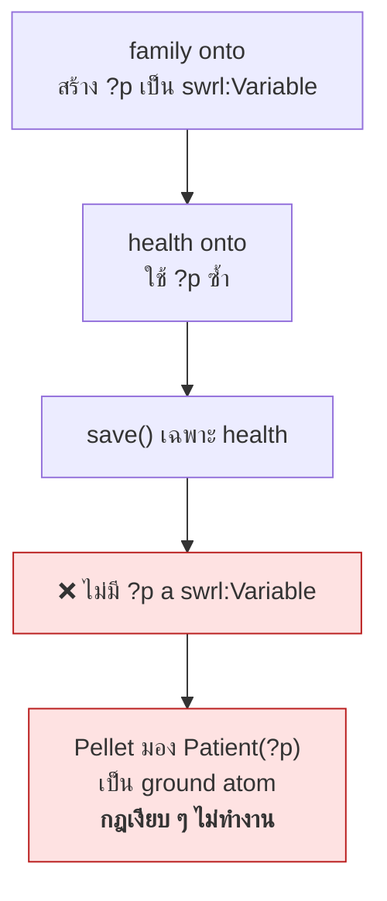
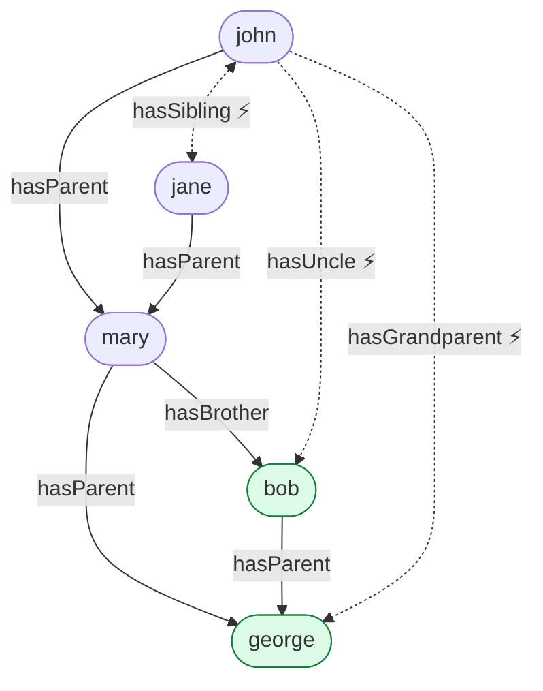
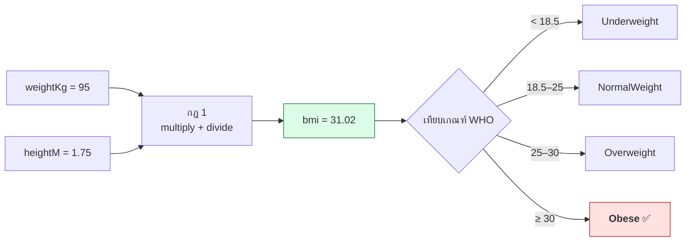
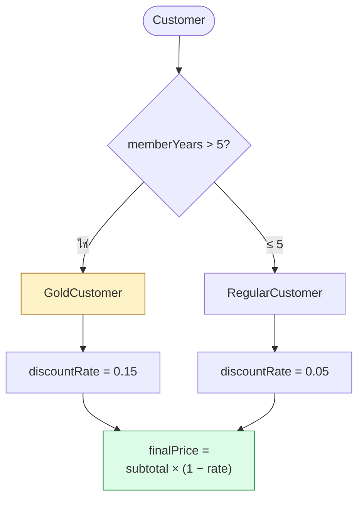
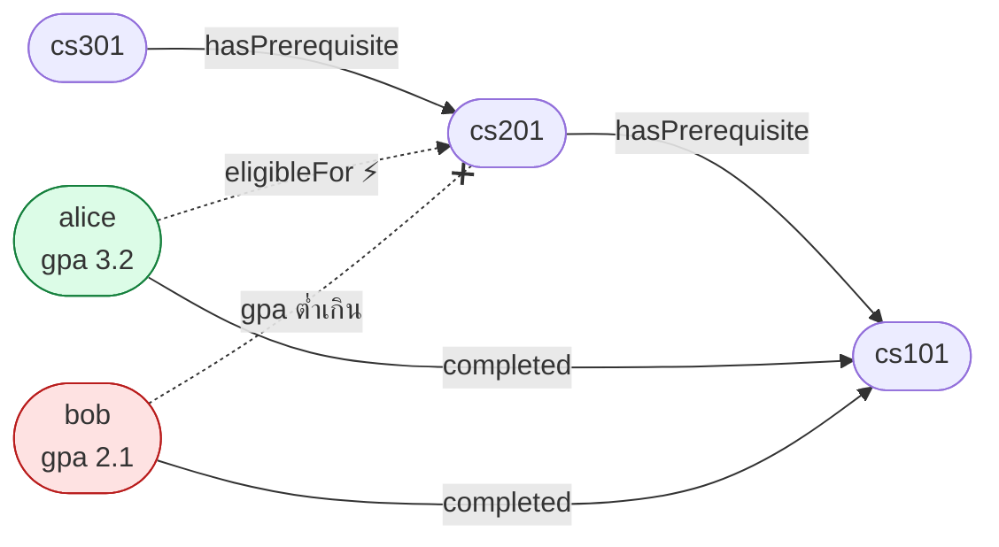
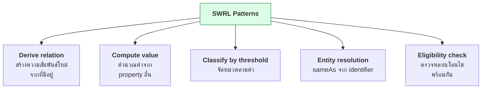

# 11.05 ตัวอย่าง SWRL Rule ที่ใช้งานจริง

บทนี้รวบรวม SWRL rule 4 ชุดที่ครอบคลุมรูปแบบการใช้งานส่วนใหญ่: **ความสัมพันธ์ในครอบครัว**, **คำนวณ BMI**, **เงื่อนไขส่วนลด** และ **วิชาบังคับก่อน**
ทุกตัวอย่างรันจริงและแสดงผลลัพธ์จริง

📄 โค้ดเต็ม: [`code/ch11/swrl_rules.py`](../code/ch11/swrl_rules.py) · [`code/ch11/pellet_runner.py`](../code/ch11/pellet_runner.py)

---

## ⚠️ กับดักที่ต้องรู้ก่อน: ตัวแปร SWRL ถูก reuse ข้าม ontology

```python
# ❌ ผิด: ทุก demo ใช้ default_world ร่วมกัน
onto1 = get_ontology("http://example.org/family#")
onto2 = get_ontology("http://example.org/health#")

# ✅ ถูก: แต่ละ demo มี World ของตัวเอง
onto1 = World().get_ontology("http://example.org/family#")
onto2 = World().get_ontology("http://example.org/health#")
```

**อธิบาย**: owlready2 เก็บตัวแปร SWRL (`?p`, `?x`, ...) เป็น individual ประเภท `swrl:Variable`
ถ้า ontology ที่สองใช้ชื่อตัวแปรซ้ำ owlready2 จะ **reuse ตัวแปรจาก ontology แรก**
เวลา `save()` เฉพาะ ontology ที่สอง ประกาศ `swrl:Variable` จะหายไป



> 🔥 **นี่คือ bug ที่หายากที่สุด** — ไม่มี error, ไม่มีคำเตือน, กฎแค่ไม่ทำงาน

---

## ตัวอย่าง 1: ความสัมพันธ์ในครอบครัว

**ใช้ HermiT ได้ เพราะไม่มี builtin**



```python
from owlready2 import (AllDifferent, Imp, ObjectProperty, Thing, World,
                       sync_reasoner_hermit)

onto = World().get_ontology("http://example.org/family#")

with onto:
    class Person(Thing):
        pass

    class Male(Person):
        pass

    class Female(Person):
        pass

    class hasParent(ObjectProperty):
        pass

    class hasBrother(ObjectProperty):
        pass

    class hasUncle(ObjectProperty):
        pass

    class hasSibling(ObjectProperty):
        pass

    class hasGrandparent(ObjectProperty):
        pass

    # ลุง = พี่ชายของพ่อแม่  (OWL ทำได้ด้วย propertyChainAxiom เช่นกัน)
    Imp().set_as_rule(
        "Person(?x), hasParent(?x, ?y), hasBrother(?y, ?z) -> hasUncle(?x, ?z)")

    # พี่น้อง = มีพ่อแม่คนเดียวกัน  (OWL ทำไม่ได้!)
    Imp().set_as_rule(
        "Person(?x), Person(?y), hasParent(?x, ?p), hasParent(?y, ?p), "
        "differentFrom(?x, ?y) -> hasSibling(?x, ?y)")

    # ปู่ย่าตายาย = พ่อแม่ของพ่อแม่
    Imp().set_as_rule(
        "hasParent(?x, ?y), hasParent(?y, ?z) -> hasGrandparent(?x, ?z)")

    # ----- ABox -----
    george, mary, bob = Male("george"), Female("mary"), Male("bob")
    john, jane = Male("john"), Female("jane")

    mary.hasParent = [george]
    bob.hasParent = [george]
    mary.hasBrother = [bob]
    john.hasParent = [mary]
    jane.hasParent = [mary]

    # ⚠️ จำเป็น -- ไม่มี UNA จึงต้องบอกว่าทุกคนเป็นคนละคน
    AllDifferent([george, mary, bob, john, jane])

sync_reasoner_hermit(onto.world, infer_property_values=True)

print(f"  john.hasUncle       = {[p.name for p in john.hasUncle]}")
print(f"  john.hasSibling     = {[p.name for p in john.hasSibling]}")
print(f"  john.hasGrandparent = {[p.name for p in john.hasGrandparent]}")
print(f"  mary.hasSibling     = {[p.name for p in mary.hasSibling]}")
```

Expected output:

```
* Owlready * Adding relation family.jane hasUncle family.bob
* Owlready * Adding relation family.john hasUncle family.bob
* Owlready * Adding relation family.bob hasSibling family.mary
* Owlready * Adding relation family.mary hasSibling family.bob
* Owlready * Adding relation family.jane hasSibling family.john
* Owlready * Adding relation family.john hasSibling family.jane
* Owlready * Adding relation family.jane hasGrandparent family.george
* Owlready * Adding relation family.john hasGrandparent family.george
  john.hasUncle       = ['bob']
  john.hasSibling     = ['jane']
  john.hasGrandparent = ['george']
  mary.hasSibling     = ['bob']
```

### เทียบกับ OWL

<table>
<tr><th width="50%">OWL ทำได้ (hasUncle)</th><th width="50%">OWL ทำไม่ได้ (hasSibling)</th></tr>
<tr valign="top">
<td>

```turtle
@prefix fam: <http://example.org/family#> .
@prefix owl: <http://www.w3.org/2002/07/owl#> .

fam:hasUncle owl:propertyChainAxiom
    ( fam:hasParent fam:hasBrother ) .
```

**เป็นสายโซ่ตรง ๆ**
`x → y → z` = รูปต้นไม้ ✅

</td>
<td>

```
# ต้องใช้ SWRL
hasParent(?x, ?p),
hasParent(?y, ?p),
differentFrom(?x, ?y)
    -> hasSibling(?x, ?y)
```

**มีวงจร** — `?x` และ `?y`
มาบรรจบที่ `?p` แล้วส่งกลับ ❌

</td>
</tr>
</table>

> 💡 **ถ้า OWL ทำได้ ให้ใช้ OWL** — เร็วกว่า, decidable แน่นอน, reasoner ทุกตัวรองรับ

---

## ตัวอย่าง 2: คำนวณ BMI และจัดหมวด

**ต้องใช้ Pellet เพราะมี builtin**



```python
from owlready2 import DataProperty, FunctionalProperty, Imp, Thing, World

from pellet_runner import parse_propvals, parse_realization, run_pellet

onto = World().get_ontology("http://example.org/health#")

with onto:
    class Patient(Thing):
        pass

    class Underweight(Patient):
        pass

    class NormalWeight(Patient):
        pass

    class Overweight(Patient):
        pass

    class Obese(Patient):
        pass

    class weightKg(DataProperty, FunctionalProperty):
        domain = [Patient]
        range = [float]

    class heightM(DataProperty, FunctionalProperty):
        domain = [Patient]
        range = [float]

    class bmi(DataProperty, FunctionalProperty):
        domain = [Patient]
        range = [float]

    # BMI = weight / height²
    Imp().set_as_rule(
        "Patient(?p), weightKg(?p, ?w), heightM(?p, ?h), "
        "multiply(?hh, ?h, ?h), divide(?b, ?w, ?hh) -> bmi(?p, ?b)")

    # จัดหมวดตามเกณฑ์ WHO
    Imp().set_as_rule("Patient(?p), bmi(?p, ?b), lessThan(?b, 18.5) -> Underweight(?p)")
    Imp().set_as_rule("Patient(?p), bmi(?p, ?b), greaterThanOrEqual(?b, 18.5), "
                      "lessThan(?b, 25.0) -> NormalWeight(?p)")
    Imp().set_as_rule("Patient(?p), bmi(?p, ?b), greaterThanOrEqual(?b, 25.0), "
                      "lessThan(?b, 30.0) -> Overweight(?p)")
    Imp().set_as_rule("Patient(?p), bmi(?p, ?b), greaterThanOrEqual(?b, 30.0) -> Obese(?p)")

    for name, w, h in [("john", 95.0, 1.75), ("mary", 55.0, 1.65),
                       ("sara", 45.0, 1.70), ("dave", 80.0, 1.72)]:
        p = Patient(name)
        p.weightKg, p.heightM = w, h

out = run_pellet(onto)
for cls, inds in parse_realization(out).items():
    print(f"    {cls:14s} → {inds}")
for subj, prop, val in sorted(parse_propvals(out)):
    if prop == "bmi":
        print(f"    {subj:6s} = {float(val):.2f}")
```

Expected output:

```
  Classification:
    NormalWeight   → ['mary']
    Obese          → ['john']
    Overweight     → ['dave']
    Underweight    → ['sara']

  Computed BMI:
    dave   = 27.04
    john   = 31.02
    mary   = 20.20
    sara   = 15.57
```

### 🔗 Rule Chaining เกิดขึ้นเอง

**กฎจัดหมวดใช้ `bmi` ที่กฎแรกสร้างขึ้น** — reasoner รันซ้ำจนไม่มีอะไรเปลี่ยน (**fixpoint**)
ไม่ต้องสั่งลำดับเอง

### ⚠️ ทำไมต้องแบ่งช่วงแบบมีขอบล่างและขอบบน

```
# ❌ ผิด: ไม่มีขอบล่าง -- john (31.02) จะถูกจัดเป็น NormalWeight ด้วย!
Patient(?p), bmi(?p, ?b), lessThan(?b, 25.0) -> NormalWeight(?p)

# ✅ ถูก: ระบุทั้งสองขอบ
Patient(?p), bmi(?p, ?b), greaterThanOrEqual(?b, 18.5),
    lessThan(?b, 25.0) -> NormalWeight(?p)
```

**SWRL ไม่มี else** — ทุกกฎทำงานอิสระ ต้องเขียนเงื่อนไขให้ครบทุกด้าน

---

## ตัวอย่าง 3: เงื่อนไขส่วนลด



```python
onto = World().get_ontology("http://example.org/shop#")

with onto:
    class Customer(Thing):
        pass

    class Order(Thing):
        pass

    class GoldCustomer(Customer):
        pass

    class RegularCustomer(Customer):
        pass

    class placedBy(ObjectProperty, FunctionalProperty):
        domain = [Order]
        range = [Customer]

    class subtotal(DataProperty, FunctionalProperty):
        domain = [Order]
        range = [float]

    class memberYears(DataProperty, FunctionalProperty):
        domain = [Customer]
        range = [int]

    class discountRate(DataProperty, FunctionalProperty):
        domain = [Order]
        range = [float]

    class finalPrice(DataProperty, FunctionalProperty):
        domain = [Order]
        range = [float]

    # ลูกค้าระดับ Gold = เป็นสมาชิกเกิน 5 ปี
    Imp().set_as_rule(
        "Customer(?c), memberYears(?c, ?y), greaterThan(?y, 5) -> GoldCustomer(?c)")

    # ⚠️ SWRL ไม่มี negation -- เขียน "ถ้าไม่ใช่ Gold" ไม่ได้
    #    ต้องนิยาม RegularCustomer ด้วยเงื่อนไขบวกแทน
    Imp().set_as_rule(
        "Customer(?c), memberYears(?c, ?y), lessThanOrEqual(?y, 5) "
        "-> RegularCustomer(?c)")

    Imp().set_as_rule(
        "Order(?o), placedBy(?o, ?c), GoldCustomer(?c), subtotal(?o, ?s), "
        "greaterThan(?s, 1000.0) -> discountRate(?o, 0.15)")

    Imp().set_as_rule(
        "Order(?o), placedBy(?o, ?c), RegularCustomer(?c), subtotal(?o, ?s), "
        "greaterThan(?s, 1000.0) -> discountRate(?o, 0.05)")

    # ราคาสุทธิ = subtotal × (1 − rate)
    Imp().set_as_rule(
        "Order(?o), subtotal(?o, ?s), discountRate(?o, ?r), "
        "subtract(?keep, 1.0, ?r), multiply(?f, ?s, ?keep) -> finalPrice(?o, ?f)")

    alice = Customer("alice")
    alice.memberYears = 7
    bob = Customer("bob")
    bob.memberYears = 2

    o1 = Order("order001")
    o1.placedBy, o1.subtotal = alice, 1500.0
    o2 = Order("order002")
    o2.placedBy, o2.subtotal = bob, 1500.0
```

Expected output:

```
  Classification:
    GoldCustomer   → ['alice']
    RegularCustomer → ['bob']
    Order          → ['order002', 'order001']

  Order values:
    order001   discountRate  = 0.15
    order001   finalPrice    = 1275.00
    order002   discountRate  = 0.05
    order002   finalPrice    = 1425.00
```

### 🔥 บทเรียน: SWRL ไม่มี "else"

```
# ❌ อยากเขียนแบบนี้ -- ทำไม่ได้!
Customer(?c), NOT GoldCustomer(?c) -> RegularCustomer(?c)

# ✅ ต้องเขียนเงื่อนไขบวกที่ครอบคลุมทุกกรณี
Customer(?c), memberYears(?c, ?y), greaterThan(?y, 5)      -> GoldCustomer(?c)
Customer(?c), memberYears(?c, ?y), lessThanOrEqual(?y, 5)  -> RegularCustomer(?c)
```

**เหตุผลเชิงลึก**: OWL ใช้ **Open World Assumption** — "ยังไม่รู้ว่าเป็น Gold" ≠ "ไม่ใช่ Gold"
ถ้าอนุญาต negation กฎจะให้ผลต่างกันเมื่อเพิ่มข้อมูลใหม่ ทำลาย **monotonicity**

---

## ตัวอย่าง 4: วิชาบังคับก่อน



```python
onto = World().get_ontology("http://example.org/uni#")

with onto:
    class Student(Thing):
        pass

    class Course(Thing):
        pass

    class EligibleStudent(Student):
        pass

    class hasPrerequisite(ObjectProperty):
        domain = [Course]
        range = [Course]

    class completed(ObjectProperty):
        domain = [Student]
        range = [Course]

    class eligibleFor(ObjectProperty):
        domain = [Student]
        range = [Course]

    class gpa(DataProperty, FunctionalProperty):
        domain = [Student]
        range = [float]

    # เรียนวิชาบังคับก่อนหน้าครบ + GPA ≥ 2.5 → ลงทะเบียนได้
    Imp().set_as_rule(
        "Student(?s), Course(?c), hasPrerequisite(?c, ?pre), completed(?s, ?pre), "
        "gpa(?s, ?g), greaterThanOrEqual(?g, 2.5) -> eligibleFor(?s, ?c), "
        "EligibleStudent(?s)")

    cs101, cs201, cs301 = Course("cs101"), Course("cs201"), Course("cs301")
    cs201.hasPrerequisite = [cs101]
    cs301.hasPrerequisite = [cs201]

    alice = Student("alice")
    alice.completed, alice.gpa = [cs101], 3.2

    bob = Student("bob")
    bob.completed, bob.gpa = [cs101], 2.1

    AllDifferent([cs101, cs201, cs301, alice, bob])
```

Expected output:

```
  Classification:
    Course           → ['cs201', 'cs301', 'cs101']
    Student          → ['bob']
    EligibleStudent  → ['alice']

  eligibleFor:
    alice    → cs201
```

### ⚠️ ข้อจำกัดสำคัญ: กฎนี้ไม่ตรวจว่าเรียน prerequisite **ครบทุกวิชา**

```
# กฎปัจจุบัน: "มี prerequisite อย่างน้อยหนึ่งวิชาที่เรียนแล้ว"
hasPrerequisite(?c, ?pre), completed(?s, ?pre) -> eligibleFor(?s, ?c)
```

ถ้า `cs401` ต้องการทั้ง `cs201` และ `cs301` แต่ alice เรียนแค่ `cs201` → **กฎจะบอกว่าลงได้** ❌

**SWRL ตรวจ "ครบทุกวิชา" ไม่ได้** เพราะต้องใช้ **universal quantification** ซึ่ง SWRL ไม่มี

| ทางเลือก | วิธี |
| --- | --- |
| **OWL** | `Course ⊑ ∀hasPrerequisite.CompletedCourse` + closure axiom |
| **SPARQL** | `FILTER NOT EXISTS { ?c :hasPrerequisite ?p . FILTER NOT EXISTS { ?s :completed ?p } }` |
| **SHACL** | `sh:qualifiedMinCount` เทียบกับจำนวน prerequisite |

---

## 📊 ตารางสรุปตัวอย่างทั้ง 4

| ตัวอย่าง | Reasoner | Builtin | บทเรียนหลัก |
| --- | --- | --- | --- |
| **Family** | HermiT | ❌ | `hasSibling` เป็นสิ่งที่ OWL ทำไม่ได้ แต่ `hasUncle` ทำได้ด้วย property chain |
| **BMI** | Pellet | ✅ | rule chaining ทำงานเอง; ต้องระบุทั้งขอบบนและขอบล่าง |
| **Discount** | Pellet | ✅ | ไม่มี else — ต้องเขียนเงื่อนไขบวกให้ครอบคลุม |
| **Prerequisite** | Pellet | ✅ | SWRL ตรวจ "ครบทุกอัน" ไม่ได้ (ไม่มี universal quantification) |

---

## 🎯 Pattern ที่ใช้บ่อย



| Pattern | โครงสร้าง |
| --- | --- |
| **Derive relation** | `p1(?x,?y), p2(?y,?z) -> p3(?x,?z)` |
| **Compute value** | `C(?x), p1(?x,?a), builtin(?r,?a,...) -> p2(?x,?r)` |
| **Classify by threshold** | `C(?x), p(?x,?v), greaterThan(?v, k) -> SubClass(?x)` |
| **Entity resolution** | `C(?x), C(?y), id(?x,?i), id(?y,?i), differentFrom(?x,?y) -> sameAs(?x,?y)` |
| **Eligibility check** | `A(?x), B(?y), r1(?x,?y), p(?x,?v), cmp(?v,k) -> eligible(?x,?y)` |

---

## Key Points

- ⚠️ **ใช้ `World()` แยกต่อ ontology** — ไม่งั้นตัวแปร SWRL ถูก reuse ข้าม ontology และกฎจะเงียบ ๆ ไม่ทำงาน
- **`hasUncle` ทำได้ด้วย `owl:propertyChainAxiom`** — ถ้า OWL ทำได้ อย่าใช้ SWRL
- **`hasSibling` เป็นตัวอย่างคลาสสิกที่ OWL ทำไม่ได้** — มีวงจร ทำลาย tree model property
- ⚠️ **ต้องใช้ `differentFrom` + `AllDifferent`** ในกฎ sibling ไม่งั้นทุกคนเป็นพี่น้องของตัวเอง
- **Rule chaining ทำงานอัตโนมัติ** — กฎที่ใช้ผลของกฎอื่นไม่ต้องสั่งลำดับเอง reasoner รันจนถึง fixpoint
- ⚠️ **SWRL ไม่มี else** — ต้องระบุทั้งขอบบนและขอบล่างของทุกช่วง
- ⚠️ **SWRL ไม่มี negation** — เขียน `NOT GoldCustomer(?c)` ไม่ได้ ต้องนิยาม `RegularCustomer` ด้วยเงื่อนไขบวก
- ⚠️ **SWRL ตรวจ "ครบทุกอัน" ไม่ได้** — ไม่มี universal quantification ต้องใช้ OWL `allValuesFrom`, SPARQL หรือ SHACL
- **Pattern หลัก 5 แบบ**: derive relation, compute value, classify by threshold, entity resolution, eligibility check
