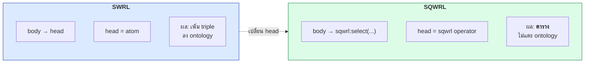
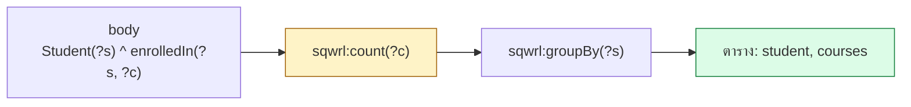
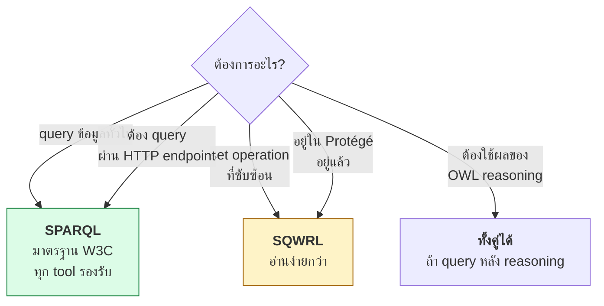
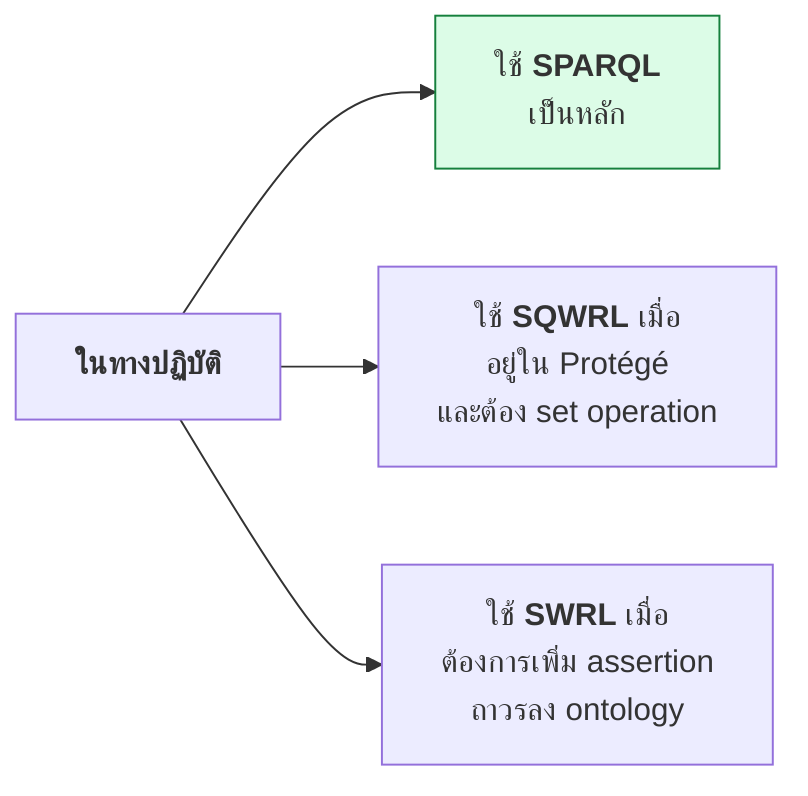
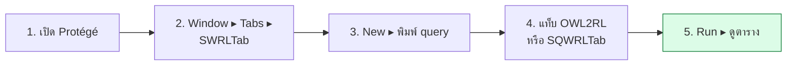

# 11.06 SQWRL

**SQWRL (Semantic Query-Enhanced Web Rule Language)** คือส่วนขยายของ SWRL ที่เปลี่ยน rule ให้กลายเป็น **query** — head ไม่ได้เพิ่ม assertion แต่คืนตารางผลลัพธ์แทน
บทนี้อธิบาย syntax ของ SQWRL เทียบกับ SPARQL และบอกว่าเมื่อไหร่ควรใช้อันไหน

📄 โค้ดเต็ม: [`code/ch11/sqwrl_query.py`](../code/ch11/sqwrl_query.py)

---

## SWRL vs SQWRL



```
# SWRL: เพิ่ม assertion
Student(?s) ^ gpa(?s, ?g) ^ swrlb:greaterThan(?g, 3.5) -> HonorStudent(?s)

# SQWRL: คืนตาราง
Student(?s) ^ gpa(?s, ?g) ^ swrlb:greaterThan(?g, 3.5) -> sqwrl:select(?s, ?g)
```

> ⚠️ **SQWRL รันได้เฉพาะบน SWRLAPI** (Protégé SWRLTab หรือ Java)
> **Pellet CLI และ owlready2 ไม่รองรับ `sqwrl:` built-in** — ในคอร์สนี้จึงแสดง SQWRL syntax
> คู่กับ SPARQL ที่ให้ผลเดียวกันเพื่อยืนยันผลลัพธ์จริง

---

## ข้อมูลตัวอย่าง

```turtle
@prefix uni:  <http://example.org/university#> .
@prefix rdfs: <http://www.w3.org/2000/01/rdf-schema#> .

uni:alice a uni:Student ; rdfs:label "Alice"@en ;
    uni:gpa 3.80 ; uni:enrolledIn uni:cs501 , uni:cs502 , uni:cs503 ;
    uni:memberOf uni:csDept .
uni:bob a uni:Student ; rdfs:label "Bob"@en ;
    uni:gpa 2.10 ; uni:enrolledIn uni:cs501 ;
    uni:memberOf uni:csDept .
uni:carol a uni:Student ; rdfs:label "Carol"@en ;
    uni:gpa 3.20 ; uni:enrolledIn uni:cs501 , uni:cs502 ;
    uni:memberOf uni:mathDept .
uni:dave a uni:Student ; rdfs:label "Dave"@en ;
    uni:gpa 2.90 ; uni:enrolledIn uni:cs502 ;
    uni:memberOf uni:mathDept .
```

---

## 1. `sqwrl:select` และการเรียงลำดับ

<table>
<tr><th width="50%">SQWRL</th><th width="50%">SPARQL เทียบเท่า</th></tr>
<tr valign="top">
<td>

```
Student(?s) ^ gpa(?s, ?g)
    -> sqwrl:select(?s, ?g)
       ^ sqwrl:orderByDescending(?g)
```

</td>
<td>

```sparql
PREFIX uni: <http://example.org/university#>

SELECT ?s ?g WHERE {
  ?s a uni:Student ; uni:gpa ?g .
}
ORDER BY DESC(?g)
```

</td>
</tr>
</table>

ผลลัพธ์

```
             alice                3.80
             carol                3.20
              dave                2.90
               bob                2.10
```

| SQWRL | SPARQL |
| --- | --- |
| `sqwrl:select(?a, ?b)` | `SELECT ?a ?b` |
| `sqwrl:selectDistinct(?a)` | `SELECT DISTINCT ?a` |
| `sqwrl:orderBy(?g)` | `ORDER BY ?g` |
| `sqwrl:orderByDescending(?g)` | `ORDER BY DESC(?g)` |
| `sqwrl:limit(2)` | `LIMIT 2` |
| `sqwrl:columnNames("a", "b")` | ตั้งชื่อคอลัมน์ (ไม่มีใน SPARQL) |

---

## 2. กรองด้วย builtin

<table>
<tr><th width="50%">SQWRL</th><th width="50%">SPARQL</th></tr>
<tr valign="top">
<td>

```
Student(?s) ^ gpa(?s, ?g)
    ^ swrlb:greaterThan(?g, 3.0)
    -> sqwrl:select(?s, ?g)
```

</td>
<td>

```sparql
PREFIX uni: <http://example.org/university#>

SELECT ?s ?g WHERE {
  ?s a uni:Student ; uni:gpa ?g .
  FILTER(?g > 3.0)
}
```

</td>
</tr>
</table>

```
             alice                3.80
             carol                3.20
```

> 💡 **`swrlb:` builtin ใช้ใน body ได้เหมือนเดิม** — SQWRL เปลี่ยนแค่ head

---

## 3. Aggregate ⭐

**นี่คือเหตุผลหลักที่ SQWRL มีอยู่ — SWRL ล้วนทำ aggregate ไม่ได้เลย**



<table>
<tr><th width="50%">SQWRL</th><th width="50%">SPARQL</th></tr>
<tr valign="top">
<td>

```
Student(?s) ^ enrolledIn(?s, ?c)
    -> sqwrl:count(?c)
       ^ sqwrl:groupBy(?s)
       ^ sqwrl:columnNames("student", "courses")
```

</td>
<td>

```sparql
PREFIX uni: <http://example.org/university#>

SELECT ?s (COUNT(?c) AS ?courses) WHERE {
  ?s uni:enrolledIn ?c .
}
GROUP BY ?s
ORDER BY DESC(?courses)
```

</td>
</tr>
</table>

```
             alice                   3
             carol                   2
               bob                   1
              dave                   1
```

### ค่าเฉลี่ยต่อกลุ่ม

<table>
<tr><th width="50%">SQWRL</th><th width="50%">SPARQL</th></tr>
<tr valign="top">
<td>

```
Student(?s) ^ memberOf(?s, ?d)
    ^ gpa(?s, ?g)
    -> sqwrl:avg(?g)
       ^ sqwrl:groupBy(?d)
```

</td>
<td>

```sparql
PREFIX uni: <http://example.org/university#>

SELECT ?d (AVG(?g) AS ?avgGpa) WHERE {
  ?s a uni:Student ;
     uni:memberOf ?d ;
     uni:gpa ?g .
}
GROUP BY ?d
```

</td>
</tr>
</table>

```
            csDept                2.95
          mathDept                3.05
```

### ตาราง aggregate

| SQWRL | SPARQL | ความหมาย |
| --- | --- | --- |
| `sqwrl:count(?x)` | `COUNT(?x)` | นับ |
| `sqwrl:countDistinct(?x)` | `COUNT(DISTINCT ?x)` | นับไม่ซ้ำ |
| `sqwrl:sum(?x)` | `SUM(?x)` | ผลรวม |
| `sqwrl:avg(?x)` | `AVG(?x)` | ค่าเฉลี่ย |
| `sqwrl:min(?x)` | `MIN(?x)` | ค่าน้อยสุด |
| `sqwrl:max(?x)` | `MAX(?x)` | ค่ามากสุด |
| `sqwrl:median(?x)` | ❌ ไม่มี | มัธยฐาน |
| `sqwrl:groupBy(?g)` | `GROUP BY ?g` | จัดกลุ่ม |

> 💡 **`sqwrl:median` ไม่มีใน SPARQL 1.1** — ต้องเขียนด้วย subquery ที่ซับซ้อน

---

## 4. Set Operations

**SQWRL มี set operation ที่ SPARQL ไม่มีโดยตรง**

```
Student(?s) ^ enrolledIn(?s, ?c)
    -> sqwrl:makeSet(?set, ?c)
       ^ sqwrl:groupBy(?set, ?s)
       ^ sqwrl:size(?n, ?set)
       ^ sqwrl:select(?s, ?n)
```

| Operation | ความหมาย |
| --- | --- |
| `sqwrl:makeSet(?set, ?x)` | สร้างเซตจากค่า `?x` |
| `sqwrl:makeBag(?bag, ?x)` | สร้าง multiset (มีค่าซ้ำได้) |
| `sqwrl:size(?n, ?set)` | ขนาดของเซต |
| `sqwrl:element(?x, ?set)` | `?x` เป็นสมาชิกไหม |
| `sqwrl:notElement(?x, ?set)` | ไม่เป็นสมาชิก |
| `sqwrl:intersection(?r, ?s1, ?s2)` | เซตร่วม |
| `sqwrl:union(?r, ?s1, ?s2)` | เซตรวม |
| `sqwrl:difference(?r, ?s1, ?s2)` | ผลต่างเซต |
| `sqwrl:contains(?s1, ?s2)` | `?s1 ⊇ ?s2` |
| `sqwrl:equal(?s1, ?s2)` | เซตเท่ากัน |

### 🎯 ตัวอย่างที่ SQWRL ชนะ SPARQL ชัดเจน

**"นักศึกษาที่ลงวิชาครบทุกวิชาที่ภาควิชากำหนด"**

<table>
<tr><th width="48%">SQWRL — อ่านง่าย</th><th width="52%">SPARQL — ต้องใช้ double negation</th></tr>
<tr valign="top">
<td>

```
Student(?s) ^ memberOf(?s, ?d)
  ^ requiredCourse(?d, ?rc)
  ^ enrolledIn(?s, ?ec)
  -> sqwrl:makeSet(?req, ?rc)
     ^ sqwrl:makeSet(?enr, ?ec)
     ^ sqwrl:groupBy(?req, ?d)
     ^ sqwrl:groupBy(?enr, ?s)
     ^ sqwrl:contains(?enr, ?req)
     ^ sqwrl:select(?s)
```

</td>
<td>

```sparql
PREFIX uni: <http://example.org/university#>

SELECT ?s WHERE {
  ?s a uni:Student ; uni:memberOf ?d .
  FILTER NOT EXISTS {
    ?d uni:requiredCourse ?rc .
    FILTER NOT EXISTS {
      ?s uni:enrolledIn ?rc .
    }
  }
}
```

</td>
</tr>
</table>

> 💡 **double negation ใน SPARQL คือรูปแบบที่คนอ่านผิดบ่อยที่สุด** — SQWRL `contains` อ่านตรงไปตรงมากว่ามาก

---

## 5. เปรียบเทียบ SQWRL กับ SPARQL



| ประเด็น | SQWRL | SPARQL |
| --- | --- | --- |
| **มาตรฐาน** | ❌ ไม่ใช่ W3C | ✅ W3C Recommendation |
| **การรองรับ** | Protégé SWRLTab, SWRLAPI | ทุก triple store |
| **HTTP endpoint** | ❌ | ✅ |
| **Federation** | ❌ | ✅ `SERVICE` |
| **Aggregate** | ✅ + `median` | ✅ (ไม่มี median) |
| **Set operation** | ✅ ครบ | ⚠️ ต้องเลี่ยงด้วย double negation |
| **Property path** | ❌ | ✅ `*` `+` `?` `^` |
| **UPDATE ข้อมูล** | ❌ | ✅ SPARQL Update |
| **ใช้ผล reasoning** | ✅ อัตโนมัติ | ⚠️ ต้อง materialize ก่อน |
| **ทำงานบน named graph** | ❌ | ✅ |
| **เขียนใน Python** | ❌ ไม่มี library | ✅ rdflib, SPARQLWrapper |

---

## 🎓 ข้อสรุปเชิงปฏิบัติ



| สถานการณ์ | เลือก |
| --- | --- |
| สร้าง API / endpoint | **SPARQL** |
| ทำงานใน Python | **SPARQL** (rdflib) |
| ตรวจ ontology ตอนออกแบบใน Protégé | **SQWRL** |
| ต้องการ set operation ที่อ่านง่าย | **SQWRL** |
| ต้องการเพิ่ม assertion ถาวร | **SWRL** |
| ต้องการ federation ข้าม endpoint | **SPARQL** `SERVICE` |

---

## 🖥️ ใช้ SQWRL ใน Protégé



> ⚠️ **SWRLTab ต้องติดตั้ง plugin แยก** — `File ▸ Check for plugins ▸ SWRLTab`
> และต้องเลือก rule engine (Drools) ก่อนรัน

---

## Key Points

- **SQWRL = SWRL ที่เปลี่ยน head เป็น query operator** — คืนตารางแทนการเพิ่ม triple
- ⚠️ **SQWRL รันได้เฉพาะบน SWRLAPI** (Protégé SWRLTab / Java) — **Pellet CLI และ owlready2 ไม่รองรับ**
- **`sqwrl:select`** = `SELECT`, **`sqwrl:orderByDescending`** = `ORDER BY DESC`, **`sqwrl:limit`** = `LIMIT`
- **เหตุผลหลักที่ SQWRL มีอยู่คือ aggregate** — SWRL ล้วนทำ `COUNT`/`SUM`/`AVG` ไม่ได้เลย
- **SQWRL มี `sqwrl:median`** ซึ่ง SPARQL 1.1 ไม่มี
- **Set operation ของ SQWRL อ่านง่ายกว่า SPARQL มาก** — `sqwrl:contains` แทน **double negation**
- ⚠️ SQWRL **ไม่ใช่มาตรฐาน W3C**, ไม่มี HTTP endpoint, ไม่มี federation, ไม่มี property path
- **ในทางปฏิบัติใช้ SPARQL เป็นหลัก** — SQWRL เหมาะกับการตรวจ ontology ตอนออกแบบใน Protégé
- ใช้ **SWRL** เมื่อต้องการเพิ่ม assertion **ถาวร**, ใช้ **SQWRL/SPARQL** เมื่อแค่ต้องการ **อ่าน**
