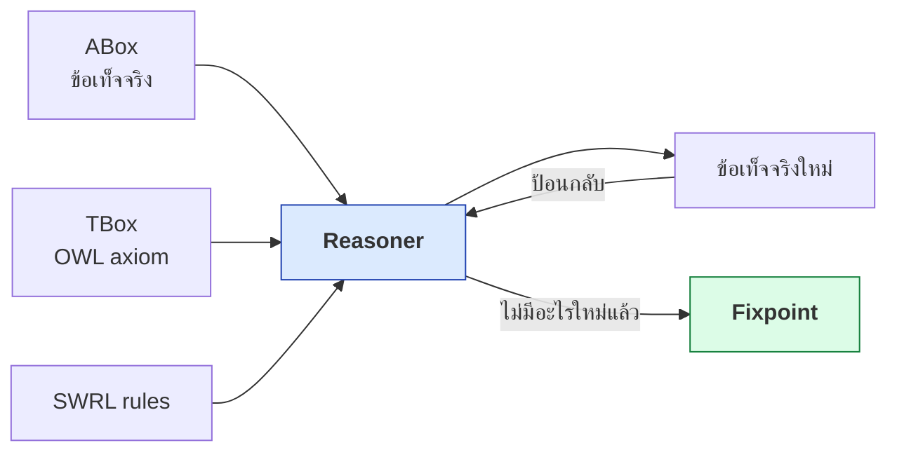
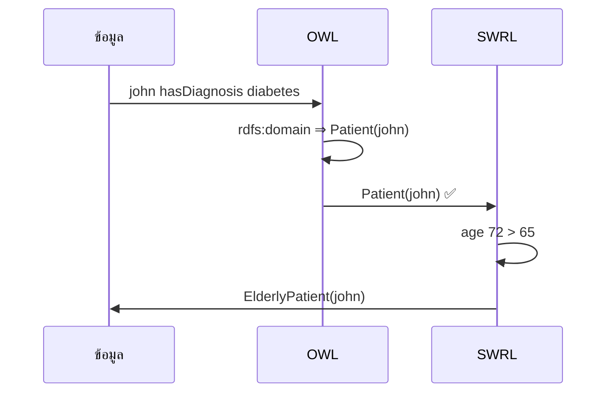
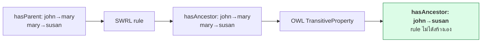
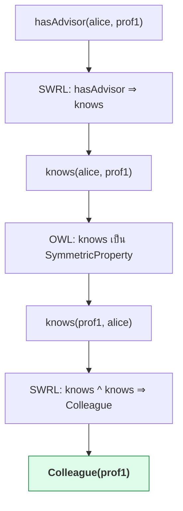
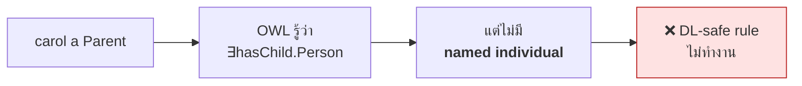
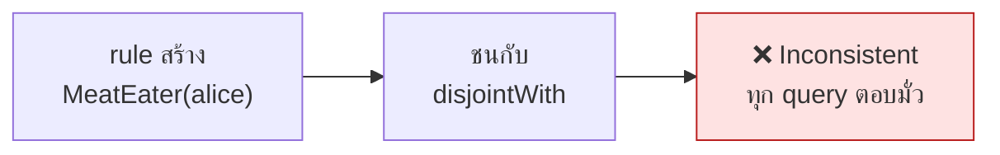
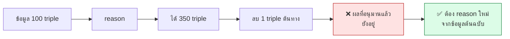
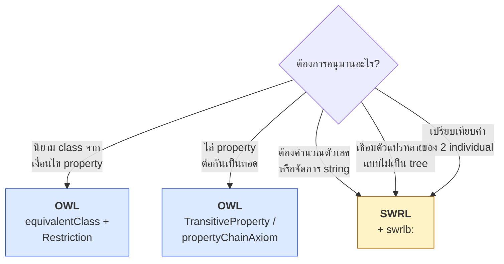

# 11.07 SWRL ทำงานร่วมกับ OWL อย่างไร

SWRL rule ไม่ได้ทำงานแยกจาก OWL แต่ถูกประมวลผล**พร้อมกัน**ในเครื่อง reasoner เดียว ทำให้ผลของ OWL axiom กลายเป็น input ของ rule และผลของ rule ก็ป้อนกลับเข้าไปให้ OWL อนุมานต่อได้
บทนี้อธิบายวงจรการทำงานร่วมกันนี้ พร้อมกับดักที่พบบ่อยที่สุด

📄 โค้ดประกอบ: [`code/ch11/swrl_owl_loop.py`](../code/ch11/swrl_owl_loop.py)

---

## วงจรการอนุมานร่วม



reasoner จะวนซ้ำจนกว่าจะถึง **fixpoint** — คือรอบที่ไม่มี triple ใหม่เกิดขึ้นอีก ไม่มีการแบ่งว่า "รัน OWL ก่อนแล้วค่อยรัน rule" ทั้งสองอย่างทำงานสลับกันไปมาในรอบเดียวกัน

---

## กรณีที่ 1 — OWL ป้อนให้ SWRL

OWL อนุมาน type ให้ก่อน แล้ว rule จึงจับได้

```turtle
# --- รูปแบบเต็ม ---
@prefix owl:  <http://www.w3.org/2002/07/owl#> .
@prefix rdf:  <http://www.w3.org/1999/02/22-rdf-syntax-ns#> .
@prefix rdfs: <http://www.w3.org/2000/01/rdf-schema#> .
@prefix ex:   <http://example.org/med#> .

ex:hasDiagnosis rdf:type owl:ObjectProperty ;
    rdfs:domain ex:Patient .           # ⬅️ OWL จะอนุมาน type ให้

ex:john ex:hasDiagnosis ex:diabetes .  # john ไม่ได้ประกาศเป็น Patient
```

```turtle
# --- รูปแบบย่อ (shorthand) ---
@prefix ex: <http://example.org/med#> .

ex:hasDiagnosis a owl:ObjectProperty ;
    rdfs:domain ex:Patient .

ex:john ex:hasDiagnosis ex:diabetes .
```

กฎที่อาศัยผลของ OWL

```
Patient(?p) ^ hasAge(?p, ?a) ^ swrlb:greaterThan(?a, 65)
    -> ElderlyPatient(?p)
```



ผลจริงจากโปรแกรม

```
[กรณี 1] OWL → SWRL
  Patient        : []
  ElderlyPatient : ['john']
  ⚠️ Pellet realize รายงานเฉพาะ class ที่เจาะจงที่สุด
     john อยู่ใต้ ElderlyPatient ⊑ Patient จึงเป็น Patient ด้วย
     → rule ทำงานได้ก็เพราะ rdfs:domain อนุมาน Patient(john) ให้ก่อน
```

> 💡 **จุดสำคัญ:** ถ้าไม่มี OWL คอยอนุมาน `Patient(john)` ให้ก่อน กฎนี้จะไม่ทำงานเลย
> เพราะ `john` ไม่เคยถูกประกาศเป็น `Patient` ตรง ๆ
>
> ⚠️ อย่าตกใจที่บรรทัด `Patient` ว่างเปล่า — คำสั่ง `realize` ของ Pellet
> รายงานเฉพาะ **class ที่เจาะจงที่สุด** ของแต่ละ individual
> `john` ปรากฏใต้ `ElderlyPatient` ซึ่งเป็น subclass ของ `Patient` อยู่แล้ว

---

## กรณีที่ 2 — SWRL ป้อนให้ OWL

rule สร้าง property assertion แล้ว OWL ใช้ property characteristic ต่อ

```turtle
# --- รูปแบบเต็ม ---
ex:hasAncestor rdf:type owl:ObjectProperty ,
                        owl:TransitiveProperty .   # ⬅️ OWL จะไล่ต่อให้
```

```turtle
# --- รูปแบบย่อ ---
ex:hasAncestor a owl:ObjectProperty , owl:TransitiveProperty .
```

```
hasParent(?x, ?y) -> hasAncestor(?x, ?y)
```



ผลจริงจากโปรแกรม

```
[กรณี 2] SWRL → OWL
  john hasAncestor : ['mary', 'susan']
```

> ✅ `john hasAncestor susan` **ไม่มีกฎไหนสร้าง** — เกิดจาก OWL `owl:TransitiveProperty`
> ที่ทำงานต่อจากผลของ rule

---

## กรณีที่ 3 — วนกลับไปกลับมา



ผลจริงจากโปรแกรม

```
[กรณี 3] วนกลับไปกลับมา
  alice knows : ['prof1']
  prof1 knows : ['alice']    ⬅️ OWL SymmetricProperty
  Colleague   : ['alice', 'prof1']
```

---

## ตารางสรุปการทำงานร่วม

| OWL construct | ทำงานร่วมกับ SWRL อย่างไร |
| --- | --- |
| `rdfs:subClassOf` | class ใน body จับ subclass ได้อัตโนมัติ |
| `rdfs:domain` / `rdfs:range` | สร้าง type ให้ ทำให้ class atom จับได้ |
| `owl:TransitiveProperty` | ไล่ต่อจาก property ที่ rule สร้าง |
| `owl:SymmetricProperty` | เติมทิศทางกลับให้ property ที่ rule สร้าง |
| `owl:inverseOf` | rule เขียนทางเดียว OWL เติมอีกทางให้ |
| `owl:equivalentClass` | class atom จับได้ทั้งสองฝั่ง |
| `owl:sameAs` | ⚠️ ผูกกับ **DL-safe** ดูหัวข้อถัดไป |
| `owl:FunctionalProperty` | ⚠️ อาจทำให้เกิด `sameAs` โดยไม่ตั้งใจ |
| `owl:disjointWith` | ถ้า rule สร้างผลขัดแย้ง → **ontology inconsistent** |

---

## ⚠️ กับดักที่ 1 — DL-safe จำกัดขอบเขต rule

reasoner ส่วนใหญ่บังคับใช้ **DL-safe rules** คือตัวแปรทุกตัวต้อง bind กับ **named individual** ที่ปรากฏใน ABox เท่านั้น ไม่ผูกกับ individual ที่ OWL "รู้ว่ามีอยู่" แต่ไม่มีชื่อ

```turtle
# --- รูปแบบเต็ม ---
ex:Parent rdf:type owl:Class ;
    rdfs:subClassOf [
        rdf:type owl:Restriction ;
        owl:onProperty ex:hasChild ;
        owl:someValuesFrom ex:Person
    ] .

ex:carol rdf:type ex:Parent .   # รู้ว่า carol มีลูก แต่ไม่รู้ว่าใคร
```

```turtle
# --- รูปแบบย่อ ---
ex:Parent a owl:Class ;
    rdfs:subClassOf [ a owl:Restriction ;
                      owl:onProperty ex:hasChild ;
                      owl:someValuesFrom ex:Person ] .

ex:carol a ex:Parent .
```

```
hasChild(?x, ?y) -> HasDescendant(?x)
```



ผลจริงจากโปรแกรม

```
[กรณี 4] DL-safe
  carol เป็น Parent (มีลูกแน่ ๆ แต่ไม่รู้ว่าใคร)
  HasDescendant : []          ⬅️ ว่างเปล่า! rule ไม่ทำงาน
  ถ้าเพิ่ม hasChild(carol, kid1) ที่มีชื่อจริง :
  HasDescendant : ['carol']   ⬅️ ทำงานทันที
```

> 🎯 **บทเรียน:** SWRL ทำงานกับสิ่งที่ **มีชื่อ** เท่านั้น
> ส่วน OWL อนุมานกับสิ่งที่ **มีอยู่** แม้จะไม่มีชื่อ — นี่คือความต่างที่สำคัญที่สุด

---

## ⚠️ กับดักที่ 2 — Open World Assumption ยังใช้อยู่

SWRL **ไม่ได้** เปลี่ยน OWL จาก Open World เป็น Closed World

```
Student(?s) ^ hasGrade(?s, ?g) ^ swrlb:lessThan(?g, 2.0) -> ProbationStudent(?s)
```

ถ้า `bob` ไม่มี `hasGrade` เลย → กฎไม่ทำงาน และ **ไม่ได้แปลว่า `bob` เกรดดี** แต่แปลว่า "ไม่รู้"

| ต้องการ | เครื่องมือที่ถูก |
| --- | --- |
| "ถ้าไม่มีข้อมูลให้ถือว่าผิด" | **SHACL** |
| "ถ้าไม่มีข้อมูลให้ถือว่าไม่รู้" | **OWL + SWRL** |
| "นับจำนวนแล้วเทียบ" | **SPARQL** |

---

## ⚠️ กับดักที่ 3 — rule ทำให้ ontology inconsistent

```turtle
# --- รูปแบบย่อ ---
ex:Vegetarian owl:disjointWith ex:MeatEater .
```

```
eats(?p, ?f) ^ Meat(?f) -> MeatEater(?p)
```

ถ้า `alice` ถูกประกาศเป็น `Vegetarian` แต่ข้อมูลบอกว่า `alice eats bacon` และ `bacon a Meat`
→ rule สร้าง `MeatEater(alice)` → ชนกับ `owl:disjointWith` → **ontology inconsistent**

ผลจริงจากโปรแกรม

```
[กรณี 5] rule ทำให้ inconsistent
  ✅ ตรวจพบ inconsistency ตามคาด
     OwlReadyInconsistentOntologyError
```



> ⚠️ เมื่อ ontology inconsistent **ทุกอย่างเป็นจริงหมด** (ex falso quodlibet)
> reasoner จะตอบทุกคำถามว่า "ใช่" — จึงต้องเช็ค consistency ก่อน query เสมอ

---

## ⚠️ กับดักที่ 4 — Non-monotonic ไม่มีใน SWRL

**เพิ่ม** ข้อมูลได้ผลเพิ่ม แต่ **ลบ** ข้อมูลออกไม่ทำให้ผลที่อนุมานแล้วหายไป (ถ้าไม่รันใหม่)



**วิธีปฏิบัติที่ถูก:** เก็บ **asserted graph** กับ **inferred graph** แยกกัน แล้วทิ้ง inferred ทั้งก้อนทุกครั้งที่ข้อมูลเปลี่ยน

---

## เลือกใช้ OWL หรือ SWRL



**หลักง่าย ๆ:** ถ้า OWL ทำได้ ให้ใช้ OWL ก่อนเสมอ เพราะเร็วกว่า มี tool รองรับมากกว่า และยังอยู่ในขอบเขตที่ decidable

---

## ตัวอย่างที่ OWL ทำแทน SWRL ได้

| SWRL rule | OWL ที่เทียบเท่า (ดีกว่า) |
| --- | --- |
| `hasParent(?x,?y) ^ hasBrother(?y,?z) -> hasUncle(?x,?z)` | `owl:propertyChainAxiom (hasParent hasBrother)` |
| `hasChild(?x,?y) -> hasParent(?y,?x)` | `owl:inverseOf` |
| `hasAncestor(?x,?y) ^ hasAncestor(?y,?z) -> hasAncestor(?x,?z)` | `owl:TransitiveProperty` |
| `Person(?x) ^ hasChild(?x,?y) -> Parent(?x)` | `owl:equivalentClass` + `someValuesFrom` |

```turtle
# --- รูปแบบเต็ม: propertyChainAxiom แทน SWRL rule ---
ex:hasUncle rdf:type owl:ObjectProperty ;
    owl:propertyChainAxiom (
        ex:hasParent
        ex:hasBrother
    ) .
```

```turtle
# --- รูปแบบย่อ ---
ex:hasUncle a owl:ObjectProperty ;
    owl:propertyChainAxiom ( ex:hasParent ex:hasBrother ) .
```

> 💡 **`owl:propertyChainAxiom` ทำงานกับ anonymous individual ได้ด้วย**
> ต่างจาก SWRL ที่ติดข้อจำกัด DL-safe

---

## Key Points

- SWRL rule กับ OWL axiom ถูกประมวลผล **พร้อมกัน** ในเครื่อง reasoner เดียว จนถึง **fixpoint**
- ผล OWL เป็น input ของ rule ได้ (`rdfs:domain` สร้าง type ให้ class atom จับ)
- ผล rule เป็น input ของ OWL ได้ (`owl:TransitiveProperty` ไล่ต่อจาก property ที่ rule สร้าง)
- ⚠️ **DL-safe** — SWRL ทำงานกับ **named individual** เท่านั้น ส่วน OWL อนุมานกับสิ่งที่ **มีอยู่** แม้ไม่มีชื่อ
- ⚠️ SWRL **ไม่ได้เปลี่ยน OWA เป็น CWA** — ไม่มีข้อมูล ≠ ข้อมูลเป็นเท็จ ถ้าต้องการตรวจว่าขาดข้อมูลให้ใช้ **SHACL**
- ⚠️ rule ที่ชนกับ `owl:disjointWith` ทำให้ **ontology inconsistent** และทุก query จะตอบมั่ว
- ⚠️ **Non-monotonic ไม่มีใน SWRL** — ลบข้อมูลต้นทางแล้วต้อง reason ใหม่ทั้งหมด แยก asserted / inferred graph
- **ถ้า OWL ทำได้ให้ใช้ OWL ก่อน** — `propertyChainAxiom`, `inverseOf`, `TransitiveProperty` แทน rule ได้หลายกรณี และไม่ติด DL-safe
- ใช้ SWRL เมื่อต้อง **คำนวณตัวเลข / จัดการ string / เชื่อมตัวแปรแบบไม่เป็น tree** เท่านั้น
