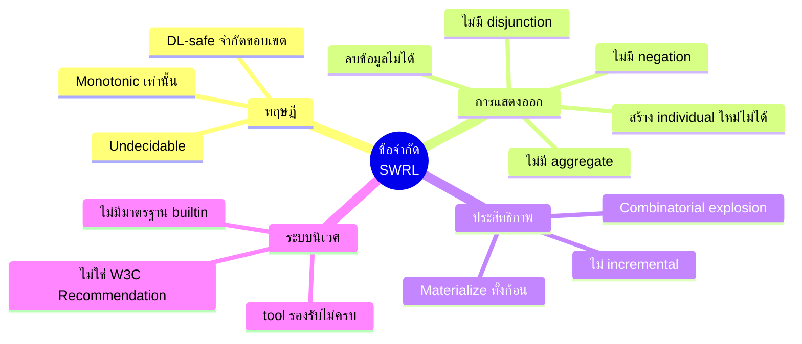
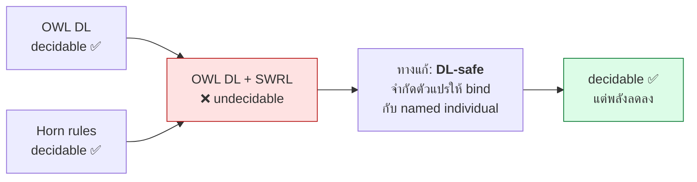
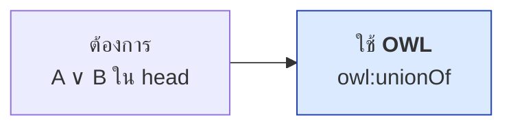
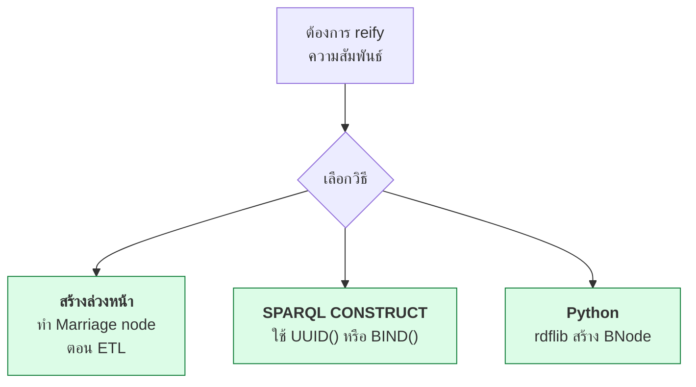
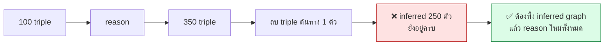
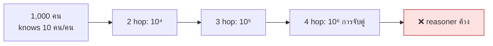
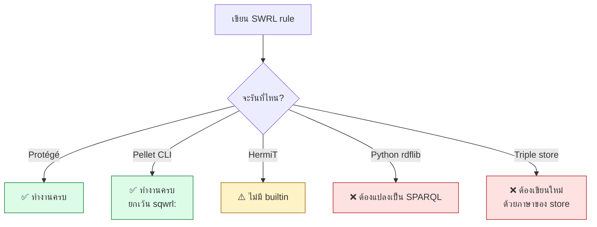
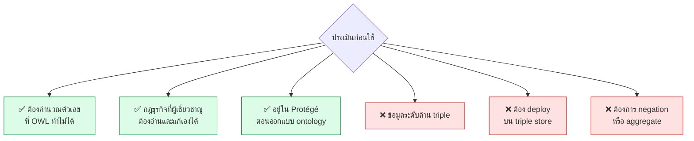

# 11.08 ข้อจำกัดของ SWRL

SWRL มีพลังในการอนุมานสูงก็จริง แต่แลกมาด้วยข้อจำกัดหลายอย่างที่ต้องรู้ก่อนเลือกใช้ในงานจริง
บทนี้รวบรวมข้อจำกัดทั้งด้านทฤษฎี ด้านการแสดงออก และด้านประสิทธิภาพ พร้อมทางเลือกทดแทนที่ใช้ได้จริง

---

## ภาพรวมข้อจำกัด 4 กลุ่ม



---

## 1. Undecidability

SWRL แบบเต็มรูปแบบ (OWL DL + rule ที่ไม่จำกัด) **undecidable** — คือไม่มีอัลกอริทึมใดรับประกันได้ว่าจะให้คำตอบภายในเวลาจำกัด



**ในทางปฏิบัติ** reasoner ทุกตัวจึงบังคับ DL-safe โดยอัตโนมัติ ผลคือ:

| ทำได้ | ทำไม่ได้ |
| --- | --- |
| อนุมานกับ individual ที่มี IRI | อนุมานกับ individual ที่ OWL รู้ว่ามีอยู่แต่ไม่มีชื่อ |
| จับผลของ `rdfs:domain` / `subClassOf` | จับผลของ `someValuesFrom` ที่ยังไม่มีตัวจริง |

---

## 2. ไม่มี Negation

SWRL ไม่มี `not` ไม่มี `NOT EXISTS` ไม่มี negation as failure

```
❌ Student(?s) ^ not(hasScholarship(?s, ?x)) -> NeedsAid(?s)     ไม่ถูกต้อง
```

### ทางเลือก 3 แบบ

<table>
<tr><th width="33%">SHACL</th><th width="33%">SPARQL</th><th width="34%">OWL closure</th></tr>
<tr valign="top">
<td>

```turtle
ex:AidShape a sh:NodeShape ;
    sh:targetClass ex:Student ;
    sh:property [
        sh:path ex:hasScholarship ;
        sh:minCount 1 ;
        sh:severity sh:Warning
    ] .
```

</td>
<td>

```sparql
SELECT ?s WHERE {
  ?s a ex:Student .
  FILTER NOT EXISTS {
    ?s ex:hasScholarship ?x
  }
}
```

</td>
<td>

```turtle
ex:bob a ex:Student ;
    a [ a owl:Restriction ;
        owl:onProperty
            ex:hasScholarship ;
        owl:maxCardinality 0 ] .
```

</td>
</tr>
<tr valign="top">
<td>✅ ตรวจได้ทันที<br/>❌ ไม่สร้าง triple ใหม่</td>
<td>✅ ยืดหยุ่นสุด<br/>❌ ต้องรันแยกจาก reasoner</td>
<td>✅ อยู่ใน OWL<br/>❌ ต้องระบุทีละ individual</td>
</tr>
</table>

> 💡 **สาเหตุลึก:** SWRL ยึด **Open World Assumption** — "ไม่มีข้อมูล" แปลว่า "ไม่รู้" ไม่ใช่ "ไม่มี"
> การเติม negation เข้าไปตรง ๆ จะทำให้ semantics ขัดกับ OWL ทันที

---

## 3. ไม่มี Disjunction ใน head

```
❌ Person(?p) -> Male(?p) ∨ Female(?p)      เขียนไม่ได้
```

head ของ SWRL ต้องเป็น **conjunction ของ atom** เท่านั้น (Horn clause)



```turtle
# --- รูปแบบเต็ม ---
ex:Person rdf:type owl:Class ;
    rdfs:subClassOf [
        rdf:type owl:Class ;
        owl:unionOf ( ex:Male ex:Female )
    ] .
```

```turtle
# --- รูปแบบย่อ ---
ex:Person rdfs:subClassOf [ a owl:Class ;
                            owl:unionOf ( ex:Male ex:Female ) ] .
```

---

## 4. สร้าง Individual ใหม่ไม่ได้

```
❌ Person(?p) ^ Person(?q) ^ married(?p, ?q) -> Marriage(?m) ^ husband(?m, ?p)
```

ตัวแปร `?m` ไม่ปรากฏใน body → **unbound variable** → reasoner ปฏิเสธ



```sparql
# SPARQL CONSTRUCT สร้าง node ใหม่ได้ ต่างจาก SWRL
PREFIX ex: <http://example.org/>

CONSTRUCT {
  ?m a ex:Marriage ; ex:husband ?p ; ex:wife ?q .
}
WHERE {
  ?p ex:married ?q .
  BIND(IRI(CONCAT(STR(ex:), "marriage-", MD5(CONCAT(STR(?p), STR(?q))))) AS ?m)
}
```

---

## 5. ลบข้อมูลไม่ได้ (Monotonic)

SWRL **เพิ่ม** ได้อย่างเดียว



```python
# แนวปฏิบัติ: แยก asserted กับ inferred ออกจากกัน
from rdflib import ConjunctiveGraph, Graph, URIRef

store = ConjunctiveGraph()
asserted = store.get_context(URIRef("urn:graph:asserted"))
inferred = store.get_context(URIRef("urn:graph:inferred"))

asserted.parse("data/facts.ttl", format="turtle")

def rebuild_inferences() -> None:
    """ทิ้งผลอนุมานเดิมทั้งก้อนแล้วสร้างใหม่ -- ถูกกว่าการตามลบทีละตัว"""
    inferred.remove((None, None, None))
    tmp = Graph()
    for triple in asserted:
        tmp.add(triple)
    # ... รัน reasoner บน tmp ...
    for triple in tmp:
        if triple not in asserted:
            inferred.add(triple)
```

---

## 6. ไม่มี Aggregate

`COUNT` / `SUM` / `AVG` ทำไม่ได้ใน SWRL ล้วน

| ต้องการ | ใช้ |
| --- | --- |
| นับใน Protégé | **SQWRL** `sqwrl:count` |
| นับใน production | **SPARQL** `COUNT` + `GROUP BY` |
| นับแล้วเขียนกลับ | **SPARQL CONSTRUCT** หรือ Python |

> 💡 บางกรณี OWL `owl:minQualifiedCardinality` ใช้แทนการนับได้
> เช่น "นักศึกษาที่ลงอย่างน้อย 5 วิชา" — แต่ระบุจำนวนตายตัวเท่านั้น เทียบตัวแปรไม่ได้

---

## 7. Combinatorial Explosion

กฎที่มีตัวแปรหลายตัวโยงกันทำให้ค่าใช้จ่ายโตแบบ **exponential**

```
❌ knows(?a,?b) ^ knows(?b,?c) ^ knows(?c,?d) ^ knows(?d,?e) -> farAway(?a,?e)
```



### แนวทางลดต้นทุน

| เทคนิค | วิธีทำ |
| --- | --- |
| ใส่ atom ที่กรองแคบไว้**ก่อน** | `Professor(?p) ^ knows(?p,?q)` ดีกว่า `knows(?p,?q) ^ Professor(?p)` |
| ใช้ `propertyChainAxiom` แทน | OWL ทำ chain ได้เร็วกว่ามาก |
| แบ่งกฎยาวเป็นหลายกฎสั้น | สร้าง intermediate property ไว้ใช้ซ้ำ |
| ใช้ SPARQL property path | `knows{1,4}` เร็วกว่าการ join แบบ rule |
| จำกัดขอบเขตด้วย class atom | `Employee(?p)` แทน `Thing` |

```
✅ Professor(?p) ^ knows(?p, ?q) ^ Student(?q) -> advises(?p, ?q)
```

---

## 8. ปัญหาด้านระบบนิเวศ

| ประเด็น | สถานะ |
| --- | --- |
| **สถานะมาตรฐาน** | W3C **Member Submission** (2004) ไม่ใช่ Recommendation |
| **Protégé** | ✅ SWRLTab เต็มรูปแบบ + SQWRL |
| **Pellet / Openllet** | ✅ รองรับ builtin ครบ |
| **HermiT** | ⚠️ รองรับ rule แต่ **ไม่รองรับ builtin** |
| **ELK** | ❌ ไม่รองรับ (OWL 2 EL เท่านั้น) |
| **Apache Jena** | ⚠️ มีระบบ rule ของตัวเอง ไม่ใช่ SWRL |
| **rdflib / owlrl** | ❌ ไม่รองรับ SWRL เลย |
| **GraphDB / Stardog** | ⚠️ ใช้ rule language ของตัวเอง (SPIN / Stardog Rules) |
| **builtin นอกมาตรฐาน** | แต่ละ engine เพิ่มเอง → ย้ายข้ามเครื่องมือไม่ได้ |



> ⚠️ **นี่คือข้อจำกัดที่กระทบงานจริงมากที่สุด** — rule ที่ทดสอบผ่านใน Protégé
> อาจรันไม่ได้เลยบน triple store ที่ใช้ production

---

## ตารางเทียบ: เลือกเครื่องมือให้ถูกงาน

| ต้องการ | SWRL | OWL | SPARQL | SHACL |
| --- | :---: | :---: | :---: | :---: |
| นิยาม class จากเงื่อนไข | ⚠️ | ✅ | ❌ | ❌ |
| ไล่ property เป็นทอด | ⚠️ | ✅ | ✅ path | ❌ |
| คำนวณตัวเลข | ✅ | ❌ | ✅ | ✅ |
| จัดการ string | ✅ | ❌ | ✅ | ✅ |
| Negation | ❌ | ⚠️ | ✅ | ✅ |
| Disjunction ใน head | ❌ | ✅ | ❌ | ❌ |
| Aggregate | ❌ | ❌ | ✅ | ⚠️ |
| สร้าง node ใหม่ | ❌ | ❌ | ✅ | ❌ |
| ลบข้อมูล | ❌ | ❌ | ✅ | ❌ |
| ตรวจความครบถ้วน | ❌ | ❌ | ⚠️ | ✅ |
| ข้อความ error ที่อ่านรู้เรื่อง | ❌ | ❌ | ❌ | ✅ |
| ทำงานบนทุก triple store | ❌ | ✅ | ✅ | ✅ |

---

## 🎯 เมื่อไหร่ควรใช้ SWRL จริง ๆ



---

## Key Points

- SWRL แบบเต็มรูปแบบ **undecidable** — reasoner จึงบังคับ **DL-safe** ทำให้ทำงานกับ named individual เท่านั้น
- ❌ **ไม่มี negation** เพราะยึด Open World — ถ้าต้องตรวจว่าข้อมูลขาดให้ใช้ **SHACL**
- ❌ **ไม่มี disjunction ใน head** เพราะเป็น Horn clause — ใช้ `owl:unionOf` แทน
- ❌ **สร้าง individual ใหม่ไม่ได้** เพราะตัวแปรใน head ต้อง bind มาจาก body — ใช้ **SPARQL CONSTRUCT** + `BIND(IRI(...))`
- ❌ **ลบข้อมูลไม่ได้ (monotonic)** — ต้องแยก asserted / inferred graph แล้ว rebuild ทั้งก้อน
- ❌ **ไม่มี aggregate** — ใช้ SQWRL (Protégé) หรือ SPARQL (production)
- ⚠️ **Combinatorial explosion** เมื่อ join ตัวแปรหลายทอด — วาง atom ที่กรองแคบไว้ก่อน และเปลี่ยนไปใช้ `propertyChainAxiom` เมื่อทำได้
- ⚠️ **ไม่ใช่ W3C Recommendation** — HermiT ไม่รองรับ builtin, rdflib ไม่รองรับเลย, triple store ส่วนใหญ่ใช้ rule language ของตัวเอง
- **ใช้ SWRL เมื่อ**: ต้องคำนวณ, กฎธุรกิจที่คนต้องอ่านออก, งานออกแบบใน Protégé
- **อย่าใช้ SWRL เมื่อ**: ข้อมูลระดับล้าน triple, ต้อง deploy บน triple store, ต้องการ negation หรือ aggregate
