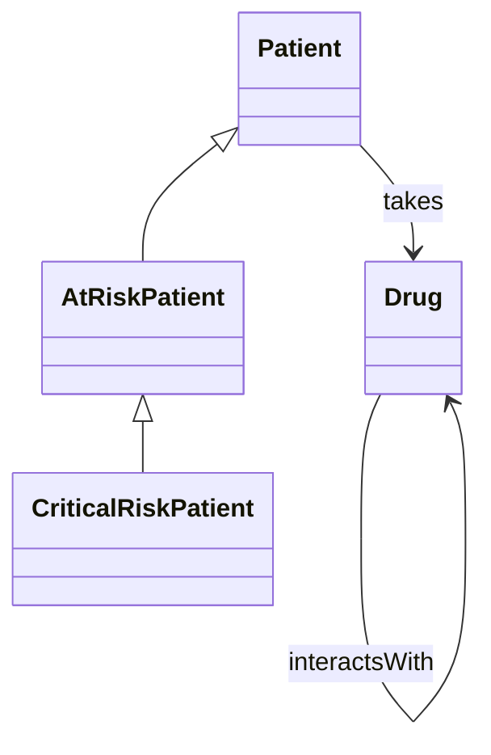
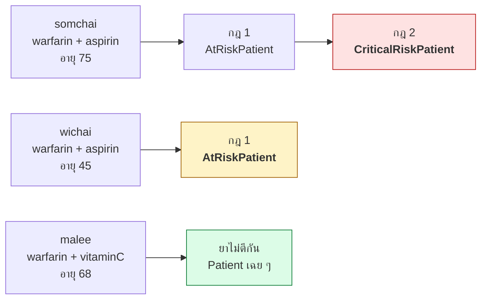
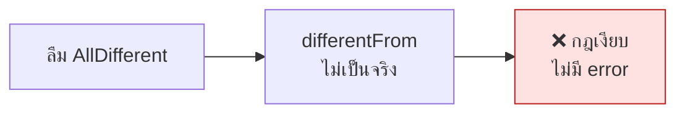
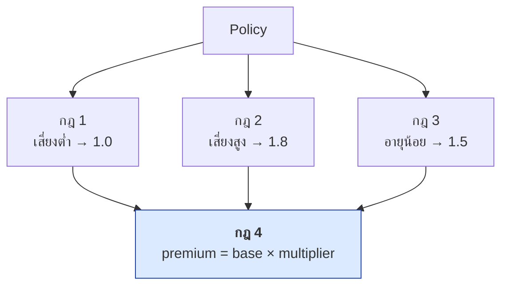
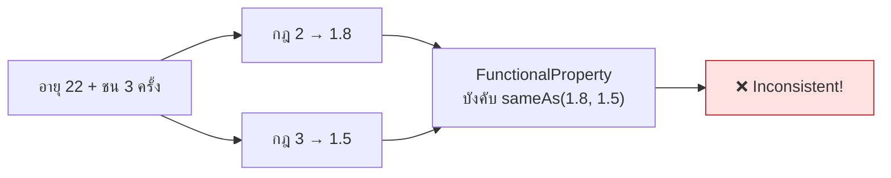
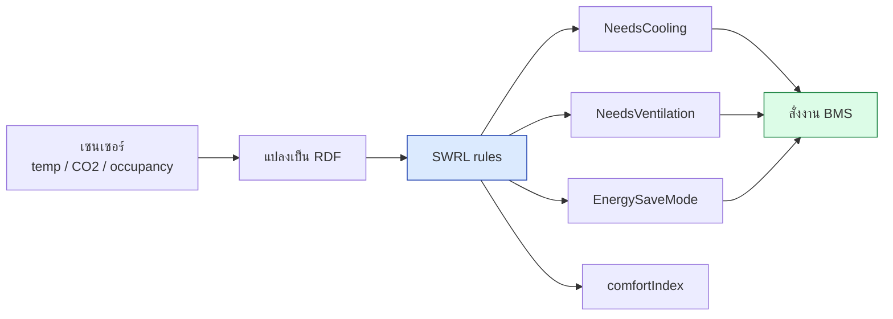
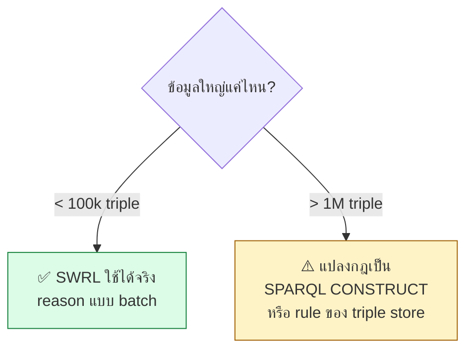
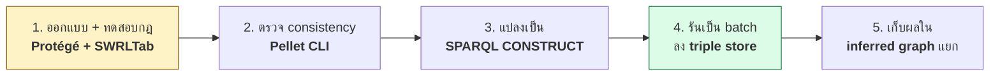

# 11.09 ตัวอย่างการใช้งานจริง

บทนี้แสดง SWRL ในโจทย์จริง 3 โดเมน — การแพทย์ ประกันภัย และอาคารอัจฉริยะ — ที่ OWL เพียงอย่างเดียวทำไม่ได้เพราะต้องคำนวณตัวเลขและเปรียบเทียบค่า
ทุกผลลัพธ์ในหน้านี้เป็นผลรันจริงจาก Pellet

📄 โค้ดเต็ม: [`code/ch11/usecase_rules.py`](../code/ch11/usecase_rules.py)

---

## Use Case 1 — แจ้งเตือนปฏิกิริยาระหว่างยา

โรงพยาบาลต้องการเตือนแพทย์อัตโนมัติเมื่อผู้ป่วยได้รับยาที่ตีกัน และยกระดับความรุนแรงถ้าผู้ป่วยเป็นผู้สูงอายุ

### โมเดล



### ข้อมูล

```turtle
# --- รูปแบบเต็ม ---
@prefix rdf: <http://www.w3.org/1999/02/22-rdf-syntax-ns#> .
@prefix owl: <http://www.w3.org/2002/07/owl#> .
@prefix ex:  <http://example.org/clinic#> .

ex:warfarin rdf:type ex:Drug ;
    ex:interactsWith ex:aspirin .
ex:aspirin  rdf:type ex:Drug ;
    ex:interactsWith ex:warfarin .
ex:vitaminC rdf:type ex:Drug .

[] rdf:type owl:AllDifferent ;
   owl:distinctMembers ( ex:warfarin ex:aspirin ex:vitaminC ) .

ex:somchai rdf:type ex:Patient ;
    ex:takes ex:warfarin , ex:aspirin ;
    ex:hasAge "75"^^<http://www.w3.org/2001/XMLSchema#int> .
```

```turtle
# --- รูปแบบย่อ ---
@prefix ex: <http://example.org/clinic#> .

ex:warfarin a ex:Drug ; ex:interactsWith ex:aspirin .
ex:aspirin  a ex:Drug ; ex:interactsWith ex:warfarin .
ex:vitaminC a ex:Drug .

[] a owl:AllDifferent ;
   owl:distinctMembers ( ex:warfarin ex:aspirin ex:vitaminC ) .

ex:somchai a ex:Patient ;
    ex:takes ex:warfarin , ex:aspirin ;
    ex:hasAge 75 .
ex:malee   a ex:Patient ;
    ex:takes ex:warfarin , ex:vitaminC ;
    ex:hasAge 68 .
ex:wichai  a ex:Patient ;
    ex:takes ex:warfarin , ex:aspirin ;
    ex:hasAge 45 .
```

### กฎ

```
# กฎ 1: กินยา 2 ตัวที่ตีกัน → เสี่ยง
Patient(?p) ^ takes(?p, ?d1) ^ takes(?p, ?d2)
    ^ interactsWith(?d1, ?d2) ^ differentFrom(?d1, ?d2)
    -> AtRiskPatient(?p)

# กฎ 2: เสี่ยงอยู่แล้ว + อายุเกิน 70 → ระดับวิกฤต
AtRiskPatient(?p) ^ hasAge(?p, ?a) ^ swrlb:greaterThan(?a, 70)
    -> CriticalRiskPatient(?p)
```

### ผลลัพธ์จริง

```
USE CASE 1 -- Drug-Drug Interaction Alert
  somchai: warfarin + aspirin, อายุ 75
  malee  : warfarin + vitaminC, อายุ 68
  wichai : warfarin + aspirin, อายุ 45

  Realization:
    AtRiskPatient          → ['wichai']
    CriticalRiskPatient    → ['somchai']
    Drug                   → ['vitaminC', 'aspirin', 'warfarin']
    Patient                → ['malee']
```



> 💡 **`somchai` ไม่ปรากฏใต้ `AtRiskPatient`** เพราะ Pellet รายงานเฉพาะ class ที่เจาะจงที่สุด
> — `CriticalRiskPatient ⊑ AtRiskPatient` อยู่แล้ว

### ⚠️ กับดักที่ทำให้กฎนี้เงียบ

```turtle
[] a owl:AllDifferent ;
   owl:distinctMembers ( ex:warfarin ex:aspirin ex:vitaminC ) .
```

**ถ้าลืมบรรทัดนี้ กฎที่ 1 จะไม่ทำงานเลย และไม่มี error ใด ๆ**
เพราะ OWL ไม่มี **Unique Name Assumption** — `warfarin` กับ `aspirin` อาจเป็นสิ่งเดียวกันก็ได้ในสายตา reasoner
`differentFrom(?d1, ?d2)` จึงไม่เป็นจริงจนกว่าจะประกาศชัดเจน



---

## Use Case 2 — คำนวณเบี้ยประกันรถยนต์

บริษัทประกันต้องการให้ **นักคณิตศาสตร์ประกันภัยแก้เกณฑ์เองได้** โดยไม่ต้องรอทีมพัฒนา — SWRL rule ที่อ่านออกจึงเหมาะกว่าโค้ดฝังใน application

### กฎ

```
# กฎ 1: ไม่เคยชน + อายุ 25-65 → เสี่ยงต่ำ ตัวคูณ 1.0
Policy(?p) ^ accidentCount(?p, ?n) ^ swrlb:lessThan(?n, 1)
    ^ driverAge(?p, ?a) ^ swrlb:greaterThan(?a, 24) ^ swrlb:lessThan(?a, 66)
    -> LowRiskPolicy(?p) ^ riskMultiplier(?p, 1.0)

# กฎ 2: ชนตั้งแต่ 2 ครั้ง → เสี่ยงสูง ตัวคูณ 1.8
Policy(?p) ^ accidentCount(?p, ?n) ^ swrlb:greaterThan(?n, 1)
    -> HighRiskPolicy(?p) ^ riskMultiplier(?p, 1.8)

# กฎ 3: คนขับอายุน้อยกว่า 25 → ตัวคูณ 1.5
Policy(?p) ^ driverAge(?p, ?a) ^ swrlb:lessThan(?a, 25)
    -> riskMultiplier(?p, 1.5)

# กฎ 4: เบี้ย = ฐาน × ตัวคูณ
Policy(?p) ^ baseAmount(?p, ?b) ^ riskMultiplier(?p, ?m)
    ^ swrlb:multiply(?prem, ?b, ?m)
    -> premium(?p, ?prem)
```



> 💡 **แยกกฎ "จัดระดับ" ออกจากกฎ "คำนวณ"** — เพิ่มเกณฑ์ความเสี่ยงใหม่ได้โดยไม่ต้องแตะสูตรคำนวณเลย

### ผลลัพธ์จริง

```
USE CASE 2 -- Insurance Premium Calculation
  pol001: ฐาน 10,000 อายุ 40 ชน 0 ครั้ง
  pol002: ฐาน 10,000 อายุ 35 ชน 3 ครั้ง
  pol003: ฐาน 10,000 อายุ 22 ชน 0 ครั้ง

  Realization:
    HighRiskPolicy         → ['pol002']
    LowRiskPolicy          → ['pol001']
    Policy                 → ['pol003']

  Inferred property values:
    pol001       premium            = 10000
    pol001       riskMultiplier     = 1.0
    pol002       premium            = 18000.0
    pol002       riskMultiplier     = 1.8
    pol003       premium            = 15000.0
    pol003       riskMultiplier     = 1.5
```

| กรมธรรม์ | อายุ | อุบัติเหตุ | ตัวคูณ | เบี้ย |
| --- | ---: | ---: | ---: | ---: |
| pol001 | 40 | 0 | 1.0 | 10,000 |
| pol002 | 35 | 3 | 1.8 | 18,000 |
| pol003 | 22 | 0 | 1.5 | 15,000 |

### ⚠️ ระวัง `FunctionalProperty` กับกฎที่ทับกัน

`riskMultiplier` ถูกประกาศเป็น `owl:FunctionalProperty` (มีค่าได้ค่าเดียว)
ถ้ามีกรมธรรม์ที่เข้าเงื่อนไขทั้งกฎ 2 และกฎ 3 พร้อมกัน — เช่นอายุ 22 และชน 3 ครั้ง — reasoner จะได้ค่า `1.8` กับ `1.5` พร้อมกัน



**ทางแก้:** ทำให้เงื่อนไขของแต่ละกฎ **แยกจากกันโดยสิ้นเชิง** (mutually exclusive) เช่นเพิ่ม `swrlb:lessThan(?n, 2)` เข้าไปในกฎ 3 หรือใช้ property แยกกันแล้วเลือกค่าสูงสุดภายหลัง

---

## Use Case 3 — ควบคุมระบบปรับอากาศในอาคารอัจฉริยะ

ข้อมูลจากเซนเซอร์ IoT ถูกแปลงเป็น RDF แล้วให้ rule ตัดสินใจว่าห้องไหนต้องทำอะไร

### กฎ

```
# กฎ 1: มีคน + ร้อนเกิน 26 → เปิดแอร์
Room(?r) ^ occupancy(?r, ?o) ^ swrlb:greaterThan(?o, 0)
    ^ temperature(?r, ?t) ^ swrlb:greaterThan(?t, 26.0)
    -> NeedsCooling(?r)

# กฎ 2: CO2 เกิน 1000 ppm → ต้องระบายอากาศ
Room(?r) ^ co2Level(?r, ?c) ^ swrlb:greaterThan(?c, 1000)
    -> NeedsVentilation(?r)

# กฎ 3: ไม่มีคน → โหมดประหยัดพลังงาน
Room(?r) ^ occupancy(?r, ?o) ^ swrlb:lessThan(?o, 1)
    -> EnergySaveMode(?r)

# กฎ 4: ดัชนีความสบาย = 100 − |t − 24| × 10
Room(?r) ^ temperature(?r, ?t)
    ^ swrlb:subtract(?d, ?t, 24.0) ^ swrlb:abs(?ad, ?d)
    ^ swrlb:multiply(?pen, ?ad, 10.0) ^ swrlb:subtract(?ci, 100.0, ?pen)
    -> comfortIndex(?r, ?ci)
```



### ผลลัพธ์จริง

```
USE CASE 3 -- Smart Building HVAC Control
  meetingRoomA: 28.5°C, CO2 1450 ppm, 12 คน
  officeB     : 24.0°C, CO2  600 ppm,  5 คน
  storageC    : 30.0°C, CO2  400 ppm,  0 คน

  Realization:
    EnergySaveMode         → ['storageC']
    NeedsCooling           → ['meetingRoomA']
    NeedsVentilation       → ['meetingRoomA']
    Room                   → ['officeB']

  Inferred property values:
    meetingRoomA comfortIndex       = 55
    officeB      comfortIndex       = 100
    storageC     comfortIndex       = 40
```

| ห้อง | อุณหภูมิ | CO2 | คน | ผลอนุมาน | ดัชนีความสบาย |
| --- | ---: | ---: | ---: | --- | ---: |
| meetingRoomA | 28.5 | 1450 | 12 | Cooling + Ventilation | 55 |
| officeB | 24.0 | 600 | 5 | ปกติ | 100 |
| storageC | 30.0 | 400 | 0 | EnergySave | 40 |

> 💡 **`storageC` ร้อน 30°C แต่ไม่ถูกสั่งเปิดแอร์** เพราะกฎ 1 ต้องการ `occupancy > 0`
> — นี่คือประโยชน์ของการเขียนเงื่อนไขไว้อย่างชัดเจนและตรวจสอบย้อนกลับได้

---

## เทียบ 3 use case

| ประเด็น | Healthcare | Insurance | Smart Building |
| --- | --- | --- | --- |
| **สิ่งที่ต้องการ** | จำแนกความเสี่ยง | คำนวณตัวเลข | ตัดสินใจสั่งงาน |
| **builtin ที่ใช้** | `greaterThan` | `multiply`, comparison | `subtract`, `abs`, `multiply` |
| **OWL ทำแทนได้ไหม** | ⚠️ บางส่วน | ❌ ไม่ได้ | ❌ ไม่ได้ |
| **กับดักหลัก** | ลืม `AllDifferent` | กฎทับกัน + Functional | กฎขาดเงื่อนไข guard |
| **ขนาดข้อมูลจริง** | ล้าน triple ⚠️ | หมื่น triple ✅ | หลักพัน ✅ |



---

## 🧭 รูปแบบการ deploy ที่ใช้ได้จริง



**เหตุผล:** SWRL เหมาะกับการ **ออกแบบและสื่อสารกฎกับผู้เชี่ยวชาญ** ส่วนการรันจริงบนข้อมูลขนาดใหญ่ควรใช้เครื่องมือที่ triple store รองรับโดยตรง

---

## Key Points

- SWRL เหมาะกับงานที่ต้อง **คำนวณตัวเลขและเปรียบเทียบค่า** ซึ่ง OWL ทำไม่ได้ — ทั้ง 3 use case ในบทนี้ใช้ `swrlb:` ทั้งหมด
- **Healthcare**: `differentFrom` ต้องมี **`owl:AllDifferent`** รองรับ มิฉะนั้นกฎเงียบโดยไม่มี error (OWL ไม่มี Unique Name Assumption)
- **Insurance**: แยก **กฎจัดระดับ** ออกจาก **กฎคำนวณ** ทำให้เพิ่มเกณฑ์ใหม่ได้โดยไม่แตะสูตร
- ⚠️ กฎที่เขียนค่าลง **`owl:FunctionalProperty`** ต้องมีเงื่อนไข **แยกจากกันโดยสิ้นเชิง** ไม่งั้น ontology inconsistent
- **Smart Building**: เขียนเงื่อนไข guard ให้ครบ (`occupancy > 0`) เพื่อไม่ให้สั่งงานผิดพลาด
- Pellet realize รายงานเฉพาะ **class ที่เจาะจงที่สุด** — individual ที่หายไปจาก superclass ไม่ได้แปลว่าอนุมานผิด
- ข้อมูล **ต่ำกว่า ~100k triple** ใช้ SWRL รันจริงได้ ถ้าเกิน **1M triple** ควรแปลงกฎเป็น SPARQL CONSTRUCT หรือ rule ของ triple store
- แนวทาง deploy: **ออกแบบใน Protégé → ตรวจด้วย Pellet → แปลงเป็น SPARQL → รัน batch → เก็บใน inferred graph แยก**
