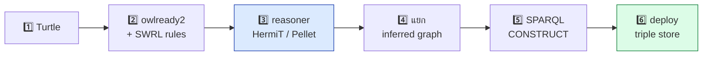
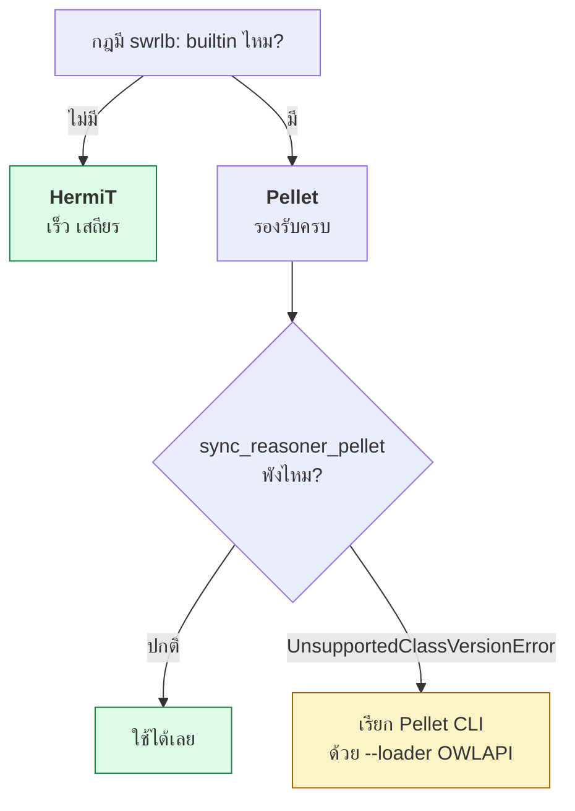
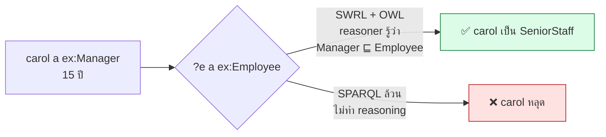

# 11.10 ใช้ SWRL ด้วย Python

Python ไม่มี library ที่รัน SWRL ได้ในตัว — ต้องอาศัย **owlready2** ที่ห่อ reasoner ฝั่ง Java (HermiT / Pellet) เอาไว้
บทนี้พาสร้างไปป์ไลน์ครบวงจร ตั้งแต่โหลดข้อมูล เพิ่มกฎ รัน reasoner แยก inferred graph ไปจนถึงแปลงกฎเป็น SPARQL CONSTRUCT สำหรับใช้งานจริง

📄 โค้ดเต็ม: [`code/ch11/swrl_pipeline.py`](../code/ch11/swrl_pipeline.py)

---

## ภาพรวมไปป์ไลน์



---

## เตรียมเครื่องมือ

```bash
pip install owlready2 rdflib
```

owlready2 ต้องการ **Java** สำหรับรัน reasoner

```python
import owlready2

print("Java:", owlready2.JAVA_EXE)
```

| Reasoner | รองรับ SWRL rule | รองรับ `swrlb:` builtin |
| --- | :---: | :---: |
| **HermiT** (`sync_reasoner_hermit`) | ✅ | ❌ |
| **Pellet** (`sync_reasoner_pellet`) | ✅ | ✅ |

> ⚠️ ถ้าใช้ `sync_reasoner_pellet()` แล้วเจอ `UnsupportedClassVersionError`
> แปลว่า jar ของ Jena ที่มากับ owlready2 ถูก compile ด้วย JDK ใหม่กว่า Java ในเครื่อง
> ทางแก้อยู่ในหัวข้อ **"เรียก Pellet โดยตรง"** ท้ายบท

---

## ขั้นที่ 1 — ข้อมูลตั้งต้น

```turtle
# --- รูปแบบเต็ม ---
@prefix rdf:  <http://www.w3.org/1999/02/22-rdf-syntax-ns#> .
@prefix rdfs: <http://www.w3.org/2000/01/rdf-schema#> .
@prefix owl:  <http://www.w3.org/2002/07/owl#> .
@prefix xsd:  <http://www.w3.org/2001/XMLSchema#> .
@prefix ex:   <http://example.org/hr#> .

ex:Employee    rdf:type owl:Class .
ex:Manager     rdf:type owl:Class ;
    rdfs:subClassOf ex:Employee .
ex:SeniorStaff rdf:type owl:Class ;
    rdfs:subClassOf ex:Employee .

ex:alice rdf:type ex:Employee ;
    ex:worksIn ex:engineering ;
    ex:yearsOfService "12"^^xsd:integer .
```

```turtle
# --- รูปแบบย่อ ---
@prefix ex: <http://example.org/hr#> .

ex:Employee    a owl:Class .
ex:Manager     a owl:Class ; rdfs:subClassOf ex:Employee .
ex:SeniorStaff a owl:Class ; rdfs:subClassOf ex:Employee .

ex:worksIn   a owl:ObjectProperty ; rdfs:domain ex:Employee ; rdfs:range ex:Department .
ex:managedBy a owl:ObjectProperty ; rdfs:domain ex:Department ; rdfs:range ex:Manager .
ex:reportsTo a owl:ObjectProperty ; rdfs:domain ex:Employee ; rdfs:range ex:Manager .

ex:yearsOfService a owl:DatatypeProperty , owl:FunctionalProperty ;
    rdfs:domain ex:Employee ; rdfs:range xsd:integer .

ex:alice a ex:Employee ; ex:worksIn ex:engineering ; ex:yearsOfService 12 .
ex:bob   a ex:Employee ; ex:worksIn ex:engineering ; ex:yearsOfService  3 .
ex:carol a ex:Manager  ; ex:worksIn ex:engineering ; ex:yearsOfService 15 .
ex:dave  a ex:Employee ; ex:worksIn ex:sales       ; ex:yearsOfService  8 .
ex:erin  a ex:Manager  ; ex:worksIn ex:sales       ; ex:yearsOfService  6 .

ex:engineering a ex:Department ; ex:managedBy ex:carol .
ex:sales       a ex:Department ; ex:managedBy ex:erin .
```

### ⚠️ owlready2 อ่าน Turtle ไม่ได้

owlready2 รองรับเฉพาะ **RDF/XML** และ **N-Triples** — ต้องแปลงผ่าน rdflib ก่อน

```python
from rdflib import Graph

asserted = Graph()
asserted.parse("data/hr.ttl", format="turtle")
asserted.serialize("data/hr.owl", format="xml")   # ⬅️ owlready2 อ่านไฟล์นี้ได้
```

---

## ขั้นที่ 2 — เก็บกฎเป็น "ข้อมูล" ไม่ใช่โค้ด

```python
# กฎอยู่ในรูปสตริง ทำให้ผู้เชี่ยวชาญโดเมนแก้เองได้โดยไม่ต้องแตะโค้ด Python
RULES: list[tuple[str, str]] = [
    ("reporting-line",
     "Employee(?e), worksIn(?e, ?d), managedBy(?d, ?m), differentFrom(?e, ?m) "
     "-> reportsTo(?e, ?m)"),
    ("senior-staff",
     "Employee(?e), yearsOfService(?e, ?y), greaterThan(?y, 9) "
     "-> SeniorStaff(?e)"),
]
```

```python
from owlready2 import Imp, World

world = World()
onto = world.get_ontology("file://data/hr.owl").load()

with onto:
    for name, body in RULES:
        rule = Imp()
        rule.set_as_rule(body)
        print(f"✓ {name}")
```

### 📝 ไวยากรณ์ของ owlready2 ต่างจาก SWRL มาตรฐานเล็กน้อย

| SWRL มาตรฐาน | owlready2 |
| --- | --- |
| `^` คั่น atom | `,` คั่น atom |
| `swrlb:greaterThan(?y, 9)` | `greaterThan(?y, 9)` (ไม่ต้องมี prefix) |
| `->` | `->` เหมือนกัน |
| ต้องอ้าง class ด้วย IRI เต็ม | ใช้ชื่อ Python ของ class ได้เลย |

---

## ขั้นที่ 3 — รัน reasoner

```python
from owlready2 import sync_reasoner_hermit

try:
    sync_reasoner_hermit(world, infer_property_values=True, debug=0)
    print("✅ HermiT สำเร็จ")
except Exception as exc:
    # HermiT ไม่รองรับ swrlb: builtin -- ต้องย้ายไป Pellet
    print(f"⚠️ HermiT ไม่รองรับ builtin: {type(exc).__name__}")
    from pellet_runner import parse_realization, run_pellet
    realized = parse_realization(run_pellet(onto))
    print(f"SeniorStaff : {sorted(realized.get('SeniorStaff', []))}")
```

ผลจริง

```
ขั้นที่ 3: รัน reasoner (HermiT)
  ⚠️ HermiT ไม่รองรับ builtin: OwlReadyJavaError
     → ใช้ Pellet แทน
  ✅ Pellet สำเร็จ (22 บรรทัด)
  SeniorStaff (SWRL + OWL) : ['alice', 'carol']
```



---

## ขั้นที่ 4 — แยก inferred ออกจาก asserted

**นี่คือขั้นตอนที่คนข้ามบ่อยที่สุด** ถ้าเก็บรวมกันไว้ พอข้อมูลต้นทางเปลี่ยนจะแยกไม่ออกว่าอะไรคือข้อเท็จจริงจริง อะไรคือผลอนุมานเก่า

```python
import tempfile
from rdflib import Graph

with tempfile.NamedTemporaryFile("wb", suffix=".owl", delete=False) as f:
    full_path = f.name
onto.save(full_path, format="rdfxml")

full = Graph()
full.parse(full_path, format="xml")

inferred = Graph()
for triple in full:
    if triple not in asserted:
        inferred.add(triple)

print(f"full     : {len(full)} triples")
print(f"asserted : {len(asserted)} triples")
print(f"inferred : {len(inferred)} triples")
```

ผลจริง

```
ขั้นที่ 4: แยก inferred ออกจาก asserted
  full     : 102 triples
  asserted : 39 triples
  inferred : 63 triples
  ⚠️ ตัวเลข inferred นับรวม triple ที่ reasoner เพิ่มเพื่อการทำงานภายในด้วย
     (declaration, blank node ของ rule) จึงสูงกว่าจำนวนข้อสรุปเชิงความหมาย
```

> ⚠️ **63 ไม่ได้แปลว่าอนุมานความรู้ใหม่ได้ 63 ข้อ** — ส่วนใหญ่คือ `owl:Declaration`,
> blank node ที่ owlready2 สร้างเพื่อเก็บ SWRL rule และ metadata ภายใน
> ถ้าต้องการนับข้อสรุปเชิงความหมายจริง ต้องกรองเฉพาะ predicate ที่สนใจ

---

## ขั้นที่ 5 — แปลงกฎเป็น SPARQL CONSTRUCT

เพื่อ deploy บน triple store ที่ไม่รองรับ SWRL

<table>
<tr><th width="46%">SWRL</th><th width="54%">SPARQL CONSTRUCT</th></tr>
<tr valign="top">
<td>

```
Employee(?e) ^ worksIn(?e, ?d)
  ^ managedBy(?d, ?m)
  ^ differentFrom(?e, ?m)
  -> reportsTo(?e, ?m)
```

</td>
<td>

```sparql
PREFIX ex: <http://example.org/hr#>

CONSTRUCT { ?e ex:reportsTo ?m }
WHERE {
  ?e a ex:Employee ; ex:worksIn ?d .
  ?d ex:managedBy ?m .
  FILTER(?e != ?m)
}
```

</td>
</tr>
<tr valign="top">
<td>

```
Employee(?e)
  ^ yearsOfService(?e, ?y)
  ^ swrlb:greaterThan(?y, 9)
  -> SeniorStaff(?e)
```

</td>
<td>

```sparql
PREFIX ex: <http://example.org/hr#>

CONSTRUCT { ?e a ex:SeniorStaff }
WHERE {
  ?e a ex:Employee ; ex:yearsOfService ?y .
  FILTER(?y > 9)
}
```

</td>
</tr>
</table>

```python
SPARQL_RULES: dict[str, str] = {
    "reporting-line": "...",   # ตามด้านบน
    "senior-staff":   "...",
}

inferred = Graph()
for name, query in SPARQL_RULES.items():
    added = 0
    for triple in asserted.query(query):
        if triple not in asserted and triple not in inferred:
            inferred.add(triple)
            added += 1
    print(f"{name:16s} → +{added} triples")
```

ผลจริง

```
ขั้นที่ 5: รันกฎเดียวกันด้วย SPARQL CONSTRUCT
  reporting-line   → +3 triples
  senior-staff     → +1 triples

  รวม inferred : 4 triples

  ผลอนุมาน:
    alice      reportsTo    carol
    alice      type         SeniorStaff
    bob        reportsTo    carol
    dave       reportsTo    erin
```

ไฟล์ผลลัพธ์ `code/ch11/hr_inferred.ttl`

```turtle
@prefix ex: <http://example.org/hr#> .

ex:alice a ex:SeniorStaff ;
    ex:reportsTo ex:carol .

ex:bob ex:reportsTo ex:carol .

ex:dave ex:reportsTo ex:erin .
```

---

## ขั้นที่ 6 — ⚠️ ผลสองวิธี **ไม่เท่ากัน**

```
ขั้นที่ 6: เทียบผลสองวิธี
  SeniorStaff จาก SWRL + OWL  : ['alice', 'carol']
  SeniorStaff จาก SPARQL ล้วน : ['alice']
```



**สาเหตุ:** `carol` ถูกประกาศเป็น `ex:Manager` ไม่ใช่ `ex:Employee` ตรง ๆ
SPARQL ไม่ทำ reasoning เอง pattern `?e a ex:Employee` จึงไม่ match แม้ว่า `Manager ⊑ Employee`

### ทางแก้ 3 แบบ

<table>
<tr><th width="33%">1. Materialize ก่อน</th><th width="33%">2. Property path</th><th width="34%">3. Reasoning ที่ store</th></tr>
<tr valign="top">
<td>

```python
import owlrl

owlrl.RDFSClosure \
    .RDFS_Semantics(
        asserted, False,
        False, False
    ).closure()
```

</td>
<td>

```sparql
SELECT ?e WHERE {
  ?e a/rdfs:subClassOf*
       ex:Employee .
  ?e ex:yearsOfService ?y .
  FILTER(?y > 9)
}
```

</td>
<td>

เปิด RDFS/OWL inference
ที่ตัว triple store

- GraphDB: ruleset
- Stardog: reasoning
- Fuseki: assembler

</td>
</tr>
<tr valign="top">
<td>✅ เร็วตอน query<br/>❌ ต้อง rebuild เมื่อข้อมูลเปลี่ยน</td>
<td>✅ ไม่ต้อง preprocess<br/>❌ ช้าลง ต้องแก้ทุก query</td>
<td>✅ โปร่งใสที่สุด<br/>❌ ผูกกับ store</td>
</tr>
</table>

> 🎯 **บทเรียนสำคัญที่สุดของบทนี้:** เมื่อย้ายกฎจาก SWRL ไป SPARQL
> **ต้องตรวจว่าผลเท่ากันจริง** — ความต่างมักมาจาก reasoning ที่หายไป ไม่ใช่จากตัวกฎ

---

## เรียก Pellet โดยตรงเมื่อ `sync_reasoner_pellet` พัง

owlready2 เรียก Pellet ด้วย `--loader Jena` ซึ่งบางเครื่องจะพังด้วย `UnsupportedClassVersionError`
ทางแก้คือบันทึกเป็น RDF/XML แล้วเรียกด้วย `--loader OWLAPI` ซึ่งไม่แตะ Jena เลย

📄 โค้ดเต็ม: [`code/ch11/pellet_runner.py`](../code/ch11/pellet_runner.py)

```python
import glob, os, subprocess, tempfile
import owlready2

PELLET_DIR = os.path.join(os.path.dirname(owlready2.__file__), "pellet")

def _classpath() -> str:
    jars = sorted(glob.glob(os.path.join(PELLET_DIR, "*.jar")))
    return ":".join(jars + [PELLET_DIR])

def run_pellet(onto, infer_values: bool = True, timeout: int = 300) -> str:
    """รัน Pellet realize บน ontology แล้วคืน stdout ดิบ"""
    with tempfile.NamedTemporaryFile("wb", suffix=".owl", delete=False) as tmp:
        path = tmp.name
    onto.save(path, format="rdfxml")

    cmd = [owlready2.JAVA_EXE, "-Xmx2000M", "-cp", _classpath(),
           "pellet.Pellet", "realize", "--loader", "OWLAPI", "--ignore-imports"]
    if infer_values:
        cmd += ["--infer-prop-values", "--infer-data-prop-values"]
    cmd.append(path)

    proc = subprocess.run(cmd, capture_output=True, text=True, timeout=timeout)
    os.unlink(path)
    if proc.returncode != 0:
        raise RuntimeError(f"Pellet failed:\n{proc.stderr[:1500]}")
    return proc.stdout
```

### อ่านผลลัพธ์ของ Pellet

Pellet ใช้คำนำหน้าต่างกันสำหรับ object property กับ data property

```python
import re

_PROP = re.compile(r"^(?:DATAPROPVAL|PROPINST):\s+(\S+)\s+(\S+)\s+(.+)$")
```

| คำนำหน้า | ใช้กับ | รูปแบบค่า |
| --- | --- | --- |
| `PROPINST:` | object property | IRI |
| `DATAPROPVAL:` | data property | `literal(ค่า, ..., ชนิด)` |
| (ย่อหน้าตามลำดับชั้น) | class realization | `Class - (individual, ...)` |

> ⚠️ `realize` รายงานเฉพาะ **class ที่เจาะจงที่สุด** ของแต่ละ individual
> ถ้า `alice` เป็นทั้ง `Employee` และ `SeniorStaff` จะเห็นแค่ `SeniorStaff`

---

## ⚠️ กับดักที่พบบ่อยใน owlready2

| อาการ | สาเหตุ | ทางแก้ |
| --- | --- | --- |
| กฎเงียบ ไม่มี error | ใช้ `default_world` ร่วมกันหลาย ontology ตัวแปร SWRL ชื่อซ้ำถูก reuse | ใช้ `World()` แยกทุกครั้ง |
| `differentFrom` ไม่เป็นจริง | ไม่มี Unique Name Assumption | ประกาศ `AllDifferent([...])` |
| `ValueError: Cannot find entity 'xxx'!` | builtin ที่ไม่มีใน owlready2 | ตรวจรายชื่อใน `owlready2.rule._BUILTINS` |
| `OwlReadyJavaError` ตอนใช้ HermiT | HermiT ไม่รองรับ builtin | เปลี่ยนไป Pellet |
| `UnsupportedClassVersionError` | jar ของ Jena ใหม่กว่า Java ในเครื่อง | เรียก Pellet CLI `--loader OWLAPI` |
| `OwlReadyInconsistentOntologyError` | กฎขัดกับ `disjointWith` หรือ `FunctionalProperty` | ตรวจว่าเงื่อนไขแต่ละกฎแยกกันจริง |
| อ่านไฟล์ `.ttl` ไม่ได้ | owlready2 รองรับแค่ RDF/XML กับ NTriples | แปลงด้วย rdflib ก่อน |

### ⚠️ ต้องใช้ `World()` แยกเสมอ

```python
# ❌ ผิด -- ontology ที่สองจะทับตัวแปร SWRL ของ ontology แรก
onto1 = get_ontology("http://example.org/a#")
onto2 = get_ontology("http://example.org/b#")

# ✅ ถูก
onto1 = World().get_ontology("http://example.org/a#")
onto2 = World().get_ontology("http://example.org/b#")
```

**อาการเมื่อทำผิด:** กฎไม่ทำงาน ไม่มี error ใด ๆ และเห็น individual ชื่อแปลก ๆ อย่าง `p` โผล่ในผล realization — เพราะ `swrl:Variable` ไม่ถูกบันทึกลงไฟล์ ทำให้ `Patient(?p)` กลายเป็น **ground atom** ที่อ้างถึง individual ชื่อ `p` จริง ๆ

---

## รันโปรแกรมเต็ม

```bash
python3 code/ch11/swrl_pipeline.py
```

---

## Key Points

- Python รัน SWRL เองไม่ได้ — ต้องใช้ **owlready2** ที่ห่อ reasoner ฝั่ง Java เอาไว้ (**rdflib และ owlrl ไม่รองรับ SWRL เลย**)
- **owlready2 อ่าน Turtle ไม่ได้** รองรับเฉพาะ RDF/XML และ N-Triples — แปลงผ่าน rdflib ก่อน
- ไวยากรณ์ owlready2 ใช้ **`,` แทน `^`** และ **ไม่ต้องใส่ prefix `swrlb:`**
- **เก็บกฎเป็นสตริงในโครงสร้างข้อมูล** ไม่ฝังในโค้ด เพื่อให้ผู้เชี่ยวชาญโดเมนแก้ได้เอง
- **HermiT ไม่รองรับ `swrlb:` builtin** (`OwlReadyJavaError`) — ต้องใช้ **Pellet**
- ถ้า `sync_reasoner_pellet()` พังด้วย `UnsupportedClassVersionError` ให้เรียก Pellet CLI ด้วย **`--loader OWLAPI`** บนไฟล์ RDF/XML
- **แยก inferred graph ออกจาก asserted graph เสมอ** — แต่ระวังว่าจำนวน triple ที่ต่างกันนับรวม declaration และ blank node ภายในด้วย
- ⚠️ **ต้องใช้ `World()` แยกทุก ontology** ไม่งั้นตัวแปร SWRL ชื่อซ้ำถูก reuse แล้วกฎจะเงียบโดยไม่มี error
- ⚠️ **`differentFrom` ต้องมี `AllDifferent` รองรับ** เพราะ OWL ไม่มี Unique Name Assumption
- แปลงกฎเป็น **SPARQL CONSTRUCT** เพื่อ deploy บน triple store — แต่ **ต้องตรวจว่าผลเท่ากันจริง** เพราะ SPARQL ไม่ทำ reasoning เอง (`Manager ⊑ Employee` จะหายไป)
