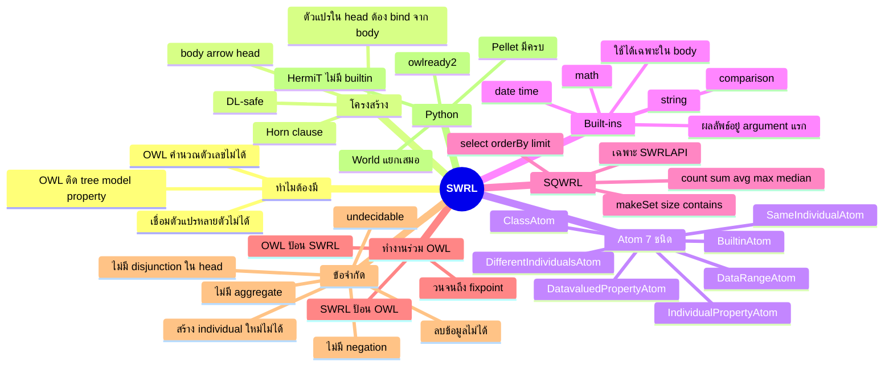
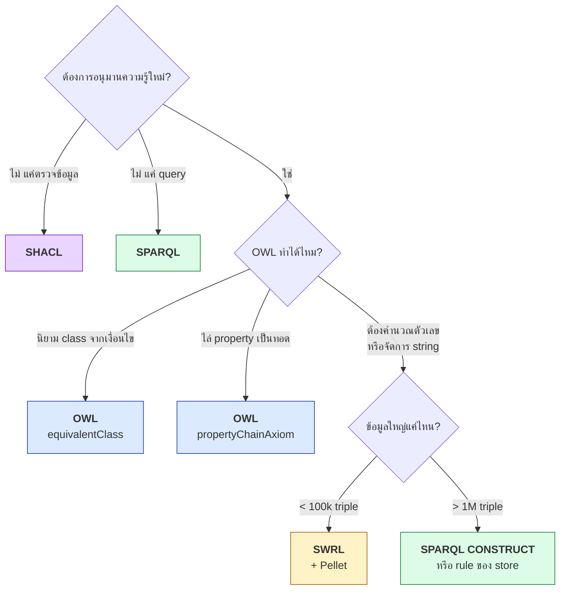
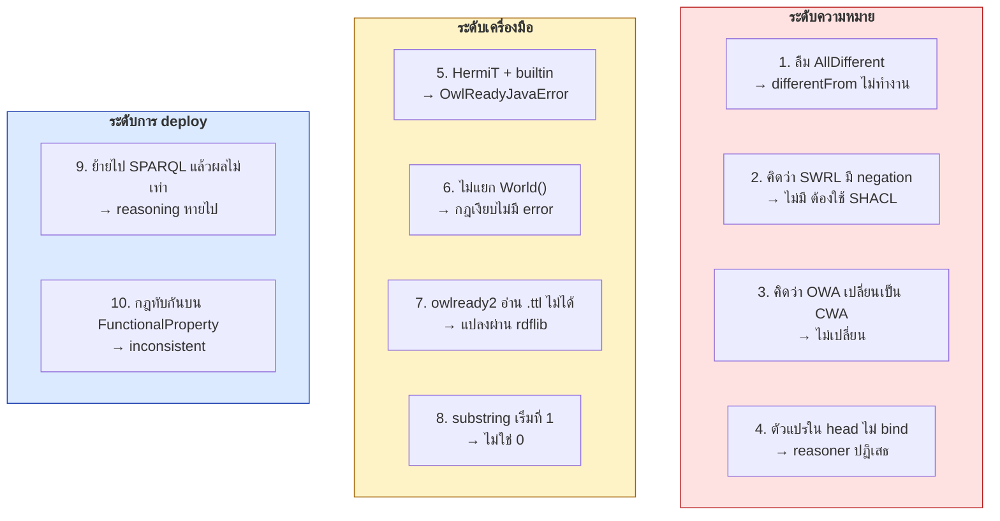
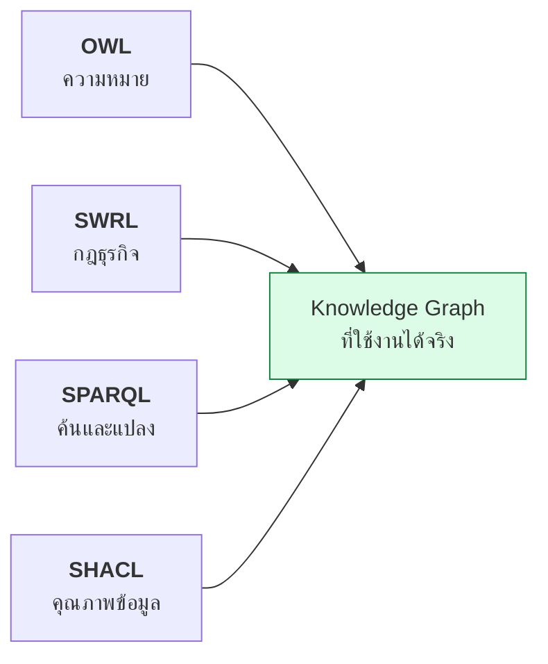

# 11.11 สรุปบทที่ 11 — SWRL

บทนี้พาเดินทางจากเหตุผลว่าทำไม OWL เพียงอย่างเดียวไม่พอ ไปจนถึงการเขียน rule ที่คำนวณตัวเลขได้ รันจริงด้วย Pellet และแปลงเป็น SPARQL เพื่อใช้งานจริง
หน้านี้รวบรวมทุกอย่างไว้ในที่เดียวสำหรับทบทวนก่อนไปบทถัดไป

---

## แผนที่ความคิดของบทนี้

---

## เส้นทางการตัดสินใจ

---

## สรุปเนื้อหาแต่ละหัวข้อ

| หัวข้อ | ใจความสำคัญ |
| --- | --- |
| [11.01 SWRL คืออะไร](11.01-swrl-intro.md) | OWL ติด **tree model property** เขียน "ลุง" ไม่ได้ — SWRL คือ OWL DL + RuleML |
| [11.02 กายวิภาคของกฎ](11.02-rule-anatomy.md) | `body -> head` เป็น **Horn clause** ตัวแปรใน head ต้อง bind มาจาก body |
| [11.03 Atom 7 ชนิด](11.03-atom-types.md) | `differentFrom` **ไม่ใช่** `!=` ของ SPARQL — ต้องมี `AllDifferent` |
| [11.04 Built-ins](11.04-builtins.md) | **ผลลัพธ์อยู่ argument แรกเสมอ**, builtin ใช้ได้เฉพาะใน body |
| [11.05 ตัวอย่างกฎ](11.05-rule-examples.md) | 5 pattern ที่ใช้ซ้ำได้: chain, calculation, classification, comparison, normalization |
| [11.06 SQWRL](11.06-sqwrl.md) | เปลี่ยน head เป็น query operator — **มี `median` ที่ SPARQL ไม่มี** แต่รันได้แค่ใน SWRLAPI |
| [11.07 ร่วมกับ OWL](11.07-swrl-owl-interaction.md) | ประมวลผล**พร้อมกัน**จนถึง fixpoint — แต่ **DL-safe** จำกัดให้ทำงานกับ named individual |
| [11.08 ข้อจำกัด](11.08-swrl-limits.md) | ไม่มี negation / disjunction / aggregate / การลบ และ **ไม่ใช่ W3C Recommendation** |
| [11.09 Use case จริง](11.09-swrl-usecases.md) | Healthcare, Insurance, Smart Building — ทุกอันต้องใช้ `swrlb:` |
| [11.10 Python](11.10-python-swrl.md) | owlready2 + Pellet, ใช้ `World()` แยกเสมอ, แปลงเป็น SPARQL แล้วต้องตรวจว่าผลเท่ากัน |

---

## ตารางอ้างอิงเร็ว — Atom

| Atom | รูปแบบ | ตัวอย่าง |
| --- | --- | --- |
| Class | `C(?x)` | `Person(?p)` |
| Object property | `P(?x, ?y)` | `hasParent(?x, ?y)` |
| Data property | `D(?x, val)` | `hasAge(?p, ?a)` |
| Same | `sameAs(?x, ?y)` | `sameAs(?a, ?b)` |
| Different | `differentFrom(?x, ?y)` | `differentFrom(?d1, ?d2)` |
| Data range | `xsd:int(?x)` | `xsd:integer(?n)` |
| Built-in | `swrlb:f(?r, ?a, ?b)` | `swrlb:add(?s, ?a, ?b)` |

## ตารางอ้างอิงเร็ว — Built-in ที่ใช้บ่อย

| กลุ่ม | Built-in |
| --- | --- |
| **เปรียบเทียบ** | `equal` `notEqual` `lessThan` `lessThanOrEqual` `greaterThan` `greaterThanOrEqual` |
| **คณิตศาสตร์** | `add` `subtract` `multiply` `divide` `pow` `abs` `ceiling` `floor` `round` `mod` |
| **สตริง** | `stringConcat` `substring` `stringLength` `upperCase` `lowerCase` `contains` `startsWith` `endsWith` `matches` `replace` |
| **วันเวลา** | `date` `time` `dateTime` `addDayTimeDurationToDateTime` `subtractDates` |
| **บูลีน** | `booleanNot` |

> 💡 **จำให้ขึ้นใจ:** `swrlb:add(?result, ?a, ?b)` หมายถึง `result = a + b`
> **argument แรกคือผลลัพธ์เสมอ** ไม่ใช่ตัวตั้ง

---

## 10 กับดักที่ต้องระวัง

---

## เทียบ 4 เทคโนโลยีในคอร์สนี้

| | OWL | SWRL | SPARQL | SHACL |
| --- | :---: | :---: | :---: | :---: |
| **จุดประสงค์** | นิยามความหมาย | อนุมานตามกฎ | ค้นและแปลงข้อมูล | ตรวจความถูกต้อง |
| **สมมติฐานโลก** | Open | Open | — | Closed |
| **นิยาม class** | ✅ | ⚠️ | ❌ | ❌ |
| **คำนวณตัวเลข** | ❌ | ✅ | ✅ | ✅ |
| **Negation** | ⚠️ | ❌ | ✅ | ✅ |
| **Aggregate** | ❌ | ❌ | ✅ | ⚠️ |
| **สร้าง node ใหม่** | ❌ | ❌ | ✅ | ❌ |
| **ลบข้อมูล** | ❌ | ❌ | ✅ | ❌ |
| **มาตรฐาน W3C** | ✅ Rec | ⚠️ Submission | ✅ Rec | ✅ Rec |
| **triple store รองรับ** | ✅ | ❌ | ✅ | ✅ |

**ทั้งสี่อย่างเสริมกัน ไม่ได้แทนกัน** — งานจริงมักใช้ครบทั้งสี่ในโครงการเดียว

---

## เช็กลิสต์ก่อนใช้ SWRL ในงานจริง

- [ ] ตรวจแล้วว่า **OWL ทำแทนไม่ได้** (`propertyChainAxiom`, `inverseOf`, `equivalentClass`)
- [ ] กฎทุกข้อมี **ตัวแปรใน head ที่ bind มาจาก body** ครบ
- [ ] ประกาศ **`owl:AllDifferent`** ถ้าใช้ `differentFrom`
- [ ] เงื่อนไขของกฎที่เขียนลง **`FunctionalProperty` แยกจากกันโดยสิ้นเชิง**
- [ ] วาง **atom ที่กรองแคบไว้ก่อน** เพื่อลด combinatorial explosion
- [ ] เลือก reasoner ให้ถูก — **มี builtin → Pellet, ไม่มี → HermiT**
- [ ] ทดสอบว่า **ontology ยัง consistent** หลังเพิ่มกฎ
- [ ] แยก **asserted graph / inferred graph** ออกจากกัน
- [ ] ถ้าจะ deploy บน triple store แล้ว **แปลงเป็น SPARQL CONSTRUCT และเทียบผลว่าเท่ากัน**
- [ ] มีแผน **rebuild inferred graph ทั้งก้อน** เมื่อข้อมูลต้นทางเปลี่ยน

---

## Key Points

- **SWRL = OWL DL + RuleML** เกิดขึ้นเพราะ OWL ติด **tree model property** จึงเขียนกฎอย่าง "ลุง" ไม่ได้
- โครงสร้างคือ **Horn clause** `body -> head` — ตัวแปรใน head **ต้อง bind มาจาก body** เสมอ
- มี **atom 7 ชนิด** และ **built-in** สำหรับคำนวณ/จัดการ string ที่ **ผลลัพธ์อยู่ argument แรก**
- **SQWRL** เปลี่ยน head เป็น query operator ทำให้ทำ aggregate และ set operation ได้ แต่รันได้เฉพาะ **SWRLAPI**
- SWRL กับ OWL ประมวลผล **พร้อมกันจนถึง fixpoint** — ผลของฝ่ายหนึ่งป้อนกลับให้อีกฝ่าย
- ข้อจำกัดหลัก: **DL-safe**, ไม่มี **negation / disjunction ใน head / aggregate / การลบ / การสร้าง individual**
- **ไม่ใช่ W3C Recommendation** — HermiT ไม่รองรับ builtin, rdflib ไม่รองรับเลย, triple store ส่วนใหญ่ใช้ภาษาของตัวเอง
- ใน Python ใช้ **owlready2 + Pellet** และต้องใช้ **`World()` แยกทุก ontology**
- แนวทาง production: **ออกแบบใน Protégé → ตรวจด้วย Pellet → แปลงเป็น SPARQL CONSTRUCT → เทียบผล → รัน batch**
- **OWL / SWRL / SPARQL / SHACL เสริมกัน ไม่ได้แทนกัน** — งานจริงใช้ครบทั้งสี่
