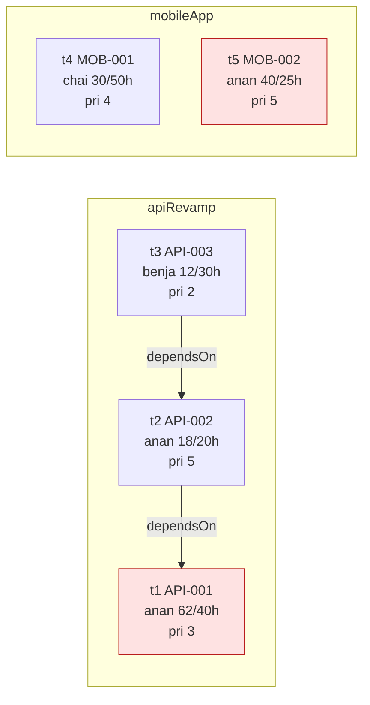
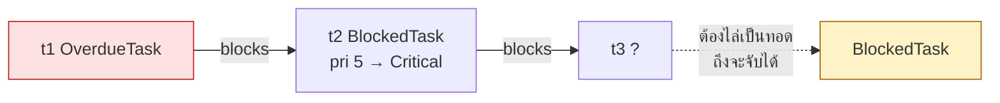
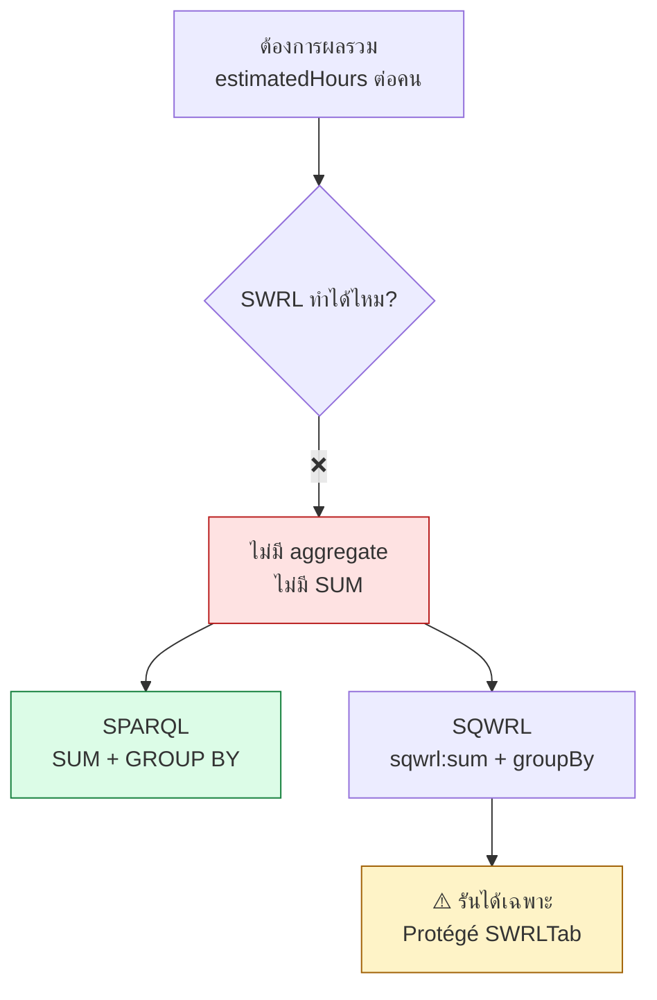
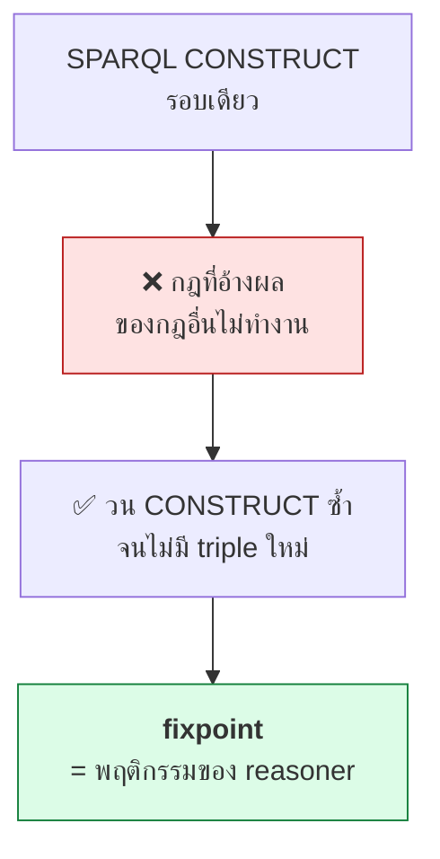
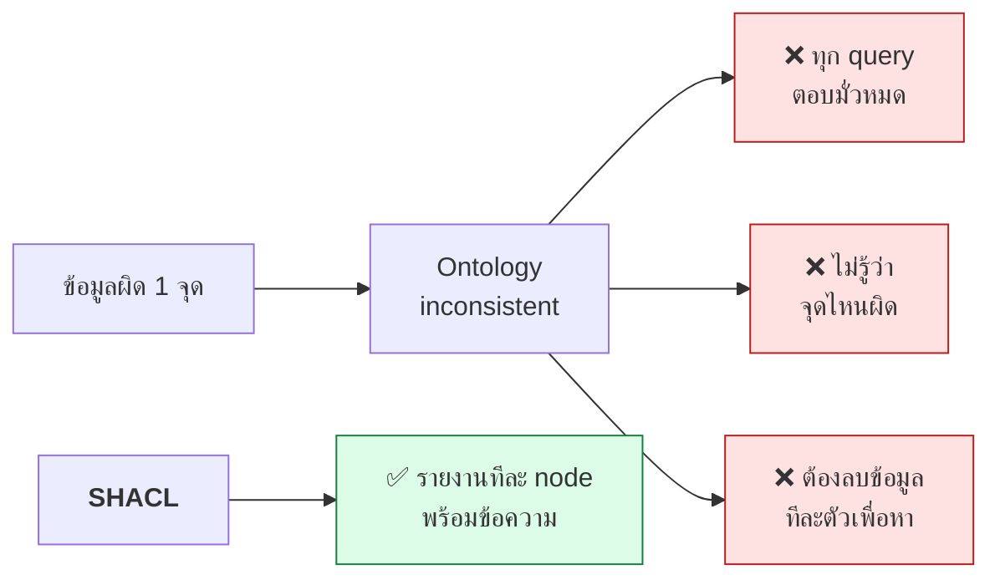

# 11.12 แบบฝึกหัดบทที่ 11

แบบฝึกหัดชุดนี้ใช้โดเมน **ระบบจัดการโครงการซอฟต์แวร์ (Software Project Management)** ต่อเนื่องกันทั้ง 5 ข้อ
เริ่มจากเขียนกฎง่าย ๆ ไปจนถึงเปรียบเทียบผลระหว่าง SWRL กับ SPARQL

---

## ข้อมูลตั้งต้น

บันทึกเป็น `data/project.ttl`

```turtle
# --- รูปแบบเต็ม ---
@prefix rdf:  <http://www.w3.org/1999/02/22-rdf-syntax-ns#> .
@prefix rdfs: <http://www.w3.org/2000/01/rdf-schema#> .
@prefix owl:  <http://www.w3.org/2002/07/owl#> .
@prefix xsd:  <http://www.w3.org/2001/XMLSchema#> .
@prefix pm:   <http://example.org/pm#> .

<http://example.org/pm> rdf:type owl:Ontology .

pm:Person    rdf:type owl:Class .
pm:Developer rdf:type owl:Class ;
    rdfs:subClassOf pm:Person .
pm:Task      rdf:type owl:Class .
pm:Project   rdf:type owl:Class .
```

```turtle
# --- รูปแบบย่อ ---
@prefix pm:  <http://example.org/pm#> .
@prefix xsd: <http://www.w3.org/2001/XMLSchema#> .

# ----- คลาส -----
pm:Person    a owl:Class .
pm:Developer a owl:Class ; rdfs:subClassOf pm:Person .
pm:Task      a owl:Class .
pm:Project   a owl:Class .

# คลาสที่ต้องให้ reasoner เติมสมาชิกให้
pm:OverdueTask     a owl:Class ; rdfs:subClassOf pm:Task .
pm:BlockedTask     a owl:Class ; rdfs:subClassOf pm:Task .
pm:CriticalTask    a owl:Class ; rdfs:subClassOf pm:Task .
pm:OverloadedDev   a owl:Class ; rdfs:subClassOf pm:Developer .
pm:ProjectAtRisk   a owl:Class ; rdfs:subClassOf pm:Project .

# ----- property -----
pm:assignedTo  a owl:ObjectProperty ; rdfs:domain pm:Task   ; rdfs:range pm:Developer .
pm:partOf      a owl:ObjectProperty ; rdfs:domain pm:Task   ; rdfs:range pm:Project .
pm:dependsOn   a owl:ObjectProperty ; rdfs:domain pm:Task   ; rdfs:range pm:Task .
pm:blocks      a owl:ObjectProperty ; owl:inverseOf pm:dependsOn .
pm:collaboratesWith a owl:ObjectProperty , owl:SymmetricProperty .

pm:estimatedHours a owl:DatatypeProperty , owl:FunctionalProperty ; rdfs:range xsd:decimal .
pm:spentHours     a owl:DatatypeProperty , owl:FunctionalProperty ; rdfs:range xsd:decimal .
pm:priority       a owl:DatatypeProperty , owl:FunctionalProperty ; rdfs:range xsd:integer .
pm:status         a owl:DatatypeProperty , owl:FunctionalProperty ; rdfs:range xsd:string .
pm:overrunRatio   a owl:DatatypeProperty , owl:FunctionalProperty ; rdfs:range xsd:decimal .
pm:workload       a owl:DatatypeProperty , owl:FunctionalProperty ; rdfs:range xsd:decimal .
pm:taskCode       a owl:DatatypeProperty , owl:FunctionalProperty ; rdfs:range xsd:string .

# ----- นักพัฒนา -----
pm:anan   a pm:Developer ; rdfs:label "Anan"@en .
pm:benja  a pm:Developer ; rdfs:label "Benja"@en .
pm:chai   a pm:Developer ; rdfs:label "Chai"@en .

[] a owl:AllDifferent ;
   owl:distinctMembers ( pm:anan pm:benja pm:chai ) .

# ----- โครงการ -----
pm:apiRevamp a pm:Project ; rdfs:label "API Revamp"@en .
pm:mobileApp a pm:Project ; rdfs:label "Mobile App"@en .

# ----- งาน -----
pm:t1 a pm:Task ; pm:taskCode "API-001" ; pm:partOf pm:apiRevamp ;
      pm:assignedTo pm:anan  ; pm:estimatedHours 40.0 ; pm:spentHours 62.0 ;
      pm:priority 3 ; pm:status "in-progress" .

pm:t2 a pm:Task ; pm:taskCode "API-002" ; pm:partOf pm:apiRevamp ;
      pm:assignedTo pm:anan  ; pm:estimatedHours 20.0 ; pm:spentHours 18.0 ;
      pm:priority 5 ; pm:status "in-progress" ;
      pm:dependsOn pm:t1 .

pm:t3 a pm:Task ; pm:taskCode "API-003" ; pm:partOf pm:apiRevamp ;
      pm:assignedTo pm:benja ; pm:estimatedHours 30.0 ; pm:spentHours 12.0 ;
      pm:priority 2 ; pm:status "in-progress" ;
      pm:dependsOn pm:t2 .

pm:t4 a pm:Task ; pm:taskCode "MOB-001" ; pm:partOf pm:mobileApp ;
      pm:assignedTo pm:chai  ; pm:estimatedHours 50.0 ; pm:spentHours 30.0 ;
      pm:priority 4 ; pm:status "in-progress" .

pm:t5 a pm:Task ; pm:taskCode "MOB-002" ; pm:partOf pm:mobileApp ;
      pm:assignedTo pm:anan  ; pm:estimatedHours 25.0 ; pm:spentHours 40.0 ;
      pm:priority 5 ; pm:status "in-progress" .
```

### ภาพรวมข้อมูล



---

### Exercise 1: งานที่ใช้เวลาเกินประมาณการ

เขียน SWRL rule **2 ข้อ**

1. คำนวณ `overrunRatio` = `spentHours / estimatedHours` ให้ทุก task
2. ถ้า `overrunRatio` มากกว่า `1.0` ให้จัดเป็น `OverdueTask`

**สิ่งที่ต้องส่ง**

- กฎทั้งสองในรูปแบบ SWRL มาตรฐาน (ใช้ `^` และ `swrlb:`)
- โค้ด Python ที่ใช้ owlready2 รันกฎด้วย Pellet

**ผลลัพธ์ที่คาดหวัง**

```
OverdueTask : ['t1', 't5']

overrunRatio:
  t1 = 1.55      (62 / 40)
  t2 = 0.90      (18 / 20)
  t3 = 0.40      (12 / 30)
  t4 = 0.60      (30 / 50)
  t5 = 1.60      (40 / 25)
```

> 💡 **คำใบ้:** `swrlb:divide(?ratio, ?spent, ?est)` — argument แรกคือผลลัพธ์
> และอย่าลืมว่า reasoner ต้องเห็น `Task(?t)` ก่อนจึงจะจับได้

---

### Exercise 2: งานที่ถูกบล็อก และงานวิกฤต

เขียน SWRL rule **2 ข้อ**

1. **`BlockedTask`** — งานที่ `dependsOn` งานซึ่งเป็น `OverdueTask`
2. **`CriticalTask`** — งานที่ `priority` ตั้งแต่ 5 ขึ้นไป **และ** เป็น `BlockedTask`

**คำถามเพิ่มเติมที่ต้องตอบ**

- `t3` ควรเป็น `BlockedTask` ด้วยหรือไม่ ในเมื่อ `t3 → t2 → t1` และ `t1` เป็น `OverdueTask`?
- ถ้าต้องการให้ `t3` ถูกจับด้วย ต้องแก้อย่างไร — และมี **2 วิธี** ให้เลือก วิธีไหนดีกว่าเพราะอะไร?

**ผลลัพธ์ที่คาดหวัง (ก่อนแก้)**

```
BlockedTask  : ['t2']
CriticalTask : ['t2']
```

**ผลลัพธ์ที่คาดหวัง (หลังแก้ให้เป็นทอด)**

```
BlockedTask  : ['t2', 't3']
CriticalTask : ['t2']
```



> 💡 **คำใบ้:** วิธีหนึ่งใช้ SWRL อีกวิธีใช้ OWL — เปรียบเทียบว่าวิธีไหน
> ทำงานกับ anonymous individual ได้ และวิธีไหนเสี่ยง combinatorial explosion น้อยกว่า

---

### Exercise 3: ภาระงานของนักพัฒนา

**นี่คือข้อที่ SWRL ทำไม่ได้ทั้งหมด — ต้องรู้ว่าตรงไหนต้องเปลี่ยนเครื่องมือ**

1. เขียน SWRL rule หา `collaboratesWith` — นักพัฒนา 2 คนที่ทำงานใน project เดียวกัน (ต้อง**ไม่ใช่**คนเดียวกัน)
2. อธิบายว่าทำไม **จึงเขียน SWRL rule คำนวณ `workload` = ผลรวม `estimatedHours` ของทุก task ที่ได้รับมอบหมาย ไม่ได้**
3. เขียน **SPARQL** ที่ทำหน้าที่ข้อ 2 แทน
4. เขียน **SQWRL** ที่ให้ผลเดียวกัน แล้วอธิบายว่าทำไมรันด้วย Python ไม่ได้

**ผลลัพธ์ที่คาดหวัง**

```
collaboratesWith:
  anan  ↔ benja      (apiRevamp: t1,t2 กับ t3)
  anan  ↔ chai       (mobileApp: t5 กับ t4)

workload (จาก SPARQL):
  anan  = 85.0       (40 + 20 + 25)
  benja = 30.0
  chai  = 50.0
```



> 💡 **คำใบ้ข้อ 1:** `collaboratesWith` เป็น `owl:SymmetricProperty` อยู่แล้ว
> เขียนกฎทางเดียวพอ ให้ OWL เติมทิศกลับให้ — แต่ต้องมี `owl:AllDifferent` รองรับ `differentFrom`

---

### Exercise 4: โครงการที่มีความเสี่ยง และรหัสแจ้งเตือน

1. เขียน SWRL rule จัด `ProjectAtRisk` — โครงการที่มี task อย่างน้อยหนึ่งงานเป็นทั้ง `OverdueTask` **และ** มี `priority` ตั้งแต่ 5
2. เขียน SWRL rule สร้าง `alertCode` จาก `taskCode` ของงานที่ overdue โดยมีรูปแบบ `"ALERT-"` + 3 ตัวแรกของ `taskCode` + `"-"` + `priority`
3. ตรวจสอบว่าผลลัพธ์ที่ได้เป็น `xsd:string` หรือไม่ ถ้าไม่ใช่แล้วมันคืออะไร และเรื่องนี้ส่งผลอะไรบ้าง

**ผลลัพธ์ที่คาดหวัง**

```
ProjectAtRisk : ['mobileApp']

alertCode:
  t5 = "ALERT-MOB-5"

⚠️ ชนิดข้อมูลของ alertCode คือ rdf:PlainLiteral ไม่ใช่ xsd:string
```

> 💡 **คำใบ้ข้อ 2:** `swrlb:substring(?result, ?str, ?offset, ?length)` — offset **เริ่มที่ 1 ไม่ใช่ 0**
> ถ้าใส่ 0 จะได้ literal ว่างเปล่าโดยไม่มี error
> และ `priority` เป็น `xsd:integer` ต้องแปลงเป็น string ก่อนต่อสตริง

> ⚠️ **คำใบ้ข้อ 3:** ลองเขียนกฎอีกข้อที่เปรียบเทียบ `alertCode` กับค่าคงที่ `"ALERT-MOB-5"^^xsd:string` ดู
> แล้วสังเกตว่าเกิดอะไรขึ้น

---

### Exercise 5: ย้ายกฎไป production

แปลงกฎจาก Exercise 1 และ 2 ไปเป็น **SPARQL CONSTRUCT** เพื่อ deploy บน triple store แล้วเทียบผลว่าเหมือนกันหรือไม่

**สิ่งที่ต้องส่ง**

1. SPARQL CONSTRUCT ที่เทียบเท่ากฎทั้งสี่ข้อ
2. โปรแกรม Python ที่รันทั้งสองทางแล้วเทียบผลเป็นตาราง
3. **รายงานความต่าง** พร้อมอธิบายสาเหตุ
4. ระบุว่าต้องทำอะไรเพิ่มเพื่อให้ผลตรงกัน

**ผลลัพธ์ที่คาดหวัง**

```
เทียบผล SWRL vs SPARQL
──────────────────────────────────────────
คลาส            SWRL            SPARQL          ตรงกัน
OverdueTask     ['t1', 't5']    ['t1', 't5']    ✅
BlockedTask     ['t2', 't3']    ['t2']          ❌
CriticalTask    ['t2']          []              ❌

สาเหตุ: SPARQL ไม่ทำ reasoning เอง
  - BlockedTask แบบเป็นทอดต้องใช้ property path  ^pm:dependsOn+
  - CriticalTask อ้าง BlockedTask ที่ SPARQL รอบแรกยังไม่ได้สร้าง
    → ต้องรัน CONSTRUCT ซ้ำจนถึง fixpoint
```



> 💡 **คำใบ้:** reasoner ทำ fixpoint iteration ให้อัตโนมัติ แต่ SPARQL CONSTRUCT ไม่ทำ
> ถ้าย้ายกฎที่พึ่งพากันเป็นทอด **ต้องเขียน loop เอง** และต้องมีเงื่อนไขหยุดที่ถูกต้อง

---

## 🏆 Challenge: ตรวจ Ontology ด้วยกฎ

เขียน SWRL rule ที่ทำให้ ontology **inconsistent โดยเจตนา** เมื่อข้อมูลมีปัญหา เพื่อใช้เป็น "unit test" ของข้อมูล

**โจทย์**

1. ประกาศคลาส `ValidTask` และ `InvalidTask` ที่ `owl:disjointWith` กัน
2. เขียนกฎที่จัด task เป็น `InvalidTask` เมื่อ `spentHours` เป็นลบ หรือ `priority` อยู่นอกช่วง 1–5
3. เขียนกฎที่จัด task ทุกอันเป็น `ValidTask`
4. เพิ่ม task ที่มี `priority` เท่ากับ 9 เข้าไปแล้วรัน reasoner

**คำถามที่ต้องตอบ**

- reasoner รายงานอะไร?
- ทำไมวิธีนี้จึง **แย่กว่า SHACL** สำหรับการตรวจข้อมูล? ตอบให้ครบ 3 เหตุผล
- ถ้าอยากรู้ว่า **task ไหน** ที่ผิด ต้องทำอย่างไร?

**ผลลัพธ์ที่คาดหวัง**

```
✅ ตรวจพบ inconsistency ตามคาด
   OwlReadyInconsistentOntologyError

⚠️ แต่ reasoner ไม่บอกว่า task ไหนผิด
   และเมื่อ ontology inconsistent ทุก query จะตอบว่า "ใช่" ทั้งหมด
```



---

## ✅ เช็กลิสต์ตรวจตัวเอง

หลังทำแบบฝึกหัดครบแล้ว ควรตอบคำถามเหล่านี้ได้ทันที

- [ ] `swrlb:divide(?r, ?a, ?b)` หมายถึงอะไร — `?r` คือตัวไหน?
- [ ] ทำไม `differentFrom(?x, ?y)` ถึงไม่ทำงานถ้าไม่มี `owl:AllDifferent`?
- [ ] `swrlb:substring` เริ่มนับจากตำแหน่งที่เท่าไหร่?
- [ ] ผลของ `swrlb:stringConcat` มีชนิดข้อมูลเป็นอะไร?
- [ ] ทำไม HermiT รันกฎที่มี `swrlb:greaterThan` ไม่ได้?
- [ ] ทำไมต้องใช้ `World()` แยกทุก ontology ใน owlready2?
- [ ] SWRL ทำ `SUM` ได้ไหม — ถ้าไม่ได้ต้องใช้อะไรแทน?
- [ ] SWRL สร้าง individual ใหม่ได้ไหม?
- [ ] ทำไมย้ายกฎไป SPARQL แล้วผลอาจไม่เท่ากัน?
- [ ] เมื่อไหร่ควรใช้ SHACL แทน SWRL?

---

## Key Points

- แบบฝึกหัดชุดนี้ครอบคลุมทั้ง **การเขียนกฎ** (Ex.1, 2, 4) **การรู้ขีดจำกัด** (Ex.3) และ **การย้ายไป production** (Ex.5)
- **Exercise 1** ฝึก builtin คณิตศาสตร์และการไล่ลำดับกฎ — กฎที่สองต้องรอผลของกฎแรก
- **Exercise 2** ฝึกความต่างระหว่าง **กฎทางเดียว** กับ **การไล่เป็นทอด** และเปรียบเทียบ SWRL กับ `TransitiveProperty`
- **Exercise 3** เป็นข้อที่สอนว่า **SWRL ทำ aggregate ไม่ได้** ต้องเปลี่ยนไปใช้ SPARQL หรือ SQWRL
- **Exercise 4** ฝึก string builtin พร้อมกับดัก **offset เริ่มที่ 1** และผลลัพธ์เป็น **`rdf:PlainLiteral`**
- **Exercise 5** เป็นบทเรียนสำคัญที่สุด — SPARQL CONSTRUCT **ไม่ทำ fixpoint iteration ให้** ต้องวนเอง
- **Challenge** แสดงว่าการใช้ inconsistency เป็น validation นั้นใช้ได้ แต่ **ด้อยกว่า SHACL** เพราะไม่บอกว่าจุดไหนผิด ไม่มีข้อความอธิบาย และทำให้ทุก query ตอบมั่ว
- ตรวจตัวเองด้วยเช็กลิสต์ 10 ข้อก่อนไปบทที่ 12
