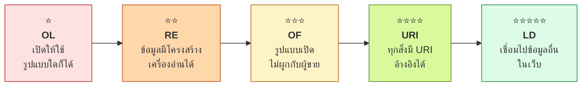
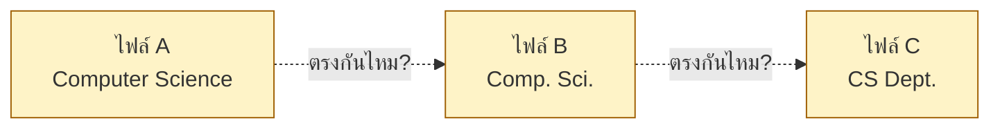
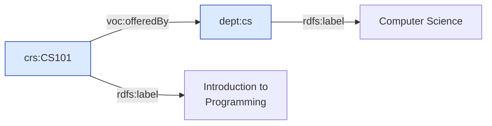
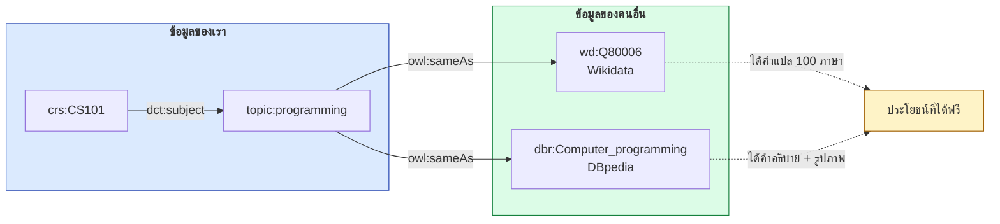
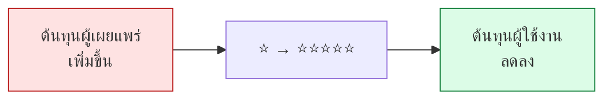
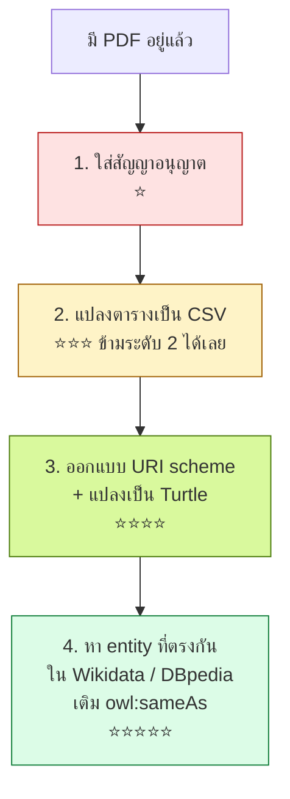

# 12.01 โมเดล 5-Star Open Data

Tim Berners-Lee เสนอระบบให้ดาว 5 ระดับในปี 2010 เพื่อวัดว่า **ข้อมูลเปิด (Open Data)** ชุดหนึ่งพร้อมให้เครื่องนำไปใช้ต่อได้ดีแค่ไหน
บทนี้อธิบายแต่ละดาวพร้อมตัวอย่างข้อมูลชุดเดียวกันที่ไต่ระดับจาก 1 ดาวขึ้นไปถึง 5 ดาว

---

## ภาพรวมทั้ง 5 ระดับ



| ดาว | ตัวย่อ | เงื่อนไข | ตัวอย่างรูปแบบไฟล์ |
| :---: | --- | --- | --- |
| ⭐ | **OL** (On the web, open License) | เผยแพร่บนเว็บพร้อมสัญญาอนุญาตแบบเปิด | PDF, JPG สแกน |
| ⭐⭐ | **RE** (machine-Readable) | ข้อมูลมีโครงสร้างที่เครื่องอ่านได้ | XLS, DOC |
| ⭐⭐⭐ | **OF** (Open Format) | ใช้รูปแบบเปิดที่ไม่ผูกกับผู้ขายรายใด | CSV, JSON, XML |
| ⭐⭐⭐⭐ | **URI** | ใช้ URI ระบุตัวตนของทุกสิ่ง เพื่อให้ชี้กลับมาได้ | RDF, Turtle, JSON-LD |
| ⭐⭐⭐⭐⭐ | **LD** (Linked Data) | เชื่อมข้อมูลของเราไปยังข้อมูลของคนอื่น | Turtle + `owl:sameAs` |

> 💡 **แต่ละดาวสะสมทับกัน** — ข้อมูล 4 ดาวต้องผ่านเงื่อนไขของ 1, 2, 3 ครบก่อนเสมอ

---

## ⭐ ระดับ 1 — เผยแพร่บนเว็บพร้อมสัญญาอนุญาตเปิด

ข้อมูลอยู่บนอินเทอร์เน็ตในรูปแบบใดก็ได้ ขอเพียงมี **สัญญาอนุญาตแบบเปิด** ระบุชัดเจน

```
📄 university-report-2024.pdf
   สัญญาอนุญาต: CC BY 4.0
```

| ✅ ได้อะไร | ❌ ยังขาดอะไร |
| --- | --- |
| คนดาวน์โหลดไปอ่านได้ | เครื่องอ่านไม่ออก |
| แชร์ต่อได้ตามกฎหมาย | ต้องพิมพ์ข้อมูลใหม่ทั้งหมด |

> ⚠️ **จุดที่คนเข้าใจผิดบ่อยที่สุด** — "เอาขึ้นเว็บแล้ว" ยังไม่นับเป็น 1 ดาว
> **ต้องมีสัญญาอนุญาตเปิดกำกับด้วย** ไม่งั้นคนอื่นนำไปใช้ต่อไม่ได้ตามกฎหมาย

---

## ⭐⭐ ระดับ 2 — ข้อมูลมีโครงสร้างที่เครื่องอ่านได้

```
📊 university-report-2024.xlsx
```

| Course Code | Course Name | Credits | Department |
| --- | --- | ---: | --- |
| CS101 | Introduction to Programming | 3 | Computer Science |
| CS201 | Data Structures | 3 | Computer Science |
| MA101 | Calculus I | 4 | Mathematics |

| ✅ ได้อะไร | ❌ ยังขาดอะไร |
| --- | --- |
| โปรแกรมอ่านค่าได้ทีละช่อง | ต้องมี Excel หรือ library เฉพาะ |
| คำนวณ เรียง กรองได้ | รูปแบบเป็นของบริษัทเดียว |

---

## ⭐⭐⭐ ระดับ 3 — รูปแบบเปิด

เปลี่ยนจาก XLS เป็น **CSV** หรือ **JSON** ที่ใครก็เปิดได้โดยไม่ต้องซื้อซอฟต์แวร์

```csv
course_code,course_name,credits,department
CS101,Introduction to Programming,3,Computer Science
CS201,Data Structures,3,Computer Science
MA101,Calculus I,4,Mathematics
```

```json
[
  { "course_code": "CS101", "course_name": "Introduction to Programming",
    "credits": 3, "department": "Computer Science" },
  { "course_code": "CS201", "course_name": "Data Structures",
    "credits": 3, "department": "Computer Science" }
]
```

| ✅ ได้อะไร | ❌ ยังขาดอะไร |
| --- | --- |
| ไม่ผูกกับผู้ขายรายใด | `"Computer Science"` เป็นแค่ข้อความ |
| เครื่องมือทุกภาษาอ่านได้ | ไม่รู้ว่า `department` ในไฟล์นี้คือหน่วยงานเดียวกับในไฟล์อื่นหรือไม่ |
| | รวมกับข้อมูลชุดอื่นต้องเขียนโค้ดจับคู่เอง |



> ⚠️ **นี่คือเพดานของ CSV** — ข้อความที่สะกดต่างกันเล็กน้อยทำให้เครื่องรวมข้อมูลไม่ได้

---

## ⭐⭐⭐⭐ ระดับ 4 — ทุกสิ่งมี URI

เปลี่ยนจาก "ข้อความ" เป็น "ตัวตนที่ชี้กลับมาได้"

```turtle
# --- รูปแบบเต็ม ---
@prefix rdf:  <http://www.w3.org/1999/02/22-rdf-syntax-ns#> .
@prefix rdfs: <http://www.w3.org/2000/01/rdf-schema#> .
@prefix xsd:  <http://www.w3.org/2001/XMLSchema#> .
@prefix uni:  <http://data.example.org/university/> .
@prefix voc:  <http://data.example.org/vocab#> .

<http://data.example.org/university/course/CS101>
    rdf:type voc:Course ;
    rdfs:label "Introduction to Programming"@en ;
    voc:courseCode "CS101"^^xsd:string ;
    voc:credits "3"^^xsd:integer ;
    voc:offeredBy <http://data.example.org/university/dept/cs> .

<http://data.example.org/university/dept/cs>
    rdf:type voc:Department ;
    rdfs:label "Computer Science"@en .
```

```turtle
# --- รูปแบบย่อ ---
# ⚠️ Turtle ไม่อนุญาตให้มี "/" ใน prefixed name
#    จึงต้องประกาศ prefix แยกต่อระดับของ URI path
@prefix crs:  <http://data.example.org/university/course/> .
@prefix dept: <http://data.example.org/university/dept/> .
@prefix voc:  <http://data.example.org/vocab#> .

crs:CS101 a voc:Course ;
    rdfs:label "Introduction to Programming"@en ;
    voc:courseCode "CS101" ;
    voc:credits 3 ;
    voc:offeredBy dept:cs .

dept:cs a voc:Department ;
    rdfs:label "Computer Science"@en .
```



| ✅ ได้อะไร | ❌ ยังขาดอะไร |
| --- | --- |
| ทุกสิ่งมีตัวตนที่ชี้กลับมาได้ | ยังเป็น "เกาะ" ของเราเอง |
| ไม่มีปัญหาสะกดต่างกัน | คนอื่นไม่รู้ว่า `dept:cs` ของเราคือหน่วยงานเดียวกับในระบบเขาหรือไม่ |
| เปิด URL แล้วได้ข้อมูลเพิ่ม | |

---

## ⭐⭐⭐⭐⭐ ระดับ 5 — เชื่อมไปข้อมูลของคนอื่น

เติม `owl:sameAs` และใช้ vocabulary มาตรฐานที่คนอื่นรู้จัก

```turtle
# --- รูปแบบเต็ม ---
@prefix rdf:  <http://www.w3.org/1999/02/22-rdf-syntax-ns#> .
@prefix owl:  <http://www.w3.org/2002/07/owl#> .
@prefix skos: <http://www.w3.org/2004/02/skos/core#> .
@prefix dct:  <http://purl.org/dc/terms/> .
@prefix voc:  <http://data.example.org/vocab#> .
@prefix wd:   <http://www.wikidata.org/entity/> .
@prefix dbr:  <http://dbpedia.org/resource/> .

<http://data.example.org/university/course/CS101>
    rdf:type voc:Course ;
    dct:subject <http://data.example.org/university/topic/programming> .

<http://data.example.org/university/topic/programming>
    owl:sameAs wd:Q80006 ;
    owl:sameAs dbr:Computer_programming ;
    skos:prefLabel "Computer programming"@en .

<http://data.example.org/university/dept/cs>
    dct:subject wd:Q21198 .
```

```turtle
# --- รูปแบบย่อ ---
@prefix crs:   <http://data.example.org/university/course/> .
@prefix dept:  <http://data.example.org/university/dept/> .
@prefix topic: <http://data.example.org/university/topic/> .
@prefix wd:    <http://www.wikidata.org/entity/> .
@prefix dbr:   <http://dbpedia.org/resource/> .
@prefix dct:   <http://purl.org/dc/terms/> .

crs:CS101 a voc:Course ;
    dct:subject topic:programming .

topic:programming
    owl:sameAs wd:Q80006 , dbr:Computer_programming ;
    skos:prefLabel "Computer programming"@en .

dept:cs dct:subject wd:Q21198 .
```



**ประโยชน์ที่ได้ทันทีโดยไม่ต้องทำอะไรเพิ่ม**

| ได้มาจาก | สิ่งที่ได้ |
| --- | --- |
| Wikidata `wd:Q80006` | ชื่อเรียกในกว่า 100 ภาษา, รหัสอ้างอิงในระบบอื่น |
| DBpedia `dbr:Computer_programming` | บทคัดย่อ, รูปภาพ, หมวดหมู่ |
| ระบบอื่นที่ชี้มาที่เดียวกัน | ค้นหาข้ามระบบได้ทันที |

---

## ตัวอย่างจริงในแต่ละระดับ

| ระดับ | ตัวอย่างจริง |
| :---: | --- |
| ⭐ | รายงานประจำปีหน่วยงานราชการที่เผยแพร่เป็น PDF สแกน |
| ⭐⭐ | ตารางสถิติที่แจกเป็น XLSX บนเว็บไซต์หน่วยงาน |
| ⭐⭐⭐ | ชุดข้อมูล CSV บน `data.go.th` และ `data.gov` |
| ⭐⭐⭐⭐ | ชุดข้อมูล RDF ที่มี URI ของตัวเองแต่ยังไม่เชื่อมออกไปข้างนอก |
| ⭐⭐⭐⭐⭐ | **DBpedia**, **Wikidata**, **GeoNames**, **Europeana** |

---

## เปรียบเทียบชุดข้อมูลเดียวกันทั้ง 5 ระดับ

| | ⭐ PDF | ⭐⭐ XLSX | ⭐⭐⭐ CSV | ⭐⭐⭐⭐ RDF | ⭐⭐⭐⭐⭐ LD |
| --- | :---: | :---: | :---: | :---: | :---: |
| คนอ่านได้ | ✅ | ✅ | ✅ | ⚠️ | ⚠️ |
| เครื่องอ่านได้ | ❌ | ✅ | ✅ | ✅ | ✅ |
| ไม่ต้องซื้อซอฟต์แวร์ | ✅ | ❌ | ✅ | ✅ | ✅ |
| อ้างอิงข้อมูลรายรายการได้ | ❌ | ❌ | ❌ | ✅ | ✅ |
| รวมกับข้อมูลอื่นอัตโนมัติ | ❌ | ❌ | ❌ | ❌ | ✅ |
| ค้นด้วย SPARQL ได้ | ❌ | ❌ | ❌ | ✅ | ✅ |
| ต้นทุนในการผลิต | ต่ำสุด | ต่ำ | ต่ำ | ปานกลาง | สูง |



> 🎯 **หัวใจของโมเดลนี้:** ดาวยิ่งมาก **ผู้เผยแพร่เหนื่อยขึ้น** แต่ **ผู้ใช้งานสบายขึ้นมาก**
> การตัดสินใจว่าจะไปถึงกี่ดาวจึงต้องดูว่าใครจะใช้ข้อมูล และใช้ทำอะไร (ดูรายละเอียดใน [12.02](12.02-cost-benefit.md))

---

## เส้นทางไต่ระดับที่ทำได้จริง



> 💡 **ข้ามระดับ 2 ไปที่ 3 ได้เลย** — ไม่มีเหตุผลที่จะแจก XLSX ในเมื่อ CSV ทำได้เท่ากันและเปิดกว่า

---

## Key Points

- โมเดล **5-star Open Data** เสนอโดย **Tim Berners-Lee (2010)** ใช้วัดความพร้อมของข้อมูลเปิดสำหรับการนำไปใช้ต่อ
- **⭐ = อยู่บนเว็บ + มีสัญญาอนุญาตเปิด** — ถ้าไม่มีสัญญาอนุญาต **ยังไม่นับเป็น 1 ดาว**
- **⭐⭐ = เครื่องอ่านได้** (XLS), **⭐⭐⭐ = รูปแบบเปิด** (CSV, JSON) — ควร**ข้ามระดับ 2 ไป 3 เลย**
- **⭐⭐⭐⭐ = ทุกสิ่งมี URI** ทำให้อ้างอิงข้อมูลรายรายการได้และหมดปัญหาการสะกดต่างกัน
- **⭐⭐⭐⭐⭐ = เชื่อมไปข้อมูลของคนอื่น** ด้วย `owl:sameAs` — ได้คำแปล คำอธิบาย และการค้นข้ามระบบมาฟรี
- **แต่ละดาวสะสมทับกัน** — ต้องผ่านระดับล่างครบก่อนเสมอ
- **ดาวยิ่งมาก ผู้เผยแพร่เหนื่อยขึ้น แต่ผู้ใช้งานสบายขึ้นมาก**
- ตัวอย่างข้อมูล 5 ดาวจริง: **DBpedia, Wikidata, GeoNames, Europeana**
