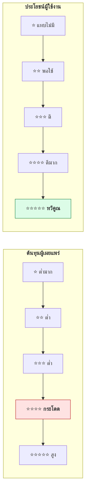
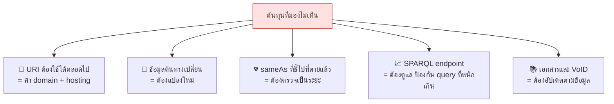
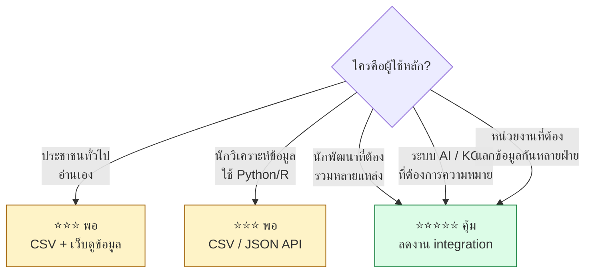
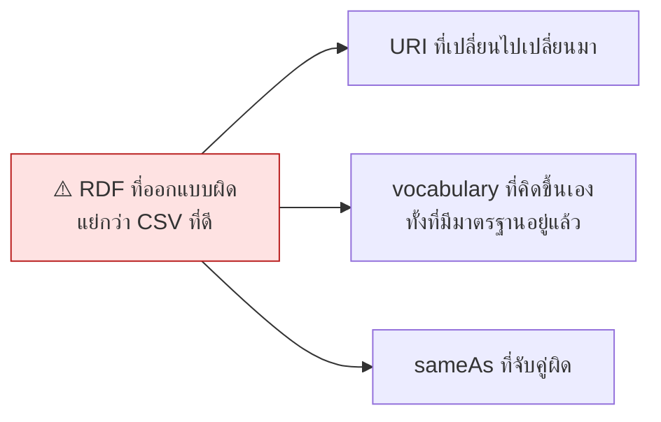
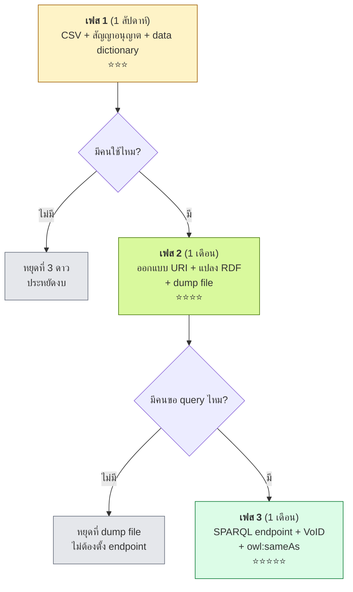
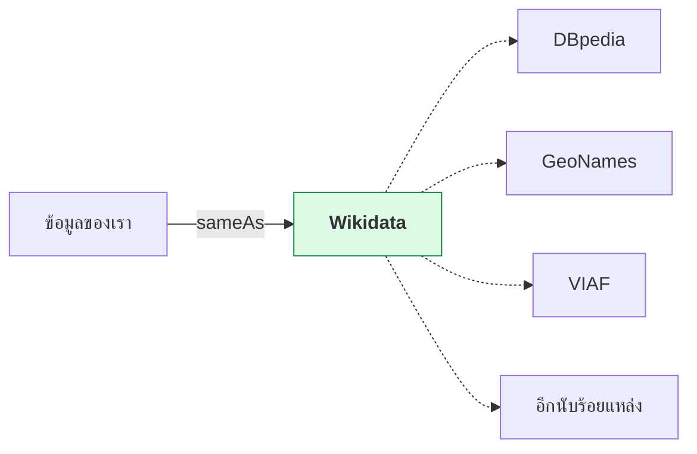

# 12.02 ต้นทุนและประโยชน์ของแต่ละระดับดาว

การไต่จาก 3 ดาวไป 5 ดาวไม่ได้ฟรี — ต้องลงแรงออกแบบ URI หา entity ที่ตรงกัน และดูแลระบบต่อเนื่อง
บทนี้ประเมินต้นทุนกับประโยชน์ของแต่ละระดับอย่างตรงไปตรงมา พร้อมแนวทางตัดสินใจว่าโครงการของคุณควรหยุดที่กี่ดาว

---

## เส้นโค้งต้นทุน–ประโยชน์



> 🎯 **จุดที่ต้นทุนกระโดดคือ ⭐⭐⭐ → ⭐⭐⭐⭐** เพราะต้องออกแบบ URI, เลือก vocabulary,
> ตั้ง server ที่ตอบ URI ได้ และดูแลให้ URI ไม่เสียตลอดอายุโครงการ

---

## ตารางต้นทุนแยกรายการ

| ระดับ | สิ่งที่ต้องทำเพิ่ม | เวลาโดยประมาณ | ทักษะที่ต้องมี |
| :---: | --- | --- | --- |
| ⭐ | เลือกและติดสัญญาอนุญาต | 1–2 ชั่วโมง | ความรู้เรื่องสัญญาอนุญาต |
| ⭐⭐ | ส่งออกเป็นไฟล์ตาราง | 1 วัน | ใช้ spreadsheet ได้ |
| ⭐⭐⭐ | แปลงเป็น CSV/JSON + ทำ data dictionary | 2–5 วัน | เขียนสคริปต์พื้นฐาน |
| ⭐⭐⭐⭐ | ออกแบบ URI scheme, เลือก vocabulary, แปลงเป็น RDF, ตั้ง server | **2–8 สัปดาห์** | RDF, ontology, ระบบเว็บ |
| ⭐⭐⭐⭐⭐ | หา entity ที่ตรงกัน, ตรวจความถูกต้อง, เติม `owl:sameAs`, ทำ VoID | **2–6 สัปดาห์** | Entity linking, SPARQL |

### ค่าใช้จ่ายต่อเนื่องที่คนมักลืม



> ⚠️ **`owl:sameAs` ที่ชี้ไปยัง URI ที่หายไปแล้ว แย่กว่าไม่มี `sameAs` เลย**
> เพราะทำให้ผู้ใช้เชื่อว่าเชื่อมได้ แล้วโปรแกรมพังตอนรัน

---

## ประโยชน์ที่ได้จริงในแต่ละระดับ

<table>
<tr><th width="50%">⭐⭐⭐ CSV</th><th width="50%">⭐⭐⭐⭐⭐ Linked Data</th></tr>
<tr valign="top">
<td>

**ผู้ใช้ต้องทำเอง**

- ดาวน์โหลดไฟล์
- อ่าน data dictionary
- เขียนโค้ดแปลงเป็นโครงสร้างที่ต้องการ
- จับคู่ชื่อกับข้อมูลชุดอื่นเอง
- ทำซ้ำทั้งหมดเมื่อไฟล์อัปเดต

</td>
<td>

**ผู้ใช้ได้ทันที**

- ค้นด้วย SPARQL โดยไม่ต้องดาวน์โหลด
- ความหมายของทุก field ระบุด้วย URI
- รวมกับข้อมูลชุดอื่นอัตโนมัติผ่าน `sameAs`
- ถามข้ามหลาย endpoint ด้วย `SERVICE`
- ข้อมูลอัปเดตแล้วเห็นทันที

</td>
</tr>
</table>

### ตัวอย่างที่จับต้องได้

โจทย์: *"หาหลักสูตรทั้งหมดในไทยที่สอนเรื่อง machine learning พร้อมพิกัดของมหาวิทยาลัย"*

<table>
<tr><th width="50%">ถ้าข้อมูลเป็น ⭐⭐⭐ CSV</th><th width="50%">ถ้าข้อมูลเป็น ⭐⭐⭐⭐⭐ LD</th></tr>
<tr valign="top">
<td>

1. ดาวน์โหลด CSV จาก 50 มหาวิทยาลัย
2. ชื่อคอลัมน์ต่างกันทุกไฟล์ → เขียน mapping มือ
3. ค้นคำว่า "machine learning" ด้วย string matching → พลาดคำว่า "การเรียนรู้ของเครื่อง"
4. หาพิกัดจากอีกแหล่ง → จับคู่ชื่อมหาวิทยาลัยเอง
5. **ใช้เวลาหลายสัปดาห์**

</td>
<td>

```sparql
PREFIX voc:  <http://data.example.org/vocab#>
PREFIX dct:  <http://purl.org/dc/terms/>
PREFIX wd:   <http://www.wikidata.org/entity/>
PREFIX wdt:  <http://www.wikidata.org/prop/direct/>

SELECT ?course ?uniLabel ?coord WHERE {
  ?course a voc:Course ;
          dct:subject wd:Q2539 ;      # machine learning
          voc:offeredBy/voc:partOf ?uni .
  SERVICE <https://query.wikidata.org/sparql> {
    ?uni wdt:P625 ?coord ;
         rdfs:label ?uniLabel .
    FILTER(LANG(?uniLabel) = "th")
  }
}
```

**ใช้เวลาไม่กี่นาที**

</td>
</tr>
</table>

---

## ใครได้ประโยชน์จากดาวไหน



> 💡 **ถ้าผู้ใช้หลักคือคนที่เปิดไฟล์ใน Excel — CSV ที่สะอาดและมีเอกสารดี มีค่ามากกว่า RDF ที่ทำลวก ๆ**

---

## เมื่อไหร่ที่ 5 ดาวคุ้มค่าจริง

| สัญญาณว่าควรลงทุน | เหตุผล |
| --- | --- |
| ข้อมูลของคุณต้องถูกอ้างอิงจากระบบอื่น | URI ทำให้อ้างอิงได้เสถียร |
| มีข้อมูลจากหลายหน่วยงานที่ต้องรวมกัน | `sameAs` ลดงาน integration ลงมาก |
| ข้อมูลมีความสัมพันธ์ซับซ้อน ไม่ใช่แค่ตาราง | กราฟแสดงความสัมพันธ์ได้ตรงกว่าตาราง |
| มีคำศัพท์/รหัสมาตรฐานอยู่แล้ว | เชื่อมกับมาตรฐานสากลได้ทันที |
| ข้อมูลอยู่ยาว มีคนใช้ต่อเนื่องหลายปี | ต้นทุนเริ่มต้นถูกหารด้วยเวลา |

| สัญญาณว่าอย่าเพิ่ง | เหตุผล |
| --- | --- |
| ข้อมูลเป็นตารางแบน ไม่มีความสัมพันธ์ | RDF ไม่ได้เพิ่มอะไร |
| ใช้ครั้งเดียวแล้วทิ้ง | ต้นทุนไม่คุ้ม |
| ยังไม่มีคนขอใช้ข้อมูลเลย | ทำ CSV ก่อน แล้วดูว่ามีคนใช้ไหม |
| ทีมยังไม่มีใครรู้ RDF | เสี่ยงได้ RDF ที่ผิดหลักและแก้ยาก |
| ข้อมูลเปลี่ยนทุกนาที | ต้นทุนการ rebuild สูงเกิน |



---

## แนวทางไต่ระดับแบบทีละขั้น



> 💡 **วัดก่อนลงทุนต่อ** — ดูสถิติการดาวน์โหลด CSV ก่อนตัดสินใจว่าจะทำ RDF
> ข้อมูลที่ไม่มีคนดาวน์โหลดเลย ไม่มีเหตุผลที่จะทำเป็น 5 ดาว

---

## เทคนิคลดต้นทุนที่ใช้ได้จริง

| เทคนิค | ประหยัดอะไร |
| --- | --- |
| **ใช้ vocabulary ที่มีอยู่แล้ว** (schema.org, Dublin Core, SKOS, FOAF) | ไม่ต้องออกแบบ ontology เอง และคนอื่นเข้าใจทันที |
| **แจก dump file ก่อน ไม่ต้องมี endpoint** | ไม่ต้องดูแล server ที่รับ query หนัก |
| **ใช้ `w3id.org` หรือ `purl.org`** สำหรับ URI | URI คงทนแม้ย้าย hosting |
| **เชื่อมเฉพาะ entity สำคัญ** (สถานที่ องค์กร หัวข้อ) | ได้ประโยชน์ 80% ด้วยแรง 20% |
| **ใช้ `R2RML` / `RML` แปลงจากฐานข้อมูลเดิม** | ไม่ต้องเขียนสคริปต์แปลงใหม่ทุกครั้ง |
| **แปลงอัตโนมัติในไปป์ไลน์ CI** | ข้อมูลอัปเดตแล้ว RDF อัปเดตตาม |
| **ใช้ Wikidata เป็นตัวกลาง** | เชื่อมเข้า Wikidata แหล่งเดียว ได้ลิงก์ไปที่อื่นตามมา |



> 🎯 **เชื่อมเข้า Wikidata ที่เดียว คุ้มที่สุด** เพราะ Wikidata เชื่อมต่อไปยังฐานข้อมูลอื่นอีกนับร้อยแหล่งอยู่แล้ว

---

## Key Points

- **ต้นทุนกระโดดที่ ⭐⭐⭐ → ⭐⭐⭐⭐** เพราะต้องออกแบบ URI เลือก vocabulary และตั้งระบบที่ตอบ URI ได้
- ต้นทุนที่คนลืมคือ **ค่าใช้จ่ายต่อเนื่อง** — URI ต้องใช้ได้ตลอดไป, `sameAs` ต้องตรวจว่ายังไม่ตาย, endpoint ต้องดูแล
- ⚠️ **`owl:sameAs` ที่ชี้ไปยัง URI ที่หายไปแล้ว แย่กว่าไม่มีเลย**
- **5 ดาวคุ้มเมื่อ**: ข้อมูลถูกอ้างอิงจากระบบอื่น, ต้องรวมข้อมูลหลายหน่วยงาน, ความสัมพันธ์ซับซ้อน, ใช้ยาวหลายปี
- **อย่าเพิ่งทำ 5 ดาวเมื่อ**: ข้อมูลเป็นตารางแบน, ใช้ครั้งเดียว, ยังไม่มีคนขอใช้, ทีมยังไม่มีใครรู้ RDF
- ⚠️ **RDF ที่ออกแบบผิด แย่กว่า CSV ที่ดี** — URI ที่เปลี่ยนไปมา และ `sameAs` ที่จับคู่ผิด สร้างความเสียหายจริง
- ใช้แนวทาง **ไต่ทีละเฟสแล้ววัดผล** — ดูสถิติการใช้งาน CSV ก่อนตัดสินใจลงทุนทำ RDF
- ลดต้นทุนด้วยการ **ใช้ vocabulary ที่มีอยู่แล้ว**, **แจก dump file ก่อนตั้ง endpoint**, **ใช้ `w3id.org` เพื่อ URI ที่คงทน**
- **เชื่อมเข้า Wikidata ที่เดียวคุ้มที่สุด** เพราะได้ลิงก์ไปฐานข้อมูลอื่นอีกนับร้อยแหล่งตามมา
