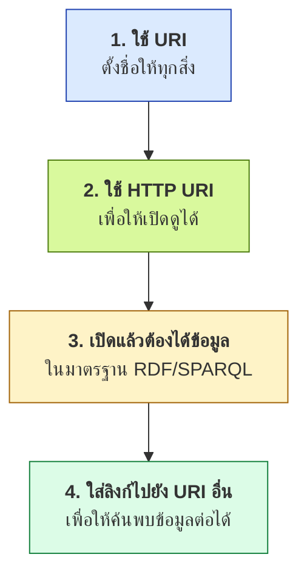
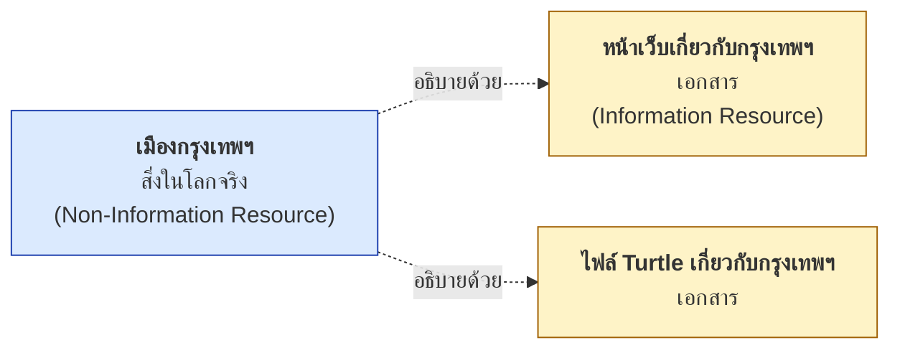
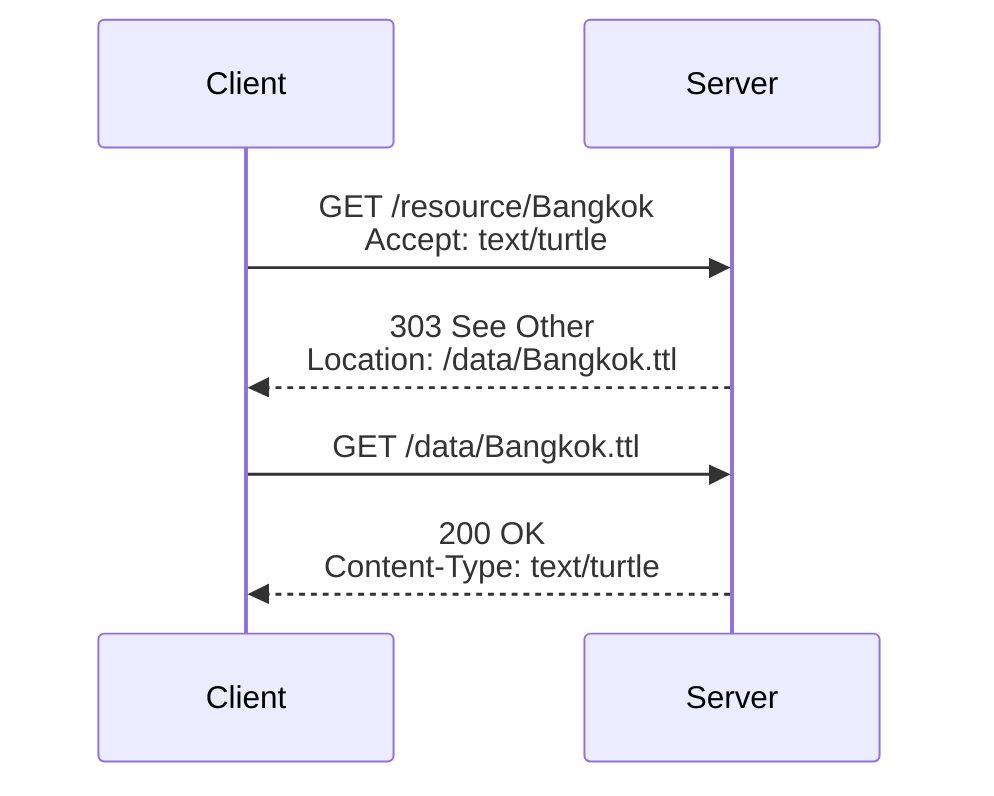
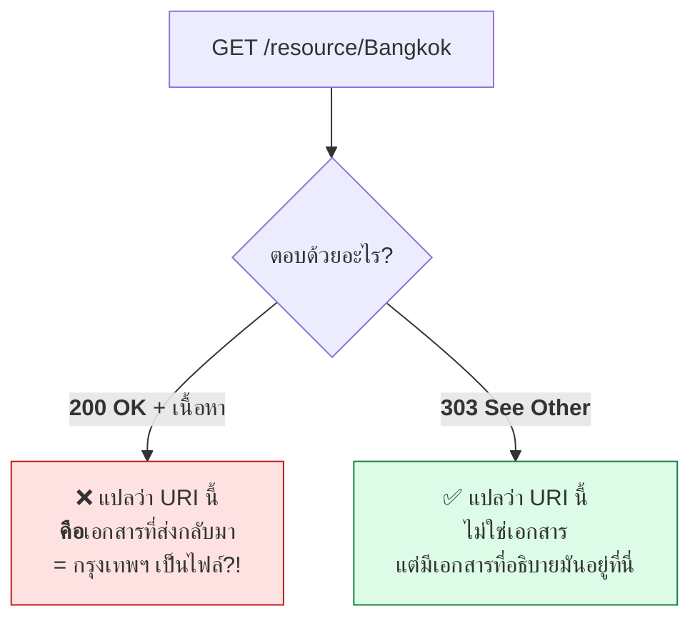
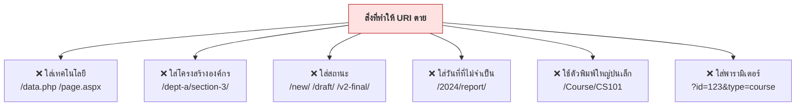
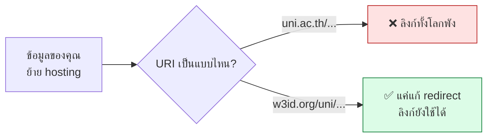
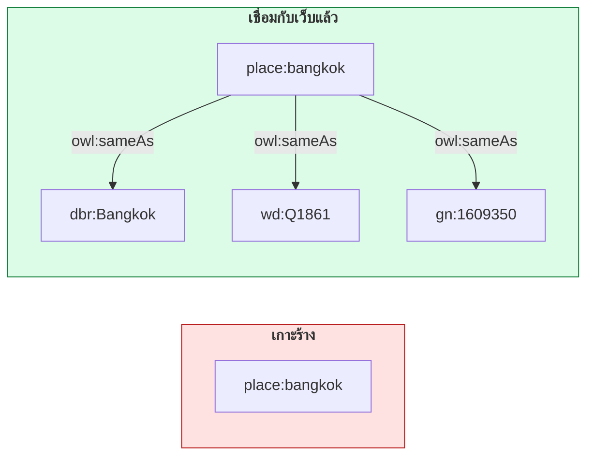
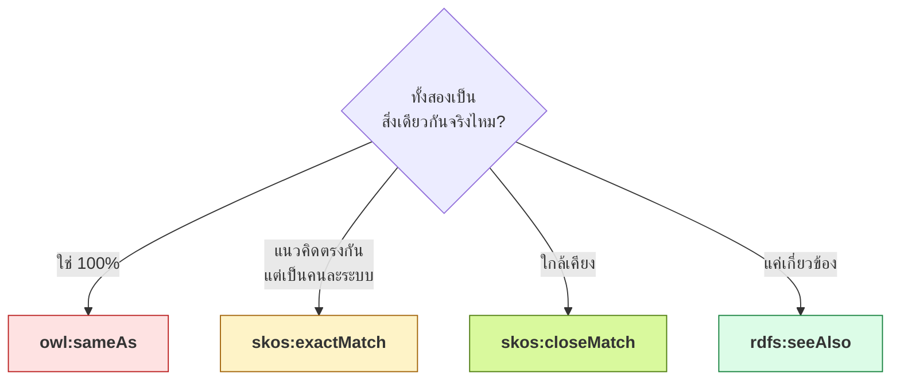

# 12.03 หลักการ Linked Data 4 ข้อ

ในปี 2006 Tim Berners-Lee เขียนบันทึกสั้น ๆ วางกฎ 4 ข้อสำหรับการเผยแพร่ข้อมูลบนเว็บให้เชื่อมโยงกันได้
กฎทั้งสี่นี้เป็นรากฐานของทุกอย่างในบทที่ 12 และผลลัพธ์ทุกอย่างในหน้านี้เป็นผลเรียกจริงจากเว็บ

---

## กฎ 4 ข้อ



| ข้อ | หลักการ | ความหมายในทางปฏิบัติ |
| :---: | --- | --- |
| 1 | **Use URIs as names for things** | ไม่ใช่แค่เอกสาร — คน สถานที่ แนวคิด ก็ต้องมี URI |
| 2 | **Use HTTP URIs** | ต้องเป็น `http://` หรือ `https://` เพื่อให้พิมพ์ลง browser แล้วเปิดได้ |
| 3 | **Provide useful information using the standards (RDF, SPARQL)** | เปิด URI แล้วต้องได้ข้อมูลที่เครื่องเข้าใจ ไม่ใช่หน้า 404 |
| 4 | **Include links to other URIs** | เชื่อมออกไปข้างนอก เพื่อให้ผู้ใช้เดินทางต่อไปหาข้อมูลอื่นได้ |

---

## กฎข้อ 1 — URI สำหรับ "สิ่งของ" ไม่ใช่แค่ "เอกสาร"

นี่คือจุดที่คนสับสนมากที่สุดในทั้งบท



**ทั้งสามต้องมี URI คนละอัน** เพราะมันคนละสิ่งกันจริง ๆ

| สิ่ง | URI ของ DBpedia |
| --- | --- |
| เมืองกรุงเทพฯ (ตัวเมืองจริง) | `http://dbpedia.org/resource/Bangkok` |
| หน้า HTML ที่อธิบายกรุงเทพฯ | `http://dbpedia.org/page/Bangkok` |
| ไฟล์ Turtle ที่อธิบายกรุงเทพฯ | `http://dbpedia.org/data/Bangkok.ttl` |

> ⚠️ **ถ้าใช้ URI เดียวกันสำหรับเมืองกับหน้าเว็บ จะเกิดเรื่องประหลาด** เช่น
> "กรุงเทพฯ มีขนาด 45 กิโลไบต์" หรือ "กรุงเทพฯ แก้ไขล่าสุดเมื่อวานนี้"

---

## กฎข้อ 2 และ 3 — Content Negotiation

เมื่อ URI เดียวต้องเสิร์ฟทั้งคนและเครื่อง เว็บเซิร์ฟเวอร์จะดูที่ HTTP header ชื่อ `Accept` แล้วเปลี่ยนเส้นทางไปยังเอกสารที่เหมาะสม



### 🔬 ทดลองจริงกับ DBpedia

```bash
curl -s -I -H "Accept: text/turtle" "https://dbpedia.org/resource/Bangkok"
```

ผลจริง

```
HTTP/2 303
content-type: text/turtle
location: http://dbpedia.org/data/Bangkok.ttl
```

```bash
curl -s -I -H "Accept: text/html" "https://dbpedia.org/resource/Bangkok"
```

ผลจริง

```
HTTP/2 303
content-type: text/html; charset=UTF-8
location: http://dbpedia.org/page/Bangkok
```

> 🎯 **URI เดียวกัน แต่ `Accept` ต่างกัน → ปลายทางต่างกัน** นี่คือหัวใจของกฎข้อ 3

### ดูข้อมูลที่ได้จริง

```bash
curl -s -L -H "Accept: text/turtle" "https://dbpedia.org/resource/Bangkok" | head -8
```

```turtle
@prefix foaf:	<http://xmlns.com/foaf/0.1/> .
@prefix wikipedia-en:	<http://en.wikipedia.org/wiki/> .
@prefix dbr:	<http://dbpedia.org/resource/> .
wikipedia-en:Bangkok	foaf:primaryTopic	dbr:Bangkok .
@prefix dbo:	<http://dbpedia.org/ontology/> .
dbr:New_York_City	dbo:wikiPageWikiLink	dbr:Bangkok .
```

---

## ทำไมต้อง **303** ไม่ใช่ 200



| รหัส | ความหมาย | เหมาะกับ |
| --- | --- | --- |
| **200 OK** | "URI นี้คือเอกสารที่คุณได้รับ" | เอกสาร รูปภาพ ไฟล์ข้อมูล |
| **303 See Other** | "URI นี้ไม่ใช่เอกสาร แต่ดูคำอธิบายได้ที่นี่" | **สิ่งของในโลกจริง** |
| **404 Not Found** | ไม่มี | ❌ อย่าให้เกิดกับ URI ที่เคยเผยแพร่ |
| **410 Gone** | เคยมี แต่เลิกแล้วอย่างถาวร | ข้อมูลที่ยกเลิก (ดีกว่า 404) |

---

## Cool URIs — URI ที่ไม่มีวันตาย

> **"Cool URIs don't change"** — Tim Berners-Lee, 1998



### ตัวอย่างเปรียบเทียบ

| ❌ URI ที่จะตาย | ✅ Cool URI |
| --- | --- |
| `http://uni.ac.th/registrar.php?course=CS101` | `http://data.uni.ac.th/course/CS101` |
| `http://uni.ac.th/2024/new/courses/CS101.html` | `http://data.uni.ac.th/course/CS101` |
| `http://uni.ac.th/Faculty-of-Sci/CS-Dept/CS101` | `http://data.uni.ac.th/course/CS101` |
| `http://uni.ac.th/api/v2/getCourse?id=101` | `http://data.uni.ac.th/course/CS101` |

### หลักการออกแบบ Cool URI

| หลัก | เหตุผล |
| --- | --- |
| **สั้นที่สุดเท่าที่จะทำได้** | จำง่าย พิมพ์ง่าย พังยาก |
| **ไม่มีนามสกุลไฟล์** | เปลี่ยนรูปแบบข้อมูลได้โดยไม่ต้องเปลี่ยน URI |
| **ไม่มีชื่อเทคโนโลยี** | เปลี่ยนจาก PHP เป็น Python ได้โดย URI ไม่ตาย |
| **ใช้ตัวพิมพ์เล็กเสมอ** | URI แยกแยะตัวพิมพ์ใหญ่-เล็ก ทำให้เกิดข้อผิดพลาดง่าย |
| **ใช้คำนามที่มั่นคง** | โครงสร้างองค์กรเปลี่ยนได้ แต่ "course" ไม่เปลี่ยน |
| **ใช้ domain ที่ควบคุมได้ยาว ๆ** | หรือใช้ `w3id.org` / `purl.org` |



---

## กฎข้อ 4 — เชื่อมออกไปข้างนอก

ข้อมูลที่ไม่มีลิงก์ออก คือ **เกาะร้าง** ที่ไม่มีใครเดินทางมาถึง

```turtle
# --- รูปแบบเต็ม: ยังเป็นเกาะ (3 กฎแรกครบ แต่ขาดข้อ 4) ---
@prefix rdf:  <http://www.w3.org/1999/02/22-rdf-syntax-ns#> .
@prefix rdfs: <http://www.w3.org/2000/01/rdf-schema#> .
@prefix voc:  <http://data.example.org/vocab#> .

<http://data.example.org/place/bangkok>
    rdf:type voc:City ;
    rdfs:label "Bangkok"@en ;
    rdfs:label "กรุงเทพมหานคร"@th .
```

```turtle
# --- รูปแบบย่อ: เชื่อมออกแล้ว (ครบทั้ง 4 กฎ) ---
@prefix place: <http://data.example.org/place/> .
@prefix voc:   <http://data.example.org/vocab#> .
@prefix owl:   <http://www.w3.org/2002/07/owl#> .
@prefix dbr:   <http://dbpedia.org/resource/> .
@prefix wd:    <http://www.wikidata.org/entity/> .
@prefix gn:    <http://sws.geonames.org/> .
@prefix geo:   <http://www.w3.org/2003/01/geo/wgs84_pos#> .

place:bangkok a voc:City ;
    rdfs:label "Bangkok"@en , "กรุงเทพมหานคร"@th ;
    geo:lat  13.7563 ;
    geo:long 100.5018 ;
    owl:sameAs dbr:Bangkok , wd:Q1861 , gn:1609350 .
```



### เลือก predicate ให้ถูกกับความหมาย

| Predicate | ใช้เมื่อ | ความเข้มงวด |
| --- | --- | --- |
| `owl:sameAs` | เป็น**สิ่งเดียวกันแน่นอน** ทุกคุณสมบัติแลกกันได้ | **เข้มมาก** |
| `skos:exactMatch` | แนวคิดตรงกันในบริบทการจัดหมวดหมู่ | เข้มปานกลาง |
| `skos:closeMatch` | ใกล้เคียงพอที่จะใช้แทนกันได้ในงานส่วนใหญ่ | หลวม |
| `skos:relatedMatch` | เกี่ยวข้องกัน แต่ไม่ใช่สิ่งเดียวกัน | หลวมมาก |
| `rdfs:seeAlso` | มีข้อมูลเพิ่มเติมอยู่ที่นั่น | ไม่ผูกมัดความหมาย |
| `foaf:primaryTopic` | เอกสารนี้มีหัวข้อหลักคือสิ่งนั้น | เชื่อมเอกสาร↔สิ่งของ |



> ⚠️ **`owl:sameAs` แรงกว่าที่คนคิดมาก** — reasoner จะรวมทุกคุณสมบัติของสองฝั่งเข้าด้วยกัน
> ถ้าจับคู่ผิดแม้แค่คู่เดียว ข้อมูลที่ผิดจะแพร่ไปทั่วกราฟ ถ้าไม่มั่นใจให้ใช้ `skos:closeMatch`

---

## เช็กลิสต์ตรวจว่าข้อมูลของคุณเป็น Linked Data จริงหรือยัง

- [ ] ทุก entity มี **HTTP URI** ของตัวเอง (ไม่ใช่ blank node)
- [ ] URI ของ **สิ่งของ** แยกจาก URI ของ **เอกสาร**
- [ ] เปิด URI แล้วได้ **303** (สำหรับสิ่งของ) หรือ **200** (สำหรับเอกสาร) ไม่ใช่ 404
- [ ] รองรับ **content negotiation** อย่างน้อย `text/html` และ `text/turtle`
- [ ] URI **ไม่มี** นามสกุลไฟล์ ชื่อเทคโนโลยี หรือพารามิเตอร์
- [ ] URI ใช้ **ตัวพิมพ์เล็ก** สม่ำเสมอ
- [ ] มี **ลิงก์ออก** ไปยัง dataset อื่นอย่างน้อย 1 แห่ง
- [ ] เลือก predicate เชื่อมโยง **ตรงกับระดับความมั่นใจ** ที่มีจริง
- [ ] URI ทุกตัวที่เผยแพร่แล้ว **ไม่เปลี่ยน** ตลอดอายุโครงการ

---

## Key Points

- หลักการ Linked Data 4 ข้อ (Tim Berners-Lee, 2006): **ใช้ URI → ใช้ HTTP URI → เปิดแล้วได้ข้อมูลมาตรฐาน → ใส่ลิงก์ออก**
- ⚠️ **URI ของ "สิ่งของ" ต้องแยกจาก URI ของ "เอกสาร"** — DBpedia แยกเป็น `/resource/`, `/page/`, `/data/`
- **Content negotiation** ใช้ HTTP header `Accept` ตัดสินว่าจะส่งคนไปหน้า HTML หรือส่งเครื่องไปไฟล์ Turtle
- ต้องตอบด้วย **303 See Other** สำหรับสิ่งของในโลกจริง — ถ้าตอบ 200 เท่ากับบอกว่า "กรุงเทพฯ คือไฟล์"
- **Cool URIs don't change** — ห้ามใส่นามสกุลไฟล์ ชื่อเทคโนโลยี โครงสร้างองค์กร สถานะ หรือพารามิเตอร์
- ใช้ **`w3id.org` หรือ `purl.org`** เพื่อให้ URI ยังใช้ได้แม้ย้าย hosting
- **ข้อมูลที่ไม่มีลิงก์ออกคือเกาะร้าง** — ต้องเชื่อมไปยัง DBpedia / Wikidata / GeoNames อย่างน้อยหนึ่งแห่ง
- ⚠️ **`owl:sameAs` เข้มงวดมาก** — reasoner รวมทุกคุณสมบัติของสองฝั่ง ถ้าไม่มั่นใจให้ใช้ **`skos:closeMatch`** แทน
