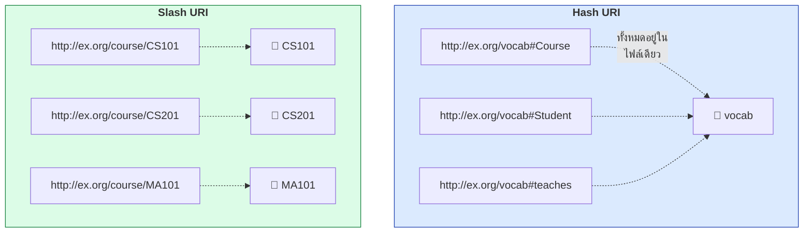
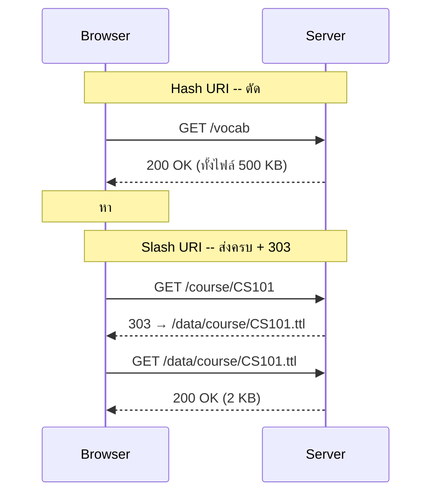
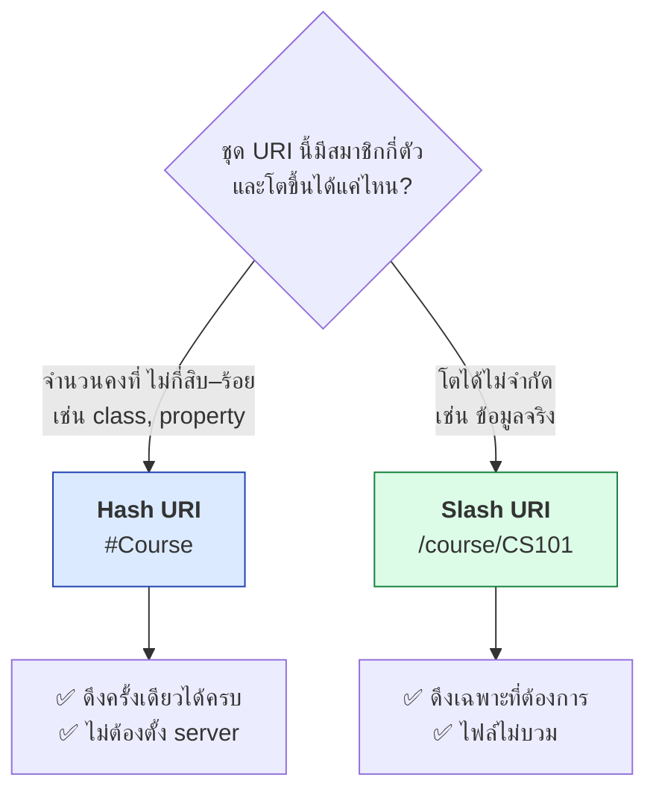
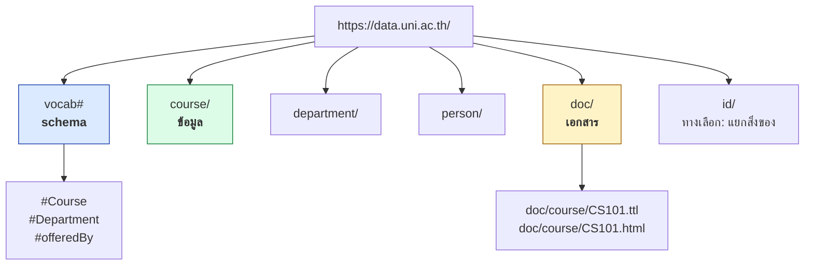
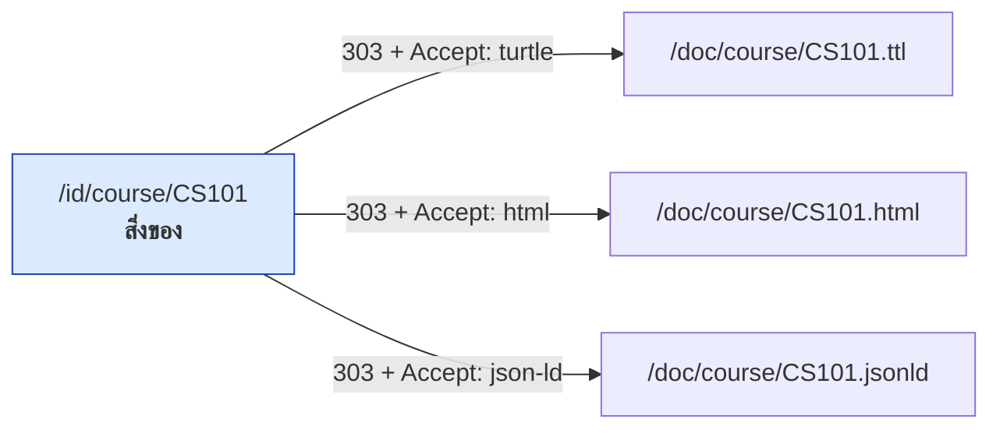
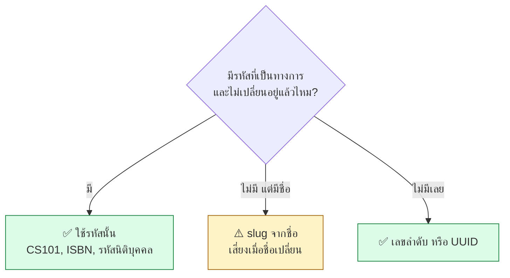
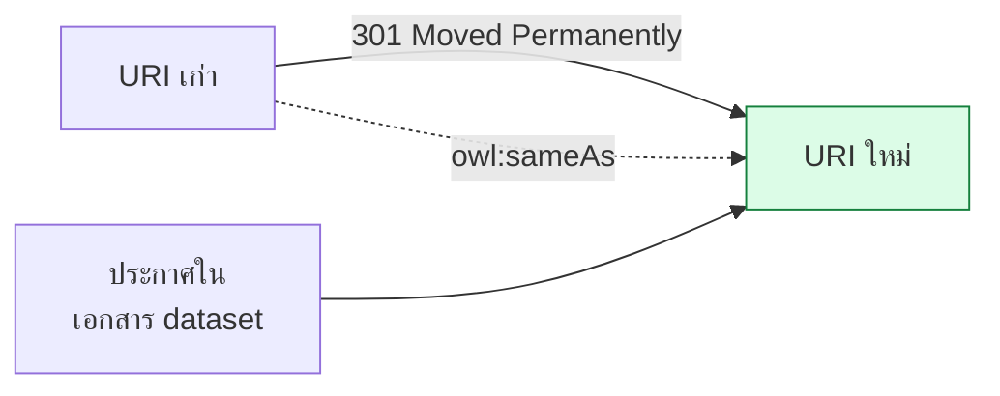

# 12.04 การออกแบบ URI

URI คือสิ่งเดียวในชุดข้อมูล Linked Data ที่ **แก้ทีหลังไม่ได้** — เพราะเมื่อคนอื่นอ้างอิงไปแล้ว การเปลี่ยนแปลงจะทำให้ลิงก์ของทั้งโลกพัง
บทนี้ลงรายละเอียดการเลือกระหว่าง Hash URI กับ Slash URI และวางโครงสร้าง URI scheme ที่ใช้ได้ยาว

---

## Hash URI กับ Slash URI



### กลไกที่ต่างกัน

| | Hash URI | Slash URI |
| --- | --- | --- |
| **รูปแบบ** | `.../vocab#Course` | `.../course/CS101` |
| **สิ่งที่ browser ส่งไป server** | `.../vocab` (ตัด `#` ทิ้ง) | `.../course/CS101` (ส่งครบ) |
| **จำนวน HTTP request** | **1** ครั้ง ได้ทั้งไฟล์ | 1 ครั้งต่อ 1 resource |
| **ต้องตั้ง 303 redirect ไหม** | ❌ ไม่ต้อง | ✅ ต้อง |
| **ต้องใช้ server ที่ตั้งค่าได้ไหม** | ❌ วางไฟล์นิ่ง ๆ ก็พอ | ✅ ต้องตั้งค่า |
| **ดึงทีละ resource ได้ไหม** | ❌ ได้ทั้งไฟล์เสมอ | ✅ ได้ |



---

## เลือกอย่างไร



| ใช้ **Hash URI** เมื่อ | ใช้ **Slash URI** เมื่อ |
| --- | --- |
| เป็น **vocabulary / ontology** | เป็น **ข้อมูลจริง (instance data)** |
| จำนวน term คงที่และไม่มาก | จำนวนรายการโตได้ไม่จำกัด |
| ผู้ใช้มักต้องการทั้งชุด | ผู้ใช้ต้องการทีละรายการ |
| ไม่มี server ที่ตั้งค่าได้ | มี server ที่ตั้ง redirect ได้ |

### ตัวอย่างจากมาตรฐานจริง

| Vocabulary | รูปแบบ | ตัวอย่าง |
| --- | --- | --- |
| **FOAF** | Hash | `http://xmlns.com/foaf/0.1/#Person` *(ใช้ slash ก็ได้)* |
| **RDF/RDFS/OWL** | Hash | `http://www.w3.org/2002/07/owl#Class` |
| **SKOS** | Hash | `http://www.w3.org/2004/02/skos/core#Concept` |
| **Dublin Core Terms** | Slash | `http://purl.org/dc/terms/title` |
| **schema.org** | Slash | `https://schema.org/Person` |
| **DBpedia resource** | Slash | `http://dbpedia.org/resource/Bangkok` |
| **Wikidata entity** | Slash | `http://www.wikidata.org/entity/Q1861` |

> 💡 **รูปแบบผสมที่ใช้กันทั่วไป:** **vocabulary ใช้ hash** + **ข้อมูลใช้ slash**
> ซึ่งเป็นรูปแบบที่คอร์สนี้ใช้ตลอด

---

## โครงสร้าง URI scheme ที่แนะนำ

```
https://data.{องค์กร}/{ประเภท}/{ตัวระบุ}
        └── domain ──┘ └─ class ─┘ └─ id ─┘
```

```turtle
# --- รูปแบบเต็ม ---
@prefix rdf:  <http://www.w3.org/1999/02/22-rdf-syntax-ns#> .
@prefix rdfs: <http://www.w3.org/2000/01/rdf-schema#> .

# vocabulary -- hash URI รวมในไฟล์เดียว
<https://data.uni.ac.th/vocab#Course>     rdf:type rdfs:Class .
<https://data.uni.ac.th/vocab#Department> rdf:type rdfs:Class .
<https://data.uni.ac.th/vocab#offeredBy>  rdf:type rdf:Property .

# ข้อมูลจริง -- slash URI แยกทีละรายการ
<https://data.uni.ac.th/course/CS101>
    rdf:type <https://data.uni.ac.th/vocab#Course> ;
    <https://data.uni.ac.th/vocab#offeredBy>
        <https://data.uni.ac.th/department/cs> .
```

```turtle
# --- รูปแบบย่อ ---
@prefix rdfs: <http://www.w3.org/2000/01/rdf-schema#> .
@prefix voc:  <https://data.uni.ac.th/vocab#> .
@prefix crs:  <https://data.uni.ac.th/course/> .
@prefix dept: <https://data.uni.ac.th/department/> .

voc:Course     a rdfs:Class .
voc:Department a rdfs:Class .
voc:offeredBy  a rdf:Property .

crs:CS101 a voc:Course ;
    voc:offeredBy dept:cs .
```

> ⚠️ **Turtle ไม่อนุญาตให้มี `/` ใน prefixed name** — จึงต้องประกาศ prefix
> แยกต่อระดับของ path (`crs:` กับ `dept:`) แทนที่จะเขียน `uni:course/CS101`

### แผนผัง namespace ที่ครบถ้วน



---

## รูปแบบ `/id/` กับ `/doc/`

เมื่อต้องแยก URI ของสิ่งของออกจาก URI ของเอกสารอย่างชัดเจน

| บทบาท | URI | ตอบด้วย |
| --- | --- | --- |
| **สิ่งของ** (หลักสูตร CS101 จริง) | `https://data.uni.ac.th/id/course/CS101` | **303** → `/doc/...` |
| **เอกสาร HTML** | `https://data.uni.ac.th/doc/course/CS101.html` | 200 `text/html` |
| **เอกสาร Turtle** | `https://data.uni.ac.th/doc/course/CS101.ttl` | 200 `text/turtle` |
| **เอกสาร JSON-LD** | `https://data.uni.ac.th/doc/course/CS101.jsonld` | 200 `application/ld+json` |



> 💡 รูปแบบนี้ใช้กันมากในภาครัฐยุโรป เช่น `data.gov.uk` เพราะ **อ่านแล้วรู้ทันที** ว่า URI ไหนคือสิ่งของ URI ไหนคือเอกสาร

---

## เลือกตัวระบุ (identifier)



| แบบ | ตัวอย่าง | ✅ ข้อดี | ❌ ข้อเสีย |
| --- | --- | --- | --- |
| **รหัสทางการ** | `/course/CS101` | อ่านรู้เรื่อง ตรงกับระบบเดิม | ถ้าองค์กรเปลี่ยนรหัส จะยุ่ง |
| **Slug จากชื่อ** | `/person/somchai-jaidee` | อ่านง่ายมาก | ชื่อเปลี่ยน สะกดผิด ชื่อซ้ำ |
| **เลขลำดับ** | `/course/10234` | ไม่เปลี่ยนแน่นอน | อ่านไม่รู้เรื่อง เดา URI อื่นได้ |
| **UUID** | `/course/9f8b...` | ไม่ชนกันแน่นอน สร้างแบบกระจายได้ | ยาว อ่านไม่ได้เลย |
| **ผสม** | `/course/CS101` + `owl:sameAs` ไปยัง UUID | ได้ทั้งสองอย่าง | ต้องดูแลสองชุด |

> ⚠️ **อย่าใช้ข้อมูลส่วนบุคคลเป็นส่วนหนึ่งของ URI** เช่น เลขบัตรประชาชนหรืออีเมล
> เพราะ URI จะถูกเก็บ แคช และจัดทำดัชนีไปทั่วโดยที่ลบไม่ได้

---

## ⚠️ กับดักที่พบบ่อย

| กับดัก | ปัญหา | ทางแก้ |
| --- | --- | --- |
| ใส่ `.ttl` ท้าย URI ของสิ่งของ | ผูก URI กับรูปแบบไฟล์ตลอดกาล | ใช้ content negotiation |
| ใช้ `http://localhost:3030/...` | หลุดออกไปตอน publish แล้วแก้ไม่ได้ | ตั้ง base URI จริงตั้งแต่วันแรก |
| URI มีช่องว่างหรืออักษรไทย | ต้อง percent-encode ทำให้อ่านยากและพลาดง่าย | ใช้ ASCII ตัวพิมพ์เล็กและ `-` |
| ใช้ตัวพิมพ์ใหญ่ปนเล็กไม่สม่ำเสมอ | `/Course/cs101` กับ `/course/CS101` เป็นคนละสิ่ง | กำหนดกฎแล้วบังคับใช้ทั้งชุด |
| เปลี่ยน URI ตอน refactor | ลิงก์ภายนอกพังทั้งหมด | ถ้าจำเป็นจริง ให้ตั้ง 301 ถาวร + `owl:sameAs` |
| ใช้ blank node แทน URI สำหรับ entity สำคัญ | อ้างอิงจากภายนอกไม่ได้เลย | ให้ URI กับทุกสิ่งที่คนอาจอยากอ้างถึง |
| ปนภาษาในตัว URI (`/หลักสูตร/CS101`) | เปลี่ยนภาษาไม่ได้ ต้องแก้ URI | URI เป็น ASCII, ใส่ชื่อไทยไว้ใน `rdfs:label` |

```turtle
# --- ❌ ผิด: ใส่ภาษาใน URI ---
<https://data.uni.ac.th/หลักสูตร/CS101> a voc:Course .

# --- ✅ ถูก: URI เป็นกลาง ชื่อไปอยู่ใน label ---
crs:CS101 a voc:Course ;
    rdfs:label "Introduction to Programming"@en ,
               "การเขียนโปรแกรมเบื้องต้น"@th .
```

---

## เมื่อจำเป็นต้องเปลี่ยน URI จริง ๆ



1. ตั้ง **301 Moved Permanently** จาก URI เก่าไปใหม่ และ**คงไว้ตลอดไป**
2. เพิ่ม `owl:sameAs` ระหว่างสองตัวในข้อมูล
3. ประกาศการเปลี่ยนแปลงในเอกสารและ changelog ของชุดข้อมูล
4. **อย่าเอา URI เก่าไปใช้กับสิ่งอื่นเด็ดขาด**

> ⚠️ **การนำ URI เก่ากลับมาใช้กับสิ่งใหม่ คือความผิดพลาดที่ร้ายแรงที่สุดใน Linked Data**
> เพราะข้อมูลของคนอื่นที่อ้างอิงไว้จะกลายเป็นข้อมูลผิดทันทีโดยไม่มีใครรู้ตัว

---

## ✅ เช็กลิสต์ก่อนล็อก URI scheme

- [ ] เลือก domain ที่ควบคุมได้อย่างน้อย 10 ปี หรือใช้ **`w3id.org`**
- [ ] แยก **vocabulary (hash)** ออกจาก **ข้อมูล (slash)**
- [ ] URI ทั้งหมดเป็น **ASCII ตัวพิมพ์เล็ก** ใช้ `-` คั่นคำ
- [ ] **ไม่มี** นามสกุลไฟล์ ชื่อเทคโนโลยี หมายเลขเวอร์ชัน หรือพารามิเตอร์
- [ ] ตัวระบุมาจาก **รหัสที่เป็นทางการและไม่เปลี่ยน**
- [ ] **ไม่มีข้อมูลส่วนบุคคล** อยู่ในตัว URI
- [ ] ทดสอบ **content negotiation** ได้ทั้ง HTML, Turtle, JSON-LD
- [ ] เขียนกฎ URI scheme เป็นเอกสาร แล้วให้ทีมทบทวนก่อนเผยแพร่ชุดแรก

---

## Key Points

- URI เป็นสิ่งเดียวใน Linked Data ที่ **แก้ทีหลังไม่ได้** — ต้องออกแบบให้เสร็จก่อนเผยแพร่ข้อมูลชุดแรก
- **Hash URI** (`#Course`) — browser ตัด `#` ก่อนส่ง จึงได้ทั้งไฟล์ใน 1 request และ **ไม่ต้องตั้งค่า server**
- **Slash URI** (`/course/CS101`) — ดึงทีละรายการได้ แต่ **ต้องตั้ง 303 redirect**
- **รูปแบบมาตรฐาน: vocabulary ใช้ hash + ข้อมูลใช้ slash**
- ⚠️ **Turtle ไม่อนุญาต `/` ใน prefixed name** — ต้องประกาศ prefix แยกต่อระดับของ path
- รูปแบบ **`/id/` กับ `/doc/`** ทำให้แยกได้ชัดว่า URI ไหนคือสิ่งของ URI ไหนคือเอกสาร
- เลือกตัวระบุจาก **รหัสทางการที่ไม่เปลี่ยน** — หลีกเลี่ยง slug จากชื่อเพราะชื่อเปลี่ยนได้
- ⚠️ **อย่าใส่ข้อมูลส่วนบุคคลใน URI** เพราะจะถูกแคชและจัดทำดัชนีไปทั่วโดยลบไม่ได้
- ⚠️ **URI ต้องเป็น ASCII** — ชื่อภาษาไทยไปอยู่ใน `rdfs:label` พร้อม language tag
- ถ้าจำเป็นต้องเปลี่ยน URI ให้ตั้ง **301 ถาวร + `owl:sameAs`** และ **ห้ามนำ URI เก่ากลับมาใช้กับสิ่งอื่น**
