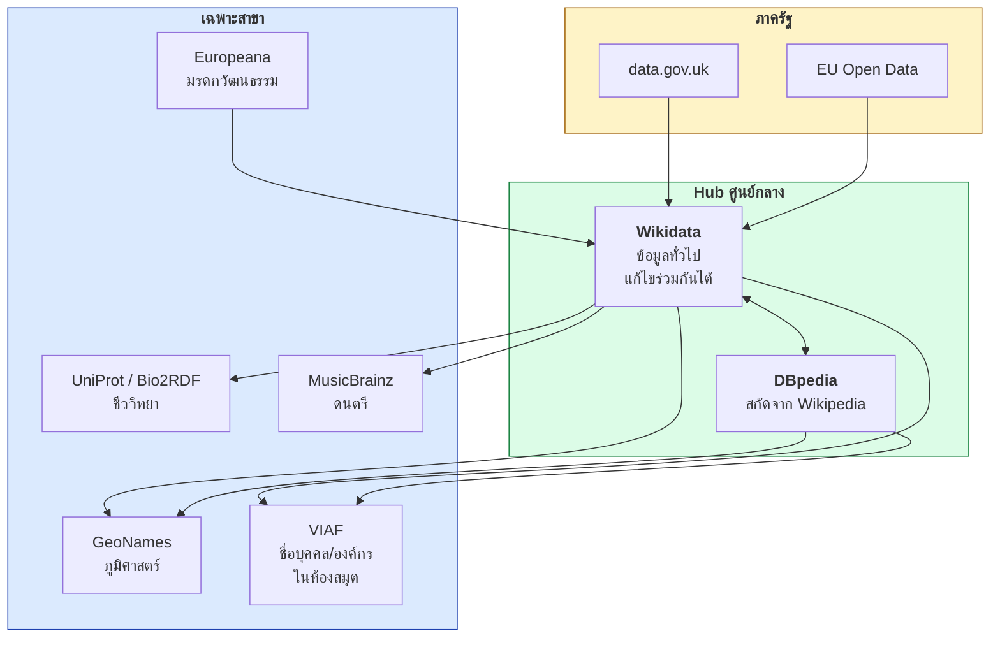
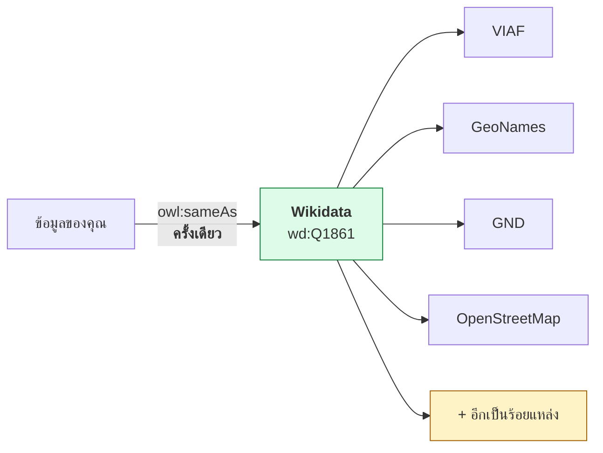
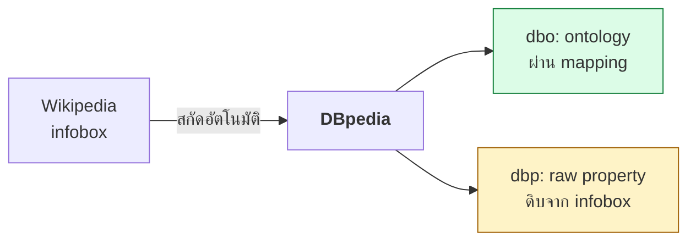
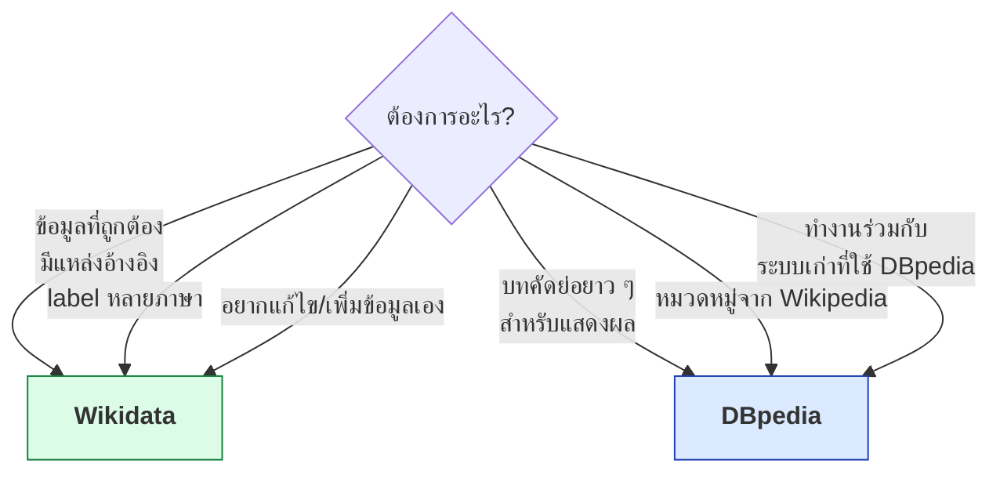

# 12.05 LOD Cloud และ Dataset สำคัญ

**LOD Cloud** คือแผนภาพที่รวบรวมชุดข้อมูล Linked Open Data ทั่วโลกและเส้นเชื่อมระหว่างกัน ทำให้เห็นว่าใครเป็นศูนย์กลางและใครเชื่อมกับใคร
บทนี้แนะนำ dataset หลักที่ควรรู้จัก พร้อมผลเรียกจริงจาก Wikidata และ DBpedia

📄 โค้ดเต็ม: [`code/ch12/explore_lod_cloud.py`](../code/ch12/explore_lod_cloud.py)

---

## โครงสร้างของ LOD Cloud



> 💡 **LOD Cloud มีโครงสร้างแบบ hub-and-spoke** — dataset ส่วนใหญ่ไม่ได้เชื่อมกันเองโดยตรง
> แต่เชื่อมผ่าน hub อย่าง Wikidata และ DBpedia

---

## Dataset ที่ควรรู้จัก

| Dataset | ขอบเขต | จุดเด่น | SPARQL Endpoint |
| --- | --- | --- | --- |
| **Wikidata** | ทุกสาขา | แก้ไขร่วมกันได้, มี label กว่า 200 ภาษา, มีแหล่งอ้างอิง | `https://query.wikidata.org/sparql` |
| **DBpedia** | ทุกสาขา | สกัดอัตโนมัติจาก Wikipedia, มีบทคัดย่อยาว | `https://dbpedia.org/sparql` |
| **GeoNames** | ภูมิศาสตร์ | ชื่อสถานที่กว่า 11 ล้านแห่ง + ลำดับชั้นการปกครอง | ผ่าน REST API |
| **VIAF** | ชื่อบุคคล/องค์กร | รวมรายการควบคุมของห้องสมุดทั่วโลก | ผ่าน REST + dump |
| **Europeana** | มรดกวัฒนธรรม | วัตถุจากพิพิธภัณฑ์/หอสมุดยุโรปกว่า 50 ล้านชิ้น | ผ่าน REST API |
| **UniProt** | โปรตีน | ฐานข้อมูลโปรตีนอ้างอิงของโลก | `https://sparql.uniprot.org/sparql` |
| **MusicBrainz** | ดนตรี | ศิลปิน อัลบั้ม เพลง พร้อมความสัมพันธ์ | ผ่าน REST + LinkedBrainz |
| **LinkedGeoData** | แผนที่ | แปลง OpenStreetMap เป็น RDF | dump |

---

## Wikidata — hub ที่สำคัญที่สุดในปัจจุบัน



### 🔬 ทดลองจริง — Bangkok (`wd:Q1861`) เชื่อมออกไปกี่แหล่ง

```sparql
SELECT (COUNT(DISTINCT ?p) AS ?n) WHERE {
  wd:Q1861 ?p ?v .
  ?prop wikibase:directClaim ?p ;
        wikibase:propertyType wikibase:ExternalId .
}
```

ผลจริง

```
1. Wikidata Q1861 เชื่อมออกไปกี่แหล่ง
  จำนวน external identifier ที่ต่างกัน : 102

  ตัวอย่างลิงก์ออกที่สำคัญ:
    VIAF cluster ID            123143268
    GND ID                     4004432-4
    OpenStreetMap relation ID  92277
    Freebase ID                /m/0fn2g
    GeoNames ID                1609350
    GeoNames ID                1609348
```

> 🎯 **เชื่อมเข้า Wikidata ที่เดียว = ได้ทางเดินไปยังฐานข้อมูลอีก 102 แห่งทันที**

### ประโยชน์ที่ได้ฟรี — label หลายภาษา

```sparql
SELECT (COUNT(?label) AS ?n) WHERE {
  wd:Q1861 rdfs:label ?label .
}
```

ผลจริง

```
2. ประโยชน์ที่ได้ฟรี -- label ของ Q1861
  จำนวนภาษาที่มี label : 252
    fr   Bangkok
    en   Bangkok
    th   กรุงเทพมหานคร
    de   Bangkok
    ja   バンコク
    zh   曼谷
```

> 💡 **เชื่อม `owl:sameAs` เส้นเดียว แล้วได้ชื่อ 252 ภาษามาใช้ทันที**
> โดยไม่ต้องจ้างแปลและไม่ต้องดูแลเอง

### โครงสร้างข้อมูลของ Wikidata

| ส่วน | รูปแบบ | ตัวอย่าง |
| --- | --- | --- |
| **Item** | `wd:Q...` | `wd:Q1861` = กรุงเทพมหานคร |
| **Property** | `wd:P...` | `wd:P625` = พิกัดภูมิศาสตร์ |
| **Truthy statement** | `wdt:P...` | `wd:Q1861 wdt:P625 ?coord` |
| **Full statement** | `p:P...` / `ps:` / `pq:` | เข้าถึง qualifier และแหล่งอ้างอิงได้ |
| **Label service** | `wikibase:label` | ดึง label ตามภาษาที่ต้องการ |

```sparql
# ⭐ pattern ที่ใช้บ่อยที่สุดใน Wikidata
PREFIX wd:   <http://www.wikidata.org/entity/>
PREFIX wdt:  <http://www.wikidata.org/prop/direct/>
PREFIX wikibase: <http://wikiba.se/ontology#>
PREFIX bd:   <http://www.bigdata.com/rdf#>

SELECT ?city ?cityLabel ?population WHERE {
  ?city wdt:P31   wd:Q1549591 ;   # instance of: big city
        wdt:P17   wd:Q869 ;       # country: Thailand
        wdt:P1082 ?population .
  SERVICE wikibase:label { bd:serviceParam wikibase:language "th,en". }
}
ORDER BY DESC(?population)
LIMIT 10
```

---

## DBpedia — สกัดจาก Wikipedia อัตโนมัติ



### 🔬 ทดลองจริง — DBpedia เชื่อมไปที่ไหนบ้าง

```sparql
SELECT ?same WHERE {
  <http://dbpedia.org/resource/Bangkok> owl:sameAs ?same .
}
LIMIT 500
```

ผลจริง

```
3. DBpedia :Bangkok เชื่อม owl:sameAs ไปที่ไหน
  จำนวน owl:sameAs ทั้งหมด : 134

  dataset ปลายทาง (ไม่รวม DBpedia ภาษาอื่น):
      3  d-nb.info
      2  sws.geonames.org
      1  sw.cyc.com
      1  yago-knowledge.org
      1  rdf.freebase.com
      1  linkedgeodata.org
      1  viaf.org
      1  api.nytimes.com
      1  www.wikidata.org
      1  musicbrainz.org
```

### ⚠️ `dbo:` กับ `dbp:` ต่างกันอย่างไร

| Namespace | ที่มา | คุณภาพ |
| --- | --- | --- |
| **`dbo:`** (`dbpedia.org/ontology/`) | ผ่าน mapping ที่คนดูแล | ✅ ชนิดข้อมูลถูกต้อง สม่ำเสมอ |
| **`dbp:`** (`dbpedia.org/property/`) | ดิบจาก infobox ตรง ๆ | ⚠️ ชนิดข้อมูลปนกัน ชื่อ property ไม่สม่ำเสมอ |

```sparql
# ✅ ใช้ dbo: เสมอเมื่อมีให้ใช้
SELECT ?city ?population WHERE {
  ?city a dbo:City ;
        dbo:country dbr:Thailand ;
        dbo:populationTotal ?population .
}
ORDER BY DESC(?population)
LIMIT 10
```

---

## Wikidata หรือ DBpedia — เลือกอะไร



| ประเด็น | Wikidata | DBpedia |
| --- | --- | --- |
| **ที่มาข้อมูล** | คนกรอกโดยตรง | สกัดจาก Wikipedia อัตโนมัติ |
| **มีแหล่งอ้างอิง** | ✅ ต่อ statement | ❌ |
| **หลายภาษา** | ✅ ในตัว entity เดียว | ⚠️ แยกเป็น dbpedia ต่อภาษา |
| **ความสดของข้อมูล** | สดทันที | ปล่อยเป็นรุ่น + มี DBpedia Live |
| **URI อ่านรู้เรื่อง** | ❌ `Q1861` | ✅ `Bangkok` |
| **บทคัดย่อ** | ❌ | ✅ ยาวและใช้ได้ทันที |
| **ความเสถียรของ endpoint** | ดี (มีการจำกัดอัตรา) | ปานกลาง |

> 💡 **ในทางปฏิบัติมักเชื่อมทั้งสองแห่ง** — ใช้ Wikidata เป็นแกนของข้อมูลเชิงโครงสร้าง
> และดึงบทคัดย่อจาก DBpedia มาแสดงผล

---

## เชื่อมข้อมูลของเราเข้ากับ hub

```turtle
# --- รูปแบบเต็ม ---
@prefix rdf:  <http://www.w3.org/1999/02/22-rdf-syntax-ns#> .
@prefix rdfs: <http://www.w3.org/2000/01/rdf-schema#> .
@prefix owl:  <http://www.w3.org/2002/07/owl#> .
@prefix geo:  <http://www.w3.org/2003/01/geo/wgs84_pos#> .
@prefix voc:  <https://data.uni.ac.th/vocab#> .

<https://data.uni.ac.th/campus/bangkok>
    rdf:type voc:Campus ;
    rdfs:label "Bangkok Campus"@en ;
    rdfs:label "วิทยาเขตกรุงเทพฯ"@th ;
    voc:locatedIn <https://data.uni.ac.th/place/bangkok> .

<https://data.uni.ac.th/place/bangkok>
    rdf:type voc:City ;
    geo:lat "13.7563"^^<http://www.w3.org/2001/XMLSchema#decimal> ;
    geo:long "100.5018"^^<http://www.w3.org/2001/XMLSchema#decimal> ;
    owl:sameAs <http://www.wikidata.org/entity/Q1861> ;
    owl:sameAs <http://dbpedia.org/resource/Bangkok> ;
    owl:sameAs <http://sws.geonames.org/1609350/> .
```

```turtle
# --- รูปแบบย่อ ---
@prefix camp:  <https://data.uni.ac.th/campus/> .
@prefix place: <https://data.uni.ac.th/place/> .
@prefix voc:   <https://data.uni.ac.th/vocab#> .
@prefix geo:   <http://www.w3.org/2003/01/geo/wgs84_pos#> .
@prefix wd:    <http://www.wikidata.org/entity/> .
@prefix dbr:   <http://dbpedia.org/resource/> .
@prefix gn:    <http://sws.geonames.org/> .

camp:bangkok a voc:Campus ;
    rdfs:label "Bangkok Campus"@en , "วิทยาเขตกรุงเทพฯ"@th ;
    voc:locatedIn place:bangkok .

place:bangkok a voc:City ;
    geo:lat 13.7563 ; geo:long 100.5018 ;
    owl:sameAs wd:Q1861 , dbr:Bangkok , <http://sws.geonames.org/1609350/> .
```

> ⚠️ **URI ของ GeoNames ลงท้ายด้วย `/`** (`http://sws.geonames.org/1609350/`)
> ซึ่งเขียนเป็น prefixed name ไม่ได้ ต้องเขียนเป็น IRI เต็มในวงเล็บมุม

---

## ⚠️ ข้อควรระวังเมื่อพึ่ง endpoint สาธารณะ

| ปัญหา | ผลกระทบ | ทางแก้ |
| --- | --- | --- |
| **จำกัดอัตราการเรียก** | ถูกบล็อกชั่วคราว | ใส่ `User-Agent` ที่ระบุตัวตน, หน่วงเวลาระหว่างเรียก |
| **Endpoint ล่ม** | ระบบของเราพังตาม | แคชผลไว้, มีทางเลือกสำรอง |
| **Query timeout** | ผลไม่ครบ | ใส่ `LIMIT`, แบ่ง query ย่อย |
| **ข้อมูลเปลี่ยนโดยไม่บอก** | ผลลัพธ์เปลี่ยนไปเงียบ ๆ | บันทึกรุ่นที่ใช้, ตรวจสอบเป็นระยะ |
| **URI ถูกลบ/รวม** | `sameAs` ชี้ไปที่ตายแล้ว | ตรวจลิงก์เป็นประจำ |

```python
# ✅ มารยาทขั้นต่ำเมื่อเรียก endpoint สาธารณะ
UA = "MyProject/1.0 (https://myproject.org; contact@myproject.org)"

req = urllib.request.Request(url, headers={"User-Agent": UA})
```

> ⚠️ **Wikidata บล็อก User-Agent ที่ไม่ระบุตัวตน** — ต้องใส่ชื่อโครงการและช่องทางติดต่อ
> ตามนโยบายของมูลนิธิวิกิมีเดีย

---

## รันโปรแกรมสำรวจ

```bash
python3 code/ch12/explore_lod_cloud.py
```

---

## Key Points

- **LOD Cloud มีโครงสร้างแบบ hub-and-spoke** — dataset ส่วนใหญ่เชื่อมกันผ่าน hub ไม่ใช่เชื่อมกันเองโดยตรง
- **Wikidata คือ hub ที่สำคัญที่สุดในปัจจุบัน** — `wd:Q1861` (Bangkok) มี external identifier ถึง **102 แบบ** และ label **252 ภาษา**
- **เชื่อมเข้า Wikidata เส้นเดียว = ได้ทางเดินไปยังฐานข้อมูลอีกกว่าร้อยแห่งทันที**
- **DBpedia** สกัดจาก Wikipedia อัตโนมัติ — Bangkok มี `owl:sameAs` **134 เส้น** ไปยัง GeoNames, VIAF, YAGO, MusicBrainz และอื่น ๆ
- ⚠️ ใน DBpedia ให้ใช้ **`dbo:`** (ผ่าน mapping ที่คนดูแล) แทน **`dbp:`** (ดิบจาก infobox ชนิดข้อมูลปนกัน)
- **ใช้ Wikidata** เมื่อต้องการข้อมูลเชิงโครงสร้างที่มีแหล่งอ้างอิงและหลายภาษา, **ใช้ DBpedia** เมื่อต้องการบทคัดย่อสำหรับแสดงผล
- ⚠️ **URI ของ GeoNames ลงท้ายด้วย `/`** จึงเขียนเป็น prefixed name ไม่ได้ — ต้องใช้ IRI เต็ม
- ⚠️ เมื่อเรียก endpoint สาธารณะ ต้อง **ใส่ `User-Agent` ที่ระบุตัวตน**, ใส่ `LIMIT`, **แคชผล** และมีแผนสำรองเมื่อ endpoint ล่ม
