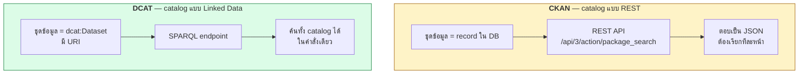
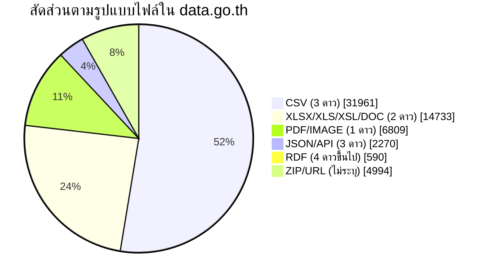
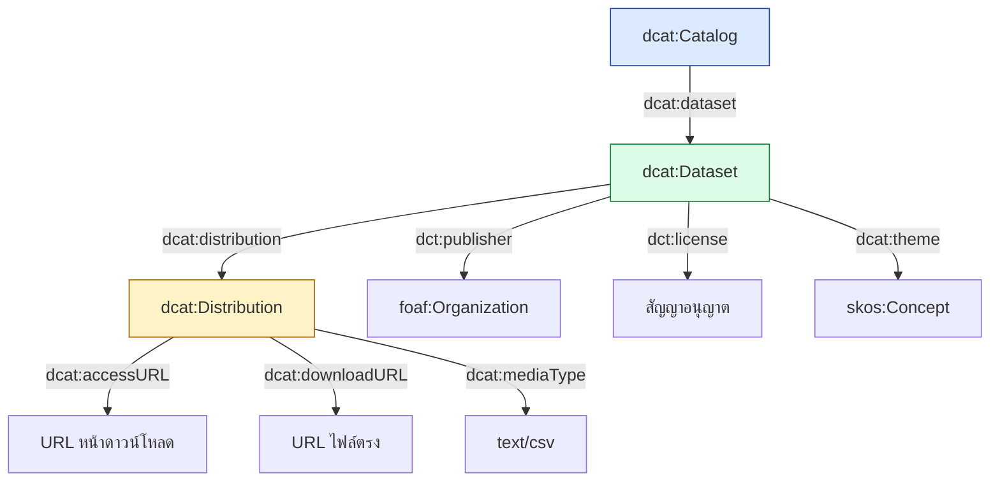
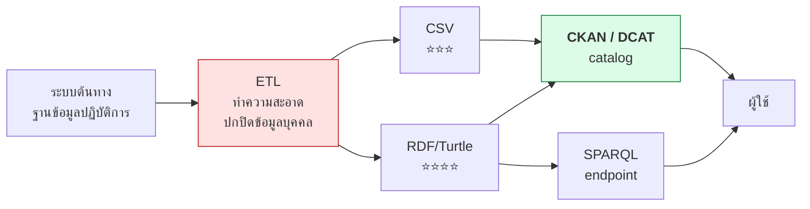
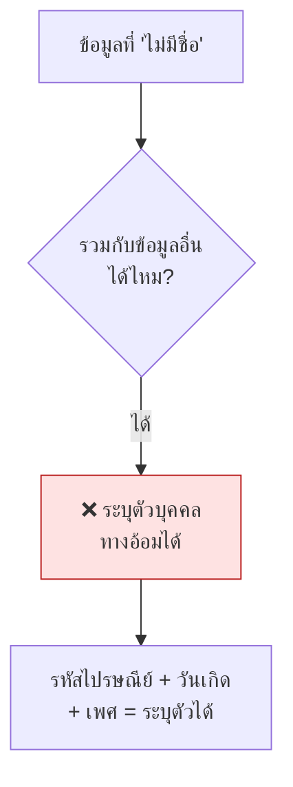

# 12.06 ข้อมูลเปิดภาครัฐ

ภาครัฐเป็นผู้ผลิตข้อมูลเปิดรายใหญ่ที่สุดของโลก แต่ส่วนใหญ่ยังหยุดอยู่ที่ระดับ 3 ดาว
บทนี้สำรวจพอร์ทัลข้อมูลเปิดจริงทั้งของไทยและยุโรป เปรียบเทียบ CKAN REST API กับ DCAT + SPARQL และดูตัวเลขจริงว่าข้อมูลเปิดวันนี้อยู่ที่ระดับไหน

📄 โค้ดเต็ม: [`code/ch12/query_gov_data.py`](../code/ch12/query_gov_data.py)

---

## สองสถาปัตยกรรมของพอร์ทัลข้อมูลเปิด



| | CKAN | DCAT + SPARQL |
| --- | --- | --- |
| **ใช้ที่ไหน** | `data.go.th`, `catalog.data.gov`, พอร์ทัลส่วนใหญ่ | `data.europa.eu`, `data.gov.uk` |
| **การค้น** | REST + พารามิเตอร์คงที่ | SPARQL แบบใดก็ได้ |
| **รวม catalog หลายแห่ง** | ต้องเขียนโค้ดผสานเอง | `SERVICE` ข้าม endpoint ได้ |
| **ตัว catalog เป็น Linked Data** | ❌ | ✅ |
| **ตั้งระบบง่าย** | ✅ | ⚠️ |

> 💡 **CKAN มี extension ที่ปล่อย DCAT ได้ด้วย** — พอร์ทัลจำนวนมากจึงรองรับทั้งสองทาง

---

## 🔬 data.go.th — ศูนย์กลางข้อมูลเปิดภาครัฐไทย

```python
import json, urllib.parse, urllib.request

UA = "SemanticWebCourse/1.0 (educational material)"
CKAN_TH = "https://data.go.th/api/3/action"

facet = urllib.parse.quote('["res_format"]')
url = f"{CKAN_TH}/package_search?rows=0&facet.field={facet}&facet.limit=12"

req = urllib.request.Request(url, headers={"User-Agent": UA})
with urllib.request.urlopen(req, timeout=30) as resp:
    data = json.load(resp)

print(data["result"]["count"])
```

ผลจริง

```
1. data.go.th -- นับชุดข้อมูลและแยกตามรูปแบบไฟล์
  จำนวนชุดข้อมูลทั้งหมด : 42,853

  รูปแบบไฟล์ที่พบมากที่สุด:
  รูปแบบ        จำนวน  สัดส่วน  ระดับดาว
  ----------------------------------------------
  CSV          31,961    52.1%  ⭐⭐⭐
  XLSX         12,352    20.1%  ⭐⭐
  PDF           6,446    10.5%  ⭐
  ZIP           2,608     4.3%  ?
  URL           2,386     3.9%  ?
  JSON          1,573     2.6%  ⭐⭐⭐
  XSL           1,161     1.9%  ⭐⭐
  XLS             833     1.4%  ⭐⭐
  API             697     1.1%  ⭐⭐⭐
  RDF             590     1.0%  ⭐⭐⭐⭐
  DOC             387     0.6%  ⭐⭐
  IMAGE           363     0.6%  ⭐

  ⚠️ ทรัพยากรที่เป็น RDF (4 ดาวขึ้นไป) : 590 = 1.0% ของทั้งหมด
```

### สิ่งที่ตัวเลขนี้บอก



| ข้อสังเกต | ความหมาย |
| --- | --- |
| **CSV ครองมากกว่าครึ่ง** | ระดับ **3 ดาว** คือมาตรฐานที่ภาครัฐทำได้จริง |
| **XLSX ยังมีถึง 20%** | ยังมีที่ให้ปรับปรุงได้ทันทีโดยแทบไม่มีต้นทุน (แปลงเป็น CSV) |
| **PDF 10%** | ข้อมูลที่เครื่องอ่านไม่ได้เลย |
| **RDF เพียง 1.0%** | **ระดับ 4 ดาวยังเป็นข้อยกเว้น ไม่ใช่บรรทัดฐาน** |

> 🎯 **โอกาสที่ชัดที่สุดคือแปลง XLSX 12,352 รายการเป็น CSV** — ได้ 3 ดาวทันที
> ด้วยต้นทุนต่ำกว่าการทำ RDF มาก

---

## 🔬 data.europa.eu — catalog ที่เป็น Linked Data จริง

EU Open Data Portal เผยแพร่ **ตัว catalog เอง** เป็น RDF ตามมาตรฐาน **DCAT-AP** พร้อม SPARQL endpoint สาธารณะ

```sparql
PREFIX dcat: <http://www.w3.org/ns/dcat#>

SELECT (COUNT(*) AS ?n) WHERE { ?s a dcat:Dataset }
```

```sparql
PREFIX dcat: <http://www.w3.org/ns/dcat#>

SELECT ?f (COUNT(*) AS ?n) WHERE {
  ?d a dcat:Distribution ; dcat:mediaType ?f .
}
GROUP BY ?f
ORDER BY DESC(?n)
LIMIT 8
```

ผลจริง

```
2. data.europa.eu -- catalog ที่เป็น Linked Data จริง
  จำนวน dcat:Dataset : 1,925,990

  media type ที่พบมากที่สุด:
      204,637  application/vnd.openxmlformats-officedocument.spreadsheetml.sheet
      193,369  text/csv
      176,275  text/plain
      173,708  application/csv
      157,878  application/x-netcdf
      137,895  text/csv
      125,196  application/json
       84,729  application/zip
```

> ⚠️ **สังเกตว่า `text/csv` โผล่มาสองครั้ง** — ครั้งหนึ่งเป็น IRI เต็มของ IANA
> อีกครั้งเป็นสตริงสั้น นี่คือปัญหาคุณภาพข้อมูลจริงที่เจอในทุก catalog ขนาดใหญ่
> และเป็นเหตุผลว่าทำไม **การกำหนด URI ให้เป็นมาตรฐานเดียวจึงสำคัญ**

---

## มาตรฐาน DCAT — vocabulary ของ catalog



```turtle
# --- รูปแบบเต็ม ---
@prefix rdf:  <http://www.w3.org/1999/02/22-rdf-syntax-ns#> .
@prefix dcat: <http://www.w3.org/ns/dcat#> .
@prefix dct:  <http://purl.org/dc/terms/> .
@prefix foaf: <http://xmlns.com/foaf/0.1/> .
@prefix xsd:  <http://www.w3.org/2001/XMLSchema#> .

<https://data.uni.ac.th/catalog>
    rdf:type dcat:Catalog ;
    dct:title "University Open Data Catalog"@en ;
    dcat:dataset <https://data.uni.ac.th/dataset/courses> .

<https://data.uni.ac.th/dataset/courses>
    rdf:type dcat:Dataset ;
    dct:title "Course Catalog 2026"@en ;
    dct:description "All courses offered in academic year 2026"@en ;
    dct:issued "2026-01-15"^^xsd:date ;
    dct:publisher <https://data.uni.ac.th/org/registrar> ;
    dct:license <https://creativecommons.org/licenses/by/4.0/> ;
    dcat:distribution <https://data.uni.ac.th/dataset/courses/csv> ,
                      <https://data.uni.ac.th/dataset/courses/ttl> .

<https://data.uni.ac.th/dataset/courses/csv>
    rdf:type dcat:Distribution ;
    dcat:downloadURL <https://data.uni.ac.th/files/courses.csv> ;
    dcat:mediaType "text/csv" ;
    dcat:byteSize "184320"^^xsd:nonNegativeInteger .
```

```turtle
# --- รูปแบบย่อ ---
@prefix dcat: <http://www.w3.org/ns/dcat#> .
@prefix dct:  <http://purl.org/dc/terms/> .
@prefix ds:   <https://data.uni.ac.th/dataset/> .
@prefix org:  <https://data.uni.ac.th/org/> .

<https://data.uni.ac.th/catalog> a dcat:Catalog ;
    dct:title "University Open Data Catalog"@en ;
    dcat:dataset ds:courses .

ds:courses a dcat:Dataset ;
    dct:title "Course Catalog 2026"@en ;
    dct:description "All courses offered in academic year 2026"@en ;
    dct:issued "2026-01-15"^^xsd:date ;
    dct:publisher org:registrar ;
    dct:license <https://creativecommons.org/licenses/by/4.0/> ;
    dcat:distribution <https://data.uni.ac.th/dataset/courses/csv> ,
                      <https://data.uni.ac.th/dataset/courses/ttl> .

<https://data.uni.ac.th/dataset/courses/csv> a dcat:Distribution ;
    dcat:downloadURL <https://data.uni.ac.th/files/courses.csv> ;
    dcat:mediaType "text/csv" ;
    dcat:byteSize 184320 .
```

### DCAT-AP — โปรไฟล์ที่ EU บังคับใช้

| ส่วนขยาย | ใช้ที่ไหน |
| --- | --- |
| **DCAT-AP** | สหภาพยุโรป — กำหนด field บังคับและ vocabulary ที่ต้องใช้ |
| **GeoDCAT-AP** | ข้อมูลเชิงพื้นที่ |
| **StatDCAT-AP** | ข้อมูลสถิติ |
| **DCAT-US** | สหรัฐอเมริกา |

> 💡 **DCAT-AP บังคับให้ใช้ controlled vocabulary** เช่น รายการภาษา ประเทศ และประเภทไฟล์
> จาก EU Vocabularies — จึงหมดปัญหา `text/csv` เขียนหลายแบบอย่างที่เห็นด้านบน

---

## แบบแผนการเผยแพร่ข้อมูลภาครัฐที่ดี



| ขั้นตอน | สิ่งที่ต้องทำ |
| --- | --- |
| **1. คัดกรอง** | ปกปิดข้อมูลส่วนบุคคล ตรวจว่าไม่ระบุตัวบุคคลได้ทางอ้อม |
| **2. ทำความสะอาด** | ชื่อคอลัมน์เป็นภาษาอังกฤษ, ใช้ `UTF-8`, วันที่เป็น ISO 8601 |
| **3. เผยแพร่หลายรูปแบบ** | CSV เสมอ + RDF ถ้าทำได้ |
| **4. ลงทะเบียนใน catalog** | DCAT metadata ครบ พร้อมสัญญาอนุญาตชัดเจน |
| **5. ตั้งรอบปรับปรุง** | ระบุ `dct:accrualPeriodicity` แล้วทำตามจริง |

### ⚠️ ความเสี่ยงเรื่องความเป็นส่วนตัว



> ⚠️ **Linked Data ทำให้ความเสี่ยงนี้สูงขึ้นมาก** เพราะการรวมข้อมูลข้ามชุดเป็นเรื่องอัตโนมัติ
> ข้อมูลที่ปลอดภัยตอนอยู่คนเดียว อาจไม่ปลอดภัยเมื่อเชื่อมกับชุดอื่น — ต้องประเมินก่อนเผยแพร่เสมอ

---

## ค้นข้อมูลเปิดภาครัฐจาก Python

```python
def ckan_search(portal: str, query: str, rows: int = 5) -> list[dict]:
    """ค้นชุดข้อมูลจากพอร์ทัลที่ใช้ CKAN"""
    params = urllib.parse.urlencode({"q": query, "rows": rows})
    url = f"{portal}/api/3/action/package_search?{params}"
    req = urllib.request.Request(url, headers={"User-Agent": UA})
    with urllib.request.urlopen(req, timeout=30) as resp:
        return json.load(resp)["result"]["results"]


for ds in ckan_search("https://data.go.th", "air quality"):
    print(ds["title"])
    for res in ds.get("resources", []):
        print(f"   {res['format']:8s} {res['url']}")
```

| CKAN endpoint | ใช้ทำอะไร |
| --- | --- |
| `/api/3/action/package_search?q=...` | ค้นชุดข้อมูล |
| `/api/3/action/package_show?id=...` | รายละเอียดชุดข้อมูลเดียว |
| `/api/3/action/organization_list` | รายชื่อหน่วยงาน |
| `/api/3/action/group_list` | รายชื่อหมวดหมู่ |
| `/api/3/action/package_search?rows=0&facet.field=["res_format"]` | สถิติแยกตามรูปแบบไฟล์ |

---

## รันโปรแกรม

```bash
python3 code/ch12/query_gov_data.py
```

---

## Key Points

- พอร์ทัลข้อมูลเปิดมี 2 สถาปัตยกรรม — **CKAN (REST)** ที่ตั้งง่าย และ **DCAT + SPARQL** ที่ตัว catalog เองเป็น Linked Data
- **data.go.th มี 42,853 ชุดข้อมูล** — **CSV 52.1%** เป็นรูปแบบหลัก แต่ **RDF มีเพียง 1.0%**
- **ระดับ 3 ดาวคือมาตรฐานที่ภาครัฐทำได้จริง ระดับ 4 ดาวยังเป็นข้อยกเว้น**
- โอกาสปรับปรุงที่คุ้มที่สุดคือ **แปลง XLSX 12,352 รายการเป็น CSV** — ได้ 3 ดาวด้วยต้นทุนต่ำ
- **data.europa.eu มี `dcat:Dataset` 1,925,990 รายการ** และค้นทั้ง catalog ด้วย SPARQL คำสั่งเดียวได้
- ⚠️ พบ **`text/csv` เขียนหลายรูปแบบใน catalog เดียวกัน** — ยืนยันว่าการกำหนด URI ให้เป็นมาตรฐานเดียวสำคัญมาก
- **DCAT** เป็น vocabulary มาตรฐานของ catalog: `dcat:Catalog` → `dcat:Dataset` → `dcat:Distribution`
- **DCAT-AP บังคับใช้ controlled vocabulary** จึงแก้ปัญหาความไม่สม่ำเสมอได้ตั้งแต่ต้นทาง
- ⚠️ **Linked Data เพิ่มความเสี่ยงในการระบุตัวบุคคลทางอ้อม** เพราะการรวมข้อมูลข้ามชุดเป็นเรื่องอัตโนมัติ — ต้องประเมินก่อนเผยแพร่เสมอ
