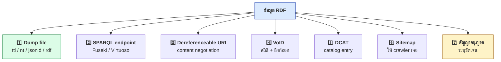
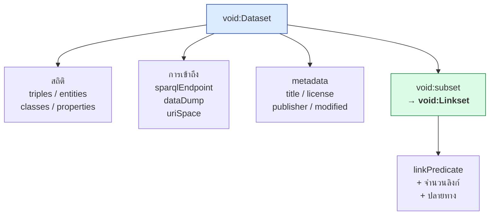
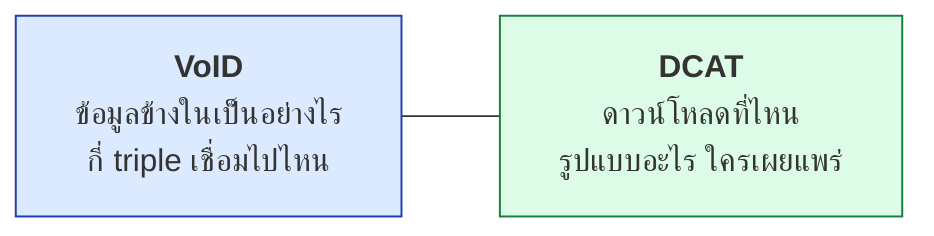
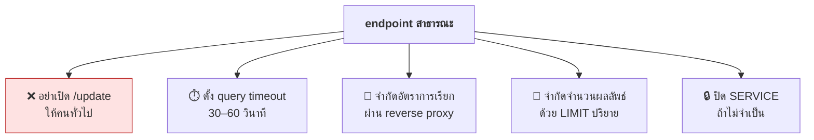
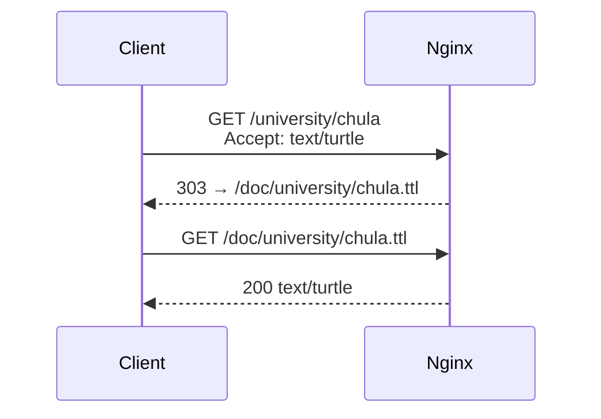

# 12.07 การเผยแพร่ Linked Open Data

การเผยแพร่ LOD ไม่ได้จบแค่แปลงข้อมูลเป็น RDF — ต้องมีที่ให้คนดาวน์โหลด มี endpoint ให้ query มี metadata บอกว่าข้อมูลคืออะไร และมีทางให้เครื่องค้นเจอ
บทนี้พาทำครบทุกชิ้นด้วยข้อมูลตัวอย่างจริงจาก [`data/lod_dataset.ttl`](../data/lod_dataset.ttl)

📄 โค้ดเต็ม: [`code/ch12/publish_lod.py`](../code/ch12/publish_lod.py)

---

## องค์ประกอบของการเผยแพร่ที่ครบถ้วน



| ชิ้นส่วน | จำเป็นแค่ไหน | ต้นทุน |
| --- | --- | --- |
| **Dump file** | ✅ ขาดไม่ได้ | ต่ำมาก |
| **สัญญาอนุญาต** | ✅ ขาดไม่ได้ | ต่ำมาก |
| **VoID** | ✅ ควรมี | ต่ำ (สร้างอัตโนมัติได้) |
| **DCAT** | ✅ ควรมี | ต่ำ |
| **Dereferenceable URI** | ⚠️ ควรมี | ปานกลาง |
| **SPARQL endpoint** | ⚠️ ถ้ามีคนขอ | สูง (ต้องดูแลต่อเนื่อง) |
| **Sitemap** | 💡 ทำก็ดี | ต่ำ |

> 💡 **เริ่มจาก dump file + สัญญาอนุญาต + VoID ก่อน** — สามอย่างนี้ต้นทุนต่ำมากแต่ได้ประโยชน์สูงสุด

---

## 1️⃣ ตรวจสุขภาพชุดข้อมูลก่อนเผยแพร่

```python
def health_check(g: Graph) -> None:
    subjects = set(g.subjects())
    named = {s for s in subjects if isinstance(s, URIRef)}
    blanks = subjects - named

    ours = {s for s in named if str(s).startswith(BASE)}
    labelled = {s for s in ours
                if (s, RDFS.label, None) in g or (s, SKOS.prefLabel, None) in g}

    out_links = link_triples(g)   # sameAs / exactMatch / closeMatch / seeAlso
```

ผลจริง

```
1. ตรวจสุขภาพชุดข้อมูล
  triples ทั้งหมด        : 96
  subject ที่มี URI      : 18
  blank node ที่เป็น subject : 0  ✅
  entity ของเรา          : 18
  มี label               : 18 (100%)  ✅
  ภาษาของ label          : {'en': 15, 'th': 8}
  ลิงก์ออกทั้งหมด        : 14  {'sameAs': 11, 'exactMatch': 3}
        8  Wikidata
        4  DBpedia
        2  GeoNames

  ⭐ ระดับดาวที่ประเมินได้ : ⭐⭐⭐⭐⭐
```

| เกณฑ์ | ทำไมสำคัญ |
| --- | --- |
| **ไม่มี blank node เป็น subject** | blank node อ้างอิงจากภายนอกไม่ได้เลย |
| **label ครบ 100%** | ไม่มี label = คนเปิดมาแล้วเห็นแต่ URI |
| **มีหลายภาษา** | ทำให้ข้อมูลใช้ได้กว้างขึ้นมาก |
| **มีลิงก์ออก** | เงื่อนไขของดาวดวงที่ 5 |

---

## 2️⃣ VoID — บัตรประจำตัวของชุดข้อมูล

**VoID (Vocabulary of Interlinked Datasets)** บอกให้เครื่องรู้ว่าชุดข้อมูลนี้มีอะไร ใหญ่แค่ไหน เชื่อมไปไหน และดึงได้ที่ไหน



### VoID ที่สร้างได้จริง

```turtle
# --- รูปแบบเต็ม (ตัดมาบางส่วน) ---
@prefix rdf:     <http://www.w3.org/1999/02/22-rdf-syntax-ns#> .
@prefix void:    <http://rdfs.org/ns/void#> .
@prefix dcterms: <http://purl.org/dc/terms/> .
@prefix xsd:     <http://www.w3.org/2001/XMLSchema#> .

<https://data.example.org/dataset/universities>
    rdf:type void:Dataset ;
    dcterms:title "Thai Universities Linked Data"@en ;
    dcterms:license <https://creativecommons.org/licenses/by/4.0/> ;
    void:triples "96"^^xsd:integer ;
    void:sparqlEndpoint <https://data.example.org/sparql> .
```

```turtle
# --- รูปแบบย่อ: ผลจริงจาก code/ch12/dist/void.ttl ---
@prefix dcterms: <http://purl.org/dc/terms/> .
@prefix owl:  <http://www.w3.org/2002/07/owl#> .
@prefix skos: <http://www.w3.org/2004/02/skos/core#> .
@prefix void: <http://rdfs.org/ns/void#> .
@prefix xsd:  <http://www.w3.org/2001/XMLSchema#> .

<https://data.example.org/dataset/universities> a void:Dataset ;
    dcterms:title "Thai Universities Linked Data"@en ;
    dcterms:description "Universities, campuses, cities and fields of study in Thailand, linked to Wikidata, DBpedia and GeoNames."@en ;
    dcterms:license <https://creativecommons.org/licenses/by/4.0/> ;
    dcterms:modified "2026-01-15"^^xsd:date ;
    dcterms:publisher <https://data.example.org/org/example> ;
    void:classes 8 ;
    void:properties 16 ;
    void:entities 18 ;
    void:triples 96 ;
    void:distinctSubjects 18 ;
    void:distinctObjects 74 ;
    void:uriSpace "https://data.example.org/" ;
    void:dataDump <https://data.example.org/dump/universities.ttl> ;
    void:sparqlEndpoint <https://data.example.org/sparql> ;
    void:feature <http://www.w3.org/ns/formats/Turtle> ;
    void:subset <https://data.example.org/linkset/wikidata-sameas> ,
                <https://data.example.org/linkset/dbpedia-sameas> ,
                <https://data.example.org/linkset/wikidata-exactmatch> ,
                <https://data.example.org/linkset/geonames-sameas> .

<https://data.example.org/linkset/wikidata-sameas> a void:Linkset ;
    dcterms:title "sameAs links to Wikidata"@en ;
    void:linkPredicate owl:sameAs ;
    void:subjectsTarget <https://data.example.org/dataset/universities> ;
    void:triples 5 .

<https://data.example.org/linkset/wikidata-exactmatch> a void:Linkset ;
    dcterms:title "exactMatch links to Wikidata"@en ;
    void:linkPredicate skos:exactMatch ;
    void:subjectsTarget <https://data.example.org/dataset/universities> ;
    void:triples 3 .
```

ผลจริงตอนสร้าง

```
2. สร้าง VoID description จากสถิติจริง
  linkset → Wikidata   sameAs       5 links
  linkset → DBpedia    sameAs       4 links
  linkset → Wikidata   exactMatch   3 links
  linkset → GeoNames   sameAs       2 links

  VoID graph : 40 triples
```

> ⚠️ **`void:Linkset` หนึ่งก้อนมี `void:linkPredicate` ได้เพียงค่าเดียว**
> จึงต้องแยก linkset ตามคู่ **(ปลายทาง, predicate)** ไม่ใช่แยกตามปลายทางอย่างเดียว
> — Wikidata จึงมี 2 linkset (`sameAs` กับ `exactMatch`)

### ควรวางไฟล์ VoID ไว้ที่ไหน

```
https://data.example.org/.well-known/void      ⬅️ ตำแหน่งมาตรฐาน
```

| ตำแหน่ง | ทำไม |
| --- | --- |
| `/.well-known/void` | มาตรฐานที่ crawler มองหาเป็นที่แรก |
| ลิงก์จากทุก resource ด้วย `void:inDataset` | ทำให้เดินจาก entity เดียวไปหา metadata ได้ |
| ลงทะเบียนใน DataHub / LOD Cloud | ทำให้คนอื่นเจอ |

---

## 3️⃣ DCAT — ลงทะเบียนใน catalog

VoID อธิบาย **ข้อมูล** ส่วน DCAT อธิบาย **ชุดข้อมูลในฐานะสิ่งที่ถูก catalog**



```turtle
# --- รูปแบบย่อ: ผลจริงจาก code/ch12/dist/catalog.ttl ---
@prefix dcat:    <http://www.w3.org/ns/dcat#> .
@prefix dcterms: <http://purl.org/dc/terms/> .

<https://data.example.org/catalog> a dcat:Catalog ;
    dcterms:title "Example Open Data Catalog"@en ;
    dcat:dataset <https://data.example.org/dataset/universities> .

<https://data.example.org/dataset/universities> a dcat:Dataset ;
    dcterms:title "Thai Universities Linked Data"@en ;
    dcterms:license <https://creativecommons.org/licenses/by/4.0/> ;
    dcterms:publisher <https://data.example.org/org/example> ;
    dcterms:accrualPeriodicity
        <http://publications.europa.eu/resource/authority/frequency/ANNUAL> ;
    dcat:distribution
        <https://data.example.org/dataset/universities/ttl> ,
        <https://data.example.org/dataset/universities/nt> ,
        <https://data.example.org/dataset/universities/jsonld> ,
        <https://data.example.org/dataset/universities/rdf> ,
        <https://data.example.org/dataset/universities/sparql> .

<https://data.example.org/dataset/universities/ttl> a dcat:Distribution ;
    dcat:downloadURL <https://data.example.org/dump/universities.ttl> ;
    dcat:mediaType "text/turtle" ;
    dcterms:license <https://creativecommons.org/licenses/by/4.0/> .
```

> 💡 **ระบุ `dcterms:license` ที่ระดับ Distribution ด้วย** ไม่ใช่แค่ที่ Dataset
> เพราะบางระบบอ่านเฉพาะระดับ Distribution

---

## 4️⃣ ส่งออกหลายรูปแบบ

```python
formats = [("ttl", "turtle"), ("nt", "nt"),
           ("jsonld", "json-ld"), ("rdf", "xml")]

for ext, fmt in formats:
    g.serialize(os.path.join(OUT, f"universities.{ext}"),
                format=fmt, encoding="utf-8")
```

ผลจริง

```
4. ส่งออกไฟล์สำหรับเผยแพร่
  universities.ttl       4,316 bytes
  universities.nt       12,548 bytes
  universities.jsonld   12,170 bytes
  universities.rdf       9,326 bytes
  void.ttl               2,330 bytes
  catalog.ttl            2,165 bytes
```

| รูปแบบ | ขนาดเทียบกับ Turtle | เหมาะกับ |
| --- | ---: | --- |
| **Turtle** | 1.0× | คนอ่าน, ไฟล์เก็บถาวร |
| **N-Triples** | 2.9× | ประมวลผลแบบสตรีม, โหลดเข้า triple store |
| **JSON-LD** | 2.8× | นักพัฒนาเว็บ, ฝังในหน้า HTML |
| **RDF/XML** | 2.2× | ระบบเก่าที่รองรับเฉพาะ XML |

> 💡 **บีบอัดด้วย gzip ก่อนเผยแพร่** — N-Triples บีบได้ดีมากเพราะมีข้อความซ้ำสูง
> และเซิร์ฟเวอร์ส่วนใหญ่ตั้งให้ส่งแบบบีบอัดอัตโนมัติได้

---

## 5️⃣ ตั้ง SPARQL endpoint ด้วย Apache Jena Fuseki

```bash
# ดาวน์โหลดและแตกไฟล์
curl -LO https://dlcdn.apache.org/jena/binaries/apache-jena-fuseki-5.2.0.tar.gz
tar xzf apache-jena-fuseki-5.2.0.tar.gz
cd apache-jena-fuseki-5.2.0
```

```bash
# รันแบบเก็บข้อมูลถาวร พร้อมโหลดข้อมูลตั้งต้น
./fuseki-server --loc=./databases/universities --update /universities
```

```bash
# โหลดข้อมูลเข้า dataset ที่รันอยู่
curl -X POST -H "Content-Type: text/turtle" \
     --data-binary @data/lod_dataset.ttl \
     "http://localhost:3030/universities/data?default"
```

```bash
# ทดสอบ query
curl -G "http://localhost:3030/universities/sparql" \
     --data-urlencode "query=SELECT (COUNT(*) AS ?n) WHERE { ?s ?p ?o }" \
     -H "Accept: application/sparql-results+json"
```

### โครงสร้าง URL ของ Fuseki

| Path | ใช้ทำอะไร |
| --- | --- |
| `/{dataset}/sparql` | SPARQL Query (อ่านอย่างเดียว) |
| `/{dataset}/update` | SPARQL Update (เขียน) |
| `/{dataset}/data` | Graph Store Protocol (อัปโหลด/ดาวน์โหลดกราฟ) |
| `/{dataset}/get` | อ่านกราฟ |
| `/$/ping` | ตรวจว่าเซิร์ฟเวอร์ยังทำงาน |

### ⚠️ ตั้งค่าความปลอดภัยก่อนเปิดสาธารณะ



```
# ตัวอย่างการตั้ง timeout ของ Fuseki
--set arq:queryTimeout=30000,60000
```

> ⚠️ **`SERVICE` ที่เปิดไว้ ทำให้ endpoint ของคุณกลายเป็น proxy ให้คนอื่นได้**
> ซึ่งอาจถูกใช้โจมตีระบบอื่นในนามของคุณ

---

## 6️⃣ Content Negotiation ด้วย Nginx

```nginx
# /etc/nginx/conf.d/data.conf
map $http_accept $rdf_ext {
    default                       "html";
    "~*text/turtle"               "ttl";
    "~*application/ld\+json"      "jsonld";
    "~*application/rdf\+xml"      "rdf";
    "~*application/n-triples"     "nt";
}

server {
    server_name data.example.org;

    # URI ของสิ่งของ → 303 ไปยังเอกสาร
    location /university/ {
        return 303 https://data.example.org/doc$request_uri.$rdf_ext;
    }

    # เอกสารจริง
    location /doc/ {
        root /var/www/lod;
        types {
            text/turtle              ttl;
            application/ld+json      jsonld;
            application/rdf+xml      rdf;
            application/n-triples    nt;
        }
    }
}
```



---

## 7️⃣ Sitemap ให้ crawler ค้นเจอ

```xml
<?xml version="1.0" encoding="UTF-8"?>
<urlset xmlns="http://www.sitemaps.org/schemas/sitemap/0.9"
        xmlns:sc="http://sw.deri.org/2007/07/sitemapextension/scschema.xsd">
  <sc:dataset>
    <sc:datasetLabel>Thai Universities Linked Data</sc:datasetLabel>
    <sc:datasetURI>https://data.example.org/dataset/universities</sc:datasetURI>
    <sc:linkedDataPrefix slicing="subject-object">
      https://data.example.org/
    </sc:linkedDataPrefix>
    <sc:sparqlEndpointLocation>
      https://data.example.org/sparql
    </sc:sparqlEndpointLocation>
    <sc:dataDumpLocation>
      https://data.example.org/dump/universities.ttl
    </sc:dataDumpLocation>
  </sc:dataset>
</urlset>
```

```
# robots.txt
Sitemap: https://data.example.org/sitemap.xml
```

---

## ✅ เช็กลิสต์ก่อนกดเผยแพร่

- [ ] URI ทั้งหมดใช้ **base URI จริง** ไม่ใช่ `localhost` หรือ `example.org`
- [ ] ทุก entity มี **`rdfs:label`** อย่างน้อยหนึ่งภาษา
- [ ] **ไม่มี blank node** เป็น subject ของ entity ที่สำคัญ
- [ ] ระบุ **สัญญาอนุญาต** ทั้งที่ระดับ Dataset และ Distribution
- [ ] มี **ลิงก์ออก** อย่างน้อย 1 dataset
- [ ] ตรวจแล้วว่า **URI ปลายทางของ `sameAs` ยังใช้งานได้จริง**
- [ ] มี **VoID** ที่ `/.well-known/void`
- [ ] มี **dump file** อย่างน้อย Turtle และ N-Triples
- [ ] ถ้ามี endpoint — ตั้ง **timeout** และ **ปิด `/update`** แล้ว
- [ ] ทดสอบ **content negotiation** ครบทุกรูปแบบที่ประกาศไว้
- [ ] มี **เอกสารตัวอย่าง query** ให้ผู้ใช้เริ่มต้นได้

---

## รันโปรแกรม

```bash
python3 code/ch12/publish_lod.py
```

---

## Key Points

- การเผยแพร่ที่ครบถ้วนมี 7 ชิ้น — **dump file, endpoint, dereferenceable URI, VoID, DCAT, sitemap, สัญญาอนุญาต**
- **เริ่มจาก dump file + สัญญาอนุญาต + VoID** เพราะต้นทุนต่ำที่สุดแต่ได้ประโยชน์สูงสุด
- **ตรวจสุขภาพก่อนเผยแพร่**: ไม่มี blank node เป็น subject, label ครบ 100%, มีลิงก์ออก
- **VoID** = บัตรประจำตัวของชุดข้อมูล (สถิติ + การเข้าถึง + linkset) วางไว้ที่ **`/.well-known/void`**
- ⚠️ **`void:Linkset` มี `linkPredicate` ได้ค่าเดียว** — ต้องแยก linkset ตามคู่ (ปลายทาง, predicate)
- **VoID อธิบายข้อมูลข้างใน / DCAT อธิบายชุดข้อมูลในฐานะรายการใน catalog** — ควรมีทั้งคู่
- ส่งออกหลายรูปแบบ: **N-Triples ใหญ่กว่า Turtle ~2.9 เท่า** แต่บีบอัดได้ดีและโหลดเข้า triple store ง่ายที่สุด
- ตั้ง endpoint ด้วย **Fuseki** — ⚠️ ต้อง **ปิด `/update`**, ตั้ง **timeout**, จำกัดอัตรา และพิจารณา **ปิด `SERVICE`** ก่อนเปิดสาธารณะ
- **Content negotiation** ทำได้ที่ระดับ Nginx ด้วย `map $http_accept` + `return 303`
- ใส่ **Semantic Sitemap** และประกาศใน `robots.txt` เพื่อให้ crawler ค้นเจอ
