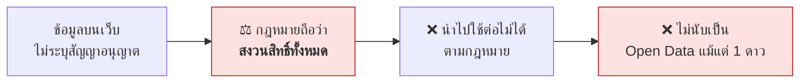
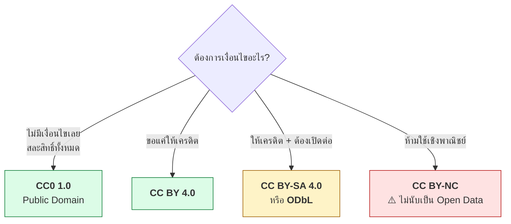
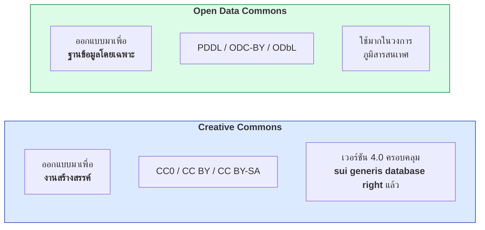
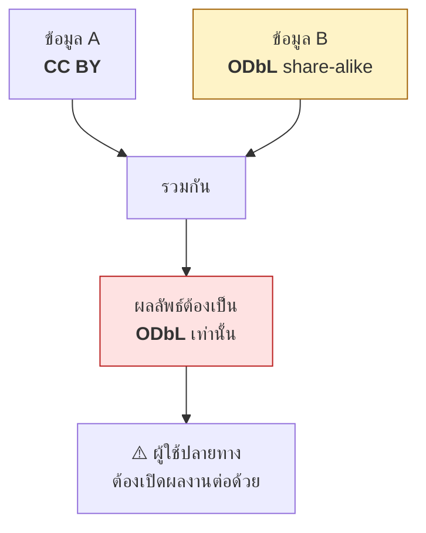
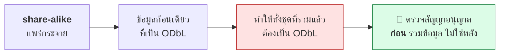
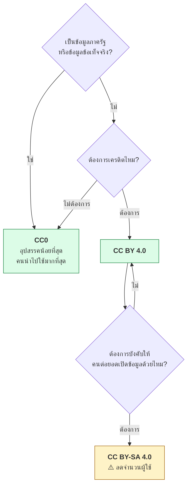
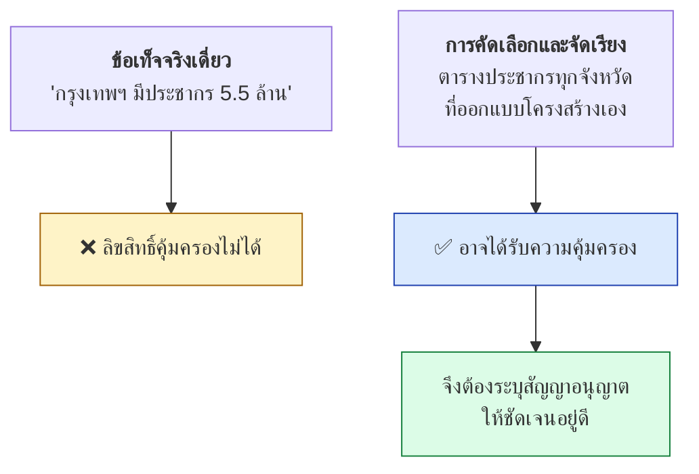

# 12.08 สัญญาอนุญาตสำหรับข้อมูลเปิด

สัญญาอนุญาตคือเงื่อนไขข้อแรกของ 5-star Open Data — ข้อมูลที่ไม่ระบุสัญญาอนุญาตถือว่า **สงวนสิทธิ์ทั้งหมด** และคนอื่นนำไปใช้ต่อไม่ได้
บทนี้เปรียบเทียบสัญญาอนุญาตที่ใช้กับข้อมูลจริง วิธีระบุในไฟล์ RDF และปัญหาที่เกิดเมื่อรวมข้อมูลหลายชุดที่ใช้สัญญาอนุญาตต่างกัน

---

## ทำไมต้องระบุสัญญาอนุญาต



> ⚠️ **"เอาขึ้นเว็บให้ดาวน์โหลดได้" ไม่เท่ากับ "อนุญาตให้ใช้"** — องค์กรที่มีฝ่ายกฎหมาย
> จะไม่แตะข้อมูลที่ไม่ระบุสัญญาอนุญาต แม้จะดาวน์โหลดได้ก็ตาม

---

## สัญญาอนุญาตที่ใช้กับข้อมูลเปิด



| สัญญาอนุญาต | ให้เครดิต | เปิดต่อ (share-alike) | ใช้เชิงพาณิชย์ | นับเป็น Open Data |
| --- | :---: | :---: | :---: | :---: |
| **CC0 1.0** | ไม่บังคับ | ไม่ | ✅ | ✅ |
| **CC BY 4.0** | ✅ บังคับ | ไม่ | ✅ | ✅ |
| **CC BY-SA 4.0** | ✅ บังคับ | ✅ บังคับ | ✅ | ✅ |
| **ODC-PDDL** | ไม่บังคับ | ไม่ | ✅ | ✅ |
| **ODC-BY** | ✅ บังคับ | ไม่ | ✅ | ✅ |
| **ODbL** | ✅ บังคับ | ✅ บังคับ | ✅ | ✅ |
| **CC BY-NC** | ✅ | ไม่ | ❌ | ❌ |
| **CC BY-ND** | ✅ | — | ✅ | ❌ |
| **ไม่ระบุ** | — | — | ❌ | ❌ |

> ⚠️ **`NC` (ห้ามเชิงพาณิชย์) และ `ND` (ห้ามดัดแปลง) ทำให้ข้อมูลไม่ผ่านนิยาม Open Data**
> ตาม Open Definition — และคำว่า "เชิงพาณิชย์" ยังคลุมเครือจนใช้งานจริงยาก

---

## Creative Commons กับ Open Data Commons



| ประเด็น | Creative Commons | Open Data Commons |
| --- | --- | --- |
| **ออกแบบเพื่อ** | งานสร้างสรรค์ (ข้อความ รูป เพลง) | ฐานข้อมูล |
| **ครอบคลุม database right** | ✅ ตั้งแต่เวอร์ชัน 4.0 | ✅ ตั้งแต่แรก |
| **คนรู้จัก** | มากกว่า | น้อยกว่า |
| **ใช้มากที่ไหน** | ทั่วไป, ภาครัฐ | OpenStreetMap, ภูมิสารสนเทศ |

> 💡 **ถ้าไม่มีเหตุผลพิเศษให้เลือก CC 4.0** เพราะคนรู้จักมากกว่า และเวอร์ชัน 4.0
> ครอบคลุมสิทธิในฐานข้อมูลแล้ว จึงไม่จำเป็นต้องใช้ ODC เว้นแต่ต้องเข้ากันได้กับ OpenStreetMap

---

## ระบุสัญญาอนุญาตใน RDF

```turtle
# --- รูปแบบเต็ม ---
@prefix rdf:     <http://www.w3.org/1999/02/22-rdf-syntax-ns#> .
@prefix dcterms: <http://purl.org/dc/terms/> .
@prefix void:    <http://rdfs.org/ns/void#> .
@prefix cc:      <http://creativecommons.org/ns#> .
@prefix schema:  <https://schema.org/> .

<https://data.example.org/dataset/universities>
    rdf:type void:Dataset ;
    dcterms:license
        <https://creativecommons.org/licenses/by/4.0/> ;
    dcterms:rights
        "© 2026 Example University. Licensed under CC BY 4.0."@en ;
    dcterms:attributionName
        "Example University Open Data"@en ;
    dcterms:attributionURL
        <https://data.example.org/> ;
    cc:license
        <https://creativecommons.org/licenses/by/4.0/> ;
    schema:license
        <https://creativecommons.org/licenses/by/4.0/> .
```

```turtle
# --- รูปแบบย่อ ---
@prefix dcterms: <http://purl.org/dc/terms/> .
@prefix void:    <http://rdfs.org/ns/void#> .
@prefix cc:      <http://creativecommons.org/ns#> .
@prefix schema:  <https://schema.org/> .

<https://data.example.org/dataset/universities> a void:Dataset ;
    dcterms:license <https://creativecommons.org/licenses/by/4.0/> ;
    dcterms:rights "© 2026 Example University. Licensed under CC BY 4.0."@en ;
    dcterms:attributionName "Example University Open Data"@en ;
    dcterms:attributionURL <https://data.example.org/> ;
    cc:license <https://creativecommons.org/licenses/by/4.0/> ;
    schema:license <https://creativecommons.org/licenses/by/4.0/> .
```

### ใช้ predicate ตัวไหน

| Predicate | ใครอ่าน | ควรใช้ไหม |
| --- | --- | --- |
| **`dcterms:license`** | เครื่องมือ LOD ทั่วไป, DCAT | ✅ **ต้องมี** |
| **`schema:license`** | เครื่องมือค้นหา | ✅ ควรมี |
| **`cc:license`** | เครื่องมือของ Creative Commons | 💡 ทำก็ดี |
| **`dcterms:rights`** | คนอ่าน | ✅ ควรมี |
| **`dcterms:attributionName` / `attributionURL`** | ผู้นำข้อมูลไปใช้ | ✅ ถ้าใช้ BY |

> ⚠️ **ค่าของ `dcterms:license` ต้องเป็น URI ไม่ใช่สตริง**
> `dcterms:license "CC BY 4.0"` ทำให้เครื่องเทียบไม่ได้ว่าเป็นสัญญาอนุญาตตัวไหน

### URI ของสัญญาอนุญาตที่ใช้บ่อย

| สัญญาอนุญาต | URI |
| --- | --- |
| CC0 1.0 | `https://creativecommons.org/publicdomain/zero/1.0/` |
| CC BY 4.0 | `https://creativecommons.org/licenses/by/4.0/` |
| CC BY-SA 4.0 | `https://creativecommons.org/licenses/by-sa/4.0/` |
| ODC-PDDL 1.0 | `https://opendatacommons.org/licenses/pddl/1-0/` |
| ODC-BY 1.0 | `https://opendatacommons.org/licenses/by/1-0/` |
| ODbL 1.0 | `https://opendatacommons.org/licenses/odbl/1-0/` |

---

## ⚠️ ปัญหาใหญ่ที่สุด — รวมข้อมูลต่างสัญญาอนุญาต



### ตารางความเข้ากันได้

| ← รวมกับ → | CC0 | CC BY | CC BY-SA | ODbL |
| --- | :---: | :---: | :---: | :---: |
| **CC0** | CC0 | CC BY | CC BY-SA | ODbL |
| **CC BY** | CC BY | CC BY | CC BY-SA | ODbL |
| **CC BY-SA** | CC BY-SA | CC BY-SA | CC BY-SA | ⚠️ ขัดกัน |
| **ODbL** | ODbL | ODbL | ⚠️ ขัดกัน | ODbL |

> ⚠️ **`CC BY-SA` กับ `ODbL` เข้ากันไม่ได้** เพราะทั้งคู่บังคับให้ผลงานต่อยอด
> ต้องใช้สัญญาอนุญาตเดียวกับตัวเอง — ซึ่งเป็นไปไม่ได้พร้อมกัน



### สัญญาอนุญาตของ dataset หลักใน LOD Cloud

| Dataset | สัญญาอนุญาต | ผลต่อการนำไปใช้ |
| --- | --- | --- |
| **Wikidata** | **CC0** | ✅ ใช้ได้อิสระที่สุด |
| **DBpedia** | **CC BY-SA 3.0** | ⚠️ ผลงานต่อยอดต้องเป็น BY-SA |
| **GeoNames** | **CC BY 4.0** | ✅ แค่ให้เครดิต |
| **OpenStreetMap / LinkedGeoData** | **ODbL** | ⚠️ share-alike |
| **Europeana metadata** | **CC0** | ✅ |
| **VIAF** | **ODC-BY** | ✅ แค่ให้เครดิต |

> 🎯 **นี่คือเหตุผลเชิงปฏิบัติอีกข้อที่ทำให้ Wikidata เป็น hub ที่ดีที่สุด — เป็น CC0**
> จึงรวมเข้ากับข้อมูลของใครก็ได้โดยไม่ติดเงื่อนไข

---

## เลือกสัญญาอนุญาตให้ข้อมูลของเรา



| ถ้าคุณคือ | แนะนำ | เหตุผล |
| --- | --- | --- |
| หน่วยงานรัฐ | **CC0** | ข้อมูลมาจากภาษี ควรใช้ได้อย่างอิสระ |
| มหาวิทยาลัย / งานวิจัย | **CC BY 4.0** | ได้เครดิตกลับมาเป็นการอ้างอิง |
| ธุรกิจที่เปิดข้อมูลบางส่วน | **CC BY 4.0** | ได้การรับรู้แบรนด์ |
| โครงการที่ต้องการให้ระบบนิเวศเปิด | **ODbL** | บังคับให้ต่อยอดแล้วต้องเปิด |

> 💡 **CC0 ทำให้ข้อมูลถูกนำไปใช้มากที่สุด** เพราะไม่มีอุปสรรคทางกฎหมายเลย
> ถ้าเป้าหมายคือให้คนใช้ข้อมูล ไม่ใช่ควบคุมการใช้ — CC0 คือคำตอบ

---

## ข้อเท็จจริงลิขสิทธิ์ไม่ได้ แต่การรวบรวมได้



| ประเทศ/ภูมิภาค | การคุ้มครองฐานข้อมูล |
| --- | --- |
| **สหภาพยุโรป** | มี **sui generis database right** แยกจากลิขสิทธิ์ |
| **สหรัฐอเมริกา** | ไม่มี — ต้องมีความคิดสร้างสรรค์ในการคัดเลือก/จัดเรียง |
| **ไทย** | ใช้หลักลิขสิทธิ์ทั่วไป การรวบรวมที่มีการคัดเลือกอาจได้รับความคุ้มครอง |

> 💡 **ต่อให้ข้อมูลของคุณอาจไม่มีลิขสิทธิ์ ก็ควรระบุ CC0 ให้ชัดเจน**
> เพราะเป็นการ **ประกาศเจตนา** ที่ทำให้ผู้ใช้มั่นใจ ไม่ต้องเดาเอง

---

## ✅ เช็กลิสต์เรื่องสัญญาอนุญาต

- [ ] ระบุสัญญาอนุญาต **เป็น URI** ด้วย `dcterms:license`
- [ ] ระบุที่ทั้งระดับ **Dataset และ Distribution**
- [ ] ถ้าใช้ `BY` — ระบุ **`attributionName`** และ **`attributionURL`** ให้ชัด
- [ ] เขียนไฟล์ **`LICENSE`** และหน้าเว็บที่คนอ่านเข้าใจ
- [ ] ตรวจสัญญาอนุญาตของ **ข้อมูลต้นทางทุกชุด** ที่นำมารวม
- [ ] ตรวจว่า **ไม่มีชุดไหนเป็น share-alike ที่ขัดกัน**
- [ ] **หลีกเลี่ยง `NC` และ `ND`** ถ้าอยากให้นับเป็น Open Data
- [ ] บันทึก **ที่มาของข้อมูล (provenance)** ด้วย `dcterms:source` หรือ PROV-O

---

## Key Points

- ข้อมูลที่ **ไม่ระบุสัญญาอนุญาต ถือว่าสงวนสิทธิ์ทั้งหมด** และไม่นับเป็น Open Data แม้แต่ 1 ดาว
- **CC0** = สละสิทธิ์ทั้งหมด, **CC BY** = ขอเครดิต, **CC BY-SA / ODbL** = บังคับให้ต่อยอดแล้วเปิดต่อ
- ⚠️ **`NC` และ `ND` ทำให้ไม่ผ่านนิยาม Open Data** ตาม Open Definition
- **CC 4.0 ครอบคลุม sui generis database right แล้ว** จึงใช้แทน ODC ได้ในกรณีทั่วไป
- ⚠️ **`dcterms:license` ต้องมีค่าเป็น URI ไม่ใช่สตริง** มิฉะนั้นเครื่องเทียบไม่ได้
- ⚠️ **`CC BY-SA` กับ `ODbL` เข้ากันไม่ได้** — ต้องตรวจสัญญาอนุญาต **ก่อน** รวมข้อมูล
- **share-alike แพร่กระจาย** — ข้อมูล ODbL ก้อนเดียวทำให้ทั้งชุดที่รวมแล้วต้องเป็น ODbL
- **Wikidata เป็น CC0** ซึ่งเป็นอีกเหตุผลที่ทำให้เป็น hub ที่ดีที่สุด ส่วน **DBpedia เป็น CC BY-SA**
- **CC0 ทำให้ข้อมูลถูกนำไปใช้มากที่สุด** — เหมาะกับหน่วยงานรัฐและข้อมูลข้อเท็จจริง
- **ข้อเท็จจริงเดี่ยวมีลิขสิทธิ์ไม่ได้ แต่การรวบรวมอาจได้** — ระบุ CC0 ไว้ชัดเจนดีกว่าปล่อยให้เดา
