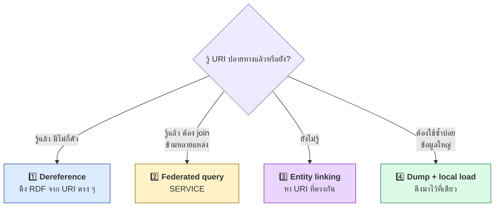
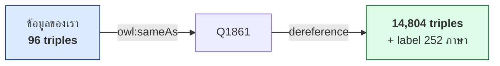
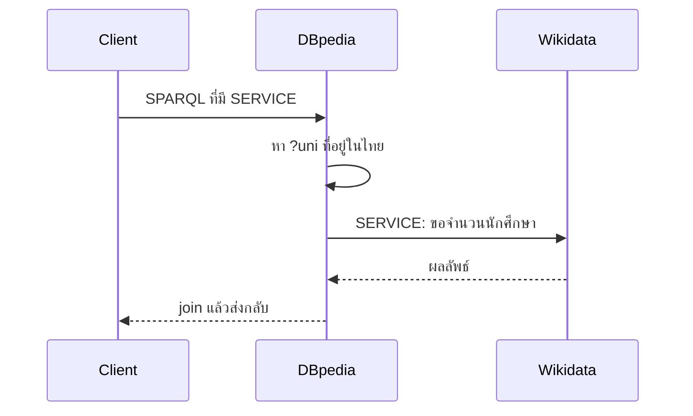
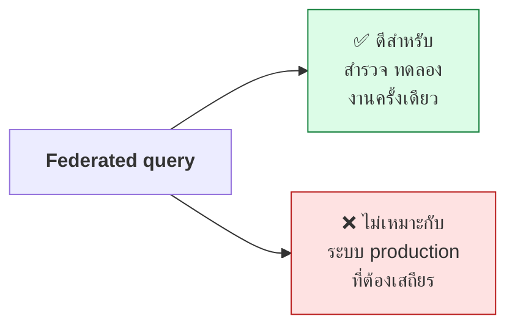
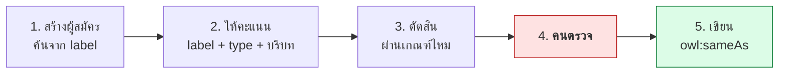
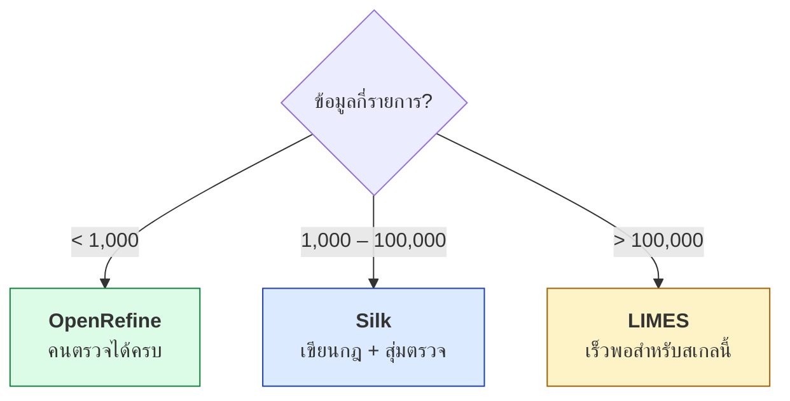
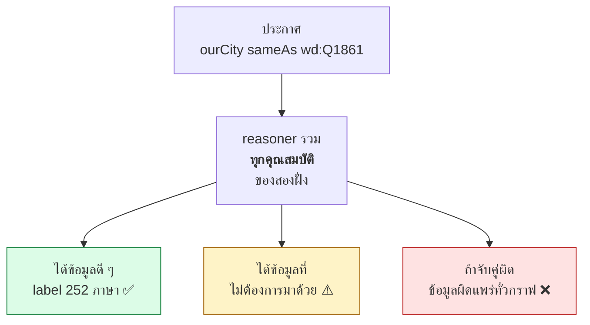
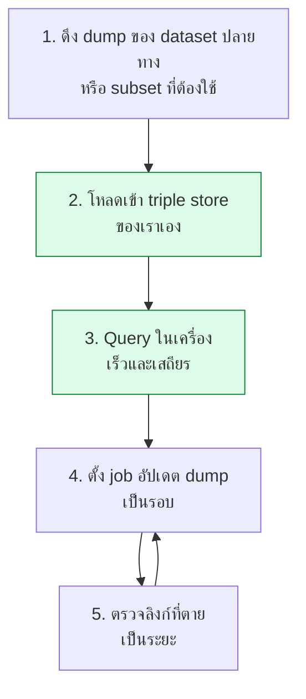

# 12.09 การบริโภค Linked Open Data

การเผยแพร่เป็นแค่ครึ่งเดียวของเรื่อง — อีกครึ่งคือการ **ดึงข้อมูลของคนอื่นมาเสริมข้อมูลของเรา**
บทนี้แสดง 4 เทคนิคหลัก พร้อมผลรันจริงที่รวมทั้งกรณีที่สำเร็จและกรณีที่ endpoint สาธารณะไม่ตอบ

📄 โค้ดเต็ม: [`code/ch12/federated_lod.py`](../code/ch12/federated_lod.py)

---

## 4 เทคนิคการบริโภค LOD



| เทคนิค | ต้นทุน | เสถียรภาพ | เหมาะกับ |
| --- | --- | --- | --- |
| **Dereference** | ต่ำ | ปานกลาง | ไม่กี่ร้อย URI |
| **Federated query** | ปานกลาง | ⚠️ ต่ำ | งานสำรวจ ทดลอง |
| **Entity linking** | สูง | — | สร้างลิงก์ครั้งแรก |
| **Dump + local load** | สูงตอนเริ่ม | ✅ สูงที่สุด | **ระบบ production** |

---

## 1️⃣ Dereference — ดึง RDF จาก URI ตรง ๆ

นี่คือหลักการ Linked Data ข้อ 3 ที่ใช้จริง: **เปิด URI แล้วต้องได้ข้อมูล**

```python
def dereference_wikidata(qid: str) -> Graph:
    """ดึง RDF ของ entity เดียวจาก Wikidata

    ใช้ Special:EntityData แทน Query Service เพราะไม่ติดการจำกัดอัตรา
    """
    url = f"https://www.wikidata.org/wiki/Special:EntityData/{qid}.ttl"
    req = urllib.request.Request(url, headers={"User-Agent": UA})
    with urllib.request.urlopen(req, timeout=60) as resp:
        data = resp.read()
    g = Graph()
    g.parse(data=data, format="turtle")
    return g
```

ผลจริง

```
1. Dereference -- เสริมข้อมูลจาก URI ที่ sameAs ชี้ไป
  จะดึงข้อมูลจาก 3 URI

  Q1071609  (3,096 triples ที่ดึงมา)
    entity ของเรา : cmu
    ภาษาที่มี label: 31
      en  Chiang Mai University
      th  มหาวิทยาลัยเชียงใหม่
      ja  チエンマイ大学
      de  Chiang-Mai-Universität
  Q1861  (14,804 triples ที่ดึงมา)
    entity ของเรา : bangkok
    ภาษาที่มี label: 252
      en  Bangkok
      th  กรุงเทพมหานคร
      ja  バンコク
      de  Bangkok
  Q52028  (5,471 triples ที่ดึงมา)
    entity ของเรา : chiang-mai
    ภาษาที่มี label: 90
      en  Chiang Mai
      th  เทศบาลนครเชียงใหม่
      ja  テーサバーンナコーン・チエンマイ
      de  Chiang Mai
```



> 🎯 **ข้อมูลของเรามีแค่ 96 triples แต่ลิงก์ 3 เส้นดึงข้อมูลมาได้กว่า 23,000 triples**
> — นี่คือพลังที่แท้จริงของดาวดวงที่ 5

> ⚠️ **ใช้ `Special:EntityData` แทน Query Service** เมื่อต้องการดึงข้อมูลรายตัว
> เพราะไม่ติดการจำกัดอัตราที่เข้มงวดของ Wikidata Query Service

---

## 2️⃣ Federated Query — `SERVICE`



```sparql
PREFIX wd:   <http://www.wikidata.org/entity/>
PREFIX wdt:  <http://www.wikidata.org/prop/direct/>
PREFIX dbo:  <http://dbpedia.org/ontology/>
PREFIX foaf: <http://xmlns.com/foaf/0.1/>

SELECT ?uni ?studentCount ?abstract WHERE {
  # --- ส่วนนี้รันที่ DBpedia (endpoint หลัก) ---
  ?uni a dbo:University ;
       dbo:country dbr:Thailand ;
       dbo:abstract ?abstract .
  FILTER(LANG(?abstract) = "en")

  # --- ส่วนนี้ส่งต่อไป Wikidata ---
  OPTIONAL {
    ?uni owl:sameAs ?wd .
    FILTER(STRSTARTS(STR(?wd), "http://www.wikidata.org/entity/"))
    SERVICE <https://query.wikidata.org/sparql> {
      ?wd wdt:P2196 ?studentCount .
    }
  }
}
LIMIT 5
```

### ⚠️ ความจริงของ federated query ในทางปฏิบัติ

```
  ⚠️ endpoint สาธารณะมักปิดหรือจำกัด SERVICE
     - Wikidata อนุญาต SERVICE เฉพาะ endpoint ใน whitelist
     - DBpedia จำกัดเวลา query อย่างเข้มงวด
     ในทางปฏิบัติจึงนิยม 'ดึงมาไว้ที่เดียวแล้ว query ในเครื่อง' มากกว่า
```

| ปัญหา | รายละเอียด |
| --- | --- |
| **Whitelist** | Wikidata ยอมให้ `SERVICE` ไปเฉพาะ endpoint ที่อนุญาตไว้ |
| **Timeout** | query ที่ join ข้ามเครื่องมักเกินเวลาที่กำหนด |
| **ลำดับการทำงาน** | ถ้า optimizer เลือกลำดับผิด อาจยิงคำขอไปปลายทางหลายพันครั้ง |
| **ไม่มีสถิติของอีกฝ่าย** | optimizer เดาต้นทุนของฝั่งตรงข้ามไม่ได้ |
| **ล่มพร้อมกัน** | endpoint ใดล่ม query ทั้งชุดล้มเหลว |



> 💡 **แนวทางที่ใช้ได้จริงในระบบ production:** ดึง subset ที่ต้องการมาไว้ใน triple store
> ของเราเอง แล้ว query ในเครื่อง — เร็วกว่า เสถียรกว่า และควบคุมได้

---

## 3️⃣ Entity Linking — หา URI ที่ตรงกัน



```python
def search(term: str, limit: int = 3) -> list[dict]:
    url = "https://www.wikidata.org/w/api.php?" + urllib.parse.urlencode({
        "action": "wbsearchentities", "search": term, "language": "en",
        "format": "json", "limit": limit, "type": "item"})
    return http_json(url).get("search", [])
```

ผลจริง

```
3. Entity linking -- หา URI ที่ตรงกันเมื่อยังไม่มี sameAs
  entity ที่ยังไม่มีลิงก์ไป Wikidata : 3

  "CMU Suthep Campus"
    ไม่พบผู้สมัคร
  "Chulalongkorn Main Campus"
    ไม่พบผู้สมัคร
  "KMITL Ladkrabang Campus"
    ไม่พบผู้สมัคร
```

> 💡 **"ไม่พบผู้สมัคร" คือผลลัพธ์ที่ถูกต้อง** — วิทยาเขตย่อยไม่มีอยู่ใน Wikidata
> ไม่ใช่ทุกสิ่งในข้อมูลของเราที่จะมีคู่เทียบข้างนอก และ **นั่นก็ไม่เป็นไร**

### ⚠️ กับดักที่พบตอนพัฒนา

ตอนแรกโปรแกรมนี้ไปค้นคำว่า `"Campus"` และ `"City"` ซึ่งเป็น **ชื่อ class ใน vocabulary** ไม่ใช่ชื่อสิ่งของ

```
  "Campus"
       Q209465  campus              cluster of buildings and land used by an educational
     Q37174750  Campus              family name              ⬅️ ผิดสิ้นเชิง
     Q19691007  institutional complex  group of many institutional buildings
  "City"
          Q515  city                large human settlement
        Q12892  Antwerp             city and municipality in Belgium   ⬅️ ผิดสิ้นเชิง
        Q50602  Manchester City F.C.  association football club        ⬅️ ผิดสิ้นเชิง
```

```python
# ⚠️ ต้องกรอง term ของ vocabulary ออก มิฉะนั้นจะไปค้นคำว่า "Campus"
#    กับ "City" ซึ่งเป็นชื่อ class ไม่ใช่ชื่อสิ่งของ
VOC = "https://data.example.org/vocab#"
if str(s).startswith(VOC):
    continue
```

> 🎯 **`"City" → Manchester City F.C.`** เป็นตัวอย่างชัดเจนว่าทำไม **การจับคู่ด้วยชื่ออย่างเดียวใช้ไม่ได้**
> — ต้องใช้ประเภท (`rdf:type`) และบริบทรอบตัวมาช่วยตัดสินเสมอ

### สัญญาณที่ใช้ให้คะแนนผู้สมัคร

| สัญญาณ | น้ำหนัก | ตัวอย่าง |
| --- | --- | --- |
| **ความเหมือนของ label** | ปานกลาง | "Chiang Mai University" ≈ "Chiang Mai University" |
| **ตรงประเภท** | **สูง** | ทั้งคู่ต้องเป็น `University` ไม่ใช่ `FootballClub` |
| **ตรงคุณสมบัติสำคัญ** | **สูงมาก** | ปีก่อตั้ง, พิกัด, ประเทศ |
| **ตรงบริบทของเพื่อนบ้าน** | สูง | อยู่ในเมืองเดียวกัน |
| **ตรงรหัสภายนอก** | **แน่นอน** | ISBN, GeoNames ID, เลขนิติบุคคล |

> 🎯 **ถ้ามีรหัสมาตรฐานร่วมกัน ให้ใช้รหัสนั้นจับคู่** — แม่นยำกว่าการเทียบชื่อทุกกรณี

### เครื่องมือเฉพาะทาง

| เครื่องมือ | จุดเด่น |
| --- | --- |
| **Silk** | ประกาศกฎเป็น XML, รวมหลายสัญญาณด้วยน้ำหนัก, ทำงานแบบกระจายได้ |
| **LIMES** | เร็วกว่ามากเพราะตัดคู่ที่เป็นไปไม่ได้ทิ้งด้วยหลักอสมการสามเหลี่ยม |
| **OpenRefine + Wikidata reconciliation** | มี UI ให้คนตรวจทีละรายการ เหมาะกับข้อมูลจำนวนไม่มาก |
| **LogMap / AgreementMakerLight** | เน้นจับคู่ระดับ ontology (class/property) ไม่ใช่ instance |



---

## 4️⃣ ตรวจว่าลิงก์ยังใช้งานได้

ลิงก์ที่ตายทำให้ผู้ใช้เชื่อว่าเชื่อมได้แล้วโปรแกรมพังตอนรัน — ต้องตรวจเป็นระยะ

```python
req = urllib.request.Request(url, headers={"User-Agent": UA}, method="HEAD")
with urllib.request.urlopen(req, timeout=15) as resp:
    status = resp.status
```

ผลจริง (รันเมื่อ DBpedia ตอบสนองช้า)

```
4. ตรวจว่า URI ปลายทางยังใช้งานได้จริง
  ลิงก์ทั้งหมด 14 เส้น ไปยัง 3 dataset

    ⚠️ TMO  http://dbpedia.org/resource/Bangkok
    ⚠️ TMO  http://dbpedia.org/resource/Chiang_Mai
    ✅ 200  http://dbpedia.org/resource/Chiang_Mai_University
    ⚠️ TMO  http://dbpedia.org/resource/Chulalongkorn_University
    ✅ 200  http://sws.geonames.org/1153671/
    ✅ 200  http://sws.geonames.org/1609350/
    ✅ 200  http://www.wikidata.org/entity/Q1071609
    ✅ 200  http://www.wikidata.org/entity/Q11023
    ✅ 200  http://www.wikidata.org/entity/Q11190
    ✅ 200  http://www.wikidata.org/entity/Q1861
    ✅ 200  http://www.wikidata.org/entity/Q21198
    ✅ 200  http://www.wikidata.org/entity/Q52028
    ✅ 200  http://www.wikidata.org/entity/Q849209
    ✅ 200  http://www.wikidata.org/entity/Q855730

  สรุป: ใช้ได้ 11 / ตาย 0 / เรียกไม่สำเร็จชั่วคราว 3
  ⚠️ 'TMO' คือเรียกไม่ทันในเวลาที่กำหนด ไม่ใช่ลิงก์ตาย
     ต้องลองซ้ำหลายรอบก่อนสรุป -- endpoint สาธารณะไม่เสถียรเป็นเรื่องปกติ
```

> 🎯 **ต้องแยก "ลิงก์ตาย" ออกจาก "เรียกไม่ทัน"** — ถ้าโปรแกรมนับ timeout เป็นลิงก์ตาย
> คุณจะลบ `owl:sameAs` ที่ถูกต้องทิ้งเพียงเพราะเซิร์ฟเวอร์ปลายทางช้าในวันนั้น
>
> ⚠️ ผลข้างต้นแสดง **DBpedia timeout 3 ครั้งจาก 4** ในการรันครั้งนี้
> ขณะที่รันครั้งก่อนหน้าทั้ง 4 ลิงก์ตอบ `200` ปกติ

---

## ⚠️ กับดักเชิงความหมายของ `owl:sameAs`



| สถานการณ์ | ควรใช้ |
| --- | --- |
| มั่นใจ 100% ว่าเป็นสิ่งเดียวกัน | `owl:sameAs` |
| แนวคิดตรงกันในการจัดหมวดหมู่ | `skos:exactMatch` |
| ใกล้เคียงพอใช้แทนกันได้ | `skos:closeMatch` |
| แค่ต้องการชี้ว่ามีข้อมูลเพิ่ม | `rdfs:seeAlso` |
| จับคู่โดยเครื่อง ยังไม่มีคนตรวจ | `skos:closeMatch` + `prov:wasGeneratedBy` |

> ⚠️ **`owl:sameAs` ที่จับคู่โดยอัตโนมัติแล้วไม่มีคนตรวจ คือหนี้ทางเทคนิคที่แพงที่สุดใน LOD**
> เพราะข้อมูลผิดจะแพร่ไปทั่วกราฟและตามลบยาก

---

## แบบแผน production ที่แนะนำ



| ทำไมไม่ query สดทุกครั้ง | เหตุผล |
| --- | --- |
| **ความเร็ว** | query ในเครื่องเร็วกว่าหลายสิบเท่า |
| **ความเสถียร** | ระบบเราไม่ล่มตามเมื่อ endpoint ปลายทางล่ม |
| **ผลที่ทำซ้ำได้** | ข้อมูลไม่เปลี่ยนกลางคัน ทดสอบได้ |
| **มารยาท** | ไม่ยิงคำขอถล่ม endpoint สาธารณะที่ให้ใช้ฟรี |

---

## รันโปรแกรม

```bash
python3 code/ch12/federated_lod.py
```

---

## Key Points

- 4 เทคนิคบริโภค LOD: **Dereference**, **Federated query**, **Entity linking**, **Dump + local load**
- **Dereference** — ข้อมูลเราแค่ **96 triples** แต่ลิงก์ 3 เส้นดึงข้อมูลมาได้กว่า **23,000 triples**
- ใช้ **`Special:EntityData`** แทน Wikidata Query Service เมื่อดึงข้อมูลรายตัว เพราะไม่ติดการจำกัดอัตรา
- ⚠️ **Federated query (`SERVICE`) ไม่เหมาะกับ production** — ติด whitelist, timeout, และล่มพร้อมกันเมื่อฝ่ายใดฝ่ายหนึ่งล่ม
- **Entity linking ห้ามใช้ชื่ออย่างเดียว** — `"City"` ให้ผู้สมัครเป็น **Manchester City F.C.** ได้
- ต้อง **กรอง term ของ vocabulary ออก** ก่อนทำ entity linking มิฉะนั้นจะไปจับคู่ชื่อ class
- **"ไม่พบผู้สมัคร" เป็นผลลัพธ์ที่ถูกต้องได้** — ไม่ใช่ทุกสิ่งของเราที่มีคู่เทียบข้างนอก
- **ถ้ามีรหัสมาตรฐานร่วมกัน (ISBN, GeoNames ID) ให้ใช้รหัสจับคู่** แม่นยำกว่าเทียบชื่อเสมอ
- เครื่องมือ: **OpenRefine** (< 1,000), **Silk** (1,000–100,000), **LIMES** (> 100,000)
- ⚠️ **ต้องแยก "ลิงก์ตาย" ออกจาก "เรียกไม่ทัน"** — ผลรันจริงมี DBpedia timeout 3 ครั้งจาก 4 ทั้งที่ครั้งก่อนหน้าตอบ 200 ครบ
- ⚠️ **`owl:sameAs` ที่จับคู่อัตโนมัติโดยไม่มีคนตรวจคือหนี้ทางเทคนิคที่แพงที่สุดใน LOD**
- **แบบแผน production: ดึง dump มาไว้ในเครื่องแล้ว query เอง** — เร็วกว่า เสถียรกว่า ทำซ้ำได้ และเป็นมารยาทต่อ endpoint สาธารณะ
