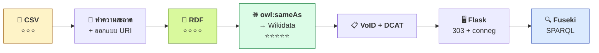
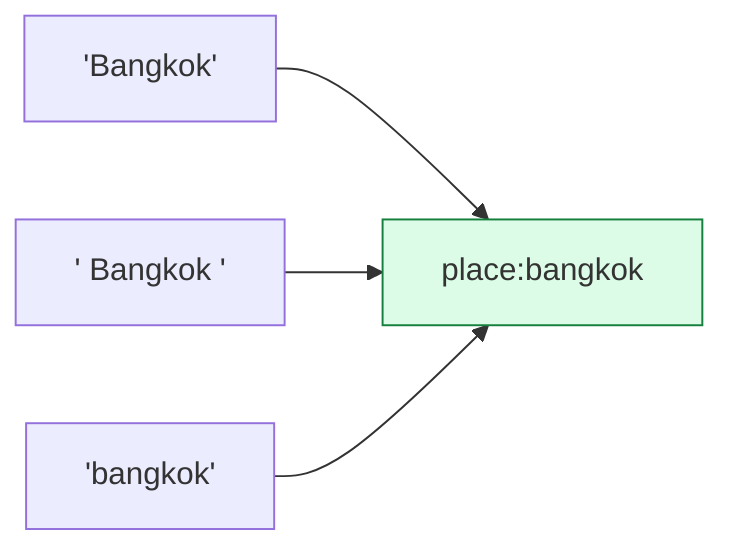
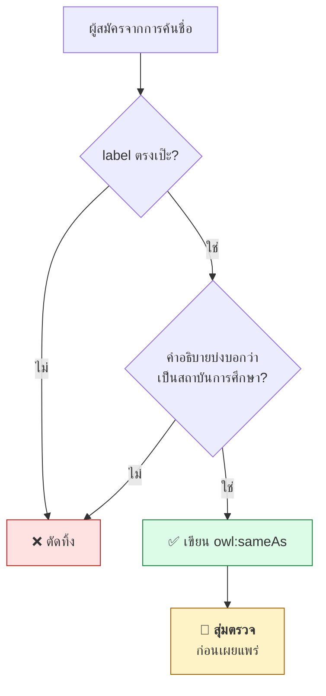
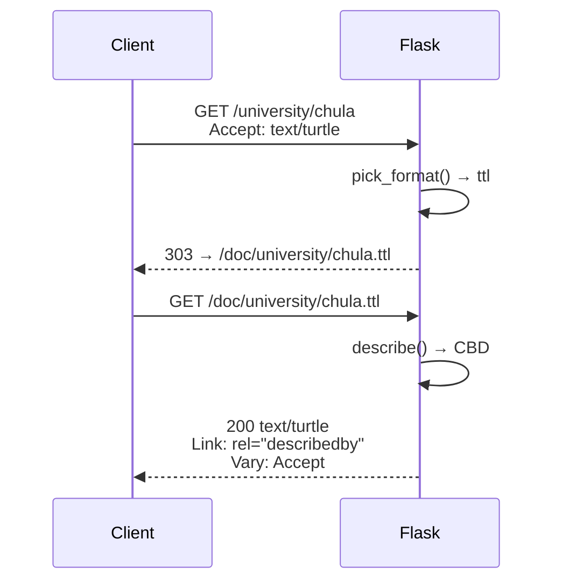
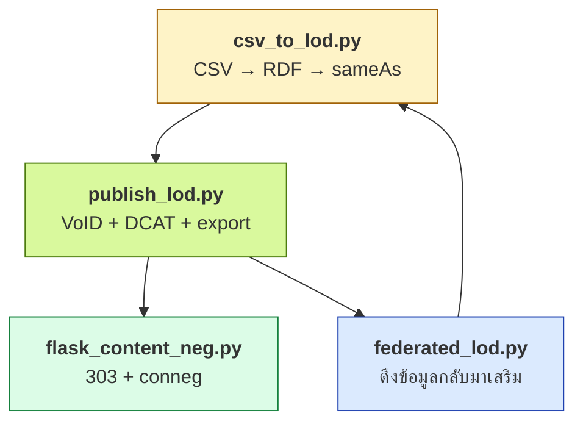

# 12.10 สร้าง Linked Open Data ด้วย Python

บทนี้ประกอบทุกอย่างในบทที่ 12 เข้าด้วยกันเป็นไปป์ไลน์เดียว — เริ่มจาก CSV ธรรมดา แปลงเป็น RDF เชื่อมเข้า Wikidata สร้าง metadata แล้วเสิร์ฟผ่าน HTTP พร้อม content negotiation
ทุกผลลัพธ์ในหน้านี้เป็นผลรันจริง

📄 โค้ดในบทนี้
- [`code/ch12/csv_to_lod.py`](../code/ch12/csv_to_lod.py) — CSV → RDF → `sameAs`
- [`code/ch12/publish_lod.py`](../code/ch12/publish_lod.py) — VoID + DCAT + ส่งออกหลายรูปแบบ
- [`code/ch12/flask_content_neg.py`](../code/ch12/flask_content_neg.py) — เซิร์ฟเวอร์ Linked Data
- [`code/ch12/federated_lod.py`](../code/ch12/federated_lod.py) — บริโภคข้อมูลจากภายนอก

---

## ภาพรวมไปป์ไลน์



```bash
pip install rdflib flask
```

---

## ขั้นที่ 1 — CSV ที่มีปัญหาแบบที่เจอจริง

```csv
name_en,name_th,founded,city,website
Chulalongkorn University,จุฬาลงกรณ์มหาวิทยาลัย,1917,Bangkok,https://www.chula.ac.th/
King Mongkut's Institute of Technology Ladkrabang,สถาบัน...,1960, Bangkok ,www.kmitl.ac.th
Chiang Mai University,มหาวิทยาลัยเชียงใหม่,1964,Chiang Mai,https://www.cmu.ac.th/
Mahidol University,มหาวิทยาลัยมหิดล,1888,Nakhon Pathom,https://mahidol.ac.th
Thammasat University,มหาวิทยาลัยธรรมศาสตร์,1934,bangkok,https://tu.ac.th/
```

ผลจริง

```
ขั้นที่ 1: อ่าน CSV (ข้อมูลระดับ 3 ดาว)
  อ่านได้ 5 แถว, 5 คอลัมน์
  คอลัมน์: ['name_en', 'name_th', 'founded', 'city', 'website']

  ⚠️ ปัญหาที่พบในข้อมูลดิบ:
     - 'Bangkok', ' Bangkok ', 'bangkok'  → ชื่อเมืองเดียวกันสะกดต่างกัน 3 แบบ
     - website บางแถวไม่มี scheme (www.kmitl.ac.th)
     - ชื่อมี apostrophe ซึ่งใช้ใน URI ไม่ได้
```

> 🎯 **นี่คือปัญหาที่ทำให้ CSV ติดอยู่ที่ 3 ดาว** — เครื่องไม่รู้ว่า `Bangkok`,
> ` Bangkok ` และ `bangkok` คือสิ่งเดียวกัน การให้ URI เท่ากับการแก้ปัญหานี้ที่ต้นเหตุ

---

## ขั้นที่ 2 — ทำความสะอาดและออกแบบ URI

```python
def slugify(text: str) -> str:
    """แปลงข้อความเป็นส่วนของ URI ที่ปลอดภัย

    กฎ: ตัวพิมพ์เล็ก, ASCII เท่านั้น, ใช้ '-' คั่นคำ, ไม่มีอักขระพิเศษ
    """
    s = text.lower()
    s = re.sub(r"[''`]", "", s)          # ตัด apostrophe ออกก่อน ไม่แทนด้วย -
    s = re.sub(r"[^a-z0-9]+", "-", s)
    return s.strip("-")
```

```python
city = r["city"].strip().title()         # 'bangkok' และ ' Bangkok ' → 'Bangkok'

site = r["website"].strip()
if site and not site.startswith(("http://", "https://")):
    site = "https://" + site             # www.kmitl.ac.th → https://www.kmitl.ac.th
```

ผลจริง

```
ขั้นที่ 2: ทำความสะอาดและออกแบบ URI
  ชื่อ                                                 URI
  Chulalongkorn University                             university/chulalongkorn-university
  King Mongkut's Institute of Technology Ladkrabang    university/king-mongkuts-institute-of-technology-ladkrabang
  Chiang Mai University                                university/chiang-mai-university
  Mahidol University                                   university/mahidol-university
  Thammasat University                                 university/thammasat-university

  เมืองหลังทำความสะอาด: ['Bangkok', 'Chiang Mai', 'Nakhon Pathom']
  ⬅️ จาก 5 ค่าที่ต่างกัน เหลือ 3
```



> ⚠️ **สังเกตการตัด apostrophe** — `King Mongkut's` ต้องกลายเป็น `king-mongkuts`
> ไม่ใช่ `king-mongkut-s` การแทน apostrophe ด้วย `-` ทำให้ URI มีขีดเกินมาโดยไม่จำเป็น

---

## ขั้นที่ 3 — แม็ปเข้า vocabulary มาตรฐาน

```python
from rdflib import Graph, Literal, Namespace, URIRef
from rdflib.namespace import OWL, RDF, RDFS, XSD

VOC = Namespace("https://data.example.org/vocab#")
UNI = Namespace("https://data.example.org/university/")
PLACE = Namespace("https://data.example.org/place/")
SCHEMA = Namespace("https://schema.org/")

# ผูก vocabulary ของเราเข้ากับมาตรฐานสากล -- ทำให้คนอื่นเข้าใจโดยไม่ต้องอ่านเอกสาร
g.add((VOC.University, RDFS.subClassOf, SCHEMA.CollegeOrUniversity))
g.add((VOC.City, RDFS.subClassOf, SCHEMA.City))

for r in rows:
    u = r["uri"]
    g.add((u, RDF.type, VOC.University))
    g.add((u, RDFS.label, Literal(r["name_en"], lang="en")))
    g.add((u, RDFS.label, Literal(r["name_th"], lang="th")))
    g.add((u, VOC.foundingYear, Literal(r["founded"], datatype=XSD.gYear)))
    g.add((u, VOC.locatedIn, r["city_uri"]))
    if r["website"]:
        g.add((u, SCHEMA.url, URIRef(r["website"])))
```

ผลจริง

```
ขั้นที่ 3: แม็ปเข้า vocabulary มาตรฐาน → RDF (4 ดาว)
  สร้าง RDF ได้ 40 triples
  entity: 10 ตัว

  ตัวอย่างผลลัพธ์:
    uni:chulalongkorn-university a voc:University ;
        rdfs:label "Chulalongkorn University"@en,
            "จุฬาลงกรณ์มหาวิทยาลัย"@th ;
        voc:foundingYear "1917"^^xsd:gYear ;
        voc:locatedIn place:bangkok ;
        schema:url <https://www.chula.ac.th/> .
```

<table>
<tr><th width="50%">CSV เดิม (3 ดาว)</th><th width="50%">RDF (4 ดาว)</th></tr>
<tr valign="top">
<td>

```csv
name_en,city
Chulalongkorn University,Bangkok
```

- `city` เป็นข้อความ
- ไม่รู้ว่าเป็นเมืองหรือจังหวัด
- ต่อกับข้อมูลอื่นไม่ได้

</td>
<td>

```turtle
uni:chulalongkorn-university
    a voc:University ;
    voc:locatedIn place:bangkok .

place:bangkok a voc:City .
```

- `place:bangkok` มีตัวตน
- ประเภทระบุชัดด้วย `rdf:type`
- ต่อกับข้อมูลอื่นได้ทันที

</td>
</tr>
</table>

---

## ขั้นที่ 4 — เชื่อมเข้า Wikidata

```python
def search(term: str) -> list[dict]:
    url = "https://www.wikidata.org/w/api.php?" + urllib.parse.urlencode({
        "action": "wbsearchentities", "search": term, "language": "en",
        "format": "json", "limit": 3, "type": "item"})
    req = urllib.request.Request(url, headers={"User-Agent": UA})
    with urllib.request.urlopen(req, timeout=30) as resp:
        return json.load(resp).get("search", [])


# เกณฑ์อัตโนมัติ: label ต้องตรงกันเป๊ะ และคำอธิบายต้องบ่งบอกว่าเป็นสถาบันการศึกษา
best = None
for h in hits:
    desc = h.get("description", "").lower()
    if h.get("label", "").lower() == r["name_en"].lower() and \
       any(k in desc for k in ("universit", "institute", "college")):
        best = h
        break
```

ผลจริง

```
ขั้นที่ 4: เชื่อม owl:sameAs ไป Wikidata (5 ดาว)
  ชื่อ                                              QID  คำอธิบายจาก Wikidata
  Chulalongkorn University                      Q855730  autonomous public research university in Ban
  King Mongkut's Institute of Technology        Q849209  university in Bangkok, Thailand
  Chiang Mai University                        Q1071609  university in Thailand
  Mahidol University                            Q626804  university in Thailand
  Thammasat University                         Q1209733  university in Thailand

  เชื่อมอัตโนมัติได้ 5/5 รายการ
  ⚠️ ผ่านเกณฑ์ครบไม่ได้แปลว่าถูกทุกรายการ
     เกณฑ์นี้แค่ 'ชื่อตรงเป๊ะ + คำอธิบายบ่งบอกว่าเป็นสถาบันการศึกษา'
     ยังควรสุ่มตรวจก่อนเผยแพร่เสมอ
```



> 🎯 **ใช้ 2 สัญญาณเสมอ ไม่ใช่สัญญาณเดียว** — ถ้าเทียบแค่ชื่อ `"City"` จะจับคู่กับ
> **Manchester City F.C.** ได้ (ดู [12.09](12.09-consuming-lod.md)) การเช็คคำอธิบายเพิ่มอีกชั้นตัดกรณีแบบนี้ออก

---

## ขั้นที่ 5 — ตรวจคุณภาพก่อนเผยแพร่

```python
ours = {s for s in entities if str(s).startswith(BASE)
        and not str(s).startswith(str(VOC))}
with_label = {s for s in ours if (s, RDFS.label, None) in g}
with_th = {s for s in ours
           if any(isinstance(o, Literal) and o.language == "th"
                  for o in g.objects(s, RDFS.label))}
with_link = {s for s in ours if (s, OWL.sameAs, None) in g}
```

ผลจริง

```
ขั้นที่ 5: ตรวจคุณภาพก่อนเผยแพร่
  เกณฑ์                        ผ่าน  ทั้งหมด  สถานะ
  มี rdfs:label                   8        8  ✅ 100%
  มี label ภาษาไทย                5        8  ⚠️ 62%
  มี owl:sameAs ออกนอก            5        8  ⚠️ 62%

  💾 บันทึก 45 triples → ch12/dist/universities_from_csv.ttl

  ⭐ ระดับที่ได้: ⭐⭐⭐⭐⭐
  💡 ตัวเลข 62% มาจากการที่ entity เมือง 3 ตัวยังไม่มี label ไทย
     และยังไม่ได้เชื่อมออก -- เป็นงานรอบถัดไปที่ต้องทำ
```

> 💡 **รายงานคุณภาพที่ดีต้องบอกว่า "ยังขาดอะไร" ไม่ใช่แค่ "ผ่านหรือไม่ผ่าน"**
> ตัวเลข 62% ชี้ตรงไปที่งานรอบถัดไป: เติมชื่อไทยและลิงก์ให้ entity เมือง

---

## ขั้นที่ 6 — เสิร์ฟผ่าน HTTP ด้วย Flask

```python
FORMATS: dict[str, tuple[str, str, str]] = {
    "text/turtle":           ("ttl",    "text/turtle",            "turtle"),
    "application/ld+json":   ("jsonld", "application/ld+json",    "json-ld"),
    "application/rdf+xml":   ("rdf",    "application/rdf+xml",    "xml"),
    "application/n-triples": ("nt",     "application/n-triples",  "nt"),
    "text/html":             ("html",   "text/html; charset=utf-8", None),
}


@app.route("/<path:kind>/<ident>")
def thing(kind: str, ident: str):
    """URI ของสิ่งของ -- ตอบ 303 เสมอ ไม่เคยตอบ 200

    นี่คือหัวใจ: 200 จะแปลว่า 'URI นี้คือเอกสารที่ส่งกลับไป'
    ซึ่งผิด เพราะมหาวิทยาลัยไม่ใช่ไฟล์
    """
    iri = f"{BASE}{kind}/{ident}"
    if (URIRef(iri), None, None) not in GRAPH:
        abort(404)
    ext, _, _ = pick_format()
    return redirect(f"/doc/{kind}/{ident}.{ext}", code=303)
```

### Concise Bounded Description

```python
def describe(iri: str) -> Graph:
    """คืน Concise Bounded Description ของ resource หนึ่งตัว

    CBD = triple ทั้งหมดที่ resource เป็น subject บวกกับ triple ที่เป็น object
    (ให้ผู้ใช้เห็นบริบทรอบตัวด้วย ไม่ใช่แค่ขาออก)
    """
    subj = URIRef(iri)
    out = Graph()
    for triple in GRAPH.triples((subj, None, None)):
        out.add(triple)
    for triple in GRAPH.triples((None, None, subj)):
        out.add(triple)
    return out
```

### ทดสอบด้วย Flask test client

```bash
python3 code/ch12/flask_content_neg.py --test
```

ผลจริง

```
  โหลดข้อมูล 96 triples จาก lod_dataset.ttl

  request                  Accept                   status  Location
  ----------------------------------------------------------------------------------------
  /university/chula        text/turtle                 303  /doc/university/chula.ttl
  /university/chula        application/ld+json         303  /doc/university/chula.jsonld
  /university/chula        text/html                   303  /doc/university/chula.html
  /place/bangkok           application/rdf+xml         303  /doc/place/bangkok.rdf
  /university/nope         text/turtle                 404  -

  ตามลิงก์ 303 ต่อไปยังเอกสารจริง:

  --- /doc/university/chula.ttl → 200 text/turtle; charset=utf-8 (860 bytes) ---
    @prefix camp: <https://data.example.org/campus/> .
    @prefix dbr: <http://dbpedia.org/resource/> .
    @prefix field: <https://data.example.org/field/> .
    @prefix owl: <http://www.w3.org/2002/07/owl#> .
    @prefix rdfs: <http://www.w3.org/2000/01/rdf-schema#> .
    @prefix schema: <https://schema.org/> .

  --- /doc/university/chula.jsonld → 200 application/ld+json (1183 bytes) ---
    [
      {
        "@id": "https://data.example.org/university/chula",
        "@type": [
          "https://data.example.org/vocab#University"
        ],

  HTTP header ที่สำคัญ:
    Content-Type   text/turtle; charset=utf-8
    Link           <https://data.example.org/university/chula>; rel="describedby"
    Vary           Accept
```



> ⚠️ **`Vary: Accept` สำคัญมาก** — ถ้าไม่มี proxy หรือ CDN จะแคชคำตอบแรกไว้
> แล้วส่ง Turtle ให้คนที่ขอ HTML

> 💡 **`Link: rel="describedby"`** บอก client ว่าเอกสารนี้อธิบาย resource ตัวไหน
> ทำให้เดินย้อนจากเอกสารกลับไปหา URI ของสิ่งของได้

### รันเซิร์ฟเวอร์จริง

```bash
python3 code/ch12/flask_content_neg.py
```

```bash
curl -i -H "Accept: text/turtle" http://localhost:5000/university/chula
```

---

## ขั้นที่ 7 — ต่อกับ Fuseki

```bash
./fuseki-server --loc=./databases/uni --update /uni
```

```bash
curl -X POST -H "Content-Type: text/turtle" \
     --data-binary @code/ch12/dist/universities_from_csv.ttl \
     "http://localhost:3030/uni/data?default"
```

```python
# query จาก Python ผ่าน SPARQLWrapper
from SPARQLWrapper import JSON, SPARQLWrapper

sparql = SPARQLWrapper("http://localhost:3030/uni/sparql")
sparql.setReturnFormat(JSON)
sparql.setQuery("""
PREFIX voc:  <https://data.example.org/vocab#>
PREFIX rdfs: <http://www.w3.org/2000/01/rdf-schema#>

SELECT ?label ?year WHERE {
  ?u a voc:University ;
     rdfs:label ?label ;
     voc:foundingYear ?year .
  FILTER(LANG(?label) = "th")
}
ORDER BY ?year
""")

for row in sparql.query().convert()["results"]["bindings"]:
    print(row["year"]["value"], row["label"]["value"])
```

---

## ประกอบทั้งหมดเข้าด้วยกัน

```bash
python3 code/ch12/csv_to_lod.py
```
```bash
python3 code/ch12/publish_lod.py
```
```bash
python3 code/ch12/flask_content_neg.py --test
```
```bash
python3 code/ch12/federated_lod.py
```



---

## ⚠️ กับดักที่พบบ่อยตอนเขียนโค้ด

| อาการ | สาเหตุ | ทางแก้ |
| --- | --- | --- |
| URI มีขีดเกิน `king-mongkut-s` | แทน apostrophe ด้วย `-` | ตัด apostrophe ทิ้งก่อน แล้วค่อยแทนที่เหลือ |
| entity ซ้ำเพราะชื่อสะกดต่าง | ไม่ normalise ก่อนสร้าง URI | `.strip().title()` แล้วค่อย slugify |
| `URIRef("www.example.com")` | ไม่มี scheme | เติม `https://` ก่อน |
| Client ได้ Turtle ทั้งที่ขอ HTML | ไม่มี `Vary: Accept` | เพิ่ม header นี้เสมอ |
| ตอบ 200 ที่ URI ของสิ่งของ | สับสนสิ่งของกับเอกสาร | ต้องเป็น **303** |
| `sameAs` ผิดคน | ใช้สัญญาณเดียว | ใช้ label + type + คำอธิบาย |
| Wikidata บล็อก | `User-Agent` ไม่ระบุตัวตน | ใส่ชื่อโครงการและช่องทางติดต่อ |
| ดึงข้อมูลช้ามาก | ยิงคำขอทีละตัวไม่หยุด | ใส่ `time.sleep()` และแคชผล |

---

## Key Points

- ไปป์ไลน์เต็ม: **CSV → ทำความสะอาด → RDF → `owl:sameAs` → VoID/DCAT → HTTP → SPARQL**
- ปัญหาที่ทำให้ CSV ติดอยู่ที่ 3 ดาวคือ **ข้อความที่สะกดต่างกันเล็กน้อย** — การให้ URI แก้ที่ต้นเหตุ
- **`slugify` ต้องตัด apostrophe ทิ้ง ไม่ใช่แทนด้วย `-`** มิฉะนั้นได้ `king-mongkut-s`
- **ผูก vocabulary ของเราเข้ากับมาตรฐาน** (`rdfs:subClassOf schema:CollegeOrUniversity`) ทำให้คนอื่นเข้าใจโดยไม่ต้องอ่านเอกสาร
- **Entity linking ต้องใช้อย่างน้อย 2 สัญญาณ** — ชื่อตรงเป๊ะ **และ** คำอธิบายตรงประเภท
- ⚠️ **ผ่านเกณฑ์อัตโนมัติครบ ไม่ได้แปลว่าถูกทุกรายการ** — ต้องสุ่มตรวจก่อนเผยแพร่เสมอ
- **รายงานคุณภาพต้องบอกว่ายังขาดอะไร** ไม่ใช่แค่ผ่าน/ไม่ผ่าน
- ใน Flask: URI ของสิ่งของตอบ **303 เสมอ**, เอกสารตอบ **200** พร้อม **`Vary: Accept`** และ **`Link: rel="describedby"`**
- ⚠️ **ถ้าไม่มี `Vary: Accept`** proxy จะแคชคำตอบแรกแล้วส่ง Turtle ให้คนที่ขอ HTML
- ใช้ **Concise Bounded Description** เพื่อให้ผู้ใช้เห็นทั้ง triple ขาออกและขาเข้าของ resource
