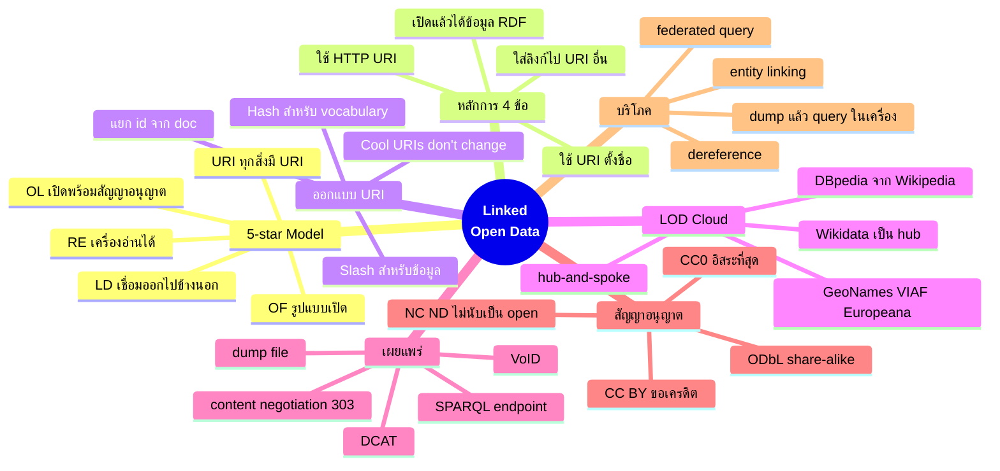
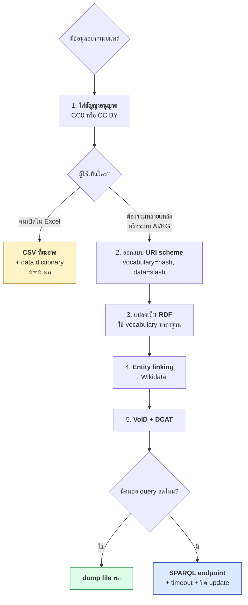
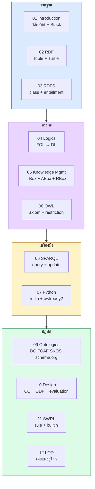
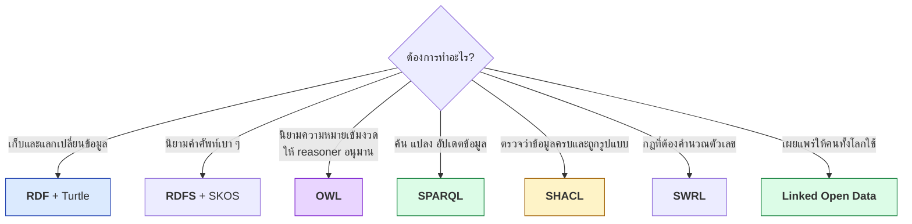
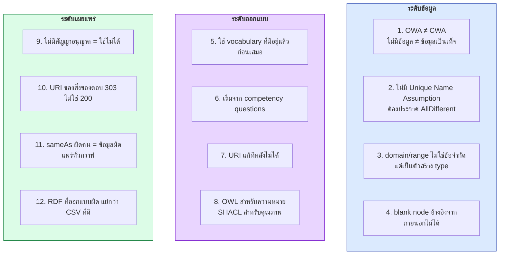
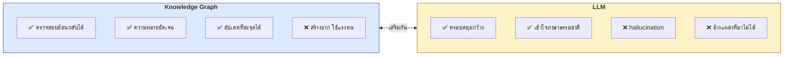
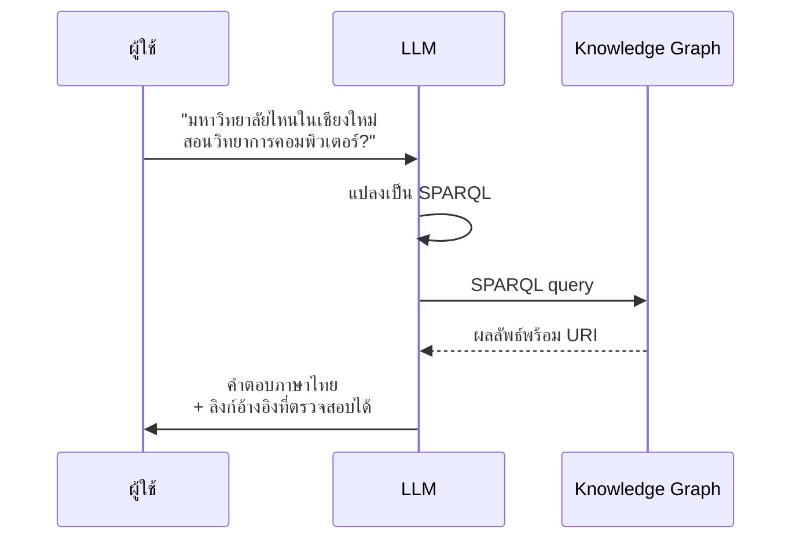

# 12.11 สรุปบทที่ 12 และปิดคอร์ส

บทที่ 12 ปิดวงจรของคอร์สนี้ — จากการเข้าใจ RDF ในบทแรก มาถึงการเผยแพร่ข้อมูลจริงบนเว็บให้คนทั้งโลกใช้ต่อได้
หน้านี้สรุปบทที่ 12 ทบทวนภาพรวมทั้งคอร์ส และชี้ทางเดินต่อไป

---

## แผนที่ความคิดของบทที่ 12

---

## เส้นทางการตัดสินใจของบทนี้

---

## สรุปเนื้อหาแต่ละหัวข้อ

| หัวข้อ | ใจความสำคัญ |
| --- | --- |
| [12.01 โมเดล 5 ดาว](12.01-5star-model.md) | ดาวยิ่งมาก **ผู้เผยแพร่เหนื่อยขึ้น ผู้ใช้สบายขึ้น** — ⭐ ต้องมีสัญญาอนุญาต |
| [12.02 ต้นทุนและประโยชน์](12.02-cost-benefit.md) | ต้นทุน**กระโดดที่ 3→4 ดาว** — วัดการใช้งาน CSV ก่อนลงทุนทำ RDF |
| [12.03 หลักการ 4 ข้อ](12.03-linked-data-principles.md) | **URI ของสิ่งของ ≠ URI ของเอกสาร** — ต้องตอบ **303** ไม่ใช่ 200 |
| [12.04 ออกแบบ URI](12.04-uri-design.md) | **Hash สำหรับ vocabulary, Slash สำหรับข้อมูล** — Cool URIs don't change |
| [12.05 LOD Cloud](12.05-lod-cloud.md) | **Wikidata คือ hub** — `wd:Q1861` มี external ID **102 แบบ** และ label **252 ภาษา** |
| [12.06 ข้อมูลเปิดภาครัฐ](12.06-open-gov-data.md) | data.go.th มี **42,853 ชุด** แต่ **RDF แค่ 1.0%** — 3 ดาวคือมาตรฐานจริง |
| [12.07 การเผยแพร่](12.07-publishing-lod.md) | เริ่มจาก **dump + สัญญาอนุญาต + VoID** ก่อน endpoint |
| [12.08 สัญญาอนุญาต](12.08-licensing.md) | **CC BY-SA กับ ODbL เข้ากันไม่ได้** — ตรวจก่อนรวมข้อมูล |
| [12.09 การบริโภค](12.09-consuming-lod.md) | ลิงก์ 3 เส้นดึงข้อมูลมาได้ **23,000 triples** — federated query ไม่เหมาะกับ production |
| [12.10 Python](12.10-python-lod.md) | ไปป์ไลน์เต็ม CSV → RDF → sameAs → VoID → Flask 303 + `Vary: Accept` |

---

## ตัวเลขสำคัญจากบทนี้ (ผลรันจริง)

| ตัวเลข | ที่มา |
| ---: | --- |
| **102** | external identifier ของ `wd:Q1861` ใน Wikidata |
| **252** | ภาษาที่มี label ของกรุงเทพฯ ใน Wikidata |
| **134** | `owl:sameAs` ของ `dbr:Bangkok` ใน DBpedia |
| **42,853** | ชุดข้อมูลใน data.go.th |
| **52.1%** | สัดส่วน CSV ใน data.go.th |
| **1.0%** | สัดส่วน RDF ใน data.go.th |
| **1,925,990** | `dcat:Dataset` ใน data.europa.eu |
| **96 → 23,371** | triples ของเรา → triples ที่ดึงมาได้จากลิงก์ 3 เส้น |

---

## 🎓 ภาพรวมทั้งคอร์ส

### สิ่งที่ควรทำได้หลังจบคอร์ส

| ทักษะ | บทที่ให้ |
| --- | --- |
| อ่านและเขียน **Turtle** ได้คล่องทั้งรูปแบบเต็มและย่อ | 02 |
| ออกแบบ **class hierarchy** และเข้าใจ **entailment** | 03, 05 |
| อธิบายความต่างระหว่าง **OWA กับ CWA** และผลที่ตามมา | 01, 03, 11 |
| เขียน **SPARQL** ตั้งแต่ SELECT ไปจนถึง federation | 06 |
| ใช้ **rdflib / owlready2 / pySHACL** ในงานจริง | 07 |
| เขียน **OWL axiom** และเลือก **profile** ให้ถูก | 08 |
| ใช้ **vocabulary มาตรฐาน** แทนการคิดขึ้นเอง | 09 |
| ออกแบบ ontology จาก **competency questions** และประเมินคุณภาพ | 10 |
| เขียน **SWRL rule** เมื่อ OWL ไม่พอ และรู้ว่าเมื่อไหร่ไม่ควรใช้ | 11 |
| **เผยแพร่ LOD** ครบวงจรพร้อม metadata และสัญญาอนุญาต | 12 |

---

## 🧭 เลือกเครื่องมือให้ถูกงาน — สรุปรวมทั้งคอร์ส

| | ทำอะไร | สมมติฐานโลก | มาตรฐาน |
| --- | --- | --- | --- |
| **RDF** | โครงสร้างข้อมูลเป็นกราฟ | — | W3C Rec |
| **RDFS** | ลำดับชั้น class/property | Open | W3C Rec |
| **OWL** | นิยามความหมายเข้มงวด | Open | W3C Rec |
| **SPARQL** | ค้นและแปลง | — | W3C Rec |
| **SHACL** | ตรวจความถูกต้อง | **Closed** | W3C Rec |
| **SWRL** | กฎแบบ if-then | Open | ⚠️ Submission |
| **LOD** | แนวปฏิบัติการเผยแพร่ | — | แนวปฏิบัติ |

---

## ⚠️ 12 บทเรียนที่ต้องจำ

---

## 🚀 ทางเดินต่อไป — Knowledge Graph กับ LLM

### 4 รูปแบบการทำงานร่วมกัน

| รูปแบบ | ทิศทาง | ทำอะไร |
| --- | --- | --- |
| **KG → LLM** (GraphRAG) | KG เป็นแหล่งความจริง | ดึงข้อเท็จจริงจาก KG มาใส่ prompt เพื่อลด hallucination และอ้างแหล่งได้ |
| **LLM → KG** | LLM ช่วยสร้าง KG | สกัด entity และความสัมพันธ์จากข้อความ, ร่าง ontology, เสนอ `sameAs` |
| **LLM as interface** | LLM แปลภาษา | แปลงคำถามภาษาไทยเป็น SPARQL ให้อัตโนมัติ |
| **KG as guardrail** | KG ตรวจ LLM | ใช้ SHACL/OWL ตรวจว่าสิ่งที่ LLM สร้างขัดกับ ontology หรือไม่ |

> 🎯 **จุดแข็งที่ KG มีแต่ LLM ไม่มีคือ "ตรวจสอบย้อนกลับได้"**
> ทุกคำตอบชี้กลับไปยัง triple ที่มี URI และแหล่งที่มาชัดเจน
> — นี่คือเหตุผลที่ Semantic Web ยังสำคัญในยุค LLM

### หัวข้อที่ควรศึกษาต่อ

| หัวข้อ | ทำไมน่าสนใจ |
| --- | --- |
| **GraphRAG** | ใช้ KG เป็นบริบทให้ LLM แทนการค้นด้วย vector อย่างเดียว |
| **RML / R2RML** | แม็ปฐานข้อมูลเดิมเป็น RDF โดยไม่ต้องเขียนสคริปต์ใหม่ |
| **SHACL ขั้นสูง** | SPARQL-based constraints, SHACL-AF, rule |
| **Graph embedding** | TransE, RotatE — ทำนายความสัมพันธ์ที่ยังไม่มีในกราฟ |
| **Named graph / RDF-star** | บันทึกที่มาและความเชื่อมั่นของแต่ละ statement |
| **Triple store ระดับ production** | GraphDB, Stardog, Virtuoso, Oxigraph, QLever |
| **Solid** | โครงการของ Tim Berners-Lee เรื่องการคืนกรรมสิทธิ์ข้อมูลให้เจ้าของ |

---

## Key Points

- โมเดล **5 ดาว** วัดความพร้อมของข้อมูลเปิด — **ดาวยิ่งมาก ผู้เผยแพร่เหนื่อยขึ้น แต่ผู้ใช้สบายขึ้นมาก**
- **หลักการ Linked Data 4 ข้อ**: ใช้ URI → ใช้ HTTP URI → เปิดแล้วได้ข้อมูล RDF → ใส่ลิงก์ออก
- ⚠️ **URI ของสิ่งของต้องตอบ 303 ไม่ใช่ 200** และต้องแยกจาก URI ของเอกสาร
- **Hash URI สำหรับ vocabulary, Slash URI สำหรับข้อมูล** — และ **URI แก้ทีหลังไม่ได้**
- **Wikidata คือ hub ที่ดีที่สุด** — เชื่อมเส้นเดียวได้ external ID กว่า 100 แบบ, label 252 ภาษา, และเป็น **CC0**
- **ข้อมูลเปิดวันนี้ยังอยู่ที่ 3 ดาวเป็นหลัก** — RDF มีเพียง 1.0% ใน data.go.th
- ⚠️ **ไม่มีสัญญาอนุญาต = นำไปใช้ไม่ได้ตามกฎหมาย** และ **CC BY-SA กับ ODbL เข้ากันไม่ได้**
- **บริโภค LOD ใน production ให้ดึง dump มาไว้ในเครื่อง** — federated query ไม่เสถียรพอ
- ⚠️ **`owl:sameAs` ที่จับคู่ผิด ทำให้ข้อมูลผิดแพร่ไปทั่วกราฟ** — ต้องใช้หลายสัญญาณและมีคนตรวจ
- ⚠️ **RDF ที่ออกแบบผิด แย่กว่า CSV ที่ดี** — อย่ารีบไป 5 ดาวถ้ายังไม่พร้อม
- **KG กับ LLM เสริมกัน** — KG ให้ความถูกต้องที่ **ตรวจสอบย้อนกลับได้** ส่วน LLM ให้ความครอบคลุมและภาษาธรรมชาติ
- ทางเดินต่อไป: **GraphRAG, RML, SHACL ขั้นสูง, graph embedding, RDF-star, triple store ระดับ production**
