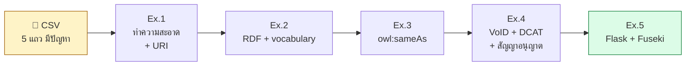
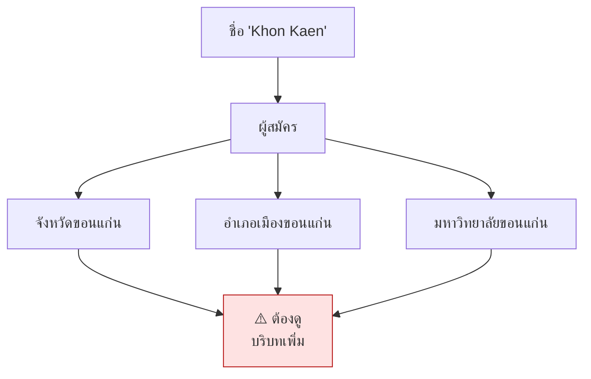
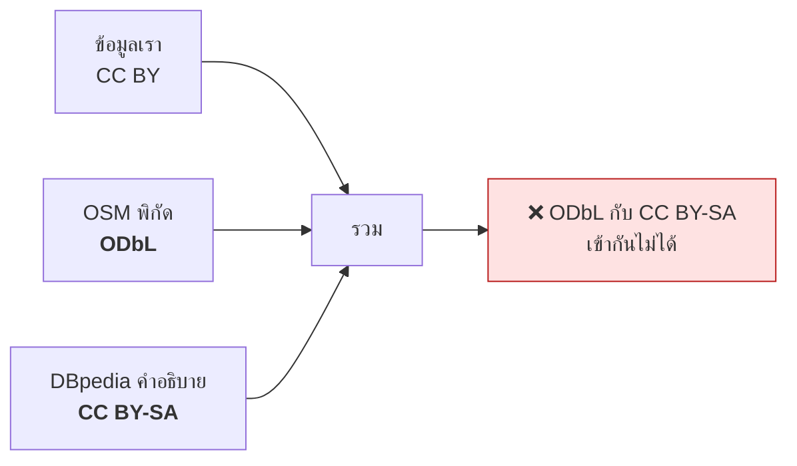

# 12.12 แบบฝึกหัดบทที่ 12

แบบฝึกหัดชุดนี้เป็นโครงการเดียวต่อเนื่องกันทั้ง 5 ข้อ — พาเผยแพร่ชุดข้อมูล **ห้องสมุดสาธารณะ** จาก CSV ระดับ 3 ดาว ไปจนถึง 5 ดาวที่มี endpoint และ metadata ครบ
เมื่อทำครบทุกข้อ คุณจะมีชุดข้อมูล LOD ที่เผยแพร่ได้จริงหนึ่งชุด

---

## ข้อมูลตั้งต้น

บันทึกเป็น `data/libraries.csv` — สังเกตว่าข้อมูลดิบมีปัญหาแบบที่เจอในงานจริง

```csv
lib_name,name_th,city,province,est,seats,website,type
Bangkok City Library,หอสมุดเมืองกรุงเทพมหานคร,Bangkok,Bangkok,2017,900,https://bangkokcitylibrary.com,public
TK Park,อุทยานการเรียนรู้ ทีเคปาร์ค, bangkok ,Bangkok,2005,,www.tkpark.or.th,public
Chiang Mai City Library,ห้องสมุดประชาชนเชียงใหม่,Chiang Mai,Chiang Mai,1996,320,,public
Khon Kaen University Library,สำนักหอสมุด มหาวิทยาลัยขอนแก่น,Khon Kaen,Khon Kaen,1964,1200,https://library.kku.ac.th,academic
Neilson Hays Library,ห้องสมุดเนียลสัน เฮส์,BANGKOK,Bangkok,1922,60,https://neilsonhayslibrary.org,private
```

### ปัญหาที่ต้องแก้

| ปัญหา | ตัวอย่าง |
| --- | --- |
| ชื่อเมืองสะกดต่างกัน 3 แบบ | `Bangkok`, ` bangkok `, `BANGKOK` |
| ค่าว่าง | TK Park ไม่มี `seats`, Chiang Mai ไม่มี `website` |
| URL ไม่มี scheme | `www.tkpark.or.th` |
| `type` เป็นข้อความอิสระ | `public` / `academic` / `private` |



---

### Exercise 1: ออกแบบ URI scheme และทำความสะอาดข้อมูล

**สิ่งที่ต้องส่ง**

1. **เอกสาร URI scheme** ที่ระบุ
   - base URI ที่เลือกและเหตุผล
   - ส่วนไหนใช้ **hash URI** ส่วนไหนใช้ **slash URI**
   - รูปแบบตัวระบุของแต่ละประเภท (library, city, province, library type)
2. โปรแกรม Python ที่อ่าน CSV แล้ว
   - normalise ชื่อเมืองให้เหลือค่าเดียวต่อเมือง
   - เติม scheme ให้ URL ที่ขาด
   - ข้ามค่าว่างโดยไม่สร้าง triple ที่มีค่าว่าง
   - สร้าง URI ด้วย `slugify` ที่จัดการ apostrophe และช่องว่างได้ถูกต้อง

**ผลลัพธ์ที่คาดหวัง**

```
ขั้นที่ 1: ทำความสะอาด
  ชื่อ                              URI
  Bangkok City Library              library/bangkok-city-library
  TK Park                           library/tk-park
  Chiang Mai City Library           library/chiang-mai-city-library
  Khon Kaen University Library      library/khon-kaen-university-library
  Neilson Hays Library              library/neilson-hays-library

  เมืองหลังทำความสะอาด : ['Bangkok', 'Chiang Mai', 'Khon Kaen']
  ⬅️ จาก 5 ค่าที่ต่างกัน เหลือ 3

  ค่าว่างที่ข้ามไป : 2 (tk-park.seats, chiang-mai-city-library.website)
```

> 💡 **คำใบ้:** อย่าสร้าง triple ที่มีค่าเป็นสตริงว่าง — `""` ไม่เท่ากับ "ไม่มีข้อมูล"
> ใน Open World การไม่มี triple เลยคือวิธีที่ถูกต้องในการบอกว่า "ไม่รู้"

---

### Exercise 2: แปลงเป็น RDF ด้วย vocabulary มาตรฐาน

**สิ่งที่ต้องส่ง**

1. เลือก vocabulary ที่มีอยู่แล้วให้มากที่สุด — **ห้ามคิด property ขึ้นเองถ้ามีของมาตรฐานอยู่**
2. สร้าง **SKOS concept scheme** สำหรับ `type` (public / academic / private) แทนการเก็บเป็นข้อความ
3. เขียน Turtle ทั้ง **รูปแบบเต็มและรูปแบบย่อ** ของ `Bangkok City Library`

**คำถามที่ต้องตอบ** — property ต่อไปนี้ควรใช้ตัวไหนจาก vocabulary มาตรฐาน

| ข้อมูล | คำใบ้ vocabulary |
| --- | --- |
| ชื่อ (en/th) | `rdfs:label` หรือ `skos:prefLabel` |
| เว็บไซต์ | `schema:url` หรือ `foaf:homepage` |
| ปีที่ก่อตั้ง | `schema:foundingDate` หรือ `dbo:foundingYear` |
| จำนวนที่นั่ง | ต้องสร้างเองไหม? |
| ประเภทห้องสมุด | `dct:type` + `skos:Concept` |
| ตั้งอยู่ในเมือง | `schema:location` หรือ `dct:spatial` |

**ผลลัพธ์ที่คาดหวัง**

```
ขั้นที่ 2: แปลงเป็น RDF
  สร้าง RDF ได้ 58 triples
  entity : 11 ตัว (library 5, city 3, type 3)
  property ที่ใช้ : 9 ตัว
  property ที่คิดขึ้นเอง : 1 ตัว (seatingCapacity)

  ⚠️ ตรวจแล้วว่า property อื่นทั้งหมดมาจาก vocabulary มาตรฐาน
```

> 💡 **คำใบ้:** `schema:CivicStructure` และ `schema:Library` มีอยู่แล้วใน schema.org
> การผูก class ของเราด้วย `rdfs:subClassOf` ทำให้คนอื่นเข้าใจโดยไม่ต้องอ่านเอกสาร

---

### Exercise 3: เชื่อมเข้า LOD Cloud

**สิ่งที่ต้องส่ง**

1. เขียนโปรแกรมค้น Wikidata ด้วย `wbsearchentities` แล้วเสนอผู้สมัครสำหรับ **ทั้งห้องสมุดและเมือง**
2. กำหนด **เกณฑ์อัตโนมัติที่ใช้อย่างน้อย 2 สัญญาณ** แล้วอธิบายว่าทำไมเลือกสัญญาณเหล่านั้น
3. เขียน `owl:sameAs` เฉพาะรายการที่ผ่านเกณฑ์ ส่วนที่ไม่ผ่านให้แสดงผู้สมัครไว้ให้คนตรวจ
4. ตรวจว่า URI ปลายทางทุกตัวยังใช้งานได้ โดย **แยก "ลิงก์ตาย" ออกจาก "เรียกไม่ทัน"**

**ผลลัพธ์ที่คาดหวัง**

```
ขั้นที่ 3: เชื่อมเข้า LOD Cloud
  เมือง:
    Bangkok         → Q1861      ✅ ผ่านเกณฑ์
    Chiang Mai      → Q52028     ✅ ผ่านเกณฑ์
    Khon Kaen       → ?          ⚠️ มีทั้งจังหวัดและอำเภอ ต้องให้คนตัดสิน

  ห้องสมุด:
    TK Park         → ?          ⚠️ ชื่อกำกวมเกินไป
    Neilson Hays Library → ?     ⚠️ ต้องตรวจ

  สรุป: เชื่อมอัตโนมัติได้ 2/8 -- ที่เหลือรอคนตรวจ

  ตรวจลิงก์: ใช้ได้ 2 / ตาย 0 / เรียกไม่สำเร็จชั่วคราว 0
```



> ⚠️ **คำใบ้:** อัตราการเชื่อมอัตโนมัติที่ต่ำ **ไม่ใช่ความล้มเหลว** — เกณฑ์ที่เข้มงวด
> ทำให้ไม่มี `sameAs` ผิด ซึ่งดีกว่าเกณฑ์หลวมที่จับคู่ผิดแล้วแพร่ข้อมูลผิดไปทั้งกราฟ

---

### Exercise 4: สร้าง metadata และเลือกสัญญาอนุญาต

**สิ่งที่ต้องส่ง**

1. **VoID description** ที่สร้างจากสถิติจริงของกราฟ พร้อม `void:Linkset` แยกตามคู่ (ปลายทาง, predicate)
2. **DCAT catalog entry** พร้อม `dcat:Distribution` อย่างน้อย 3 รูปแบบ
3. **เลือกสัญญาอนุญาต** พร้อมเหตุผลเป็นข้อความ 3–5 บรรทัด
4. ระบุสัญญาอนุญาตในไฟล์ RDF ให้ครบทั้ง 3 predicate (`dcterms:license`, `schema:license`, `cc:license`)

**คำถามที่ต้องตอบ**

- ถ้าคุณดึงพิกัดจาก **OpenStreetMap (ODbL)** มาใส่ในชุดข้อมูลนี้ จะเกิดอะไรขึ้นกับสัญญาอนุญาตของชุดข้อมูลทั้งชุด?
- ถ้าคุณดึงคำอธิบายจาก **DBpedia (CC BY-SA)** ด้วยพร้อมกัน จะเกิดปัญหาอะไร?

**ผลลัพธ์ที่คาดหวัง**

```
ขั้นที่ 4: metadata
  VoID:
    void:triples          58
    void:entities         11
    void:classes           4
    void:properties        9
    void:distinctSubjects 11
    linkset → Wikidata sameAs  2

  DCAT:
    distribution : ttl     text/turtle
    distribution : nt      application/n-triples
    distribution : jsonld  application/ld+json

  สัญญาอนุญาต: CC BY 4.0
```



---

### Exercise 5: เผยแพร่ผ่าน HTTP และ SPARQL

**สิ่งที่ต้องส่ง**

1. เซิร์ฟเวอร์ Flask ที่
   - URI ของ **สิ่งของ** ตอบ **303** ไปยังเอกสาร
   - URI ของ **เอกสาร** ตอบ **200** พร้อม `Vary: Accept` และ `Link: rel="describedby"`
   - รองรับอย่างน้อย `text/html`, `text/turtle`, `application/ld+json`
   - เสิร์ฟ VoID ที่ `/.well-known/void`
2. โหลดข้อมูลเข้า **Fuseki** แล้วเขียน SPARQL ตอบคำถาม 3 ข้อ
   - ห้องสมุดทั้งหมดในกรุงเทพฯ เรียงตามปีที่ก่อตั้ง
   - จำนวนที่นั่งรวมแยกตามประเภทห้องสมุด
   - ห้องสมุดที่ **ไม่มี** ข้อมูลเว็บไซต์
3. อธิบายว่าคำถามข้อ 3 สะท้อนปัญหาอะไรของ **Open World Assumption**

**ผลลัพธ์ที่คาดหวัง**

```
ขั้นที่ 5: เผยแพร่

  ทดสอบ content negotiation:
  request                       Accept                status  Location
  ---------------------------------------------------------------------------------
  /library/tk-park              text/turtle              303  /doc/library/tk-park.ttl
  /library/tk-park              text/html                303  /doc/library/tk-park.html
  /library/tk-park              application/ld+json      303  /doc/library/tk-park.jsonld
  /library/nonexistent          text/turtle              404  -
  /.well-known/void             text/turtle              200  -

  SPARQL:
  Q1 ห้องสมุดในกรุงเทพฯ เรียงตามปี:
     1922  Neilson Hays Library
     2005  TK Park
     2017  Bangkok City Library

  Q2 ที่นั่งรวมแยกตามประเภท:
     academic  1200
     public    1220
     private     60

  Q3 ห้องสมุดที่ไม่มีเว็บไซต์:
     Chiang Mai City Library
```

> ⚠️ **คำใบ้ข้อ 3:** SPARQL `FILTER NOT EXISTS` ตอบว่า "ไม่มี triple นี้ในกราฟ"
> ซึ่งภายใต้ **OWA แปลว่า "ไม่รู้" ไม่ใช่ "ไม่มีเว็บไซต์"** — ถ้าต้องการยืนยันว่า
> ห้องสมุดนั้นไม่มีเว็บไซต์จริง ต้องบันทึกไว้อย่างชัดเจน เช่นด้วย `owl:maxCardinality 0`
> หรือใช้ **SHACL** ตรวจแทน

---

## 🏆 Challenge: ประเมินชุดข้อมูลจริงจาก data.go.th

เลือกชุดข้อมูลจริง 3 ชุดจาก [data.go.th](https://data.go.th) แล้วประเมินตามโมเดล 5 ดาว

**สิ่งที่ต้องส่ง**

1. ตารางประเมินแต่ละชุด พร้อม**หลักฐาน**ว่าทำไมได้ดาวเท่านั้น
2. ระบุ **สิ่งที่ต้องทำเพิ่มขั้นต่ำ** เพื่อขยับขึ้นอีก 1 ดาว พร้อมประมาณการเวลา
3. เลือก 1 ชุด แล้ว **ทำจริง** — แปลงเป็น RDF พร้อม `owl:sameAs` อย่างน้อย 1 เส้น
4. เขียนรายงาน 1 หน้าว่า **คุ้มค่าที่จะทำเป็น 5 ดาวหรือไม่** พร้อมเหตุผลเชิงต้นทุน–ประโยชน์

**ผลลัพธ์ที่คาดหวัง**

```
ประเมิน 3 ชุดข้อมูลจาก data.go.th

ชุดข้อมูล                     รูปแบบ  สัญญาอนุญาต  ดาว  ขาดอะไร
-------------------------------------------------------------------------
[ชื่อชุดที่ 1]                 CSV     ระบุแล้ว     ⭐⭐⭐  URI + RDF
[ชื่อชุดที่ 2]                 XLSX    ระบุแล้ว     ⭐⭐   แปลงเป็น CSV ก่อน
[ชื่อชุดที่ 3]                 PDF     ไม่ระบุ      -     ทุกอย่าง

⚠️ ชุดที่ 3 ไม่ได้แม้แต่ 1 ดาว เพราะไม่ระบุสัญญาอนุญาต
```

> 💡 **ใช้ CKAN API ช่วยได้** — `https://data.go.th/api/3/action/package_search?q=...`
> ดูตัวอย่างใน [`code/ch12/query_gov_data.py`](../code/ch12/query_gov_data.py)

---

## ✅ เช็กลิสต์ตรวจตัวเอง

หลังทำแบบฝึกหัดครบแล้ว ควรตอบคำถามเหล่านี้ได้ทันที

- [ ] เงื่อนไขของ **1 ดาว** คืออะไร — แค่เอาขึ้นเว็บพอไหม?
- [ ] ต้นทุนกระโดดที่การเปลี่ยนจากดาวดวงไหนไปดวงไหน?
- [ ] ทำไม URI ของ **สิ่งของ** ต้องตอบ **303** ไม่ใช่ 200?
- [ ] **Hash URI** กับ **Slash URI** ต่างกันอย่างไร และใช้อันไหนกับอะไร?
- [ ] ทำไม Turtle เขียน `uni:course/CS101` ไม่ได้?
- [ ] **VoID** กับ **DCAT** ต่างกันอย่างไร?
- [ ] `owl:sameAs` กับ `skos:closeMatch` ต่างกันอย่างไร และเลือกใช้เมื่อไหร่?
- [ ] **CC BY-SA** กับ **ODbL** รวมกันได้ไหม เพราะอะไร?
- [ ] ทำไม **federated query** ไม่เหมาะกับระบบ production?
- [ ] ทำไม **`Vary: Accept`** จึงจำเป็น?
- [ ] "ไม่มี triple" แปลว่า "ไม่มีข้อมูล" หรือ "ไม่รู้"?

---

## Key Points

- แบบฝึกหัดชุดนี้เป็นโครงการต่อเนื่อง — จบแล้วได้ **ชุดข้อมูล LOD ที่เผยแพร่ได้จริง 1 ชุด**
- **Exercise 1** ฝึกสิ่งที่แก้ทีหลังไม่ได้ที่สุดคือ **URI scheme** และการ normalise ข้อมูล
- ⚠️ **อย่าสร้าง triple ที่มีค่าว่าง** — ใน Open World การไม่มี triple คือวิธีบอกว่า "ไม่รู้"
- **Exercise 2** ฝึกวินัยสำคัญที่สุดของ LOD: **ใช้ vocabulary ที่มีอยู่แล้วก่อนคิดขึ้นเอง**
- **Exercise 3** ฝึก entity linking ที่ใช้ **อย่างน้อย 2 สัญญาณ** — และเรียนรู้ว่า **อัตราเชื่อมต่ำไม่ใช่ความล้มเหลว**
- **Exercise 4** ฝึกสร้าง metadata และเจอกับดักจริงว่า **ODbL กับ CC BY-SA รวมกันไม่ได้**
- **Exercise 5** ฝึกเผยแพร่จริง — **303 + `Vary: Accept` + `/.well-known/void`** และเจอข้อจำกัดของ **OWA** ในคำถามที่ถามหาสิ่งที่ "ไม่มี"
- **Challenge** พาไปเจอข้อมูลจริงที่ยังไม่ได้แม้แต่ 1 ดาว เพราะ **ไม่ระบุสัญญาอนุญาต**
- ตรวจตัวเองด้วยเช็กลิสต์ 11 ข้อก่อนไปอ่านภาคผนวก
