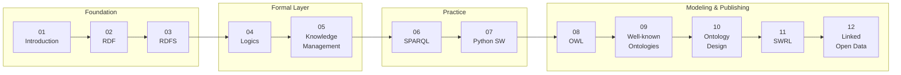

# Semantic Web & Linked Open Data with Python

คอร์สเรียนภาษาไทยว่าด้วย **Semantic Web**, **Knowledge Representation**, **Ontology Engineering**
และ **Linked Open Data** โดยใช้ **Python** เป็นเครื่องมือหลักในการลงมือปฏิบัติ
เนื้อหาไล่จากพื้นฐาน RDF ไปจนถึงการ publish dataset ขึ้น LOD Cloud จริง

> **ข้อตกลงเรื่องภาษา**: คำอธิบายเป็นภาษาไทย แต่ **technical term คงรูปภาษาอังกฤษ**
> (เช่น triple, entailment, reasoner, cardinality) และ **ตัวอย่าง data / code / URI / label ทั้งหมดเป็นภาษาอังกฤษ**
> เพื่อให้นำไปใช้ต่อกับ tool และ dataset สากลได้ทันที

---

## Prerequisites

| หัวข้อ | ระดับที่ต้องการ |
| --- | --- |
| Python | เขียน function, list/dict, virtual environment ได้ |
| Web basics | เข้าใจ URL, HTTP request/response, content type |
| Data modeling | เคยเห็น ER diagram หรือ relational schema มาบ้าง |
| Logic | ไม่จำเป็นต้องมีพื้นฐาน — Chapter 04 สอนตั้งแต่ต้น |

Software ที่ต้องติดตั้ง (รายละเอียดใน [A.05 Tools Setup](appendix/A.05-tools-setup.md)):

```bash
python -m venv .venv && source .venv/bin/activate
pip install rdflib owlready2 SPARQLWrapper pyshacl pandas networkx pyvis requests fastapi uvicorn
```

เพิ่มเติม: **Java 11+** (สำหรับ HermiT reasoner และ Apache Jena Fuseki), **Protégé** (ontology editor)

---

## How to Use This Course

1. **อ่านตามลำดับ** — ทุก chapter ต่อยอดจาก chapter ก่อนหน้า โดยเฉพาะ 02 → 03 → 04 → 05 → 08
2. **รันโค้ดทุกไฟล์** — ไฟล์ `xx.xx-python-*.md` มีโค้ดที่รันได้จริง และมีไฟล์คู่กันใน `code/chXX/`
3. **ทำ exercises ท้าย chapter** — ไฟล์ `xx.xx-exercises.md` มี 3–5 ข้อพร้อมระบุ expected output
4. **ใช้ appendix เป็น reference** — cheat sheet ของ Turtle / SPARQL / OWL / prefix สำหรับเปิดค้างไว้ระหว่างทำงาน

### Running Example ที่ใช้ตลอดคอร์ส

| Domain | ใช้ใน chapter | ไฟล์ |
| --- | --- | --- |
| University (Student, Course, Professor) | 03, 05, 07 | `data/university.ttl` |
| Library (Book, Author, Loan) | 08 | `code/ch08/library_ontology.py` |
| City / Open Data | 12 | `data/lod_dataset.ttl` |

---

## Folder Structure

```
.
├── README.md                     # ภาพรวมคอร์ส
├── index.md                      # หน้าแรก + chapter map
├── 01-introduction/              # Web evolution, SW vision, SW stack
├── 02-rdf/                       # Triple, URI, Turtle (full + shorthand)
├── 03-rdfs/                      # Class, hierarchy, domain/range, entailment
├── 04-logics/                    # FOL, Description Logic, reasoners
├── 05-knowledge-management/      # TBox / ABox / RBox
├── 06-sparql/                    # SELECT, CONSTRUCT, UPDATE, federation
├── 07-python-semantic-web/       # rdflib, owlready2, pySHACL, ETL, API
├── 08-owl/                       # Species, restrictions, cardinality
├── 09-well-known-ontologies/     # DC, FOAF, schema.org, SKOS, Wikidata
├── 10-ontology-design/           # Methodology, CQ, ODP, evaluation
├── 11-swrl/                      # Rules, builtins, SQWRL
├── 12-linked-open-data/          # 5-star, LOD Cloud, publishing
├── appendix/                     # Cheat sheets, glossary, references
├── code/
│   └── ch01/ ... ch12/           # Runnable Python + Turtle companions
└── data/
    ├── sample_triples.ttl
    ├── university.ttl
    └── lod_dataset.ttl
```

---

## Course Map



---

## License

เนื้อหาการสอนเผยแพร่ภายใต้ **CC BY 4.0** — โค้ดตัวอย่างเผยแพร่ภายใต้ **MIT License**
