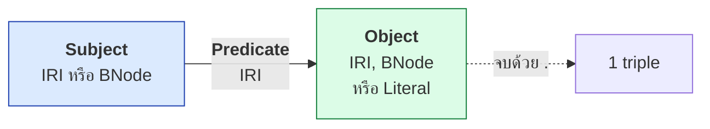
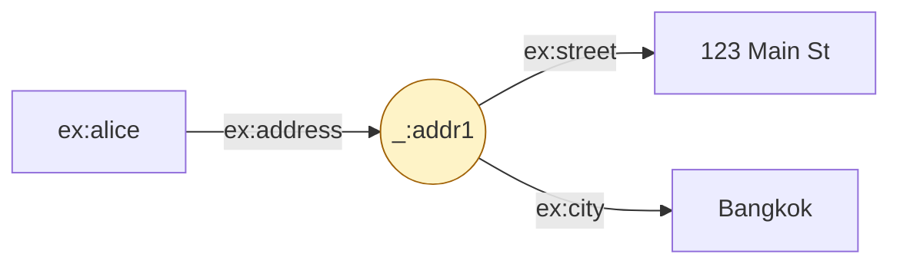
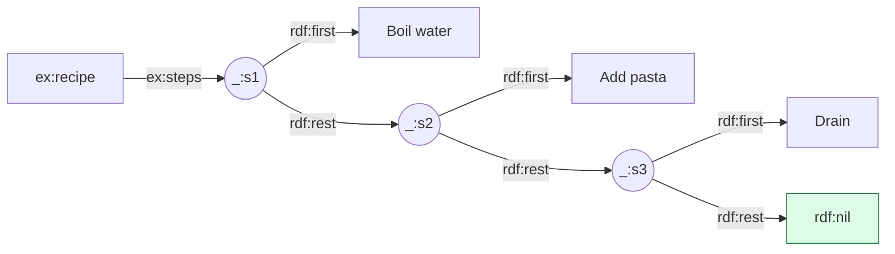

# A.01 Turtle Cheat Sheet

หน้านี้รวมไวยากรณ์ Turtle ทั้งหมดที่ใช้ในคอร์สไว้ในที่เดียว โดยแสดง **รูปแบบเต็มคู่กับรูปแบบย่อ** ทุกกรณี
ใช้เป็นแผ่นอ้างอิงตอนเขียนข้อมูลจริงโดยไม่ต้องย้อนกลับไปอ่านทั้งบท

---

## โครงสร้างพื้นฐาน



| ตำแหน่ง | ค่าที่อนุญาต |
| --- | --- |
| **Subject** | IRI, Blank Node |
| **Predicate** | IRI เท่านั้น |
| **Object** | IRI, Blank Node, Literal |

---

## 1. Prefix และ Base

<table>
<tr><th width="50%">รูปแบบเต็ม</th><th width="50%">รูปแบบย่อ</th></tr>
<tr valign="top">
<td>

```turtle
@prefix ex: <http://example.org/> .
@base <http://example.org/> .

<http://example.org/alice>
    <http://example.org/knows>
        <http://example.org/bob> .
```

</td>
<td>

```turtle
PREFIX ex: <http://example.org/>
BASE <http://example.org/>

ex:alice ex:knows ex:bob .
```

</td>
</tr>
</table>

| รูปแบบ | หมายเหตุ |
| --- | --- |
| `@prefix ex: <...> .` | ต้องมี `.` ปิดท้าย (Turtle ดั้งเดิม) |
| `PREFIX ex: <...>` | ไม่ต้องมี `.` (เหมือน SPARQL, Turtle 1.1) |
| `<relative/path>` | ขยายจาก `@base` |
| `<>` | หมายถึงตัวเอกสารเอง |

> ⚠️ **`/` ใช้ใน prefixed name ไม่ได้** — `ex:course/CS101` เป็น syntax error
> ต้องประกาศ prefix แยกต่อระดับของ path

---

## 2. ย่อ predicate และ object

<table>
<tr><th width="50%">รูปแบบเต็ม</th><th width="50%">รูปแบบย่อ</th></tr>
<tr valign="top">
<td>

```turtle
ex:alice rdf:type ex:Person .
ex:alice ex:name "Alice" .
ex:alice ex:knows ex:bob .
ex:alice ex:knows ex:carol .
```

</td>
<td>

```turtle
ex:alice a ex:Person ;
    ex:name "Alice" ;
    ex:knows ex:bob , ex:carol .
```

</td>
</tr>
</table>

| ตัวย่อ | ความหมาย |
| --- | --- |
| `a` | `rdf:type` |
| `;` | subject เดิม predicate ใหม่ |
| `,` | subject และ predicate เดิม object ใหม่ |
| `.` | จบ statement |

---

## 3. Literal

<table>
<tr><th width="50%">รูปแบบเต็ม</th><th width="50%">รูปแบบย่อ</th></tr>
<tr valign="top">
<td>

```turtle
ex:book
  ex:title "RDF Primer"^^xsd:string ;
  ex:pages "250"^^xsd:integer ;
  ex:price "29.99"^^xsd:decimal ;
  ex:weight "1.5E0"^^xsd:double ;
  ex:inPrint "true"^^xsd:boolean ;
  ex:issued
    "2024-01-15"^^xsd:date .
```

</td>
<td>

```turtle
ex:book
  ex:title "RDF Primer" ;
  ex:pages 250 ;
  ex:price 29.99 ;
  ex:weight 1.5E0 ;
  ex:inPrint true ;
  ex:issued
    "2024-01-15"^^xsd:date .
```

</td>
</tr>
</table>

| เขียนย่อได้ | กลายเป็น |
| --- | --- |
| `"ข้อความ"` | `xsd:string` |
| `250` | `xsd:integer` |
| `29.99` | `xsd:decimal` |
| `1.5E0` | `xsd:double` |
| `true` / `false` | `xsd:boolean` |

> ⚠️ **วันที่ เวลา และชนิดอื่น ๆ ย่อไม่ได้** — ต้องเขียน `^^xsd:date` เต็มเสมอ

### Language tag

```turtle
ex:book rdfs:label "RDF Primer"@en ,
                   "คู่มือ RDF"@th ,
                   "RDF-Handbuch"@de .
```

> ⚠️ **มี language tag แล้วใส่ `^^xsd:string` ด้วยไม่ได้** — literal ที่มี tag
> จะมี datatype เป็น `rdf:langString` โดยอัตโนมัติ

### ข้อความหลายบรรทัด

```turtle
ex:book ex:abstract """RDF is a standard model
for data interchange on the Web.
It has features that facilitate data merging.""" .
```

### Escape sequence

| เขียน | ได้ |
| --- | --- |
| `\"` | `"` |
| `\\` | `\` |
| `\n` | ขึ้นบรรทัดใหม่ |
| `\t` | tab |
| `ก` | อักขระ Unicode (ก) |

---

## 4. Blank Node

<table>
<tr><th width="50%">รูปแบบเต็ม (labelled)</th><th width="50%">รูปแบบย่อ (anonymous)</th></tr>
<tr valign="top">
<td>

```turtle
ex:alice ex:address _:addr1 .

_:addr1 ex:street "123 Main St" ;
        ex:city "Bangkok" ;
        ex:postcode "10330" .
```

</td>
<td>

```turtle
ex:alice ex:address [
    ex:street "123 Main St" ;
    ex:city "Bangkok" ;
    ex:postcode "10330"
] .
```

</td>
</tr>
</table>



| รูปแบบ | ใช้เมื่อ |
| --- | --- |
| `_:label` | ต้องอ้างถึงซ้ำในไฟล์เดียวกัน |
| `[ ... ]` | ใช้ครั้งเดียว อ่านง่ายกว่า |
| `[]` เป็น subject | `[] a ex:Event ; ex:date "2024-01-01"^^xsd:date .` |

> ⚠️ **Blank node อ้างอิงจากภายนอกไฟล์ไม่ได้** — อย่าใช้กับ entity ที่คนอื่นอาจอยากชี้มา

---

## 5. Collection (rdf:List)

<table>
<tr><th width="50%">รูปแบบเต็ม</th><th width="50%">รูปแบบย่อ</th></tr>
<tr valign="top">
<td>

```turtle
ex:recipe ex:steps _:s1 .

_:s1 rdf:first "Boil water" ;
     rdf:rest  _:s2 .
_:s2 rdf:first "Add pasta" ;
     rdf:rest  _:s3 .
_:s3 rdf:first "Drain" ;
     rdf:rest  rdf:nil .
```

</td>
<td>

```turtle
ex:recipe ex:steps (
    "Boil water"
    "Add pasta"
    "Drain"
) .
```

</td>
</tr>
</table>



> 💡 **Collection คือลำดับที่มีความหมาย** ต่างจาก `,` ที่เป็นเซตไม่เรียงลำดับ
> ⚠️ ราคาแพง — list ที่มี n สมาชิกใช้ **2n + 1 triples**

---

## 6. รูปแบบที่ใช้บ่อยในคอร์สนี้

### ประกาศ ontology

```turtle
# --- รูปแบบเต็ม ---
<http://example.org/onto> rdf:type owl:Ontology ;
    <http://purl.org/dc/terms/title> "Example Ontology"@en ;
    owl:versionIRI <http://example.org/onto/1.0.0> ;
    owl:imports <http://xmlns.com/foaf/0.1/> .
```

```turtle
# --- รูปแบบย่อ ---
<http://example.org/onto> a owl:Ontology ;
    dct:title "Example Ontology"@en ;
    owl:versionIRI <http://example.org/onto/1.0.0> ;
    owl:imports foaf: .
```

### Class และ property

```turtle
# --- รูปแบบย่อ ---
ex:Person a owl:Class ;
    rdfs:subClassOf ex:Agent ;
    rdfs:label "Person"@en ;
    rdfs:comment "A human being."@en .

ex:knows a owl:ObjectProperty , owl:SymmetricProperty ;
    rdfs:domain ex:Person ;
    rdfs:range  ex:Person .

ex:age a owl:DatatypeProperty , owl:FunctionalProperty ;
    rdfs:domain ex:Person ;
    rdfs:range  xsd:integer .
```

### Restriction

```turtle
# --- รูปแบบเต็ม ---
ex:Parent rdf:type owl:Class ;
    owl:equivalentClass [
        rdf:type owl:Class ;
        owl:intersectionOf (
            ex:Person
            [ rdf:type owl:Restriction ;
              owl:onProperty ex:hasChild ;
              owl:someValuesFrom ex:Person ]
        )
    ] .
```

```turtle
# --- รูปแบบย่อ ---
ex:Parent owl:equivalentClass [
    a owl:Class ;
    owl:intersectionOf (
        ex:Person
        [ a owl:Restriction ;
          owl:onProperty ex:hasChild ;
          owl:someValuesFrom ex:Person ]
    )
] .
```

### เชื่อมออกไปยัง dataset อื่น

```turtle
# --- รูปแบบย่อ ---
@prefix wd:  <http://www.wikidata.org/entity/> .
@prefix dbr: <http://dbpedia.org/resource/> .

ex:bangkok owl:sameAs wd:Q1861 , dbr:Bangkok ,
    <http://sws.geonames.org/1609350/> .
```

> ⚠️ **URI ของ GeoNames ลงท้ายด้วย `/`** จึงเขียนเป็น prefixed name ไม่ได้

---

## 7. Comment

```turtle
# นี่คือ comment -- ใช้ได้เฉพาะแบบบรรทัดเดียว
ex:alice a ex:Person .   # comment ท้ายบรรทัดก็ได้
```

> ⚠️ **Turtle ไม่มี block comment** (`/* ... */` ใช้ไม่ได้)

---

## 8. ตรวจไวยากรณ์

```bash
# ด้วย rdflib
python3 -c "from rdflib import Graph; g=Graph(); g.parse('data.ttl', format='turtle'); print(len(g), 'triples')"
```

```bash
# ด้วย Apache Jena riot
riot --validate data.ttl
```

```bash
# แปลงรูปแบบ
riot --output=ntriples data.ttl > data.nt
rdfpipe -i turtle -o json-ld data.ttl > data.jsonld
```

---

## ⚠️ ข้อผิดพลาดที่พบบ่อย

| ข้อผิดพลาด | ตัวอย่าง | แก้เป็น |
| --- | --- | --- |
| ลืม `.` ปิด statement | `ex:a ex:b ex:c` | `ex:a ex:b ex:c .` |
| ลืม `.` ท้าย `@prefix` | `@prefix ex: <...>` | `@prefix ex: <...> .` |
| ใช้ `/` ใน prefixed name | `ex:course/CS101` | ประกาศ prefix แยก |
| ใช้ `'` แทน `"` | `ex:a ex:b 'text' .` | `"text"` |
| language tag + datatype | `"x"@en^^xsd:string` | `"x"@en` |
| `,` กับ `;` สลับกัน | `ex:a ex:b ex:c , ex:d ex:e .` | ตรวจว่าตั้งใจเปลี่ยน predicate หรือไม่ |
| URI มีช่องว่าง | `<http://ex.org/my file>` | `<http://ex.org/my%20file>` |
| ใช้ prefix ที่ยังไม่ประกาศ | `foaf:name` โดยไม่มี `@prefix foaf:` | ประกาศก่อนใช้ |

---

## Key Points

- Turtle เขียน triple เป็น `subject predicate object .` โดย **predicate ต้องเป็น IRI เสมอ**
- ตัวย่อหลัก: **`a`** = `rdf:type`, **`;`** = predicate ใหม่, **`,`** = object ใหม่
- **Literal ย่อได้เฉพาะ** `xsd:string`, `xsd:integer`, `xsd:decimal`, `xsd:double`, `xsd:boolean` — **วันที่ต้องเขียน `^^xsd:date` เต็ม**
- ⚠️ **language tag ใส่คู่กับ `^^xsd:string` ไม่ได้** — จะเป็น `rdf:langString` โดยอัตโนมัติ
- **Blank node** เขียนได้ทั้ง `_:label` (อ้างซ้ำได้) และ `[ ... ]` (ใช้ครั้งเดียว) — ⚠️ **อ้างอิงจากภายนอกไฟล์ไม่ได้**
- **Collection `( ... )`** คือลำดับที่มีความหมาย — ⚠️ ใช้ **2n + 1 triples**
- ⚠️ **`/` ใช้ใน prefixed name ไม่ได้** — ต้องประกาศ prefix แยกต่อระดับของ path
- ⚠️ **Turtle ไม่มี block comment** — ใช้ `#` แบบบรรทัดเดียวเท่านั้น
- ตรวจไวยากรณ์ด้วย **`rdflib`** หรือ **`riot --validate`** ก่อนเผยแพร่เสมอ
