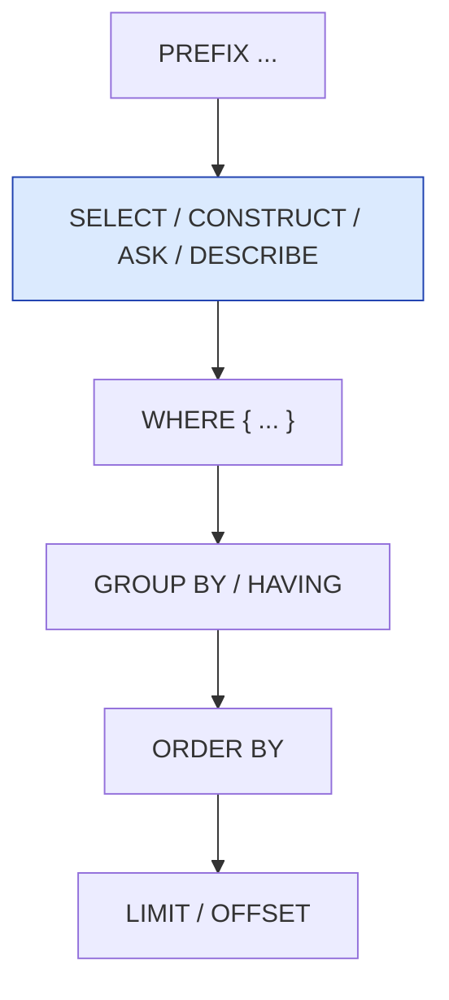
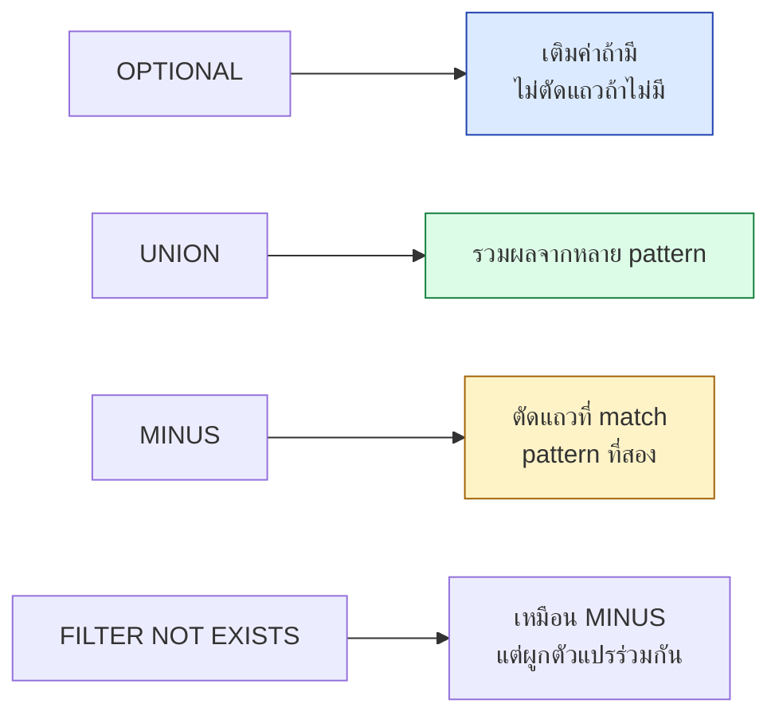

# A.02 SPARQL Cheat Sheet

หน้านี้รวมไวยากรณ์ SPARQL ที่ใช้บ่อยในคอร์สไว้ในที่เดียว ครอบคลุมตั้งแต่ `SELECT` พื้นฐานไปจนถึง property path และ federation
ใช้เป็นแผ่นอ้างอิงตอนเขียน query จริงโดยไม่ต้องย้อนกลับไปอ่านบทที่ 6

---

## โครงร่าง query



```sparql
PREFIX ex: <http://example.org/>

SELECT ?s ?label WHERE {
  ?s a ex:Person ;
     rdfs:label ?label .
}
ORDER BY ?label
LIMIT 10
```

---

## 1. Query form ทั้ง 4 แบบ

| Form | คืนอะไร | ใช้เมื่อ |
| --- | --- | --- |
| **SELECT** | ตาราง binding | ต้องการค่าเฉพาะ |
| **CONSTRUCT** | RDF graph ใหม่ | แปลงรูปแบบ, สร้าง view |
| **ASK** | `true`/`false` | ตรวจว่ามีอยู่ไหม |
| **DESCRIBE** | RDF graph รอบ resource | สำรวจ resource ที่ไม่รู้จัก |

```sparql
CONSTRUCT { ?p a foaf:Person . }
WHERE { ?p a schema:Person . }
```

```sparql
ASK { ex:alice ex:knows ex:bob . }
```

```sparql
DESCRIBE ex:alice
```

---

## 2. Triple pattern และ shorthand

```sparql
SELECT ?name WHERE {
  ex:alice a foaf:Person ;         # ; = subject เดิม
           foaf:name ?name ;
           foaf:knows ex:bob , ex:carol .   # , = predicate เดิม
}
```

| shorthand | ความหมาย |
| --- | --- |
| `a` | `rdf:type` |
| `;` | subject เดิม predicate ใหม่ |
| `,` | subject + predicate เดิม object ใหม่ |
| `[ ]` | blank node นิรนาม |
| `()` | RDF collection |

---

## 3. FILTER

```sparql
SELECT ?s ?age WHERE {
  ?s ex:age ?age .
  FILTER(?age >= 18 && ?age < 65)
}
```

| Operator/Function | ตัวอย่าง |
| --- | --- |
| เปรียบเทียบ | `?a > 10`, `?a != ?b` |
| ตรรกะ | `&&`, `\|\|`, `!` |
| `REGEX(?s, "pattern", "i")` | จับคู่ pattern (ไม่สนตัวพิมพ์) |
| `LANG(?s) = "en"` | กรองภาษา |
| `LANGMATCHES(LANG(?s), "en")` | กรองภาษารวม subtag |
| `DATATYPE(?s)` | ดึงชนิดข้อมูล |
| `BOUND(?s)` | ตรวจว่าตัวแปรถูก bind หรือยัง |
| `isURI(?s)` / `isLiteral(?s)` / `isBlank(?s)` | ตรวจชนิด term |
| `STRSTARTS`/`STRENDS`/`CONTAINS` | ตรวจสตริง |
| `EXISTS { ... }` / `NOT EXISTS { ... }` | ตรวจว่ามี pattern นี้ไหม |

---

## 4. OPTIONAL, UNION, MINUS

```sparql
SELECT ?s ?email WHERE {
  ?s a foaf:Person .
  OPTIONAL { ?s foaf:mbox ?email . }
}
```

```sparql
SELECT ?s WHERE {
  { ?s a foaf:Person . }
  UNION
  { ?s a schema:Person . }
}
```

```sparql
SELECT ?s WHERE {
  ?s a foaf:Person .
  MINUS { ?s ex:status "inactive" . }
}
```



> ⚠️ **`MINUS` กับ `FILTER NOT EXISTS`** ให้ผลต่างกันเมื่อตัวแปรไม่ได้ผูกร่วมกัน — `MINUS`
> เทียบทั้งชุด binding, `FILTER NOT EXISTS` ใช้ตัวแปรจาก scope ภายนอกเสมอ

---

## 5. Aggregate และ GROUP BY

```sparql
SELECT ?dept (COUNT(?s) AS ?n) (AVG(?gpa) AS ?avgGpa) WHERE {
  ?s ex:department ?dept ; ex:gpa ?gpa .
}
GROUP BY ?dept
HAVING (COUNT(?s) > 5)
ORDER BY DESC(?avgGpa)
```

| ฟังก์ชัน | ทำอะไร |
| --- | --- |
| `COUNT(?x)` / `COUNT(DISTINCT ?x)` | นับ |
| `SUM(?x)` | ผลรวม |
| `AVG(?x)` | ค่าเฉลี่ย |
| `MIN(?x)` / `MAX(?x)` | ค่าต่ำสุด/สูงสุด |
| `GROUP_CONCAT(?x; separator=", ")` | รวมเป็นสตริง |
| `SAMPLE(?x)` | สุ่มหนึ่งค่าจากกลุ่ม |

---

## 6. Property Path

```sparql
SELECT ?ancestor WHERE {
  ex:alice ex:hasParent+ ?ancestor .   # 1 ขั้นขึ้นไป
}
```

| สัญลักษณ์ | ความหมาย |
| --- | --- |
| `p1/p2` | เดินตามลำดับ |
| `p1\|p2` | ทางใดทางหนึ่ง |
| `p*` | 0 ขั้นขึ้นไป |
| `p+` | 1 ขั้นขึ้นไป |
| `p?` | 0 หรือ 1 ขั้น |
| `^p` | ทิศทางกลับ |
| `!p` | ไม่ใช่ property นี้ |
| `(p1/p2)*` | รวมกันแล้ววนซ้ำ |

```sparql
# ทุก subclass (ทางตรงและทางอ้อม)
SELECT ?c WHERE { ?c rdfs:subClassOf* ex:Animal . }

# พ่อของพ่อ (เดินย้อนสองขั้น)
SELECT ?gp WHERE { ex:alice ^ex:hasChild/^ex:hasChild ?gp . }
```

> ⚠️ **Property path ไม่คืนจำนวนขั้นที่เดิน** และ **ห้ามใช้ตัวแปรกลาง** ถ้าต้องรู้ระยะทาง
> ต้องเขียนแบบ join ธรรมดาแทน

---

## 7. SPARQL Update

```sparql
INSERT DATA {
  ex:dave a foaf:Person ; foaf:name "Dave" .
}
```

```sparql
DELETE DATA { ex:bob foaf:age 24 . }
```

```sparql
DELETE { ?s foaf:age ?old }
INSERT { ?s foaf:age ?new }
WHERE  { ?s foaf:age ?old . BIND(?old + 1 AS ?new) }
```

```sparql
DROP GRAPH <http://example.org/graph1>
CLEAR GRAPH <http://example.org/graph1>
COPY <http://example.org/g1> TO <http://example.org/g2>
```

---

## 8. Named Graph และ Dataset

```sparql
SELECT ?s ?p ?o ?g WHERE {
  GRAPH ?g { ?s ?p ?o . }
}
```

```sparql
SELECT * FROM <http://example.org/g1>
FROM NAMED <http://example.org/g2>
WHERE {
  ?s ?p ?o .
  GRAPH <http://example.org/g2> { ?s2 ?p2 ?o2 . }
}
```

---

## 9. Federation

```sparql
SELECT ?label WHERE {
  ex:bangkok owl:sameAs ?wd .
  SERVICE <https://query.wikidata.org/sparql> {
    ?wd rdfs:label ?label .
    FILTER(LANG(?label) = "th")
  }
}
```

> ⚠️ `SERVICE SILENT <...>` ทำให้ query ไม่ล้มทั้งชุดถ้า endpoint ปลายทางล่ม

---

## 10. BIND, VALUES, Expression

```sparql
SELECT ?s ?bmi WHERE {
  ?s ex:weight ?w ; ex:height ?h .
  BIND(?w / (?h * ?h) AS ?bmi)
}
```

```sparql
SELECT ?s WHERE {
  VALUES ?s { ex:alice ex:bob ex:carol }
  ?s a foaf:Person .
}
```

```sparql
SELECT (STRLEN(?name) AS ?len) (UCASE(?name) AS ?upper)
       (CONCAT(?first, " ", ?last) AS ?full)
WHERE { ?s foaf:name ?name ; ex:firstName ?first ; ex:lastName ?last . }
```

---

## 11. รันจาก Python (rdflib)

```python
from rdflib import Graph

g = Graph()
g.parse("data/university.ttl", format="turtle")

for row in g.query("""
    SELECT ?name WHERE { ?s a ex:Person ; foaf:name ?name . }
""", initNs={"ex": "http://example.org/", "foaf": "http://xmlns.com/foaf/0.1/"}):
    print(row.name)
```

## 12. รันจาก Python (SPARQLWrapper — remote endpoint)

```python
from SPARQLWrapper import SPARQLWrapper, JSON

sparql = SPARQLWrapper("https://query.wikidata.org/sparql")
sparql.setQuery("SELECT ?label WHERE { wd:Q1861 rdfs:label ?label . "
                "FILTER(LANG(?label)='th') }")
sparql.setReturnFormat(JSON)
for row in sparql.query().convert()["results"]["bindings"]:
    print(row["label"]["value"])
```

---

## ⚠️ ข้อผิดพลาดที่พบบ่อย

| ข้อผิดพลาด | ทางแก้ |
| --- | --- |
| ลืม `PREFIX` แล้ว query error | ตรวจว่าประกาศครบทุก prefix ที่ใช้ |
| `OPTIONAL` วางผิดตำแหน่งทำให้ผลขาด | วาง pattern บังคับไว้ก่อน `OPTIONAL` เสมอ |
| `FILTER` อยู่นอก block ที่ตั้งใจ | ตรวจ `{ }` ให้ตรงกับ scope |
| ลืม `DISTINCT` ทำให้ผลซ้ำ | เติมเมื่อ join ทำให้เกิดแถวซ้ำ |
| Property path นับระยะทางไม่ได้ | เปลี่ยนไปใช้ join แบบขั้นต่อขั้น |
| `GROUP BY` ไม่ครบตัวแปรใน `SELECT` | ทุกตัวแปรที่ไม่ใช่ aggregate ต้องอยู่ใน `GROUP BY` |

---

## Key Points

- 4 query form: **SELECT** (ตาราง), **CONSTRUCT** (กราฟใหม่), **ASK** (boolean), **DESCRIBE** (สำรวจ)
- shorthand หลัก: **`a`** = `rdf:type`, **`;`** = predicate ใหม่, **`,`** = object ใหม่
- **`OPTIONAL`** เติมค่าถ้ามีโดยไม่ตัดแถว, **`MINUS`**/**`FILTER NOT EXISTS`** ตัดแถวที่ match
- **Aggregate** ต้องมากับ **`GROUP BY`** — ตัวแปรที่ไม่ใช่ aggregate ต้องอยู่ใน `GROUP BY` ครบ
- **Property path**: `p*` (0+), `p+` (1+), `p?` (0/1), `^p` (กลับทาง) — ⚠️ **นับระยะทางไม่ได้**
- **SPARQL Update**: `INSERT DATA`, `DELETE DATA`, `DELETE/INSERT/WHERE` สำหรับแก้ไขแบบมีเงื่อนไข
- **`SERVICE`** ยิง query ข้าม endpoint — ใช้ `SERVICE SILENT` กันไม่ให้ query ทั้งชุดล้มเมื่อ endpoint ปลายทางล่ม
- Python: **`rdflib`** สำหรับ query ในเครื่อง, **`SPARQLWrapper`** สำหรับ remote endpoint
