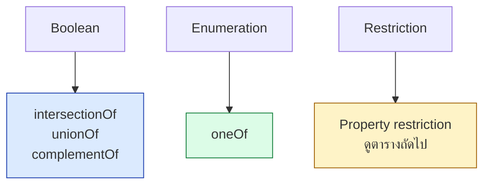

# A.03 OWL Cheat Sheet

หน้านี้รวม axiom, constructor, restriction และ property characteristic ของ OWL ที่ใช้ในคอร์สไว้ในที่เดียว ทุกตัวอย่างแสดงทั้ง **Turtle** และ **Manchester Syntax**
ใช้เป็นแผ่นอ้างอิงตอนเขียน ontology จริง

---

## Class Axiom

| Axiom | Turtle | Manchester |
| --- | --- | --- |
| Subclass | `ex:Dog rdfs:subClassOf ex:Animal .` | `Class: Dog SubClassOf: Animal` |
| Equivalent | `ex:Human owl:equivalentClass ex:Person .` | `Class: Human EquivalentTo: Person` |
| Disjoint | `ex:Cat owl:disjointWith ex:Dog .` | `DisjointClasses: Cat, Dog` |
| Disjoint union | `ex:Animal owl:disjointUnionOf (ex:Cat ex:Dog) .` | — |

```turtle
ex:Person a owl:Class ;
    rdfs:subClassOf ex:Agent ;
    owl:disjointWith ex:Organization .
```

---

## Class Constructor



```turtle
# intersectionOf -- Manchester: Parent EquivalentTo: Person and (hasChild some Person)
ex:Parent owl:equivalentClass [
    a owl:Class ;
    owl:intersectionOf ( ex:Person
        [ a owl:Restriction ; owl:onProperty ex:hasChild ;
          owl:someValuesFrom ex:Person ] )
] .

# unionOf -- Manchester: Vehicle EquivalentTo: Car or Motorcycle or Truck
ex:Vehicle owl:equivalentClass [
    a owl:Class ;
    owl:unionOf ( ex:Car ex:Motorcycle ex:Truck )
] .

# complementOf -- Manchester: NonHuman EquivalentTo: not Human
ex:NonHuman owl:equivalentClass [
    a owl:Class ; owl:complementOf ex:Human
] .

# oneOf -- Manchester: DayOfWeek EquivalentTo: {Mon, Tue, Wed, Thu, Fri, Sat, Sun}
ex:DayOfWeek owl:equivalentClass [
    a owl:Class ;
    owl:oneOf ( ex:Mon ex:Tue ex:Wed ex:Thu ex:Fri ex:Sat ex:Sun )
] .
```

---

## Property Restriction

| Restriction | Manchester | ความหมาย |
| --- | --- | --- |
| `owl:someValuesFrom` | `p some C` | มีอย่างน้อยหนึ่งค่าเป็น C |
| `owl:allValuesFrom` | `p only C` | ทุกค่า (ถ้ามี) ต้องเป็น C |
| `owl:hasValue` | `p value v` | มีค่า v นี้แน่นอน |
| `owl:minCardinality` | `p min n` | อย่างน้อย n ค่า |
| `owl:maxCardinality` | `p max n` | อย่างมาก n ค่า |
| `owl:cardinality` | `p exactly n` | เท่ากับ n ค่าพอดี |
| `owl:minQualifiedCardinality` | `p min n C` | อย่างน้อย n ค่าที่เป็น C |
| `owl:maxQualifiedCardinality` | `p max n C` | อย่างมาก n ค่าที่เป็น C |
| `owl:qualifiedCardinality` | `p exactly n C` | เท่ากับ n ค่าที่เป็น C พอดี |

```turtle
# Manchester: Parent EquivalentTo: hasChild some Person
[] a owl:Restriction ;
   owl:onProperty ex:hasChild ;
   owl:someValuesFrom ex:Person .

# Manchester: VegetarianPizza SubClassOf: hasTopping only VegetarianTopping
[] a owl:Restriction ;
   owl:onProperty ex:hasTopping ;
   owl:allValuesFrom ex:VegetarianTopping .

# Manchester: LargeFamily EquivalentTo: hasChild min 4
[] a owl:Restriction ;
   owl:onProperty ex:hasChild ;
   owl:minCardinality "4"^^xsd:nonNegativeInteger .

# Manchester: Biped EquivalentTo: hasLeg exactly 2 Leg
[] a owl:Restriction ;
   owl:onProperty ex:hasLeg ;
   owl:onClass ex:Leg ;
   owl:qualifiedCardinality "2"^^xsd:nonNegativeInteger .
```

> ⚠️ **`allValuesFrom` เพียงลำพัง "เปิด" อยู่เสมอ** — ถ้าไม่เคยประกาศ `hasTopping`
> เลย ก็ยัง**ผ่าน**ข้อจำกัดนี้โดยอัตโนมัติ (vacuously true) ต้องคู่กับ `someValuesFrom`
> ถ้าต้องการบังคับว่า "ต้องมีด้วย"

---

## Property Axiom และ Characteristic

| Characteristic | Turtle | ความหมาย |
| --- | --- | --- |
| Domain/Range | `rdfs:domain` / `rdfs:range` | สร้าง type ให้ (ไม่ใช่ข้อจำกัด) |
| Inverse | `owl:inverseOf` | property กลับทิศ |
| Functional | `a owl:FunctionalProperty` | มีค่าได้อย่างมาก 1 ค่า |
| Inverse Functional | `a owl:InverseFunctionalProperty` | เป็น key ย้อนกลับได้ |
| Transitive | `a owl:TransitiveProperty` | ไล่ต่อกันได้ |
| Symmetric | `a owl:SymmetricProperty` | สมมาตร |
| Asymmetric | `a owl:AsymmetricProperty` | ไม่สมมาตร |
| Reflexive | `a owl:ReflexiveProperty` | จริงกับตัวเองเสมอ |
| Irreflexive | `a owl:IrreflexiveProperty` | ไม่จริงกับตัวเอง |
| Property chain | `owl:propertyChainAxiom` | นิยาม property จากลำดับ property อื่น |
| Disjoint properties | `owl:propertyDisjointWith` | สอง property ใช้คู่เดียวกันพร้อมกันไม่ได้ |

```turtle
ex:hasUncle a owl:ObjectProperty ;
    owl:propertyChainAxiom ( ex:hasParent ex:hasBrother ) .

ex:hasChild owl:inverseOf ex:hasParent .

ex:knows a owl:ObjectProperty , owl:SymmetricProperty .

ex:hasAncestor a owl:ObjectProperty , owl:TransitiveProperty .
```

---

## Individual Axiom

```turtle
ex:alice a owl:NamedIndividual , ex:Person .

ex:alice owl:sameAs ex:aliceSmith .

ex:alice owl:differentFrom ex:bob .

[] a owl:AllDifferent ;
   owl:distinctMembers ( ex:alice ex:bob ex:carol ) .
```

> ⚠️ **OWL ไม่มี Unique Name Assumption** — ถ้าไม่ประกาศ `differentFrom` หรือ
> `AllDifferent` ไว้ ชื่อสองชื่อ**อาจ**ถูกมองว่าเป็นสิ่งเดียวกันได้

---

## OWL 2 Species/Profile

| Profile | เหมาะกับ | ตัวอย่าง construct ที่ไม่มี |
| --- | --- | --- |
| **OWL 2 DL** | ทั่วไป, decidable เต็มรูปแบบ | — |
| **OWL 2 EL** | ontology ขนาดใหญ่มาก (การแพทย์) | ไม่มี `unionOf`, `complementOf` |
| **OWL 2 QL** | query กับฐานข้อมูลเชิงสัมพันธ์ | ไม่มี transitive + qualified cardinality พร้อมกัน |
| **OWL 2 RL** | rule engine, materialize เร็ว | ไม่มี `minCardinality`/`minQualifiedCardinality` ในตำแหน่ง superclass |

---

## Datatype

```turtle
ex:AdultAge a owl:Class ;
    owl:equivalentClass [
        a rdfs:Datatype ;
        owl:onDatatype xsd:integer ;
        owl:withRestrictions ( [ xsd:minInclusive 18 ] )
    ] .
```

---

## Punning (Metaclass)

```turtle
# ex:Dog ใช้เป็นทั้ง class และ individual -- ต้องประกาศทั้งสองแบบ
ex:Dog a owl:Class , owl:NamedIndividual .
ex:Dog ex:conservationStatus ex:LeastConcern .
```

> ⚠️ OWL 2 DL อนุญาต **punning** (ใช้ IRI เดียวเป็นทั้ง class และ individual)
> แต่ทั้งสองบทบาทถือเป็น**คนละสิ่งกัน**ในทางตรรกะ — ห้ามผสมกับ metamodeling เต็มรูปแบบ

---

## Key Points

- Class axiom หลัก: **`subClassOf`**, **`equivalentClass`**, **`disjointWith`**
- Constructor: **`intersectionOf`**, **`unionOf`**, **`complementOf`**, **`oneOf`**
- Restriction แบ่งเป็น 3 กลุ่ม: **quantifier** (`some`/`only`), **hasValue**, **cardinality** (`min`/`max`/`exactly`)
- ⚠️ **`allValuesFrom` เพียงลำพัง "เปิด" เสมอ** — ต้องคู่กับ `someValuesFrom` ถ้าต้องการบังคับว่ามีอยู่จริง
- Property characteristic: **Functional, Transitive, Symmetric, Asymmetric, Reflexive, Irreflexive, InverseFunctional**
- **`propertyChainAxiom`** แทน SWRL rule แบบง่ายได้ และไม่ติดข้อจำกัด DL-safe
- ⚠️ **ไม่มี Unique Name Assumption** — ต้องประกาศ `differentFrom`/`AllDifferent` เอง
- 4 profile: **DL** (เต็มรูปแบบ), **EL** (เร็ว, ใหญ่), **QL** (ต่อฐานข้อมูล), **RL** (rule engine — ไม่มี `minCardinality` เป็น superclass)
- **Punning** ให้ใช้ IRI เดียวเป็นทั้ง class และ individual ได้ แต่สองบทบาทแยกกันทางตรรกะ
