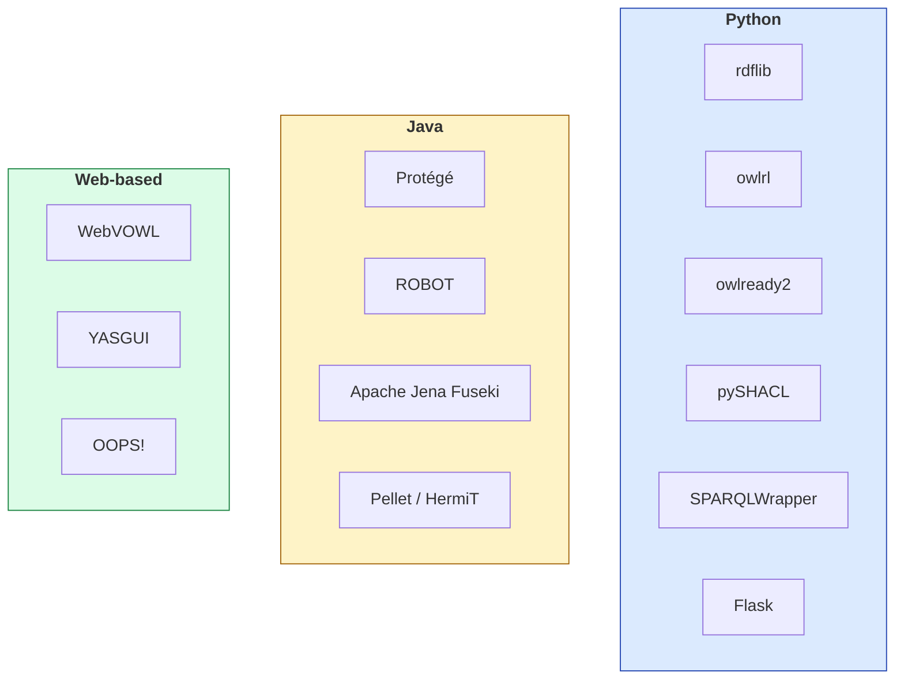

# A.05 การติดตั้งเครื่องมือ

หน้านี้รวมขั้นตอนติดตั้งเครื่องมือทั้งหมดที่ใช้ในคอร์สไว้ในที่เดียว ทั้งฝั่ง Python, Java-based reasoner, และโปรแกรม GUI
ใช้เป็นคู่มืออ้างอิงตอนตั้งเครื่องใหม่

---

## ภาพรวมเครื่องมือที่ใช้ตลอดคอร์ส



---

## 1. Python environment

```bash
python3 -m venv venv
source venv/bin/activate        # Windows: venv\Scripts\activate
```

```bash
pip install rdflib owlrl owlready2 pyshacl SPARQLWrapper flask pandas
```

| แพ็กเกจ | ใช้ในบทที่ |
| --- | --- |
| `rdflib` | 02, 06, 07 และเกือบทุกบท |
| `owlrl` | 03, 04, 05, 08 |
| `owlready2` | 04, 07, 10, 11 |
| `pyshacl` | 07 |
| `SPARQLWrapper` | 06, 09, 12 |
| `flask` | 12 |
| `pandas` | 07 |

> 💡 **ตรวจเวอร์ชัน:** `pip show rdflib` — คอร์สนี้ทดสอบกับ `rdflib >= 6.0`

---

## 2. Java (จำเป็นสำหรับ owlready2 reasoner)

`owlready2` เรียก HermiT/Pellet ผ่าน Java — ต้องมี JDK ติดตั้งไว้

```bash
# macOS (Homebrew)
brew install openjdk@17

# Ubuntu/Debian
sudo apt-get install openjdk-17-jre-headless

# ตรวจสอบ
java -version
```

```python
import owlready2
print(owlready2.JAVA_EXE)   # ตรวจว่า owlready2 หา Java เจอ
```

> ⚠️ **ปัญหาที่พบบ่อย**: `UnsupportedClassVersionError` เกิดจาก jar ที่ owlready2
> แถมมาถูก compile ด้วย JDK ใหม่กว่า Java ที่ติดตั้งไว้ — อัปเดต Java หรือเรียก
> reasoner โดยตรงด้วย `--loader OWLAPI` (ดู [11.10](../11-swrl/11.10-python-swrl.md))

---

## 3. Protégé


1. ดาวน์โหลดจาก [protege.stanford.edu](https://protege.stanford.edu/) (เลือกเวอร์ชัน Desktop)
2. ต้องมี Java 17+ ติดตั้งไว้ก่อน (ในตัวติดตั้งมักรวมมาให้แล้ว)
3. เปิดโปรแกรม → `File ▸ Check for plugins` → ติดตั้ง **SWRLTab**
4. เมนู Reasoner จะมี HermiT ติดมาให้ในตัว — Pellet ต้องติดตั้งเพิ่ม

---

## 4. ROBOT (command-line ontology tool)

```bash
curl -L https://github.com/ontodev/robot/releases/latest/download/robot.jar -o robot.jar
curl -L https://raw.githubusercontent.com/ontodev/robot/master/bin/robot -o robot
chmod +x robot
```

```bash
./robot reason --reasoner HermiT --input onto.ttl --output onto-reasoned.ttl
./robot report --input onto.ttl --output report.tsv
```

> 💡 ต้องมี Java ในเครื่องเช่นกัน — ตรวจด้วย `java -version`

---

## 5. Apache Jena Fuseki (SPARQL endpoint)

```bash
curl -LO https://dlcdn.apache.org/jena/binaries/apache-jena-fuseki-5.2.0.tar.gz
tar xzf apache-jena-fuseki-5.2.0.tar.gz
cd apache-jena-fuseki-5.2.0
./fuseki-server --loc=./db --update /ds
```

เปิด `http://localhost:3030` เพื่อใช้งาน UI หรือยิง query ผ่าน `http://localhost:3030/ds/sparql`

---

## 6. เครื่องมือบนเว็บ (ไม่ต้องติดตั้ง)

| เครื่องมือ | URL | ใช้ทำอะไร |
| --- | --- | --- |
| **WebVOWL** | [service.tib.eu/webvowl](https://service.tib.eu/webvowl/) | วาด ontology เป็นแผนภาพ |
| **YASGUI** | [yasgui.triply.cc](https://yasgui.triply.cc/) | รัน SPARQL กับ endpoint ใดก็ได้ |
| **OOPS!** | [oops.linkeddata.es](https://oops.linkeddata.es/) | ตรวจ pitfall ของ ontology |
| **Wikidata Query Service** | [query.wikidata.org](https://query.wikidata.org/) | query Wikidata แบบมี UI |
| **prefix.cc** | [prefix.cc](https://prefix.cc/) | ค้นหา prefix มาตรฐาน |
| **Linked Open Vocabularies** | [lov.linkeddata.es](https://lov.linkeddata.es/) | ค้นหา vocabulary ที่มีอยู่แล้ว |

---

## 7. VS Code extension ที่แนะนำ

| Extension | ประโยชน์ |
| --- | --- |
| **Turtle** (stardog-union) | syntax highlighting สำหรับ `.ttl` |
| **SPARQL** notebook extensions | รัน SPARQL ใน editor |

---

## ✅ ตรวจว่าติดตั้งครบ

```python
import rdflib, owlrl, owlready2, pyshacl
from SPARQLWrapper import SPARQLWrapper
import flask

print("rdflib   :", rdflib.__version__)
print("owlready2:", owlready2.VERSION)
print("Java     :", owlready2.JAVA_EXE)
print("✅ พร้อมใช้งาน")
```

---

## Key Points

- Python stack หลัก: **`rdflib`, `owlrl`, `owlready2`, `pyshacl`, `SPARQLWrapper`, `flask`**
- **`owlready2` ต้องมี Java** เพื่อรัน HermiT/Pellet — ตรวจด้วย `owlready2.JAVA_EXE`
- ⚠️ **`UnsupportedClassVersionError`** มักแก้ด้วยการอัปเดต Java หรือเรียก reasoner ผ่าน `--loader OWLAPI` โดยตรง
- **Protégé** ต้องติดตั้ง **SWRLTab** เพิ่มเองผ่าน `Check for plugins`
- **ROBOT** และ **Fuseki** เป็นไฟล์ jar ที่ไม่ต้องติดตั้งแบบเต็มรูปแบบ ดาวน์โหลดมาใช้ได้เลย
- เครื่องมือบนเว็บที่ไม่ต้องติดตั้ง: **WebVOWL, YASGUI, OOPS!, Wikidata Query Service**
