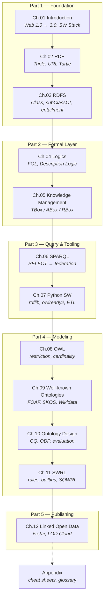

# Semantic Web & Linked Open Data with Python

ยินดีต้อนรับสู่คอร์ส **Semantic Web & Linked Open Data with Python** คอร์สนี้พาคุณเดินทางจากคำถามพื้นฐานว่า
"ทำไม Web ทุกวันนี้ machine ถึงอ่านไม่เข้าใจ" ไปจนถึงการสร้าง **ontology** ของตัวเอง ใส่ **reasoner** เข้าไปอนุมานความรู้ใหม่
และ publish dataset ออกสู่ **LOD Cloud** ทุกบทมีทั้งทฤษฎี ตัวอย่าง Turtle และโค้ด Python ที่รันได้จริง

---

## Learning Objectives

เมื่อจบคอร์สนี้ ผู้เรียนจะสามารถ:

1. **อธิบาย** แนวคิด Semantic Web, Semantic Web Stack และความแตกต่างระหว่าง Open World Assumption (OWA) กับ Closed World Assumption (CWA)
2. **เขียน** RDF graph ด้วย Turtle ทั้ง full form และ shorthand และแปลงข้ามไปเป็น JSON-LD / N-Triples / RDF/XML
3. **ออกแบบ** schema ด้วย RDFS และเข้าใจว่า `rdfs:domain` / `rdfs:range` เป็น **inference trigger** ไม่ใช่ constraint
4. **แปลง** ประโยคภาษาธรรมชาติเป็น First-Order Logic (FOL) และ Description Logic (DL) พร้อมระบุ DL family ของ ontology
5. **จัดโครงสร้าง** Knowledge Base เป็น TBox / ABox / RBox และแยกไฟล์อย่างเป็นระบบ
6. **เขียน** SPARQL ได้ครบทุก query form (SELECT, CONSTRUCT, ASK, DESCRIBE) รวมถึง property path และ federated query
7. **ใช้** rdflib, owlready2, SPARQLWrapper, pySHACL สร้าง pipeline ตั้งแต่ CSV ไปจนถึง SPARQL endpoint
8. **สร้าง** ontology ด้วย OWL 2 พร้อม restriction, cardinality และตรวจ inconsistency ด้วย reasoner
9. **นำ** ontology มาตรฐาน (Dublin Core, FOAF, schema.org, SKOS, Wikidata) มา reuse อย่างถูกวิธี
10. **ประเมิน** ontology ด้วย Competency Question, OOPS! และ consistency check
11. **เขียน** SWRL rule เพื่ออนุมานความรู้ที่ OWL เพียงอย่างเดียวทำไม่ได้
12. **เผยแพร่** dataset ตามหลัก 5-star Linked Open Data พร้อม `owl:sameAs` link และ VoID description

---

## Chapter Map

---

## Chapters

### [01 — Introduction](01-introduction/01.01-web-evolution.md)

| ไฟล์ | หัวข้อ |
| --- | --- |
| [01.01](01-introduction/01.01-web-evolution.md) | Web Evolution: 1.0 → 2.0 → 3.0 |
| [01.02](01-introduction/01.02-semantic-web-vision.md) | วิสัยทัศน์ Semantic Web ของ Tim Berners-Lee |
| [01.03](01-introduction/01.03-sw-stack.md) | Semantic Web Stack (Layer Cake) |
| [01.04](01-introduction/01.04-key-concepts.md) | Key Concepts: Resource, Triple, Ontology, OWA vs CWA |
| [01.05](01-introduction/01.05-applications.md) | Applications ในโลกจริง |
| [01.06](01-introduction/01.06-python-intro.md) | Python: ดึง Schema.org JSON-LD จากเว็บจริง |
| [01.07](01-introduction/01.07-summary.md) | Summary + Concept Map |
| [01.08](01-introduction/01.08-exercises.md) | Exercises |

### [02 — RDF](02-rdf/02.01-triple-model.md)
Triple model, URI/Literal/Blank Node, RDF Graph, Turtle (full + shorthand), formats อื่น ๆ, prefix cheat sheet, rdflib

### [03 — RDFS](03-rdfs/03.01-class-instance.md)
Class & instance, class hierarchy, property, domain/range, annotation, entailment rules, ข้อจำกัดของ RDFS, real vocabularies, owlrl

### [04 — Logics](04-logics/04.01-why-logic.md)
ทำไมต้อง formal logic, FOL, ข้อจำกัดของ FOL, Description Logic (ALC → SROIQ), reasoning tasks, reasoners, owlready2

### [05 — Knowledge Management](05-knowledge-management/05.01-knowledge-base.md)
KB = TBox + ABox + RBox, primitive vs defined class, axioms, negation, role chain, KB management

### [06 — SPARQL](06-sparql/06.01-sparql-intro.md)
SELECT/FILTER/OPTIONAL, aggregate, property path, CONSTRUCT/ASK/DESCRIBE, SPARQL Update, endpoint, federation

### [07 — Python Semantic Web](07-python-semantic-web/07.01-ecosystem.md)
Ecosystem map, rdflib ขั้นสูง, SPARQLWrapper, owlready2, pySHACL, visualization, pandas ↔ RDF, ETL, FastAPI

### [08 — OWL](08-owl/08.01-owl-species.md)
OWL species & profiles, class axioms, constructors, property types & characteristics, restrictions, cardinality

### [09 — Well-known Ontologies](09-well-known-ontologies/09.01-dublin-core.md)
Dublin Core, FOAF, schema.org, SKOS, PROV-O/DCAT/VoID, domain ontologies, Wikidata, DBpedia

### [10 — Ontology Design](10-ontology-design/10.01-methodology.md)
METHONTOLOGY/NeOn/SAMOD, Competency Questions, conceptualization, ODP, anti-patterns, evaluation, tools

### [11 — SWRL](11-swrl/11.01-swrl-intro.md)
Rule anatomy, atom types, builtins, ตัวอย่าง rule, SQWRL, การทำงานร่วมกับ OWL reasoner, ข้อจำกัด

### [12 — Linked Open Data](12-linked-open-data/12.01-5star-model.md)
5-star model, Linked Data principles, URI design, LOD Cloud, open government data, publishing, licensing

### [Appendix](appendix/A.01-turtle-cheatsheet.md)
Turtle / SPARQL / OWL cheat sheet, prefix registry, tools setup, glossary, references

---

## Key Points

- คอร์สนี้เรียงจาก **syntax (RDF)** → **schema (RDFS)** → **logic (DL/OWL)** → **query (SPARQL)** → **publishing (LOD)**
- **Turtle** คือ format หลักที่ใช้ตลอดคอร์ส และตั้งแต่ Chapter 02 จะแสดงทั้ง full form และ shorthand คู่กันเสมอ
- ทุก chapter ปิดท้ายด้วยไฟล์ `summary` (cheat sheet + concept map) และ `exercises` (โจทย์พร้อม expected output)
- โค้ด Python ทุกชิ้นมีไฟล์จริงใน `code/chXX/` ที่ `python <file>.py` แล้วรันได้ทันที
- ข้อมูลตัวอย่างทั้งหมดเป็นภาษาอังกฤษ เพื่อให้เชื่อมต่อกับ DBpedia / Wikidata ได้จริง
